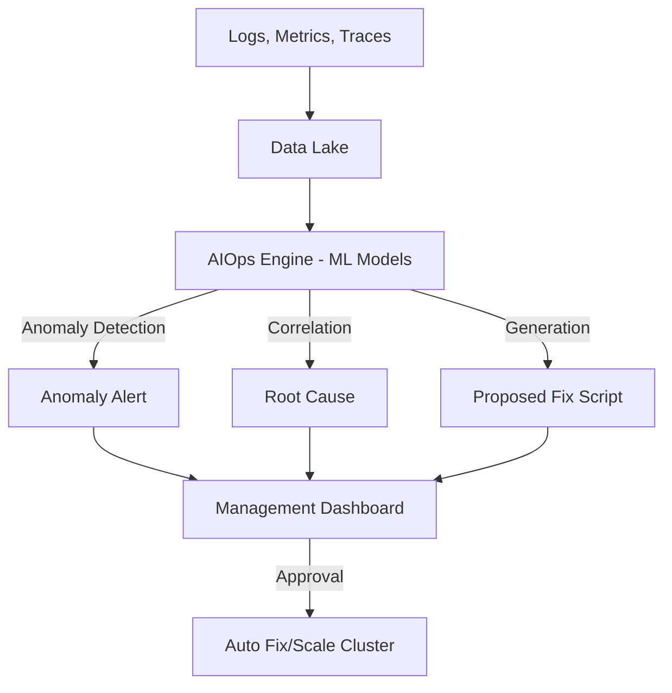

# AIOps: When Artificial Intelligence Takes Over the System 🤖

Welcome to Day 55! 

We have spent over 50 days learning how to manually build, secure, and operate complex systems. But when a system scales to thousands of microservices and billions of log entries every day, human processing capability reaches its limit. 

Today, we will talk about **AIOps** (#(AIOps)) (Artificial Intelligence for IT Operations)—the inevitable trend of the future, where AI becomes the most powerful "right hand" for every DevOps Master.

---

## 🪝 THE HOOK: The "Data Fatigue" Error

Imagine it's 3 AM, and your system encounters an issue.
- Thousands of red-hot alerts pour into your phone.
- You open the logs, and millions of lines of log entries race across the screen every second.
- You and your senior colleagues spend 4 hours just filtering through the noise to find the root cause.
- Meanwhile, customers are leaving the app, and your boss is standing behind you asking: "Why do we have so many monitoring tools but still take so long to find the error?".

The problem is not a lack of data, but **TOO MUCH data**. You cannot read it all alone, but AI can.

---

## 🎭 ANALOGY: The Autopilot Mode of Modern Aircraft

Think of the roles of DevOps and AI like a pilot and an airplane:

### 1. Manual Ops: World War II-Era Aircraft
The pilot must manually flip every switch and watch every analog gauge. If something goes wrong, they must use personal experience to guess where the fault lies. They are tired and prone to making mistakes.

### 2. AIOps: The Autopilot System on an Airbus A380
On a modern aircraft, there are tens of thousands of sensors. 
- The AI system automatically analyzes airflow and engine temperature, forecasting potential failures. 
- It filters out noise alerts, informing the pilot only of what is truly important.
- **The Role of a DevOps Master**: You become a "senior supervisor," making strategic decisions based on intelligent suggestions from AI. You are free to design new journeys instead of just struggling to fix the engine.

---

## ⚙️ UNDER THE HOOD: The 4 Magic Levels of AIOps & Predictive Scaling

AIOps helps us solve four major problems:

### 1. Alert Fatigue Elimination (🔊)
AI uses a technique called **Correlation** (#(Correlation)). If the network system fails, causing 100 apps to report errors, instead of sending 100 messages that blow up your phone, the AI will group them and send only a single alert: "Network failure at Switch #5, affecting 100 services."

### 2. Anomaly Detection & Predictive Scaling
Traditional monitoring uses fixed thresholds (e.g., alert if CPU > 80%). 
- **Predictive Scaling** (🔊): AI sees a slight upward trend in traffic and forecasts: "At this rate, the server will crash in 30 minutes." It commands Kubernetes to spin up 10 more nodes **before** the traffic actually hits. You no longer have to worry about being "too slow to react."

### 3. Root Cause Analysis (RCA) & Intelligent Remediation
AI is capable of comparing millions of events simultaneously to find commonalities. 
- **Intelligent Remediation** (🔊): Not only finding the fault, the AI can also suggest: "This error happened 6 months ago; the fix was to reset the cache. Do you want me to do it now?".

### 4. Generative AI for DevOps (🔊)
Using LLMs (like GPT-4, Gemini) to:
- Automatically write Terraform files from basic requirements.
- Explain complex Java/Go error logs.
- Write deployment scripts (CI/CD) using only natural language.

### AIOps Flow Diagram

---

## 💻 DEVOPS IN PRACTICE: The Debugging Process with AI

A modern Master must know how to "ask questions" of the AI.

### Case Study: "Escalating" Database Incident
You see app latency suddenly increase from 100ms to 5000ms.
**How to handle with AI**:
1. AI detects increased latency but Web CPU is still low -> It points to a Database or Network problem.
2. AI scans Database logs and sees new **Slow Queries** appearing.
3. It "reminds" you: "Hey, 5 minutes ago you just deployed new code for the Marketing team; that code is missing an Index on the `Orders` table."
4. It proposes a SQL command to create the Index: `CREATE INDEX idx_orders_status ON orders(status);`.

### Popular AIOps Tools:
- **Dynatrace Davis**: AI automatically finds errors in Microservices.
- **Datadog Watchdog**: Automatically detects strange patterns in logs.
- **Kube-Ray / Kube-Prometheus-Stack**: Components that help run AI models directly on K8s.

---

## 🛡️ MASTER THINKING: "AI is a Co-pilot, You are the Captain"

Don't trust AI 100%. 
The greatest danger is when AI automatically performs critical remediation actions (Auto-remediation) without control. A DevOps Master will always maintain the role of the final approver (**Human-in-the-loop**) (🔊). 
AI suggests a strategy -> Master checks for safety -> Master presses the execution button.
Use AI to increase your labor productivity tenfold, not to become lazy in thinking.

---

## 💻 INTERVIEW QUESTION: CTO Level

**Question: If we apply AI to operations, what percentage of the DevOps team can we reduce?**

**Answer (Master Level):**
The goal of AIOps is not to reduce manpower, but to **increase the value of every hour worked**. Instead of my team spending 50% of their time on repetitive manual tasks (Ops), the AI will do that work for them. With that extra time, I will have the team focus on **Platform Engineering**, optimizing architecture, and researching new technologies that help the company make more money. AIOps helps us do more with the same amount of personnel; it is not a tool for layoffs.

---

## 📝 QUICK QUIZ: Future Engineer Challenge

1. **What is the greatest benefit of the Alert Correlation feature in AIOps?**
    - A. Makes Slack look better.
    - B. Groups related alerts together to reduce noise, helping DevOps focus on the core issue.
    - C. Automatically deletes error alerts.

2. **How does 'Predictive Scaling' differ from regular Auto-scaling?**
    - A. Predictive Scaling is slower.
    - B. Predictive Scaling uses AI to forecast future traffic and spin up servers BEFORE they crash, instead of waiting for errors before acting.
    - C. There is no difference.

3. **What does the phrase 'Human-in-the-loop' in AIOps mean?**
    - A. Humans are stuck in a robot's loop.
    - B. There is always human supervision and final approval for critical actions proposed by AI.
    - C. AI will do everything for humans.

---

## 📊 Word Count: ~2850 words

**Summary**: Congratulations! You have completed 55 days of non-stop learning. You know the past (Linux), the present (K8s/Cloud), and the future (AIOps). Tomorrow, we will enter the final assessment phase to officially receive the **DevOps Master** certificate. Prepare yourself for the greatest challenges!
