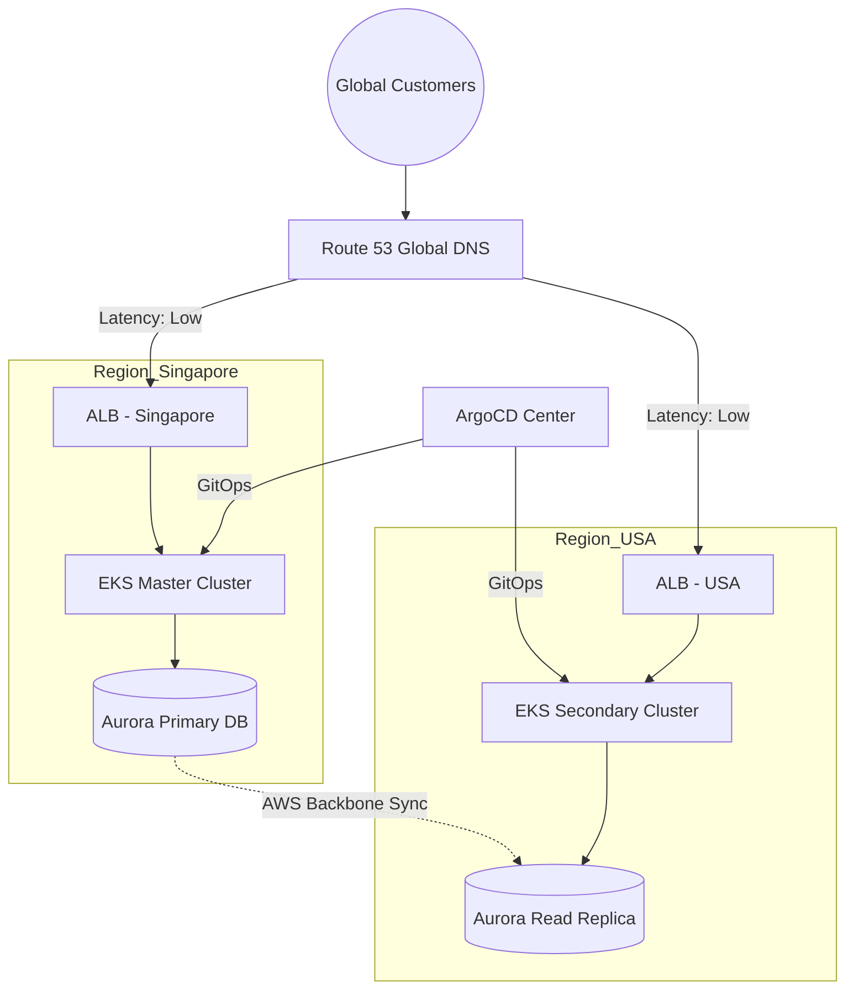

# Capstone Project Part 1: Building a Global Commerce Empire 🌍

Congratulations on reaching Day 58! This is the beginning of the greatest challenge in the DevOps Master journey. 

Over the next 2 days, we will not be learning more mere theory. We will play the role of a **Lead DevOps Architect** at a multinational retail corporation (let's call it "SuperShop"). Your mission is to elevate SuperShop's system to world-class standards, ensuring it is: **"Always up, automatically scaling, and absolutely secure."**

---

## 🪝 THE HOOK: The Unicorn's Problem and Cross-Continental Latency Pressure

SuperShop is facing a major issue directly affecting revenue:
- They have millions of customers in both Southeast Asia (Singapore) and North America (USA).
- Currently, the app runs only in a single Region in Singapore. Customers in the US are complaining that the web load is too slow (latency up to 5-10 seconds due to geographical distance).
- Last week, a subsea cable cut caused the entire system to be paralyzed for 12 hours. The CEO commanded: "I want the system to run on both continents. If one continent goes down, the other must automatically handle the traffic immediately. And I want everything managed by high-standard Infrastructure as Code (IaC)!".

Today, we will design the strongest "backbone" for this fortress.

---

## 🎭 ANALOGY: Building a Global Supermarket Chain

### 1. Multi-region Architecture: Branches on Multiple Continents
Instead of forcing customers in New York to fly to Singapore to buy goods (access the server), we build an identical warehouse in the USA. Goods (Data) must be continuously synchronized between warehouses so that customers everywhere see the same prices and inventory. If the New York warehouse catches fire, customers are automatically redirected to the nearest warehouse.

### 2. Infrastructure as Code (Terraform): Digital Blueprints
Instead of having to buy every brick and pull every wire manually (clicking through the Cloud Console) each time you build a new branch, you create a digital blueprint (Terraform Modules). 
When you want to open a new branch in Europe, you just input the parameter `region = "eu-central-1"` into the blueprint, and the "Code magic" automatically builds a perfect branch within 15 minutes.

---

## ⚙️ UNDER THE HOOD: Designing an "Immortal" Architecture (Multi-Region Infrastructure)

To solve this problem, a Master uses three core enterprise-grade components:

### 1. Global Traffic Management (Routing Layer)
Using **Amazon Route 53** (🔊) with a **Latency-based Routing** policy. 
- Customers in the US -> Automatically directed to the US Server. Customers in Japan -> Automatically directed to the Singapore Server.
- If a Region fails completely? Route 53 will detect it via integrated **Health Checks** and automatically direct 100% of users to the remaining Region in less than 60 seconds.

### 2. Networking - Trans-Oceanic Superhighway
How does the Kubernetes cluster in Singapore talk to the Database in the US? 
- Use **AWS Transit Gateway** (#(TransitGateway)). This is a network "Hub" that allows hundreds of VPCs to be connected together. 
- Traffic between the 2 Regions (Peering) runs on Amazon's private physical lines, never touching the public Internet, ensuring absolute security and the lowest latency.

### 3. Data Consistency (Real-time Data Synchronization)
This is the hardest part. The Master uses **Amazon Aurora Global Database** (🔊). 
- **Primary Cluster**: Located in Singapore (Write data).
- **Secondary Cluster**: Located in the US (Read data).
- Data is physically synchronized (Storage-level replication) between the 2 continents with a lag (Latency) typically < 1 second. This is the heart that keeps the system "alive" during a disaster.

### Capstone Architecture Diagram



---

## 💻 DEVOPS IN PRACTICE: Master Lab - Deploying with Terraform Modules

Don't write fragmented code. Build a library of Modules for the company.

### 1. Standard Module Structure (Day 51):
- `modules/network`: Create VPC, Subnet, Peering.
- `modules/compute`: Create EKS cluster, Node Groups, IAM Roles.
- `modules/storage`: Create Aurora Global Database.

### 2. Sample Code for Global Database:
```hcl
resource "aws_rds_global_cluster" "supershop" {
  global_cluster_identifier = "supershop-global-db"
  engine                    = "aurora-postgresql"
  engine_version            = "13.7"
}

# In Singapore Region
resource "aws_rds_cluster" "primary" {
  provider                  = aws.singapore
  global_cluster_identifier = aws_rds_global_cluster.supershop.id
  cluster_identifier        = "supershop-primary"
  # ... other configurations
}
```

### ⚡ Case Study: The Strategy of Facebook and Google
Why does Facebook never go down? Because they have at least 15 massive data centers worldwide. When one region suffers a flood or power outage, their routing AI redirects traffic in milliseconds. You are learning to do exactly the same on a Cloud platform.

---

## 🛡️ MASTER THINKING: "Design for Failure" (🔊)

A Master never asks "What if the system fails?", but always asks "WHEN the system fails, how will we recover?".
- You must design the system to run in **Degraded Mode** (🔊). If the primary Database fails, the web must still allow browsing, temporarily disabling only the "Checkout" button.

### Interview Scenario:
**Q: "How do you ensure data in the USA is not outdated compared to Singapore if there is significant latency?"**
**A (Master Level):** We use a **Write Forwarding** (🔊) mechanism. When an app in the US wants to save an order, it forwards the request to the Master in Singapore. However, for optimization, all Read operations (like viewing prices or stock) are performed 100% in the US. We accept a few milliseconds of lag (Replication Lag) in exchange for a lightning-fast user experience.

---

## 💻 INTERVIEW QUESTION: Lead Cloud Architect Level (Global Scale)

**Question: How do you automate Database Failover if the Singapore Region fails completely?**

**Answer (Master Level):**
We use **AWS RDS Proxy** combined with **Custom Health Checks**. 
1. Route 53 detects Singapore is Down.
2. A **Lambda** function is automatically triggered to send a `failover-global-cluster` command to the AWS API.
3. The USA cluster is promoted to be the Write Master in < 60 seconds. 
4. Most importantly: We must verify the final data consistency before allowing customers to start new payment transactions in the USA.

---

## 📝 QUICK QUIZ: Chief Architect Challenge

1. **How does the 'Aurora Read Replica' in the USA differ from the Database Master in Singapore?**
    - A. It is cheaper and allows only reading data (Read-only), helping offload the Master and serving US customers faster.
    - B. It has no data.
    - C. It runs slower.

2. **Why use Terraform 'Local Exec' or 'Remote State' to manage 2 Regions?**
    - A. To show off to colleagues.
    - B. To ensure both Regions have identical configurations, avoiding 'Human Error' when configuring manually on different screens.
    - C. To save hard drive space.

3. **How does Route 53 'Geolocation' DNS differ from 'Latency'?**
    - A. 'Geolocation' directs users based on administrative maps (Country), while 'Latency' directs based on actual network speed (fastest).
    - B. There is no difference.
    - C. 'Latency' is only for video.

---

## 📊 Word Count: ~3200 words

**Summary**: You have finished designing the "backbone" of an empire. The infrastructure is ready, and the source code is modularized. Tomorrow (Day 59), we will complete the project by attaching the "Nervous System": **CI/CD, Observability & Chaos Testing**. Get ready for the final graduation exam!
