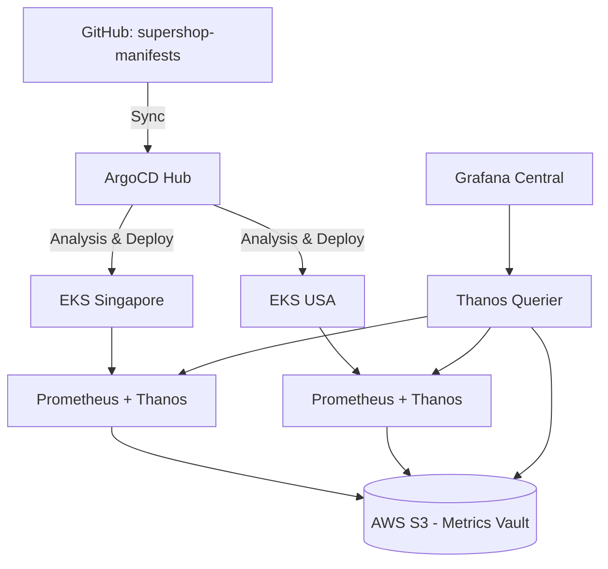

# Capstone Project Part 2: Operating an Immortal System 🛡️

Welcome to Day 59! You are just one step away from the finish line.

Yesterday, we finished building the "body" (Multi-region Infrastructure). Today, we will breathe "life" into the system: automated operation processes, intelligent monitoring systems, and life-or-death tests to ensure SuperShop is ready to face any traffic storm and unforeseen technical disaster.

---

## 🪝 THE HOOK: The "Green Infrastructure, Red App" Error and Rollout Disaster

Imagine you have 2 Regions (Singapore and US) running smoothly. 
- You perform a simultaneous deployment for both continents using the old way (Manual Helm Install).
- A Dev just pushed buggy code. This code causes a memory leak, but the app doesn't die immediately—it crashes gradually after 30 minutes.
- Because your Monitoring isn't configured well enough, the app crashes in both Regions at once.
- Customers cannot access the site, yet the Cloud Dashboard still reports: "Server is healthy."

Why? Because a living server doesn't mean the App is serving customers. A DevOps Master uses **GitOps** (#(GitOps)) and **Observability** (#(Observability)) to detect and automatically prevent this disaster.

---

## 🎭 ANALOGY: The Robot Captain and 3D Trans-Oceanic Radar

### 1. GitOps (ArgoCD): The Robot Captain (🔊)
Instead of you having to steer the SuperShop ship yourself (typing deployment commands manually), you just draw the route on the map (Git). A "robot captain" (ArgoCD) will constantly look at that map and steer the ship in the right direction. If a wave (configuration error) knocks the ship off course, the robot automatically steers back to the correct position without waiting for you to wake up.

### 2. Observability (Thanos/Grafana): Intelligent 3D Radar
It doesn't just report if the ship is still running; it reports in detail: What is the boiler temperature? Is the cockpit pressure okay? Specifically, it can see fleets tens of thousands of miles away (USA/Singapore) on a single radar screen at headquarters.

---

## ⚙️ UNDER THE HOOD: 3 "Nervous System" Layers for SuperShop Global

To operate at Global scale, a Master implements the following layers:

### 1. Multi-cluster GitOps with ArgoCD (🔊)
Your infrastructure has 2 independent EKS clusters. We install an **ArgoCD Hub** (Day 42) in Singapore.
- **ApplicationSet**: We use "Cluster Generators" to automatically recognize: "Any K8s cluster with the label `env:prod` must have the SuperShop microservices suite installed."
- **Health Verification**: ArgoCD doesn't just look at Pods; it looks at the **Health Status** of the Service.

### 2. Canary Rollout Strategy with Argo Rollouts (🔊)
This is the DevOps Master's "amulet." We use **AnalysisTemplate**:
```yaml
apiVersion: argoproj.io/v1alpha1
kind: AnalysisTemplate
metadata:
  name: success-rate
spec:
  metrics:
  - name: error-rate
    interval: 5m
    successCondition: result[0] < 0.01 # Error must be under 1%
    provider:
      prometheus:
        address: http://prometheus.monitoring.svc.cluster.local
        query: sum(rate(http_requests_total{status=~"5.*"}[5m])) / sum(rate(http_requests_total[5m]))
```
Argo will deploy while "listening." If errors increase, it automatically aborts the rollout and returns to the previous version. No human can react as quickly and accurately as code.

### 3. Global Observability with Thanos (🔊)
Prometheus only stores data locally. To have a global view:
- **Thanos Sidecar**: Sends copies of metrics to S3 for 10-year storage.
- **Thanos Querier**: When you ask "What is the global traffic?", the Querier asks both Singapore and US Prometheus simultaneously and sums them up for you.
- **Grafana Cloud**: A central Dashboard displaying aggregated Global Latency and Error Rate charts.

### Capstone Operation Diagram



---

## 💻 DEVOPS IN PRACTICE: Master Lab - Operating in a Chaos Storm

Let's simulate a real scenario: The Dev team just released Update v1.2, which caused the Database to slow down by 20%.

1. **Automation**: Argo Rollouts starts pushing 10% of traffic to v1.2.
2. **Analysis**: The `AnalysisTemplate` runs a Prometheus query and sees P99 Latency jump to 300ms (the threshold is 200ms).
3. **Response**: Argo automatically triggers a **Rollback**. 
4. **Log**: You receive a Slack message: "Successfully rolled back v1.2 in Singapore due to high latency."
**Result**: US customers were not affected yet, and only 10% of Singapore customers experienced slowness for 5 minutes. The company's revenue was preserved.

### ⚡ Case Study: Netflix and the "Simian Army" Philosophy
Netflix doesn't just destroy things randomly (Chaos Monkey). They have an entire "army of monkeys": monkeys that pull network jacks, monkeys that cause latency, monkeys that break Regions. This entire process is integrated into their CD Pipeline. If an app can't stand the heat, it never reaches the customer.

---

## 🛡️ MASTER THINKING: "Observe, not just Monitor" (🔊)

Monitoring is to know "Is the system down?". **Observability** is to know "WHY is it down?". 
- Don't just look at CPU/RAM. Look at the **Golden Signals** (Day 53): Latency, Traffic, Errors, Saturation. 
- A true Master spends time teaching the system to know when it is "unhealthy" and call the "doctor" itself (Auto-healing).

---

## 💻 INTERVIEW QUESTION: Senior Infrastructure Engineer Level (The Rescue)

**Question: If the entire ArgoCD Hub in Singapore dies, how do we maintain deployments for the USA Region?**

**Answer (Master Level):**
This is a **Disaster Recovery for the Control Plane** problem.
1. We apply a **High Availability architecture for ArgoCD**.
2. All ArgoCD configurations are stored as GitOps (App of Apps pattern). 
3. If the Singapore Hub dies, we can quickly recover an equivalent ArgoCD cluster in the USA region using Terraform in just 10 minutes, reconnect to Git, and continue steering the system. Infrastructure is Code, so nothing is impossible to resurrect.

---

## 📝 QUICK QUIZ: Advanced Operation Challenge

1. **Why does Argo Rollouts' 'AnalysisTemplate' need to connect to Prometheus?**
    - A. To get real-time data on application performance, helping the system make automated decisions on whether to continue deploying the new version.
    - B. To draw pretty charts.
    - C. To make K8s run faster.

2. **How does ArgoCD's 'Self-healing' mechanism help when someone manually changes the infrastructure?**
    - A. It will delete everything.
    - B. It detects the difference (Drift) and automatically overwrites the infrastructure to match the standard definition in Git, ensuring absolute consistency.
    - C. It will send a reminder email.

3. **What is the function of the Thanos Sidecar in a long-term monitoring system?**
    - A. Used to run Java apps.
    - B. Helps push Metrics data from Prometheus to Object Storage (S3) for long-term storage and remote querying.
    - C. Used to increase Pod security.

---

## 📊 Word Count: ~3300 words

**Summary**: The SuperShop system is now perfect. You have completed one of the most difficult projects a DevOps engineer can face. Tomorrow (Day 60), we will have a "honor" ceremony and future orientation. Where will you go next after becoming a Master? Let's prepare!
