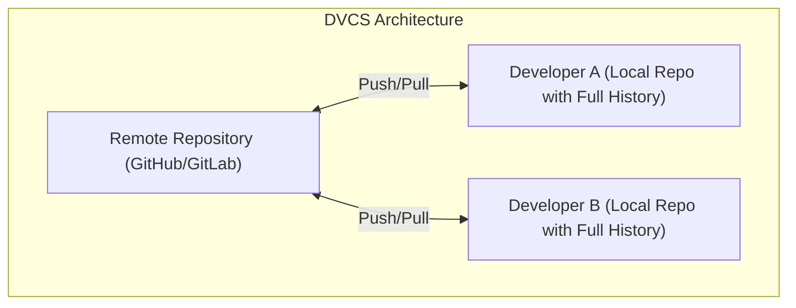

# Day 1: What is a Version Control System? The Foundations of Git

Welcome to the first day of the **Git & GitHub Mastery** course! Over the next 10 days, we will transform Git from a collection of confusing command-line arguments into an indispensable tool in your daily software engineering workflow.

Today, we won't rush into typing commands. First and most importantly, we need to understand the **core nature** and concepts of the tool we are about to use.

---

## 1. What is a Version Control System (VCS)?

Imagine you are working on your graduation thesis or a major project report. You have a document named `Report.docx`. After a few days of editing, your project folder might look like this:

*   `Report_Final.docx`
*   `Report_Final_Actually.docx`
*   `Report_Final_Revised_LastOne.docx`
*   `Report_Final_Submitted.docx`

This approach (manual version control) introduces massive headaches:
1.  You can't remember what exactly changed in `Revised_LastOne` compared to `Final`.
2.  If you accidentally delete a paragraph that you actually need later, it is extremely difficult to recover.
3.  If you collaborate with others, how do you merge your changes with theirs without overwriting each other's work?

A **Version Control System (VCS)** was born to solve these exact problems. It is a software utility that records changes to a file or set of files over time so that you can recall specific versions later.

### 1.1. Evolution of VCS Models

Before Git dominated the industry, software engineering went through several stages of VCS architectures:

**A. Local Version Control Systems (Local VCS)**
This model involves keeping a simple database on your local machine that stores all changes to files under revision control. It is slightly safer than manually renaming files, but if your local hard drive crashes, you lose everything. Furthermore, collaboration is virtually impossible.

**B. Centralized Version Control Systems (CVCS)**
*Examples: Subversion (SVN), CVS.*
To collaborate with other developers on different machines, CVCS architectures were introduced. They feature a single central server containing all versioned files, and a number of clients check out files from that central place.
*   **Pros:** Easy to manage, administrative control, everyone knows what others are doing.
*   **Cons (Critical Flaw):** Single Point of Failure. If the central server goes down for an hour, nobody can collaborate or save versioned changes during that time. If the server's hard drive becomes corrupted and has no backup, you lose the entire history of the project.

**C. Distributed Version Control Systems (DVCS)**
*Examples: Git, Mercurial.*
This is the modern standard for version control, with Git being the absolute king. In a DVCS, clients don't just check out the latest snapshot of the files; rather, they **fully mirror the repository, including its entire history**.
If any server dies, any of the client repositories can be copied back up to the server to restore it. Every clone is a full backup of all the data.



> 💡 **Why did Git defeat SVN?**
> The power lies in its "Distributed" nature. Even without an active internet connection, you can still view project history, switch between features (branches), and save your progress (commit) locally on your machine. Once connection is restored, you simply synchronize (push) your changes to the remote server.

---

## 2. Under the Hood of Git: Snapshots vs. Deltas

This is the foundational knowledge that differentiates you from the top 20% of Git users.

Most older version control systems (like SVN) store information as a list of file-based changes, commonly known as **deltas** (Delta-based version control). They store the base file and then record the differences (lines added or deleted) for each subsequent version.

Git, however, thinks about its data differently. Git models its data as a stream of **snapshots** of a miniature filesystem.

Every time you commit or save the state of your project in Git, it basically takes a picture of what all your files look like at that moment and stores a reference to that snapshot. To be efficient, if a file has not changed, Git doesn’t store the file again—just a link to the previous identical file it has already stored.

*This makes Git think more like a mini-filesystem with incredibly powerful tools built on top of it, rather than a simple VCS.*

---

## 3. Installing Git

Before we begin, let's make sure Git is properly installed on your computer.

### Check if Git is already installed
Open your Terminal (macOS/Linux) or Command Prompt / PowerShell / Git Bash (Windows) and type:

```bash
git --version
```

If it returns something like `git version 2.45.0`, congratulations, Git is already installed. Skip to the configuration section. If you receive a `command not found` error, follow the instructions below.

### 🐧 Installing on Linux (Ubuntu/Debian)
Open your terminal and run:
```bash
sudo apt update
sudo apt install git
```

### 🍎 Installing on macOS
The easiest way is to open your Terminal and run:
```bash
git --version
```
If you don't have it installed, macOS will prompt you with a dialog box asking if you want to install the "Command Line Developer Tools". Click Install.

*(Advanced: If you use Homebrew, you can simply run `brew install git`)*

### 🪟 Installing on Windows
1.  Visit the official Git website: [https://git-scm.com/download/win](https://git-scm.com/download/win)
2.  Download the Standalone Installer suitable for your system architecture (usually 64-bit).
3.  Run the `.exe` file. During installation, click `Next` on the default settings (these default choices are the safest for beginners).
4.  Once installed, open **Git Bash** (which is packaged with Git) to run the subsequent commands. Avoid using the default Windows Command Prompt.

---

## 4. Proper Git Global Configuration

After installing Git, the **very first** action you must take is to configure your identity. Why? Because every single commit you save in Git stamps this name and email address permanently into the history.

Open Terminal or Git Bash and run the following commands (replace with your real name and email address):

**Set your Display Name:**
```bash
git config --global user.name "John Doe"
```

**Set your Email:**
*(Note: Use the email address you plan to use when registering your GitHub account).*
```bash
git config --global user.email "johndoe@example.com"
```

**Verify your configuration:**
To confirm the values were set correctly, run:
```bash
git config --list
```
You should see `user.name` and `user.email` listed in the output.

> 🛠️ **Understanding the `--global` flag:**
> The `--global` option tells Git to apply these settings across *all* projects on your computer. If you have a specific company project that requires a different email address, you can configure a local identity by omitting the `--global` flag when inside that specific project repository.

**Changing the Default Branch Name (Modern Best Practice)**
Historically, Git initialized the default branch with the name `master`. To promote inclusive language, the modern tech community standardized on using `main`. Configure Git to always initialize new repositories with `main`:

```bash
git config --global init.defaultBranch main
```

---

## 5. Practical Hands-On: Your First Git Repository

Now, let's create a new project directory and initialize it with Git.

**Step 1: Create a new project folder**
Open Terminal or Git Bash, navigate to your Desktop, and create a directory.

```bash
cd ~/Desktop
mkdir git-fundamentals
cd git-fundamentals
```

**Step 2: Initialize Git (Transform a standard folder into a Git Repository)**
While inside the `git-fundamentals` folder, type this highly important command:

```bash
git init
```

The output should look similar to:
`Initialized empty Git repository in /Users/johndoe/Desktop/git-fundamentals/.git/`

**Step 3: Discover the hidden `.git` folder (Git's Secret Engine)**
What did `git init` actually do? It created a hidden directory named `.git` inside your project root.
To reveal it in your terminal, run:
```bash
ls -a
```
You will see the `.git` folder listed.

> 🚨 **CRITICAL WARNING:**
> The `.git` folder is the "soul" and "brain" of your version control system. Every single snapshot, history point, and configuration is stored here.
> **NEVER** manually modify, edit, or delete any files inside the `.git` folder by hand. If you accidentally delete the `.git` folder, your project reverts to a standard directory, and your entire version control history will be permanently lost (though your current working files on your drive will remain intact).

---

## Summary of Day 1

Today, you completed crucial foundational milestones:
1.  Understood **what a VCS is** and why **Distributed VCS (Git)** is the gold standard.
2.  Learned the unique **Snapshot-based** data storage mechanism of Git.
3.  Installed and configured your global identity (`user.name`, `user.email`).
4.  Used `git init` to initialize your very first local Git repository.

On Day 2, we will start writing actual code and learn how to track and save our progress using commits. Rest up!

---

### 📝 End-of-Day Assignment:
Verify your global configuration using the `git config --global --list` command. Ensure that your name and email are exactly as you want them displayed in your future commits.
