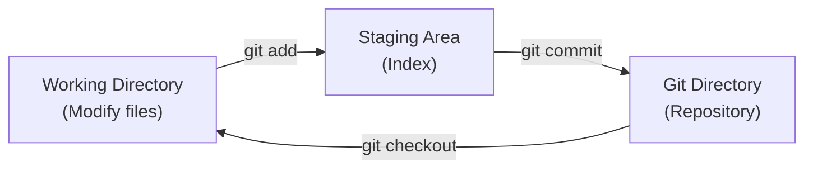

# Day 2: The Git File Lifecycle

Welcome back! Yesterday, we learned "what Git is." Today, we will study "how Git works."

This is the **most important** lesson to ensure you never feel lost when typing commands. If you master the lifecycle of a file in Git, you will always know exactly where your code resides and what you need to do next.

---

## 1. The Three Sections of Git

To manage your files efficiently, Git divides your project into three distinct working areas. Think of it like preparing a gift to send through the mail:

1.  **Working Directory (Working Tree):** This is your physical desk. You are actively writing code, modifying files, adding images, etc. Anything here is not yet "locked in" by Git.
2.  **Staging Area (Index):** This is the gift box. You pick out the specific modified files that you want to save and put them into the box. You can freely add or remove files from this box before sealing it.
3.  **Git Directory (Repository):** Once you seal the box and write the address, it officially becomes a permanent entry in your history. Git stores this snapshot securely inside the `.git` folder.



> 💡 **In short:** You edit files in the **Working Directory**, mark key files using `git add` to place them in the **Staging Area**, and then execute `git commit` to permanently record them into the **Git Directory**.

---

## 2. The Four States of a File

In Git's eyes, every single file within your project directory can only exist in one of four states:

### 2.1. Untracked
These are brand new files you just created. Git sees that they exist on your hard drive, but it doesn't track their changes yet. If you don't explicitly tell Git to track them, they will never be saved in your project's history.

### 2.2. Unmodified
These are files that already exist in your Git history (committed in the past) and have not been edited or touched in your current session.

### 2.3. Modified
You have opened the file and made some changes to the code, but you have not yet prepared or marked these changes to be saved.

### 2.4. Staged
You have finished making changes and run the `git add` command to mark the file as ready to be included in your next commit snapshot.

---

## 3. Practical Hands-On: From "Zero" to "Commit"

We will continue using the `git-fundamentals` folder we created on Day 1.

### Step 1: Create a file and check the status
Create a new file named `README.md` (the standard project introduction file):

```bash
echo "# Learning Git with Sensei Hub" > README.md
```

Now, ask Git about the current status of your directory:
```bash
git status
```

**The output will display:**
`Untracked files: (use "git add <file>..." to include in what will be committed) README.md`
-> Git informs us that `README.md` is in the **Untracked** state.

### Step 2: Add the file to the Staging Area
To tell Git to begin tracking this file, run:
```bash
git add README.md
```

Check the status again:
```bash
git status
```
The file path will now be highlighted in green with the message `Changes to be committed`. It has successfully transitioned to the **Staged** state.

### Step 3: Save to project history
This is when we take our project "snapshot." The commit command requires a message summarizing what changes were made.

```bash
git commit -m "feat: initialize first README file"
```

**The output will look like:**
`1 file changed, 1 insertion(+)`
Congratulations! You have recorded your very first commit. Your file has now returned to the **Unmodified** state.

---

## 4. The Art of Writing Commit Messages (Conventional Commits)

Avoid writing lazy commit messages like `update`, `fix bug`, or `aaaaa`. As your codebase grows, these messages make it impossible to track down changes.
Professional software engineers follow the **Conventional Commits** specification:

Format: `<type>: <description>`

*   **feat:** Introducing a new feature (e.g., `feat: add login button`).
*   **fix:** Fixing a bug (e.g., `fix: login crash on iOS`).
*   **docs:** Documentation changes only (e.g., `docs: update readme`).
*   **style:** Formatting, semicolons, whitespace changes that don't affect code logic.
*   **refactor:** Code changes that neither fix a bug nor add a feature, but improve code structure.
*   **chore:** Maintenance tasks, dependency updates, build configurations.

> 🌟 **Tip:** Writing your commit messages in English is highly recommended as it builds a globally competitive engineering profile that international recruiters love to see.

---

## 5. Reviewing Project History

To view all the commits recorded in your project's history, run:
```bash
git log
```

If you prefer a highly concise, clean, single-line format:
```bash
git log --oneline
```

You will see an alphanumeric string like `a1b2c3d` next to your commit. This is the **SHA-1 Hash**, the unique fingerprint of that specific commit. You will use this hash later if you ever need to roll back or reference this specific point in time.

---

## 6. Excluding Unwanted Files using `.gitignore`

In real-world software projects, there are many files you **NEVER** want to track in Git:
*   Files containing sensitive credentials, passwords, or API Keys (`.env`).
*   Massive dependency directories (`node_modules`).
*   Operating system junk files (`.DS_Store`, `thumbs.db`).

To solve this, we create a special configuration file named `.gitignore`.

**Practical Hands-On:**
1.  Create a file containing mock secrets:
```bash
echo "DATABASE_PASSWORD=supersecret123" > .env
```
2.  Create the `.gitignore` file and instruct Git to ignore `.env`:
```bash
echo ".env" > .gitignore
```
3.  Check the status:
```bash
git status
```
You will see Git lists `.gitignore` as an untracked file, but it completely ignores the `.env` file! Perfect!

---

## 7. Pro Tips for `git add`

*   `git add .` : Stages all modified and new files in the current directory and its subdirectories.
*   `git add -p` : (Interactive Staging) Git will prompt you with each modified code block (hunk) individually, asking whether you want to stage it. This is extremely useful when you've written code across multiple features but only want to commit a specific part.

---

## Summary of Day 2

Today, you mastered the lifecycle of Git:
1.  Understood the **Three Sections**: Working Directory $\rightarrow$ Staging Area $\rightarrow$ Repository.
2.  Learned the **Four States** of a file.
3.  Practiced using `git status`, `git add`, and `git commit`.
4.  Adopted **Conventional Commit** practices.
5.  Configured a `.gitignore` file to protect project secrets.

**Assignment:**
Create two new text files, edit the content of your `README.md`, and make two separate commits using clean Conventional Commit messages.

Tomorrow, we will take our local repository and push it to **GitHub** for the world to see!
