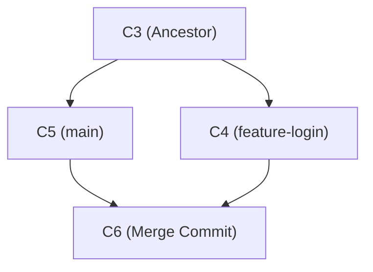

# Day 4: Deep Dive into Branching & Merging

Welcome to Day 4! Today, we will conquer one of Git's most valuable and revolutionary features: **Branching**.

In older version control systems (like SVN), branching is expensive because it copies the entire source code into a new physical directory. In Git, branching is instantaneous and extremely lightweight. Why? Because underneath it all lies the elegant concept of "pointers." Let’s unpack the secret mechanics of Git branches.

---

## 1. The True Nature of a Branch: It’s a Pointer, Not a Copy!

Recall Day 1: Git stores data as a series of **snapshots**. Every commit is a historical snapshot.

In Git, a branch is actually nothing more than a **movable pointer** that points to one of these commits. The default branch initialized in almost all repositories is `main`.

### The Timeline Diagram:
When you make three commits, the `main` branch pointer points to the latest commit (C3).

```text
(C1) <---- (C2) <---- (C3) [main branch]
                        ^
                      [HEAD]
```

**What is HEAD?**
Think of `HEAD` as a "magnifying glass" that tells Git which branch you are currently standing on. When you switch branches, Git simply moves the `HEAD` magnifying glass to that specific branch pointer.

---

## 2. Basic Branch Operations

### 2.1. Creating a new branch (`git branch`)
To create a new branch named `feature-login`:
```bash
git branch feature-login
```
At this point, Git creates a new pointer named `feature-login` also pointing to the C3 commit.

### 2.2. Switching branches (`git switch`)
To start writing code on the newly created branch, you must move `HEAD` to point to it:
```bash
git switch feature-login
```

If you record a new commit (C4) while on the `feature-login` branch:
```bash
echo "login code" > login.js
git add .
git commit -m "feat: implement login logic"
```

The `feature-login` pointer moves forward to C4, while `main` remains at C3!

```text
(C1) <---- (C2) <---- (C3) [main branch]
                        ^
                        +---- (C4) [feature-login branch]
                                ^
                              [HEAD]
```

> 💡 **Pro-Tip (Combo Command):** To create and switch to a new branch in a single command, run:
> `git switch -c feature-name`

---

## 3. Merging: When Timelines Converge

Once you finish building the feature on `feature-login`, you must merge the changes back into `main`. There are two main merging scenarios:

### 3.1. Fast-forward Merge
If the `main` branch **has not received any new commits** since you branched off, merging is incredibly simple. Git merely moves the `main` branch pointer forward to align with `feature-login`. No complex code calculations or merge commits are created.

### 3.2. Three-way Merge
If the `main` branch has received new commits (e.g., C5) from your teammates while you were working on `feature-login`, a fast-forward is impossible.

Git resolves this by executing a three-way merge. It compares the tip of both branches (C4 and C5) with their common ancestor (C3) and automatically creates a new **Merge Commit (C6)** that ties both histories together.



---

## 4. The Art of Rebase: Keeping Your History Clean

In addition to `merge`, Git offers another powerful synchronization command: `rebase`.

### Merge vs. Rebase: What’s the Difference?
*   **Merge:** Creates a new commit that joins the two branches.
    *   *Pros:* Preserves historical accuracy.
    *   *Cons:* Can make the commit history look like a tangled "subway map" in large teams.
*   **Rebase:** Rewrites the "base" of your branch. Git takes the commits you made on the `feature` branch, temporarily sets them aside, applies the new commits from `main`, and then reapplies your commits on top of the newly updated history.
    *   *Pros:* Keeps the commit history perfectly linear and clean.

**To execute a rebase:**
```bash
git switch feature-login
git rebase main
```

> ⚠️ **THE GOLDEN RULE OF REBASE:** Never rebase commits that you have already **pushed to a public remote repository (GitHub)**. Doing so rewrites public history, which will cause massive synchronization issues for your teammates when they pull.

---

## 5. Resolving Merge Conflicts: A Survival Guide

A conflict occurs when you and a teammate (or you on two different branches) modify the **exact same line** of the **exact same file** and attempt to merge them.

### Step-by-Step Conflict Resolution:
1.  **Identify Conflicted Files:** After running `git merge`, Git will halt and list the files containing `CONFLICT`.
2.  **Open the Files:** Look for the conflict markers inserted by Git:
    *   `<<<<<<< HEAD`: Your current local branch changes.
    *   `=======`: The dividing boundary.
    *   `>>>>>>> feature`: The changes coming from the merging branch.
3.  **Resolve the Conflict:** Manually edit the file to remove the conflict markers and decide which code logic to keep.
4.  **Finalize the Merge:**
    ```bash
    git add <resolved-file>
    git commit -m "fix: resolve merge conflict in login controller"
    ```

---

## 6. Working with Remote Branches

In collaborative environments, your local Git repository tracks remote branches, usually prefixed with `origin/`.

*   `origin/main`: A read-only representation of the `main` branch on GitHub cached on your local machine. You cannot write code directly on this branch.
*   To update these remote tracking branches, run `git fetch`.
*   To merge these updates into your local branch, run `git merge origin/main`.
*   *(Alternatively, run `git pull` to perform both actions in a single command).*

---

## 7. Advanced Branch Management Commands

*   `git branch -vv` : Lists all local branches, showing which remote branches they are tracking and if they are ahead or behind.
*   `git branch --merged` : Lists branches that have been safely merged into your current branch (safe to delete).
*   `git remote prune origin` : Cleans up stale remote-tracking branches locally that have already been deleted on the GitHub remote.

---

## Summary of Day 4

1.  **Branches are lightweight pointers:** Creating branches in Git is cheap, fast, and secure.
2.  **Merge vs. Rebase:** Use Merge to preserve history; use Rebase to keep a linear timeline before merging.
3.  **Conflicts are normal:** Merge conflicts are a safety gate, helping you and your team align code logic safely.
4.  **Stay Clean:** Always delete feature branches once they have been safely merged.

**Assignment:**
Create a new branch, add some commits, and practice interactive rebasing (`git rebase -i`) to squash three commits into a single commit before merging it into `main`. This is an essential senior engineering skill!

Tomorrow, we will take our branching knowledge to the cloud and explore **GitHub Pull Requests**!
