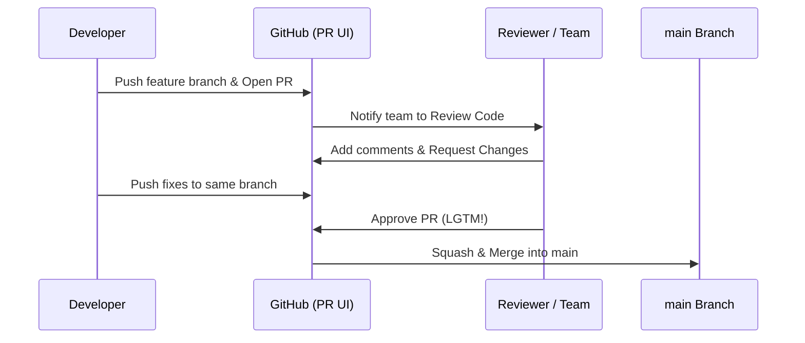

# Day 5: Professional Workflows - Pull Requests & Collaboration

Welcome to Day 5! By now, you have successfully mastered local Git commands on your workstation. However, in a real-world enterprise environment, you will never write code in isolation.

Software development is a team sport. Today, we will study **Pull Requests (PR)**—the most powerful workflow tool available to software engineers for ensuring codebase quality and enabling frictionless collaboration.

---

## 1. The True Spirit of a Pull Request (PR)

Do not think of a Pull Request as just a button you click on GitHub. A PR is a **dialogue**.

When you open a PR, you are telling your team: *"Hey team, I've finished implementing feature X on my branch `feature-x`. Here is a clean comparison of my changes (the diff). Please review it to make sure it contains no bugs and adheres to our quality standards, then merge (pull) it into our main codebase!"*



### Why are PRs Crucial?
1.  **Code Review:** Having teammates inspect your code before merging ensures that mistakes are caught early. Two sets of eyes are always better than one.
2.  **Historical Documentation:** Every design decision, code correction, and technical justification is permanently documented within the PR discussion logs. Years down the line, this is where engineers go to understand the *why* behind legacy code.
3.  **CI/CD Automation:** Every PR serves as a trigger. Automated pipelines (like GitHub Actions) spin up to run unit tests, check code formatting (linting), and verify security policies before any human review takes place.

---

## 2. The Standard 6-Step Collaboration Workflow

Memories this sequence; it is the industry-standard workflow used in elite tech corporations worldwide:

### Step 1: Synchronize Your Main Branch
Before you start any new task, pull down the latest codebase to ensure your environment is up to date:
```bash
git switch main
git pull origin main
```

### Step 2: Create a Feature Branch
Always isolate your tasks on dedicated branches. Never commit code directly to `main`:
```bash
git switch -c feature/login-page
```

### Step 3: Develop and Commit Locally
Write your code. Run tests. Make regular, modular commits with clean Conventional Commit messages:
```bash
git add .
git commit -m "feat: design user login form UI"
```

### Step 4: Push Your Branch to the Remote Server
Upload your feature branch to the remote repository on GitHub:
```bash
git push origin feature/login-page
```

### Step 5: Open a Pull Request on GitHub
Navigate to your GitHub repository page. GitHub will automatically detect your new branch and show a prompt. Click the **Compare & pull request** button.

### Step 6: Review, Address Feedback, and Merge
Teammates will review your code and write comments. You can push direct fixes to the same branch, and the PR will automatically update. Once approved, the branch is merged into `main`.

---

## 3. The Art of Professional Code Reviews

A code review is not about criticizing someone's work; it is an educational, collaborative feedback loop designed to elevate the entire engineering team.

### Checklist for the Author:
*   **PR Title:** Concise, descriptive, and prefixed correctly (e.g., `fix: resolve avatar profile image parsing error`).
*   **PR Description:** Clear, concise answers to:
    *   What was implemented?
    *   Why was this approach chosen?
    *   How can the reviewer manually test these changes?
    *   Include screenshots or screen recordings for frontend/UI changes.
*   **Self-Review:** Read through your own diff once on GitHub before assigning reviewers. You will catch 50% of your typos here.

### Checklist for the Reviewer:
*   **Logic and Edge Cases:** Does this code correctly handle errors, database outages, or malicious inputs?
*   **Performance:** Are there inefficient nested loops, memory leaks, or unoptimized database queries?
*   **Readability:** Are variable names clear, self-explanatory, and aligned with team conventions?
*   **Empathy and Professionalism:** Always offer constructive feedback respectfully. Instead of stating "This code is completely wrong," say "I think we can optimize this loop using approach X. What do you think?"

---

## 4. Squash and Merge: Keeping History Linear

During local development, you might record 20 minor commits like `fix typo`, `update css`, or `testing again`. If you merge all 20 commits into `main`, your production history will become extremely cluttered.

**The Solution: Squash and Merge.**
GitHub allows you to compress (squash) all 20 of those minor commits into a **single, unified commit** upon merging. This keeps your production history on the `main` branch exceptionally clean, structured, and easy to read.

---

## 5. Automating Quality Control with Git Hooks

Have you ever committed code only to realize you forgot to run your formatting or test suite? Git Hooks can automate these checks for you.

Git Hooks are executable scripts stored inside your project's hidden `.git/hooks/` directory. They trigger automatically when specific Git lifecycle events occur (such as right before a commit or right before a push).

*   **Pre-commit hook:** Can be configured to run lint checkers (e.g., ESLint, Prettier) or unit tests. If the script detects any syntax errors or failing tests, Git aborts the commit, forcing you to fix the issues locally.
*   **Benefit:** Guarantees that only clean, well-formatted, and passing code ever enters the repository.

---

## 6. Securing Your Codebase: Branch Protection Rules

How do you prevent a new developer or yourself from accidentally executing a `git push --force` that overwrites or deletes the entire production codebase? GitHub provides **Branch Protection Rules**.

**How to Configure:**
1.  Navigate to your GitHub Repository $\rightarrow$ **Settings** $\rightarrow$ **Branches**.
2.  Under **Branch protection rules**, click **Add rule**.
3.  In the **Branch name pattern** field, type `main`.
4.  Check the following key guardrails:
    *   **Require a pull request before merging:** Absolutely bans direct pushing to `main`.
    *   **Require approvals:** Mandates at least 1 team approval before code can be merged.
    *   **Require status checks to pass:** Blocks merging if automated CI/CD pipeline tests fail.

---

## 7. Versioning and Releases with Git Tags

When your software reaches a stable production milestone (e.g., launching your MVP or Beta), you should permanently "tag" that specific commit point:

```bash
git tag -a v1.0.0 -m "Release of official production v1.0.0"
git push origin v1.0.0
```

After pushing a tag, GitHub automatically registers a **Release**. You can then write Release Notes outlining the new features, bug fixes, and upgrade instructions.

---

## Summary of Day 5

1.  **PRs are collaborative culture:** A PR is a vital feedback loop that drives software quality.
2.  **Squash Merges:** Compress incremental development commits into clean production milestones.
3.  **Git Hooks:** Automate local quality gates so bad code never gets committed.
4.  **Branch Protection:** Guardrails that protect your production code from accidental deletions or force pushes.

**Assignment:**
Go to your GitHub repository settings and configure a Branch Protection Rule for the `main` branch. Then, try to push a local commit directly to `main` using your terminal. Observe how GitHub securely blocks your push!

Tomorrow, we will learn "Git Rescue Operations"—the elite commands to save your codebase when commits go wrong!
