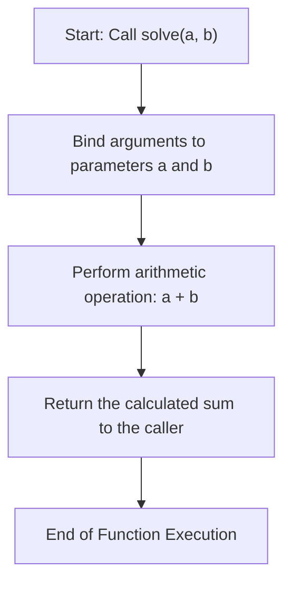
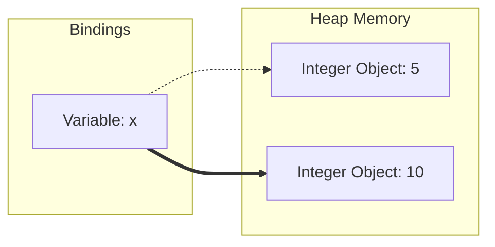

# Day 1: Introduction to Python & Basic Arithmetic

Welcome to the **Python, Machine Learning & Deep Learning** course! This curriculum is designed to take you from a programming beginner to understanding advanced Machine Learning and Deep Learning models entirely within your browser.

---

### 🎯 Learning Objectives
By the end of this lesson, you will be able to:
- Explain why Python is the preferred language for general programming, data science, and AI.
- Declare variables and understand Python's dynamic typing behavior.
- Perform basic mathematical operations using Python's arithmetic operators.
- Write and call a simple Python function that takes arguments and returns a result.

---

### 🧩 Core Concepts (Why)
#### 1. Why Python?
Python is a high-level, interpreted programming language known for its readability and simplicity. Instead of writing verbose boilerplates, Python allows developers to express concepts in fewer lines of code compared to C++ or Java. In data science and AI, Python is the absolute standard because of its powerful ecosystem (NumPy, Scikit-Learn, PyTorch, etc.).

#### 2. Variables: The Placeholders of Memory
A **variable** is a named location in the computer's memory used to store data. In Python, variables are created the moment you assign a value to them using the assignment operator (`=`). Python is **dynamically typed**, meaning you do not need to specify the type of variable (like `int` or `float`) beforehand; the interpreter detects it at runtime.

#### 3. Functions: Reusable Building Blocks
A **function** is a block of organized, reusable code used to perform a single, related action. Functions provide better modularity for your application and a high degree of code reusing.

---

### 🔁 Logic and Operation
When you define a function like `solve(a, b)` that adds two numbers, the control flows as follows:



This sequence ensures that input values are received, processed mathematically, and the resulting value is handed back to whatever called the function.

---

### 📝 Annotated Examples
Here is a annotated Python snippet showcasing variables, arithmetic operators, and a simple function.

```python
# --- Variables and Assignment ---
x = 15  # Assigns integer 15 to variable x
y = 4.0  # Assigns float 4.0 to variable y

# --- Arithmetic Operators ---
addition = x + y          # 19.0 (int + float yields float)
subtraction = x - y       # 11.0
multiplication = x * y    # 60.0
division = x / y          # 3.75 (returns a float division)
floor_division = x // y   # 3.0 (divides and rounds down to nearest whole number)
modulo = x % y            # 3.0 (returns the remainder of division)
exponentiation = x ** 2   # 225 (x raised to the power of 2)

# --- Function Definition ---
def calculate_area(width, height):
    """
    Calculates the area of a rectangle.
    This docstring explains the function's purpose.
    """
    area = width * height  # Intermediate calculation stored in local variable
    return area           # Exits function and passes back the result

# Calling the function and saving its returned value
result = calculate_area(5, 10)
print(result)  # Output: 50
```

---

### ❌ Common Mistakes
#### Mistake 1: Incorrect Indentation
```python
def solve(a, b):
# Missing indentation below
return a + b
```
```text
IndentationError: expected an indented block after function definition on line 1
```
```python
def solve(a, b):
    return a + b  # Indented by 4 spaces
```
> Python uses indentation (spaces/tabs) to define code blocks instead of curly braces. Omitting it results in an IndentationError.

#### Mistake 2: Mixing Variable Types (TypeError)
```python
x = "5"
y = 3
result = x + y
```
```text
TypeError: can only concatenate str (not "int") to str
```
```python
# Convert the string to an integer first (Type Casting)
result = int(x) + y  # result is 8
```
> Python is strongly typed and will not implicitly convert strings to numbers. You must explicitly cast them using functions like int() or float().

#### Mistake 3: Division by Zero
```python
result = 10 / 0
```
```text
ZeroDivisionError: division by zero
```
```python
# Check divisor before dividing
divisor = 0
result = 10 / divisor if divisor != 0 else 0
```
> Dividing by zero is mathematically undefined. You should always validate your variables to ensure the divisor is not zero before executing division.

---

### 💡 Tips & Idioms
- **Multiple Assignment:** You can assign values to multiple variables in a single line:
  ```python
  a, b, c = 1, 2, 3
  ```
- **Augmented Assignment:** Instead of writing `x = x + 5`, you can use shortcut operator `+=`:
  ```python
  x = 10
  x += 5  # x is now 15
  ```
- **Docstrings:** Always document your functions using triple quotes `"""` right after the function signature. This is crucial for readability and automatically generating documentation.

---

### 🧠 Deep Dive (Under the hood)
<details>
<summary>How Python Handles Variables and Objects (Click to expand)</summary>

In Python, everything is an object. When you write `x = 5`, Python:
1. Creates an object representing the integer `5` in memory.
2. Binds the name `x` to that integer object.

If you later do `x = 10`, the name `x` is simply rebound to a new integer object `10`. The original `5` object is left behind and eventually cleared from memory by Python's automatic garbage collector if no other variables refer to it.


This reference-based architecture is why variables in Python are dynamic and don't need fixed type declarations.
</details>

---

### 🏋️ Exercise
Complete the `solve(a, b)` function to return the sum of the parameters `a` and `b`.

```python
def solve(a, b):
    # Your code here
    return None
```

#### Hints
1. You need to use the addition operator `+`.
2. Do not just print the result; you must return it using the `return` keyword.

---

### ✅ Self-Check
1. What will be the output of `print(10 // 3)`?
2. What is the value of `x` after executing `x = 2; x **= 3`?
3. What error is thrown when you omit indentation inside a function?

<details>
<summary>Click here to reveal answers</summary>

1. **`3`**: Floor division `//` divides the numbers and rounds down to the nearest whole integer.
2. **`8`**: `x **= 3` is equivalent to `x = x ** 3` (2 cubed), which is `2 * 2 * 2 = 8`.
3. **`IndentationError`**: Python uses indentation to mark code block boundaries, and omitting it results in an IndentationError.
</details>

---

### 📌 Summary
- Python is highly readable, dynamically typed, and has a rich ecosystem for machine learning.
- Variables act as references to objects in memory.
- Standard arithmetic operators include `+`, `-`, `*`, `/`, `//` (floor division), `%` (modulo), and `**` (exponentiation).
- Functions are defined using the `def` keyword, require indented blocks, and return values back to the caller using `return`.
