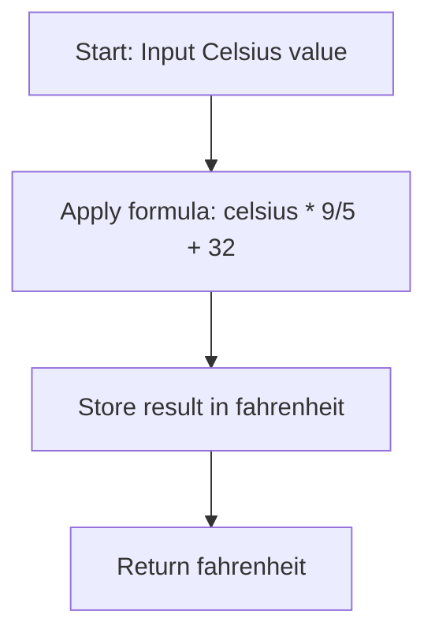

# Day 2: Variables & Basic Data Types

In Python, understanding variables and data types is the foundation of writing robust applications. Unlike statically-typed languages, Python gives you the flexibility to store different kinds of information dynamically while enforcing rules under the hood to prevent illogical operations.

---

### 🎯 Learning Objectives
By the end of this lesson, you will be able to:
- Identify and work with the four primitive data types: `int`, `float`, `str`, and `bool`.
- Understand and explain Python's dynamic typing and object references.
- Convert values between different types using explicit type casting (`int()`, `float()`, `str()`, `bool()`).
- Format output dynamically using f-strings (formatted string literals).

---

### 🧩 Core Concepts (Why)
#### 1. Why Data Types Matter
Computers store all information in binary (1s and 0s). The computer needs to know *how* to interpret a sequence of binary digits. For instance, the binary representation of a number is stored differently from a character in a text message. Specifying a data type lets the Python runtime know what operations are valid (e.g., you can add two numbers, but you cannot subtract text).

#### 2. Dynamic Typing: Labels, Not Boxes
In statically-typed languages like C++ or Java, variables are containers (boxes) with a fixed type. In Python, variables are **labels (pointers)** bound to objects in memory. The type belongs to the object (the value itself), not the variable name. This allows a variable name to point to an integer at one point, and a string later on.

#### 3. String Interpolation (f-strings)
When creating user interfaces or reporting metrics, we frequently need to inject variables into sentences. Rather than using awkward string concatenations like `"Temperature is " + str(temp) + " degrees"`, Python provides **f-strings** (formatted string literals) to embed expressions directly inside string literals with curly braces `{}`.

---

### 🔁 Logic and Operation
Converting Celsius to Fahrenheit involves receiving a numerical input (an integer or a float), performing a mathematical formula, and returning the result. The process is visualized below:



Under the hood, if we pass an integer Celsius, Python dynamically performs float division (`9/5` yields `1.8`) and implicitly promotes the final `fahrenheit` variable to a float type.

---

### 📝 Annotated Examples
Here is how you can declare variables of different types, inspect them, cast them, and interpolate them:

```python
# --- 1. Declaring Primitive Data Types ---
age = 25                  # 'int' (integer)
price = 19.99             # 'float' (floating point decimal)
course_name = "Python"    # 'str' (string)
is_active = True          # 'bool' (boolean: True or False)

# --- 2. Dynamic Re-assignment ---
x = 42                    # x points to an int object
x = "Hello"               # Now x points to a str object. This is legal in Python!

# --- 3. Explicit Type Casting ---
str_number = "100"
converted_int = int(str_number)      # Converts "100" to integer 100
converted_float = float(20)          # Converts integer 20 to float 20.0
to_string = str(3.14)                # Converts float 3.14 to string "3.14"

# --- 4. Truthiness and Boolean Casting ---
# Almost any object can be cast to boolean. Only empty/zero values are False.
print(bool(0))            # False
print(bool(""))           # False (empty string)
print(bool(5))            # True
print(bool("Hello"))      # True

# --- 5. String Formatting (f-strings) ---
name = "Alice"
score = 98.5
message = f"Student {name} scored {score}% in the exam."
print(message)            # Output: Student Alice scored 98.5% in the exam.
```

---

### ❌ Common Mistakes
#### Mistake 1: Implicit Concatenation Error
Trying to add strings and integers directly without converting the integer.
```python
current_year = 2026
message = "The year is " + current_year
```
**Actual Error Message:**
```text
TypeError: can only concatenate str (not "int") to str
```
**Correct Code:**
```python
# Using f-strings (recommended)
message = f"The year is {current_year}"

# Or casting explicitly
message = "The year is " + str(current_year)
```
> Python is strongly typed and does not automatically convert numbers to strings when using the `+` operator.

#### Mistake 2: Using Reserved Keywords for Variable Names
Using names that have special meanings in Python syntax.
```python
class = "Introduction to AI"
```
**Actual Error Message:**
```text
SyntaxError: invalid syntax
```
**Correct Code:**
```python
class_name = "Introduction to AI"
```
> Reserved words like `class`, `def`, `if`, `import`, and `for` cannot be used as variable names.

#### Mistake 3: Floating Point Precision Inaccuracy
Assuming decimal math is exactly precise in all assertions.
```python
result = (0.1 + 0.2) == 0.3
print(result)
```
**Actual Output / Failure:**
```text
False  (0.1 + 0.2 evaluates to 0.30000000000000004)
```
**Correct Code:**
```python
# Check if numbers are extremely close (within an epsilon value)
is_equal = abs((0.1 + 0.2) - 0.3) < 1e-9
```
> Computers represent floats in binary fraction form (IEEE 754 standards), which cannot represent certain base-10 decimals exactly.

---

### 💡 Tips & Idioms
- **Constant Names:** Python does not support true constant variables that are protected from modification. Instead, developers use uppercase names by convention (`PI = 3.14159`, `MAX_USERS = 100`) to signal that the value should not be modified.
- **Readable Large Numbers:** You can use underscores as visual digit separators for readability:
  ```python
  one_billion = 1_000_000_000
  ```
- **Type Check preference:** To check if a variable matches a specific type, prefer using `isinstance(var, type)` over `type(var) == type`:
  ```python
  is_integer = isinstance(age, int)  # True
  ```

---

### 🧠 Deep Dive (Under the hood)
<details>
<summary>Object Identity vs. Object Value (Click to expand)</summary>

When you assign a value to a variable, Python allocates space for the object and returns its address reference.
- **Value (`==`)**: Checks if the values of two objects are equal.
- **Identity (`is`)**: Checks if two variables point to the exact same memory address.

For performance optimization, Python caches small integers (typically from `-5` to `256`) and short strings. This is called **interning**.

```python
a = 256
b = 256
print(a == b)  # True
print(a is b)  # True (points to the same cached object)

c = 1000
d = 1000
print(c == d)  # True
print(c is d)  # False (points to different objects in memory)
```
You can inspect the actual memory address using the `id()` function:
```python
print(id(c))  # e.g., 140356230491024
```
</details>

---

### 🏋️ Exercise
Complete the function `c_to_f(celsius)` to convert a temperature from Celsius to Fahrenheit and return it.

The mathematical formula to convert Celsius ($C$) to Fahrenheit ($F$) is:
$$F = \left(C \times \frac{9}{5}\right) + 32$$

```python
def c_to_f(celsius):
    # Complete the function to convert Celsius to Fahrenheit
    fahrenheit = None
    return fahrenheit
```

#### Hints
1. You can multiply `celsius` by `9/5` (or `1.8`) and then add `32`.
2. Ensure you return the calculated value, rather than printing it.

---

### ✅ Self-Check
1. If `x = 5.8`, what is the result of `int(x)`?
2. What does `type(True)` return?
3. How would you insert variables `name` and `age` into a message using an f-string?

<details>
<summary>Click here to reveal answers</summary>

1. **`5`**: Casting a float to an int using `int()` discards the fractional part (it truncates towards zero) instead of rounding it.
2. **`<class 'bool'>`**: True and False are objects belonging to the boolean class.
3. **`f"Name: {name}, Age: {age}"`**: Placing the variable names inside curly braces inside a string prefixed with `f` interpolates their values.
</details>

---

### 📌 Summary
- Python is dynamically typed (types are bound to values, not variables) and strongly typed (no implicit operations on incompatible types).
- Primitive types include integer (`int`), floating-point (`float`), text string (`str`), and boolean (`bool`).
- Use `type()` to inspect the type of an object and `int()`, `float()`, `str()`, `bool()` to explicitly cast types.
- f-strings are the modern, clean way to format strings by embedding expressions within `{}` brackets.
