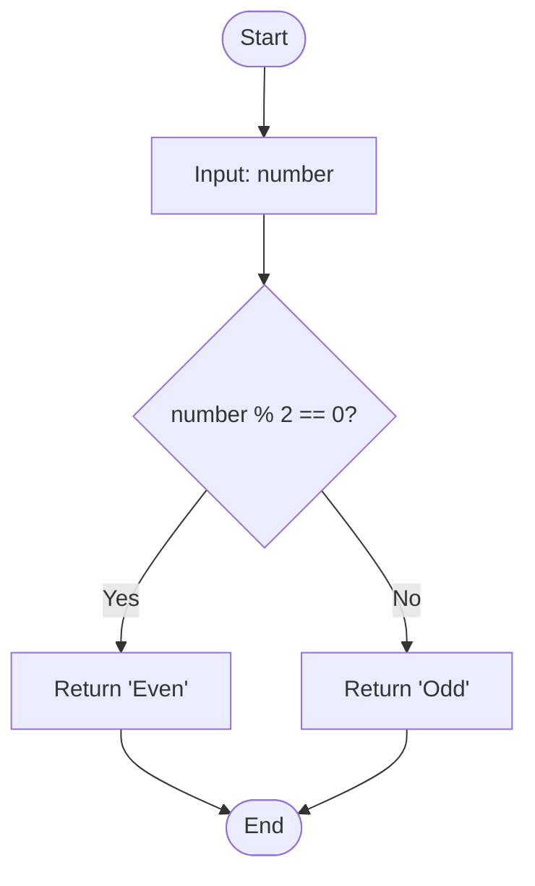

# Day 3: Control Flow & Conditionals

### 🎯 Learning Objectives
- Understand boolean logic, comparison operators, and logical operators in Python.
- Master the syntax and structure of `if`, `elif`, and `else` statements.
- Explain the importance of indentation for code blocks.
- Apply conditional logic to solve a parity checking task.

### 🧩 Core Concepts (Why)
Programs shouldn't execute in a single straight line. Real-world applications require decision-making logic. For example, verifying if a user's password is correct, checking if a bank account has sufficient funds before a withdrawal, or determining a letter grade based on a numerical score. Conditionals act as the decision-making brain of programs, determining which paths of code should run depending on dynamic data.

### 🔁 Logic and Operation
Conditional branching works by evaluating expressions that result in a boolean value (`True` or `False`). Python evaluates these conditions sequentially from top to bottom. The first condition that evaluates to `True` triggers its associated block of code, and the rest of the conditional chain is skipped.

Here is a flowchart illustrating how the parity checking logic (even vs. odd) works:



### 📝 Annotated Examples

```python
# 1. Simple if statement
temperature = 25
if temperature > 20:
    print("It's a warm day.")  # Executed because temperature > 20 is True

# 2. if-else chain
score = 75
if score >= 80:
    print("Pass with distinction")
else:
    print("Pass")  # Executed because score is less than 80

# 3. if-elif-else chain
age = 15
if age >= 18:
    ticket_price = 10  # Adults pay $10
elif age >= 12:
    ticket_price = 7   # Teens pay $7
else:
    ticket_price = 5   # Children pay $5
print(f"Ticket price: ${ticket_price}")

# 4. Nested conditionals
username = "admin"
logged_in = True
if logged_in:
    if username == "admin":
        print("Welcome, administrator!")  # Executed: nested under logged_in
    else:
        print("Welcome, user!")
else:
    print("Please log in.")

# 5. Logical operators (and, or, not)
has_id = True
has_ticket = False
if has_id or has_ticket:
    print("Access granted.")  # Executed because 'or' requires only one condition to be True
```

### ❌ Common Mistakes

Wrong code:
```python
x = 10
if x > 5
    print("Greater than 5")
```
Traceback:
```text
SyntaxError: expected ':'
```
Correct code:
```python
x = 10
if x > 5:
    print("Greater than 5")
```
> Python requires a colon `:` at the end of conditional statements to define a new block.

Wrong code:
```python
x = 10
if x > 5:
print("Greater than 5")
```
Traceback:
```text
IndentationError: expected an indented block after 'if' statement on line 2
```
Correct code:
```python
x = 10
if x > 5:
    print("Greater than 5")
```
> Python uses indentation (typically 4 spaces) to group statements within a conditional block.

Wrong code:
```python
x = 5
if x = 5:
    print("Five")
```
Traceback:
```text
SyntaxError: invalid syntax. Maybe you meant '==' or ':=' instead of '='?
```
Correct code:
```python
x = 5
if x == 5:
    print("Five")
```
> The single `=` is for variable assignment. To check for equality, you must use the double equals `==` operator.

### 💡 Tips & Idioms
- **Chained comparisons:** In Python, you can chain comparisons naturally. For example, `18 < age < 65` checks if `age` is strictly between 18 and 65, which is cleaner than writing `age > 18 and age < 65`.
- **Ternary Operator (Conditional Expression):** For simple assignments, use a single-line ternary format: `status = "Adult" if age >= 18 else "Minor"`.
- **Truthiness:** Every object in Python has an inherent boolean value. Empty containers (`[]`, `{}`, `()`), zero (`0`, `0.0`), `None`, and empty strings (`""`) evaluate to `False`. All other values evaluate to `True`.
- **Compare Booleans Implicitly:** Avoid comparing boolean variables to `True` or `False`. Write `if is_valid:` instead of `if is_valid == True:`.

### 🧠 Deep Dive (Under the hood)
<details><summary>Short-Circuit Evaluation (Click to expand)</summary>

When evaluating logical operators `and` and `or`, Python employs **short-circuit evaluation**:
- For `and` expressions, if the left operand evaluates to `False`, Python immediately returns `False` without evaluating the right operand.
- For `or` expressions, if the left operand evaluates to `True`, Python immediately returns `True` without evaluating the right operand.

This optimization improves execution speed and allows safe coding patterns, such as checking for existence before accessing attributes:
```python
# Safe: if user is None, the second condition is never evaluated, preventing an AttributeError
if user is not None and user.is_active:
    print("User is active")
```
</details>

### 🏋️ Exercise
Complete the `is_even_or_odd(number)` function to return `"Even"` if the input number is even, and `"Odd"` if it is odd.

Refer to the initial code template in the editor to get started.

### ✅ Self-Check
<details><summary>Click to view questions and answers</summary>

1. **Question:** What does `bool("")` evaluate to?
   - **Answer:** `False`, because empty strings are considered "falsy" in Python.
2. **Question:** In the expression `True or print("Hello")`, will "Hello" be printed?
   - **Answer:** No, because of short-circuit evaluation. The left operand is `True`, so the `or` expression returns `True` immediately without evaluating the right operand.
</details>

### 📌 Summary
- Conditionals run different code paths based on boolean evaluations.
- Indentation is not optional; it is a syntax requirement that defines code blocks.
- Chains of conditionals are built using `if`, `elif`, and `else`.
- Truthiness allows non-boolean values to act as conditions (e.g., checking if a list is empty).
- Short-circuit evaluation evaluates expressions lazily for performance and safety.

