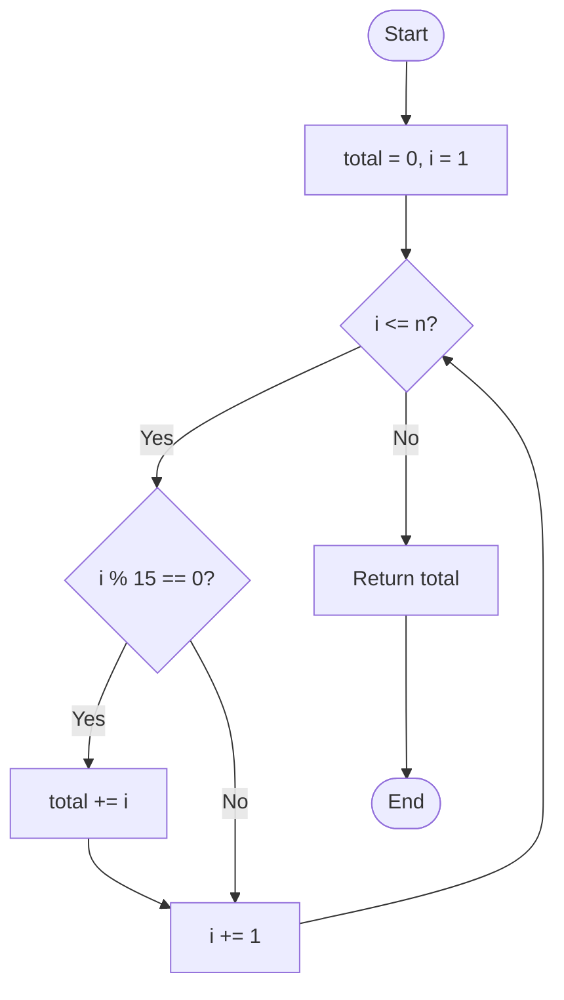

# Day 4: Loops & Iterations

### 🎯 Learning Objectives
- Explain the difference between `for` loops (definite iteration) and `while` loops (indefinite iteration).
- Utilize the `range()` function to generate numerical sequences.
- Control loop execution flow using `break` and `continue`.
- Implement loops with conditional filters to solve cumulative sum calculations.

### 🧩 Core Concepts (Why)
Computers excel at performing repetitive tasks millions of times without fatigue. Writing repetitive instructions manually is inefficient, hard to maintain, and error-prone. Loops allow us to execute a block of code multiple times. 
- A **`for` loop** is used for *definite iteration*, meaning you know in advance how many times the loop will run (e.g., iterating through a list of names, or a range of numbers).
- A **`while` loop** is used for *indefinite iteration*, meaning the loop continues running until a specific condition changes to `False` (e.g., waiting for a user to input "exit", or reading lines from a file until it's empty).

### 🔁 Logic and Operation
A loop continuously tests a conditional expression. If the condition is met (evaluates to `True`), the block of code inside the loop executes. If not, the program exits the loop and continues executing subsequent lines of code.

Here is a flowchart illustrating the logic of the cumulative sum challenge `sum_multiples(n)` where we iterate from `1` to `n` and sum up numbers divisible by 15:



### 📝 Annotated Examples

```python
# 1. Definite iteration using a for loop and range()
# range(5) generates numbers from 0 to 4 (5 is excluded)
for i in range(5):
    print(f"Iteration {i}")

# 2. Iterating over a sequence (list)
fruits = ["apple", "banana", "cherry"]
for fruit in fruits:
    print(f"I like {fruit}")

# 3. Indefinite iteration using a while loop
countdown = 3
while countdown > 0:
    print(countdown)
    countdown -= 1  # Crucial: decrease countdown to avoid an infinite loop
print("Blast off!")

# 4. Controlling loop execution: break
# break exits the loop immediately
for num in range(1, 10):
    if num == 5:
        break  # Stops the loop when num is 5
    print(num)  # Prints 1, 2, 3, 4

# 5. Controlling loop execution: continue
# continue skips the rest of the current iteration and goes to the next one
for num in range(1, 6):
    if num == 3:
        continue  # Skips printing 3
    print(num)  # Prints 1, 2, 4, 5
```

### ❌ Common Mistakes

Wrong code:
```python
n = 5
for i in n:
    print(i)
```
Traceback:
```text
TypeError: 'int' object is not iterable
```
Correct code:
```python
n = 5
for i in range(n):
    print(i)
```
> Integers are not iterable. To iterate a specific number of times, you must wrap the integer in the `range()` function.

Wrong code:
```python
i = 1
while i <= 3:
    print(i)
    # Missing counter increment (i += 1)
```
Traceback:
```text
TimeoutError: Execution exceeded maximum time limit of 5.0 seconds
```
Correct code:
```python
i = 1
while i <= 3:
    print(i)
    i += 1
```
> A `while` loop condition must eventually become False. Forgetting to update the variable used in the condition creates an infinite loop.

Wrong code:
```python
# Attempting to print 1 to 5 inclusive
for i in range(1, 5):
    print(i)
```
Traceback:
```text
1
2
3
4
```
Correct code:
```python
# Upper bound is exclusive, so use 6 to include 5
for i in range(1, 6):
    print(i)
```
> Python's `range(start, stop)` function is exclusive of the `stop` value. To include `n`, you must set the limit to `n + 1`.

### 💡 Tips & Idioms
- **`enumerate()` for index and value:** When iterating over a list and you need both the element and its index, use `enumerate()`:
  ```python
  names = ["Alice", "Bob"]
  for index, name in enumerate(names):
      print(f"{index}: {name}")
  ```
- **`zip()` for parallel iteration:** To loop through two lists of the same length simultaneously, pair them using `zip()`:
  ```python
  items = ["Apple", "Phone"]
  prices = [1.2, 800]
  for item, price in zip(items, prices):
      print(f"{item} costs ${price}")
  ```
- **Loop `else` clause:** Python loops can have an `else` block. It runs *only* if the loop finishes naturally without encountering a `break` statement. This is highly useful for search operations.
  ```python
  for x in range(3):
      print(x)
  else:
      print("Success!")  # Runs because no break was encountered
  ```

### 🧠 Deep Dive (Under the hood)
<details><summary>Iterators and Iterables (Click to expand)</summary>

Under the hood, a `for` loop in Python doesn't use simple index counters. It works on the concept of **Iterables** and **Iterators**:
1. An **Iterable** is any object that can return its elements one at a time (e.g., lists, tuples, strings, or `range` objects). Iterables implement the `__iter__` method.
2. When a `for` loop starts, it calls `iter(iterable)` to obtain an **Iterator** object.
3. The loop then repeatedly calls `next(iterator)` to retrieve the next item.
4. When there are no more items left, the iterator raises a `StopIteration` exception. The `for` loop catches this exception internally and terminates the loop cleanly.

You can simulate this mechanism manually:
```python
nums = [10, 20]
it = iter(nums)      # Get iterator
print(next(it))      # Output: 10
print(next(it))      # Output: 20
# print(next(it))    # This would raise StopIteration
```
</details>

### 🏋️ Exercise
Complete the `sum_multiples(n)` function to return the sum of all integers from `1` to `n` (inclusive) that are divisible by both `3` and `5` (multiples of `15`).

Refer to the initial code template in the editor to get started.

### ✅ Self-Check
<details><summary>Click to view questions and answers</summary>

1. **Question:** What is the output of `list(range(2, 10, 3))`?
   - **Answer:** `[2, 5, 8]`. The range starts at 2, stops before 10, and increments by 3.
2. **Question:** What is the difference between `break` and `continue`?
   - **Answer:** `break` terminates the loop completely, jumping to the code after the loop. `continue` skips only the rest of the current iteration and jumps to the next cycle of the loop.
</details>

### 📌 Summary
- `for` loops iterate over a known sequence or range.
- `while` loops repeat code as long as a condition remains `True`.
- `range(start, stop, step)` generates numerical sequences, excluding the `stop` value.
- Use `break` to exit loops early, and `continue` to skip the remainder of the current iteration.
- Under the hood, Python loops utilize iterators and handle `StopIteration` exceptions to terminate.

