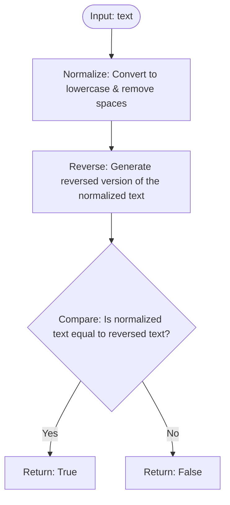

# Day 5: Defining & Using Functions

### 🎯 Learning Objectives
- Define custom functions using the `def` keyword, handle parameters, and use the `return` statement.
- Explain Python's default `None` return behavior when no explicit return is provided.
- Differentiate between local and global scopes, understanding how namespaces isolate variables.
- Write robust modular code and trace code execution flows.

### 🧩 Core Concepts (Why)
In programming, we often need to execute the same block of code multiple times with different inputs. Writing the same code repeatedly leads to duplication, which makes programs harder to maintain, debug, and update. 

Functions solve this problem by wrapping a block of code into a named, reusable unit. They act as "black boxes" where you provide inputs (arguments), the function performs processing, and it outputs a result (return value). Functions allow us to decompose complex problems into smaller, manageable, and testable sub-tasks.

### 🔁 Logic and Operation
A function in Python is defined with the `def` keyword, followed by its name, parameters inside parentheses, and a colon. The body is indented. 

Here is the logic flow for a palindrome checking process:



- **Parameters vs. Arguments**: Parameters are the variables listed in the function definition (e.g., `text` in `is_palindrome(text)`). Arguments are the actual values passed to the function when it is called (e.g., `"radar"` in `is_palindrome("radar")`).
- **The Return Statement**: `return` exits the function immediately and passes back a value. If no `return` statement is written, or if a bare `return` is used, Python automatically returns `None`.

### 📝 Annotated Examples
```python
# 1. Simple function definition with a default parameter value
def greet(name="Guest"):
    # If no name is passed, "Guest" is used as the default value
    return f"Hello, {name}!"

print(greet("Alice"))  # Output: Hello, Alice!
print(greet())         # Output: Hello, Guest! (uses default)

# 2. Implicit return of None when return is omitted
def print_sum(a, b):
    result = a + b
    print(f"Sum is: {result}")
    # No return statement here!

value = print_sum(3, 4)
print(value)  # Output: None (implicit return value)

# 3. Local vs Global Scope
message = "I am global"  # Global variable

def check_scope():
    message = "I am local"  # Local variable shadowing global
    print(f"Inside function: {message}")

check_scope()           # Prints: Inside function: I am local
print(f"Outside function: {message}")  # Prints: Outside function: I am global
```

### ❌ Common Mistakes
**Mistake 1: Accessing local variables in the global scope**
```python
def calculate_area(radius):
    area = 3.14 * radius * radius
    return area

calculate_area(5)
print(area)
```
```text
NameError: name 'area' is not defined
```
```python
def calculate_area(radius):
    area = 3.14 * radius * radius
    return area

my_area = calculate_area(5)
print(my_area)
```
> Variables defined inside a function (local scope) cannot be accessed outside it. To use the result, you must return it and store the returned value in a new variable in the outer scope.

**Mistake 2: Operating on the default None return value**
```python
def add_five(number):
    result = number + 5

output = add_five(10)
print(output * 2)
```
```text
TypeError: unsupported operand type(s) for *: 'NoneType' and 'int'
```
```python
def add_five(number):
    result = number + 5
    return result

output = add_five(10)
print(output * 2)
```
> If a function has no explicit `return` statement, it implicitly returns `None`. You cannot perform mathematical operations on `None`.

**Mistake 3: Modifying a global variable without the global declaration**
```python
count = 0

def increment():
    count = count + 1

increment()
```
```text
UnboundLocalError: cannot access local variable 'count' where it is not associated with a value
```
```python
count = 0

def increment():
    global count
    count = count + 1

increment()
```
> Python treats variables assigned within a function as local. If you try to modify a global variable without declaring it `global`, Python raises an UnboundLocalError when it attempts to read the local variable before assignment.

### 💡 Tips & Idioms
- **Reversing Slicing**: Reversing strings or sequences is extremely concise in Python using the `[::-1]` slicing trick.
- **Single Responsibility Principle**: Write small, focused functions that do only one thing. If a function is doing multiple things, break it down into helper functions.
- **Return Early Pattern**: Use guards or early returns to handle special or edge cases first, keeping the main logic less indented and easier to read.
- **Docstrings**: Document functions using triple-quoted string literals immediately below the function definition header, which makes your code self-documenting.

### 🧠 Deep Dive (Under the hood)
<details>
<summary>Namespaces and Recursion</summary>

- **Namespaces and Scopes (LEGB Rule)**: Python uses namespaces to store variables. When looking up a variable name, Python searches in this order:
  1. **L**ocal: Inside the current function.
  2. **E**nclosing: In any enclosing local scopes of nested functions.
  3. **G**lobal: At the module level.
  4. **B**uilt-in: Python's pre-loaded keywords/functions (like `print`, `len`).
- **Recursion and the Call Stack**: When a function calls itself, it is called recursion. Each nested function call creates a new execution frame on Python's call stack to track local variables and execution points. If a recursive function does not reach its base case, it will keep pushing frames until it exceeds the maximum stack size, raising a `RecursionError` (stack overflow).
</details>

### 🏋️ Exercise
Complete the `is_palindrome(text)` function to check if the input string `text` reads the same forwards and backwards. Make sure to ignore spaces and case sensitivity.

**Hint:**
1. Convert the input text to lowercase using `lower()`.
2. Remove spaces using `replace(" ", "")`.
3. Compare the cleaned text with its reversed version using string slicing `[::-1]`.

### ✅ Self-Check
<details>
<summary>Click to view questions and answers</summary>

**Question 1:** What does a function return if there is no explicit `return` statement in its definition?
- **Answer:** It returns `None` (an instance of `NoneType`).

**Question 2:** Explain the difference between local and global scopes.
- **Answer:** Variables defined inside a function belong to its local scope and are only accessible within that function. Variables defined in the main body of the script belong to the global scope and are accessible anywhere, but can only be modified inside a function if declared using the `global` keyword.
</details>

### 📌 Summary
- Functions are defined using `def`, accept parameters, and return values using `return`.
- If no `return` is provided, Python functions return `None` by default.
- Local variables exist inside the function's namespace (local scope) and are inaccessible from the outside.
- Recursion involves a function calling itself; it requires a base case to prevent infinite loops.
