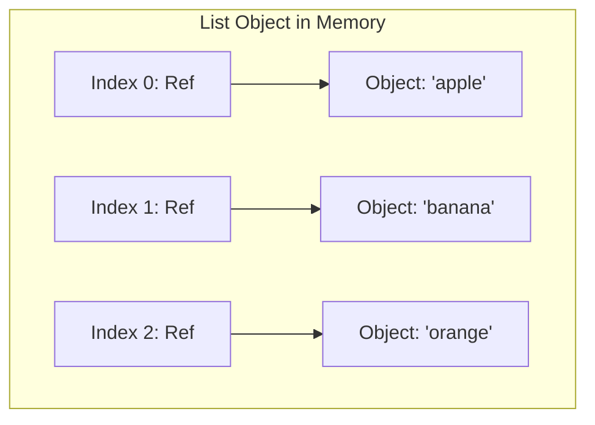

# Day 6: Lists & Tuples

### 🎯 Learning Objectives
- Differentiate between lists (mutable) and tuples (immutable) and identify when to use each.
- Retrieve and modify elements using 0-based and negative indexing.
- Use slice notation (`start:stop:step`) to extract sub-sequences safely.
- Perform sequence operations like adding (`append`), removing (`remove`), and sorting (`sorted`, `sort`).

### 🧩 Core Concepts (Why)
When writing programs, we often need to store a collection of related items rather than single values. 

Python provides two main built-in sequence types to store collections:
1. **Lists (`list`)**: Ordered, mutable collections of items. You can grow, shrink, sort, or modify them after creation. They are ideal for lists of items that change over time (e.g., a shopping list or task list).
2. **Tuples (`tuple`)**: Ordered, immutable collections of items. Once created, they cannot be changed, added to, or reordered. They provide data safety (guaranteeing that a fixed pair like coordinates `(latitude, longitude)` or configurations won't be mutated accidentally) and are slightly faster and more memory-efficient than lists.

### 🔁 Logic and Operation
Unlike arrays in some low-level languages where elements are stored in a contiguous block of memory, a Python list is an array of references (pointers) to Python objects stored elsewhere in memory (the heap).



- **Indexing**: Elements can be accessed by their index starting at `0` for the first element. Python also supports negative indexing, starting from `-1` for the last element.
- **Slicing**: You can extract a portion of a sequence using slice notation: `sequence[start:stop:step]`. This creates a new sequence without modifying the original.

### 📝 Annotated Examples
```python
# 1. Lists are mutable
fruits = ["apple", "banana"]
fruits.append("orange")  # Adds "orange" to the end: ['apple', 'banana', 'orange']
fruits[1] = "mango"      # Modifies index 1: ['apple', 'mango', 'orange']
print(fruits)

# 2. Tuples are immutable
coordinates = (40.7128, -74.0060)
# coordinates[0] = 34.0522  # This would raise a TypeError!

# 3. Indexing & Slicing
numbers = [10, 20, 30, 40, 50]
print(numbers[0])    # Output: 10 (first item)
print(numbers[-1])   # Output: 50 (last item)
print(numbers[1:4])  # Output: [20, 30, 40] (indices 1 up to but excluding 4)
print(numbers[::-1]) # Output: [50, 40, 30, 20, 10] (reverses the list)
```

### ❌ Common Mistakes
**Mistake 1: Index out of range**
```python
fruits = ["apple", "banana"]
print(fruits[2])
```
```text
IndexError: list index out of range
```
```python
fruits = ["apple", "banana"]
print(fruits[-1])
```
> Valid indices range from `0` to `len(list) - 1`. Attempting to access an index equal to or greater than the length of the list raises an IndexError.

**Mistake 2: Attempting to mutate a tuple**
```python
point = (1, 2)
point[0] = 9
```
```text
TypeError: 'tuple' object does not support item assignment
```
```python
point = (9, 2)
```
> Tuples are immutable sequence types. If you need a modified version, you must recreate a new tuple with the new values.

**Mistake 3: Assigning the return value of in-place modifying methods**
```python
numbers = [3, 1, 2]
sorted_numbers = numbers.sort()
print(sorted_numbers[0])
```
```text
TypeError: 'NoneType' object is not subscriptable
```
```python
numbers = [3, 1, 2]
sorted_numbers = sorted(numbers)
print(sorted_numbers[0])
```
> Methods like `list.sort()` and `list.append()` modify the list in-place and return `None`. To obtain a new sorted list, use the built-in `sorted()` function.

### 💡 Tips & Idioms
- **Safe Slicing**: Slicing is highly forgiving. Accessing out-of-bounds indices via slicing does not raise an error; it simply returns whatever elements are available (e.g., `fruits[1:100]`).
- **Unpacking**: You can easily assign elements of a list or tuple to individual variables: `x, y = coordinates`. You can also collect remaining elements using the star operator: `first, *rest = [1, 2, 3, 4]`.
- **Membership Check**: Use the `in` operator to check if an item exists in a list or tuple: `if "apple" in fruits:`.
- **Deduplication**: You can remove duplicates from a list by converting it to a set, then back to a list: `unique_list = list(set(original_list))`.

### 🧠 Deep Dive (Under the hood)
<details>
<summary>References, Aliasing, and Computational Complexity</summary>

- **Variables as References (Aliasing)**: In Python, assigning `list_b = list_a` does not copy the list; it merely copies the reference (arrow) pointing to the same list object in memory. Any modification made through `list_b` will affect `list_a`. To create a separate independent copy, use `list_a.copy()`.
- **Time Complexity (Big O)**:
  - **Index Lookup**: $O(1)$ (constant time), because the list is stored as a contiguous array of pointers and index math points directly to the memory address.
  - **Append**: Amortized $O(1)$, because memory allocations are pre-allocated in chunks.
  - **Insert/Delete (at index 0 or middle)**: $O(n)$ (linear time), because Python must shift all subsequent elements in memory.
  - **Membership Check (`in`)**: $O(n)$, since Python must scan the list sequentially from start to end in the worst case.
</details>

### 🏋️ Exercise
Complete the `unique_sort(numbers)` function to remove duplicates from the input list `numbers` and return a sorted list containing the unique elements.

**Hint:**
1. Use the `set()` function to easily remove duplicate numbers.
2. Convert the set back into a list using `list()`.
3. Sort the list in ascending order using the `sorted()` function and return it.

### ✅ Self-Check
<details>
<summary>Click to view questions and answers</summary>

**Question 1:** What is the difference in time complexity between appending an item to the end of a list and inserting it at index 0?
- **Answer:** Appending is $O(1)$ because no elements need to be shifted. Inserting at index 0 is $O(n)$ because every element in the list must be shifted one slot to the right.

**Question 2:** How do you create a tuple containing only a single element?
- **Answer:** You must include a trailing comma (e.g., `single_element_tuple = (5,)`). Writing `(5)` without a comma is evaluated as a regular integer inside parentheses.
</details>

### 📌 Summary
- Lists are mutable, ordered sequences; tuples are immutable, ordered sequences.
- Access elements using indices (0 to $N-1$, or $-1$ to $-N$ for negative indexing).
- Slicing retrieves a sub-sequence without modifying the original.
- Be mindful of aliasing when copying lists, and know the difference in complexity between append ($O(1)$) and insert/remove ($O(n)$).
