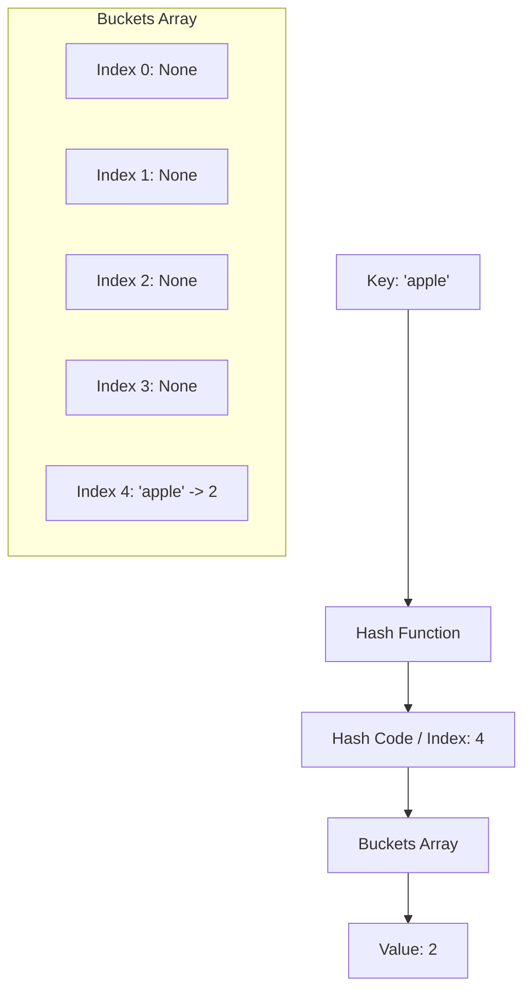

# Day 7: Dictionaries & Sets

Dictionaries store data in **key-value** pairs. Sets are unordered collections of **unique** elements.

### 🎯 Learning Objectives
- Explain key-value association and why dictionaries are more efficient than list lookups.
- Retrieve dictionary values safely using `get()` to prevent runtime errors.
- Understand set uniqueness and perform set operations (union, intersection, difference).
- Analyze the internal hashing mechanism and why elements must be hashable.

### 🧩 Core Concepts (Why)
- **Dictionaries**: In list collections, finding an item requires scanning through elements one by one, which is slow for large collections. Dictionaries solve this by associating a unique key with a value (like a real dictionary where you look up a word to find its definition).
- **Sets**: Sometimes we only care about uniqueness and membership testing, not the order. Sets store unique elements and support mathematical set operations (like finding common friends between two users).

### 🔁 Logic and Operation
Here is the hash lookup process that enables fast lookups:

For Sets, they use a similar hash table structure but store only keys without values to guarantee $O(1)$ membership testing and uniqueness.

### 📝 Annotated Examples
```python
# 1. Dictionary Creation and Modification
student = {
    "name": "Alice",
    "grade": "A",
    "skills": ["Python", "Git"]
}
student["age"] = 20  # Add a new key-value pair
student["grade"] = "A+"  # Update an existing key

# 2. Safe Retrieval
# Using standard brackets on missing key raises KeyError
# student["major"]  # Error!
major = student.get("major", "Undecided")  # Safely returns default value "Undecided"

# 3. Sets and Uniqueness
unique_numbers = {1, 2, 3, 3, 2, 1}
print(unique_numbers)  # Output: {1, 2, 3} (duplicates are automatically removed)

# 4. Set Operations
group_a = {"Python", "SQL", "HTML"}
group_b = {"Python", "Git", "C++"}

# Union: items in either set
print(group_a | group_b)  # {'Python', 'SQL', 'HTML', 'Git', 'C++'}

# Intersection: items in both sets
print(group_a & group_b)  # {'Python'}

# Difference: items in group_a but not in group_b
print(group_a - group_b)  # {'SQL', 'HTML'}
```

### ❌ Common Mistakes
**Mistake 1: Accessing non-existent key directly**
```python
info = {"name": "Bob"}
print(info["age"])
```
```text
KeyError: 'age'
```
```python
info = {"name": "Bob"}
print(info.get("age", 0))  # Correct: Use get() with default fallback
```
> Accessing a missing key with square brackets raises a KeyError. `get()` avoids this by returning `None` or a specified default value.

**Mistake 2: Using a mutable object (like a list) as a dictionary key or set element**
```python
bad_dict = {[1, 2]: "numbers"}
```
```text
TypeError: unhashable type: 'list'
```
```python
good_dict = {(1, 2): "numbers"}  # Correct: Use a tuple (immutable)
```
> Dictionary keys and set elements must be hashable. Mutable objects like lists can be modified, making their hash values unstable, so Python forbids them.

**Mistake 3: Modifying a dictionary while iterating over it**
```python
data = {"a": 1, "b": 2}
for key in data:
    if data[key] == 1:
        del data[key]
```
```text
RuntimeError: dictionary changed size during iteration
```
```python
data = {"a": 1, "b": 2}
for key in list(data.keys()):  # Correct: Iterate over a copy of the keys
    if data[key] == 1:
        del data[key]
```
> Modifying the structure (adding or removing keys) of a dictionary during iteration invalidates the internal iterator state, leading to a runtime error.

### 💡 Tips & Idioms
- **Dictionary Comprehension**: Create dictionaries quickly: `{x: x**2 for x in range(5)}`
- **Default value creation**: Instead of checking `if key not in dict`, use `dict.setdefault(key, default)` or `collections.defaultdict`.
- **Membership Check Speed**: `item in set` is extremely fast ($O(1)$) compared to `item in list` ($O(n)$) because sets use hash lookups.

### 🧠 Deep Dive (Under the hood)
<details><summary>Hashability, Hashing Algorithm, and Lookup Complexity</summary>

Python dictionaries and sets are implemented as **hash tables**.
1. When you insert a key, Python computes its hash using `hash(key)`. This integer is mapped to an index in an internal array.
2. If two keys hash to the same index (a *hash collision*), Python uses *open addressing* (specifically, pseudo-random probing) to find the next empty slot.
3. Because searching involves directly calculating the index via the hash function, the average time complexity for insertion, deletion, and lookup is **$O(1)$**.
4. To be hashable, an object must be **immutable** (or have a stable hash value during its lifetime) and support equality comparison (`__eq__`). This is why `tuple` can be a key, but `list` cannot.
</details>

### 🏋️ Exercise
Complete the `count_words(words)` function to read a list of strings (`words`) and return a dictionary containing the frequency (count) of each unique word in the list.

```python
def count_words(words):
    # Complete the function to count the frequency of each word in the list.
    # Return a dictionary where keys are words and values are their counts.
    freq = {}
    return freq
```

### ✅ Self-Check
1. What will `{"a": 1}.get("b", 0)` return?
2. If `s = {1, 2}` and we run `s.add(2)`, what will be the length of `s`?
<details><summary>Show Answers</summary>

1. It returns `0` because the key `"b"` is not in the dictionary, falling back to the default value.
2. The length remains `2` (the set is `{1, 2}`) because sets contain only unique elements; adding an existing element has no effect.
</details>

### 📌 Summary
- Dictionaries map unique keys to values. Sets store unique elements with no duplicates.
- Use `get()` for safe dictionary lookup to prevent `KeyError`.
- Sets support mathematical operations: Union (`|`), Intersection (`&`), and Difference (`-`).
- Both dicts and sets rely on hashing for $O(1)$ lookup performance, requiring keys to be immutable (hashable).
