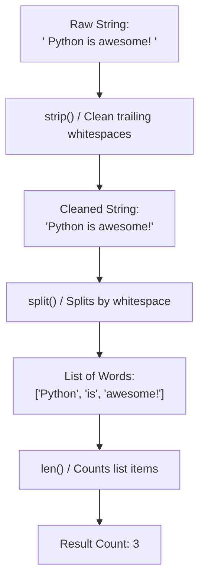

# Day 8: String Manipulation

Python has rich built-in support for manipulating text.

### 🎯 Learning Objectives
- Perform common string manipulations including splitting, joining, stripping, and replacing.
- Apply string slicing to extract specific parts of a string.
- Explain the concept of string immutability in Python and its memory implications.
- Describe the mechanism of string interning (caching) for performance optimization.

### 🧩 Core Concepts (Why)
- **Strings** are sequence collections of characters. We read, validate, clean, and format them constantly.
- Python treats strings as **immutable**. Once created in memory, they cannot be modified in-place. If we want to change a string, we must create a new one. This ensures thread safety, security (e.g., using strings as dictionary keys), and performance optimization.

### 🔁 Logic and Operation
Here is the processing pipeline for counting words in a sentence using `strip()` and `split()`:


### 📝 Annotated Examples
```python
# 1. Splitting and Joining
text = "apple,banana,orange"
fruits = text.split(",")  # Splits by comma: ['apple', 'banana', 'orange']
joined = " - ".join(fruits)  # Joins elements: 'apple - banana - orange'

# 2. Stripping and Replacing
dirty = "   hello world! \n"
clean = dirty.strip()  # Removes leading/trailing spaces and newlines: 'hello world!'
replaced = clean.replace("world", "Python")  # Replaces substring: 'hello Python!'

# 3. String Slicing
# string[start:stop:step]
message = "PythonProgram"
print(message[0:6])   # 'Python' (characters from index 0 to 5)
print(message[6:])    # 'Program' (characters from index 6 to the end)
print(message[::-1])  # 'margorPnohtyP' (reversed string using step -1)

# 4. Immutability Demo
s = "cat"
# s[0] = "b" # Raises TypeError!
s = "b" + s[1:] # Creates a new string: "bat"
```

### ❌ Common Mistakes
**Mistake 1: Attempting to modify a character in a string directly**
```python
name = "Jello"
name[0] = "H"
```
```text
TypeError: 'str' object does not support item assignment
```
```python
name = "Jello"
name = "H" + name[1:]  # Correct: Construct a new string
```
> Strings in Python are immutable. You cannot modify them in-place; instead, you must build a new string with the desired changes.

**Mistake 2: Calling `split()` with incorrect delimiters or assuming it modifies the string in-place**
```python
line = "one two three"
line.split()
print(line)  # Expecting split result, but still prints the original string
```
```text
one two three
```
```python
line = "one two three"
words = line.split()  # Correct: Assign the returned list to a variable
print(words)
```
> String methods like `split()` do not modify the original string in-place (since strings are immutable). They return a new list or string that must be saved to a variable.

**Mistake 3: Wrong syntax order when using `join()`**
```python
words = ["Python", "is", "fun"]
joined = words.join(" ")
```
```text
AttributeError: 'list' object has no attribute 'join'
```
```python
words = ["Python", "is", "fun"]
joined = " ".join(words)  # Correct: Call join on the separator string
```
> The `join()` method belongs to the string class, not the list class. The separator string is the object calling the method, and the list of strings is passed as the argument.

### 💡 Tips & Idioms
- **Check Substring**: Use the `in` operator to check if a string contains a substring: `"Py" in "Python"` (returns `True`).
- **Chain Methods**: Since string methods return strings, you can chain them: `text.strip().lower().replace(" ", "-")`.
- **F-strings**: Use f-strings for readability and performance: `f"Hello {name}, you are {age} years old."`.

### 🧠 Deep Dive (Under the hood)
<details><summary>Immutability in Memory and String Interning</summary>

Python strings are optimized heavily under the hood:
1. **Immutability**: Because strings cannot change, Python can reuse them in memory.
2. **String Interning**: For short, compile-time constant strings (usually those resembling identifiers, like variable names or alphanumeric sequences), Python stores only *one* copy in a global internal dictionary (intern pool).
3. If you create two separate variables with the value `"hello"`, they will point to the exact same memory address. You can verify this with the `is` operator: `a = "hello"; b = "hello"; a is b` returns `True`.
4. This optimization saves memory and speeds up comparisons, as checking if two interned strings are identical is a quick pointer comparison ($O(1)$) instead of comparing character-by-character ($O(n)$).
</details>

### 🏋️ Exercise
Complete the `count_words_in_sentence(sentence)` function to split the text by whitespace and return the total number of words.

```python
def count_words_in_sentence(sentence):
    # Complete the function to count the number of words in a sentence.
    # Words are separated by whitespace. Ignore empty/blank sentences.
    count = 0
    return count
```

### ✅ Self-Check
1. What does `"  hello  ".strip()` return?
2. If `text = "Python"`, what is `text[1:4]`?
<details><summary>Show Answers</summary>

1. It returns `"hello"` with the leading and trailing whitespace removed.
2. It returns `"yth"` (characters at index 1, 2, and 3).
</details>

### 📌 Summary
- Strings are immutable sequences of characters in Python; any modification returns a new string.
- Common methods include `split()`, `join()`, `strip()`, and `replace()`.
- Use slicing (`[start:stop:step]`) to extract parts of a string or reverse it.
- Python uses string interning to optimize memory and speed up comparisons for identical immutable strings.
