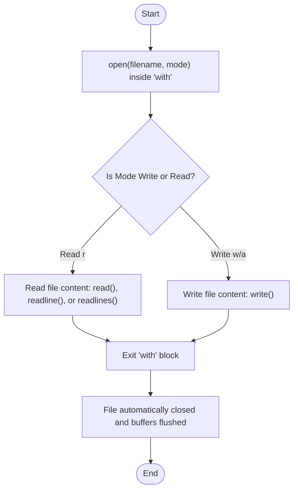

# Day 9: File Input & Output (File I/O)

In programming, variables hold data in memory (RAM), but this data is lost as soon as the program exits. To persist data across executions or interact with external data sources, we read from and write to files on storage disks.

### 🎯 Learning Objectives
- Open, read, write, and append to files using the built-in `open()` function.
- Explain the role and security limitations of Pyodide's virtual memory filesystem.
- Use context managers (`with` statements) to guarantee safe and automated resource cleanup.
- Compare file reading methods (`read()`, `readline()`, and `readlines()`) for performance and memory optimization.

### 🧩 Core Concepts (Why)
Files allow programs to store records, configuration options, or analysis results permanently. 

In Python, file operations follow a simple lifecycle: open, read/write, and close. Traditionally, forgetting to close a file after opening it creates resource leaks, file locks, or lost data. Python solves this using **Context Managers** (via the `with` keyword), which automatically close the file when the execution block exits—even if an error halts the program.

#### ⚠️ Pyodide Virtual Filesystem Note
Since this course runs in your browser using Pyodide (Python compiled to WebAssembly), Python does not have access to your computer's actual hard drive for security reasons. Instead, Pyodide mounts a **virtual filesystem in the browser's temporary memory (RAM)**. When you write a file in this editor, it is saved on this virtual disk. It exists as long as the page is open but is deleted if you refresh or close the browser tab.

### 🔁 Logic and Operation
The diagram below illustrates the file access lifecycle. Opening a file requests a handle from the operating system, operations are performed, and the context manager guarantees the file is closed and buffers are flushed when exiting the block.



### 📝 Annotated Examples

Here is how you write and read files in Python.

```python
# --- Writing Data ---
# Open 'user_logs.txt' in write mode ('w'). This creates the file or overwrites it if it exists.
with open("user_logs.txt", "w") as file:
    file.write("User: Alice, Status: Active\n")  # Writes a string. Note the explicit newline '\n'.
    file.write("User: Bob, Status: Inactive\n")  # Writes a second line.

# --- Reading Data (All at once) ---
# Open 'user_logs.txt' in read mode ('r'). This is the default mode if omitted.
with open("user_logs.txt", "r") as file:
    content = file.read()  # Reads the entire file content as a single string.
    print("--- Entire File ---")
    print(content)

# --- Reading Data Line by Line (Memory-efficient) ---
# Iterating over the file object reads lines dynamically without loading the whole file into RAM.
with open("user_logs.txt", "r") as file:
    print("--- Line by Line ---")
    for line in file:
        # Each line includes the newline character '\n' from the file.
        # We use rstrip() to strip whitespaces and newlines from the right side of the string.
        print(f"Logged: {line.rstrip()}")

# --- Appending Data ---
# Open 'user_logs.txt' in append mode ('a') to add content to the end without erasing previous data.
with open("user_logs.txt", "a") as file:
    file.write("User: Charlie, Status: Active\n")
```

### ❌ Common Mistakes

**Mistake 1: Operating on a closed file**
```python
with open("note.txt", "w") as f:
    f.write("Hello")
f.write(" World")
```
```text
ValueError: I/O operation on closed file.
```
```python
with open("note.txt", "w") as f:
    f.write("Hello")
    f.write(" World")
```
> The `with` statement automatically closes the file object once execution exits its indented block. Any further read or write operations on that file object will raise a `ValueError`.

**Mistake 2: Attempting to write to a read-only file**
```python
with open("data.txt", "r") as f:
    f.write("Hello")
```
```text
UnsupportedOperation: not writable
```
```python
with open("data.txt", "w") as f:
    f.write("Hello")
```
> The default mode when opening a file is `"r"` (read-only). If you need to write data, you must explicitly specify `"w"` (write) or `"a"` (append) mode.

**Mistake 3: Opening a non-existent file for reading**
```python
with open("non_existent.txt", "r") as f:
    content = f.read()
```
```text
FileNotFoundError: [Errno 2] No such file or directory: 'non_existent.txt'
```
```python
import os
if os.path.exists("non_existent.txt"):
    with open("non_existent.txt", "r") as f:
        content = f.read()
else:
    content = ""
```
> Reading a file that does not exist raises a `FileNotFoundError`. Use `os.path.exists()` or exception handling (`try-except`) to handle files that may not be present.

### 💡 Tips & Idioms
- **Use `rstrip('\r\n')`**: Plain `.strip()` removes leading spaces and tabs, which can corrupt formatted data. To only remove newline markers, use `.rstrip('\r\n')`.
- **Iteration is memory-efficient**: Never use `read()` or `readlines()` for massive files (e.g., gigabyte-scale logs). Instead, use `for line in file:` which loads only one line at a time into RAM.
- **Encoding parameters**: When handling text files containing non-ASCII characters (e.g., Japanese or Vietnamese), explicitly specify the encoding parameter: `open("file.txt", "r", encoding="utf-8")`.

### 🧠 Deep Dive (Under the hood)
<details>
<summary>Buffering & Virtual Filesystem Internals</summary>

#### File Buffering
When you execute `file.write()`, the data is not immediately written to the disk sector. Operating Systems buffer file operations in system RAM to minimize slow disk write requests. The data is flushed to physical storage only when the buffer is full, when `flush()` is called explicitly, or when the file is closed. Leaving files open can prevent buffered data from ever being written if the program terminates unexpectedly.

#### Pyodide virtual disk mounting
In standard Python, `open()` interacts with local OS system APIs. Under Pyodide, these API calls are hijacked by Emscripten's virtual filesystem (MEMFS). MEMFS maps standard POSIX file operations onto WebAssembly memory structures. Essentially, writing a file creates a dynamic byte array inside the browser's allocated WebAssembly memory space. While this allows code using `open()` to execute without changes, it is strictly ephemeral and will disappear once the WebAssembly run-time environment is torn down (tab refresh).
</details>

### 🏋️ Exercise
Complete the function `reverse_file_lines(filename, text)` which:
1. Writes the string `text` to the file specified by `filename`.
2. Reads the file back.
3. Removes trailing newlines and returns a list containing all the lines in **reversed order**.

Refer to the initial code block on the right to implement your solution.

### ✅ Self-Check
<details>
<summary>1. What happens if you open an existing file in "w" (write) mode?</summary>
Opening a file in write mode ("w") immediately truncates (deletes) all existing contents of that file. If you want to keep the old contents and write new lines at the end, open the file in append mode ("a").
</details>

<details>
<summary>2. Why does the "with" statement prevent memory and resource leaks?</summary>
The "with" statement implements Python's Context Manager protocol. When exiting the block, Python guarantees that the `__exit__` method of the file object is called. This automatically closes the OS file descriptor and flushes all unwritten buffers, even if the code inside the block raised an exception and crashed.
</details>

### 📌 Summary
- Use `with open(filename, mode) as file:` to guarantee files are closed properly.
- **Modes**: `"r"` for reading (default), `"w"` for writing (overwrites), `"a"` for appending (adds to the end).
- **Virtual Storage**: In Pyodide, files are saved in the browser's temporary memory and are deleted if the page is refreshed.
- **Iteration**: Iterate over file objects line-by-line (`for line in file`) to handle large files memory-efficiently.
