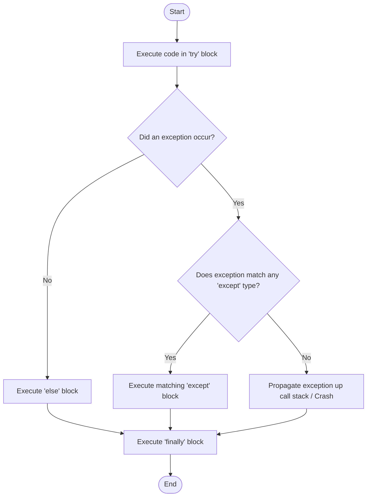

# Day 10: Exception Handling (try-except)

No matter how well-written code is, errors happen. A user might input invalid data, a file might be missing, or division by zero might occur. If left unhandled, these errors (called **exceptions** in Python) crash the program. Exception handling allows code to anticipate errors, fail gracefully, clean up resources, and keep running.

### 🎯 Learning Objectives
- Identify the differences between Syntax Errors and Runtime Exceptions.
- Write try-except blocks to catch and handle specific exceptions (`ValueError`, `ZeroDivisionError`, `TypeError`).
- Utilize `else` and `finally` blocks to orchestrate success paths and cleanup routines.
- Manually raise exceptions using the `raise` keyword.
- Define custom exception classes for domain-specific error handling.

### 🧩 Core Concepts (Why)
An **Exception** is an event triggered during program execution that disrupts the normal flow of instructions. 

Without handling, Python halts execution and outputs a Traceback. However, in production applications (like a web server or mobile app), crashing is unacceptable. We wrap risky code in a `try` block. If an error occurs, control transfers to the matching `except` block, preventing a crash.

Python provides four key blocks for error management:
1. `try`: Houses code that might raise an exception.
2. `except`: Handles the error if an exception matches its specified type.
3. `else`: Runs code only if **no** exceptions occurred in the `try` block.
4. `finally`: Runs code **unconditionally** at the end, whether an error occurred or not (excellent for cleanup).

### 🔁 Logic and Operation
The flowchart below illustrates how Python routes control flow through the try-except-else-finally structures when an exception is raised or skipped.



### 📝 Annotated Examples

Here is how you handle multiple exceptions and run cleanup routines in Python.

```python
def process_data(val):
    # A complete try-except-else-finally structure
    try:
        # Convert input to integer. Might raise ValueError.
        num = int(val)
        # Division operation. Might raise ZeroDivisionError.
        result = 100 / num
    except ValueError as e:
        # Executes only if a ValueError occurs (e.g., passing 'abc')
        print(f"Conversion Error: {e}")
        result = None
    except ZeroDivisionError as e:
        # Executes only if a ZeroDivisionError occurs (passing 0)
        print(f"Calculation Error: {e}")
        result = None
    else:
        # Executes only if the 'try' block runs with zero exceptions
        print(f"Calculation successful. Result: {result}")
    finally:
        # Executes always, regardless of errors. Useful for reset operations.
        print("Data processing attempt finished.")
    return result

# --- Raising Exceptions ---
def set_age(age):
    if age < 0:
        # Manually trigger an exception if user input violates business rules
        raise ValueError("Age cannot be negative!")
    print(f"Age set to: {age}")
```

### ❌ Common Mistakes

**Mistake 1: Using a bare except block**
```python
try:
    # Typo in print function name
    prnt("Hello")
except:
    print("An error occurred")
```
```text
NameError: name 'prnt' is not defined
```
```python
try:
    print("Hello")
except Exception as e:
    print(f"An unexpected error occurred: {e}")
```
> Using a bare `except:` catches all exceptions, including syntax errors, typos, and system exits (like KeyboardInterrupt), making debugging extremely difficult. You should always catch specific exception types or use `except Exception as e` to catch general runtime errors while letting system/syntax errors propagate.

**Mistake 2: Accessing variables initialized after a failed statement**
```python
try:
    value = int("invalid")
    result = value + 10
except ValueError:
    print(f"Failed. Result was: {result}")
```
```text
NameError: name 'result' is not defined
```
```python
result = None
try:
    value = int("invalid")
    result = value + 10
except ValueError:
    print("Failed to convert value.")
```
> If an exception is raised inside the `try` block, execution immediately jumps to the `except` block. Any variables that were scheduled to be defined after the line that failed (like `result`) will not exist, leading to a `NameError` inside the handler.

### 💡 Tips & Idioms
- **EAFP (Easier to Ask for Forgiveness than Permission)**: Python style favors wrapping actions in `try-except` rather than writing endless `if` statements to check safety beforehand (LBYL - Look Before You Leap). It is faster when exceptions are rare and avoids race conditions.
- **Catch specific errors first**: If you are catching multiple exceptions, put more specific subclasses at the top and general classes (like `Exception`) at the bottom.
- **Clean up in `finally`**: Always perform teardowns (closing database handles, releasing locks, resetting network sockets) in `finally` blocks to guarantee they execute even if the code crashes or returns early.

### 🧠 Deep Dive (Under the hood)
<details>
<summary>Exception Propagation & Custom Exceptions</summary>

#### The Call Stack & Propagation
When an exception occurs inside a function, Python's runtime looks for a matching `try-except` handler in that function's scope. If none is found, the function exits, and the exception propagates up to the caller function. This propagation repeats up the **Call Stack** (the chain of active function calls). If the exception reaches the root of the program without being caught, Python halts and outputs the traceback. This allows centralized error handling at the top level rather than polluting every helper function with error checks.

#### Custom Exceptions
In large systems, built-in Python exceptions are not descriptive enough. You can define your own exceptions by subclassing Python's built-in `Exception` class:
```python
class InsufficientFundsError(Exception):
    """Raised when a bank account withdrawal exceeds the balance."""
    def __init__(self, balance, amount):
        super().__init__(f"Cannot withdraw ${amount}. Current balance: ${balance}")
        self.balance = balance
        self.amount = amount
```
Raising this custom class provides clear business-logic warnings to other modules.
</details>

### 🏋️ Exercise
Complete the function `safe_divide(a, b)`:
1. Attempt to return `a / b`.
2. If `b` is `0`, catch `ZeroDivisionError` and return the string `"ZeroDivisionError"`.
3. If `a` or `b` is not a valid number (causing a mismatch of types), catch `TypeError` and return the string `"TypeError"`.

Refer to the initial code block on the right to implement your solution.

### ✅ Self-Check
<details>
<summary>1. Will the "finally" block execute if a function returns early from inside the "try" block?</summary>
Yes. Even if you have a `return` statement inside the `try` or `except` block, Python will execute the `finally` block *before* actually returning the value to the caller.
</details>

<details>
<summary>2. What is the difference between "except Exception as e" and a bare "except:"?</summary>
`except Exception as e` catches all exceptions that inherit from the base `Exception` class (which covers almost all runtime logic errors). A bare `except:` catches absolutely everything, including system-level exceptions like `SystemExit` and `KeyboardInterrupt` (Ctrl+C), which should generally not be intercepted because doing so prevents the user from killing a stuck script.
</details>

### 📌 Summary
- Use `try-except` to catch exceptions and prevent program crashes.
- **Syntax**: `try` runs code, `except` handles errors, `else` runs on success, `finally` always runs.
- **Raise**: Use `raise ValueError("msg")` to manually trigger exceptions.
- **Propagation**: Unhandled exceptions bubble up the call stack until handled or the program crashes.
