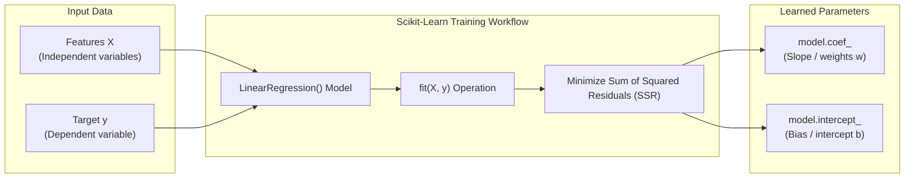

# Day 11: Linear Regression with NumPy and Scikit-Learn

### 🎯 Learning Objectives
- Explain the fundamental concept of Linear Regression and how it models relationships between variables.
- Identify the components of a linear regression model: features ($X$), targets ($y$), coefficient/slope (`coef_`), and intercept (`intercept_`).
- Implement and train a Simple Linear Regression model using Scikit-Learn.
- Interpret the trained model parameters to make predictions on new data.

### 🧩 Core Concepts (Why)
In many real-world scenarios, we want to predict a continuous numerical value (such as house prices, temperature, or sales figures) based on one or more characteristics. This is a **regression** problem.
**Linear Regression** is the simplest and most foundational algorithm for regression. It assumes that the target variable $y$ can be modeled as a linear combination of the input features $X$.
Why do we use it?
1. **Interpretability**: Unlike complex "black-box" models, linear regression clearly tells us how much the target changes when a feature changes.
2. **Computational Efficiency**: It is mathematically straightforward and fast to train.
3. **Baseline**: It serves as a starting point to benchmark more complex algorithms.

### 🔁 Logic and Operation
The algorithm finds the "best-fit line" by minimizing the vertical distance between the actual data points and the predicted line. This process is called **Ordinary Least Squares (OLS)**.



The mathematical equation for a simple linear regression is:
$$y = w \cdot x + b$$
- $y$ is the predicted target.
- $x$ is the input feature.
- $w$ (slope/coefficient) determines the steepness of the line. In Scikit-Learn, this is stored in `model.coef_`.
- $b$ (y-intercept) is the value of $y$ when $x = 0$. In Scikit-Learn, this is stored in `model.intercept_`.

### 📝 Annotated Examples
Here is how to create a dataset, train a model, and inspect its parameters:
```python
import numpy as np
from sklearn.linear_model import LinearRegression

# 1. Prepare training data (X must be 2D, y must be 1D)
# X: Square footage of houses (in thousands of sqft)
X = np.array([[1.2], [1.6], [2.1], [2.4], [2.9]])
# y: House prices (in hundreds of thousands of USD)
y = np.array([2.5, 3.2, 4.1, 4.9, 5.8])

# 2. Instantiate the model
model = LinearRegression()

# 3. Fit the model to the data (Training phase)
model.fit(X, y)

# 4. Access the trained parameters
print("Slope (coef_):", model.coef_)       # Output: array([1.947]) -> For every 1000 sqft increase, price increases by ~$195k
print("Intercept (intercept_):", model.intercept_) # Output: ~0.142 -> Base price when sqft is 0

# 5. Predict on new data (input must be 2D)
new_houses = np.array([[1.8], [2.5]])
predictions = model.predict(new_houses)
print("Predictions:", predictions) # Output: array([3.647, 5.010])
```

### ❌ Common Mistakes

**Mistake 1: Passing a 1D array for features X**
```python
import numpy as np
from sklearn.linear_model import LinearRegression
X = np.array([1.0, 1.5, 2.0, 2.5, 3.0]) # 1D array
y = np.array([2.0, 3.1, 3.8, 5.0, 6.2])
model = LinearRegression()
model.fit(X, y)
```
```text
ValueError: Expected 2D array, got 1D array instead:
array=[1.  1.5 2.  2.5 3. ].
Reshape your data either using array.reshape(-1, 1) if your data has a single feature or array.reshape(1, -1) if it contains a single sample.
```
```python
import numpy as np
from sklearn.linear_model import LinearRegression
X = np.array([[1.0], [1.5], [2.0], [2.5], [3.0]]) # 2D array
y = np.array([2.0, 3.1, 3.8, 5.0, 6.2])
model = LinearRegression()
model.fit(X, y)
```
> Scikit-Learn's estimators expect the feature matrix `X` to be a 2D array of shape `(n_samples, n_features)`. Even if there is only one feature, it must be structured as a 2D column vector.

**Mistake 2: Making predictions before training the model**
```python
import numpy as np
from sklearn.linear_model import LinearRegression
model = LinearRegression()
model.predict(np.array([[2.0]]))
```
```text
sklearn.exceptions.NotFittedError: This LinearRegression instance is not fitted yet. Call 'fit' with appropriate arguments before using this estimator.
```
```python
import numpy as np
from sklearn.linear_model import LinearRegression
X = np.array([[1.0], [2.0], [3.0]])
y = np.array([2.0, 4.0, 6.0])
model = LinearRegression()
model.fit(X, y) # Train first!
model.predict(np.array([[2.0]]))
```
> You must always call `fit(X, y)` before using `predict()` so that the model can learn the optimal weights from data.

**Mistake 3: Mismatched sample sizes between X and y**
```python
import numpy as np
from sklearn.linear_model import LinearRegression
X = np.array([[1.0], [2.0], [3.0]])
y = np.array([2.0, 4.0]) # Only 2 samples
model = LinearRegression()
model.fit(X, y)
```
```text
ValueError: Found input variables with inconsistent numbers of samples: [3, 2]
```
```python
import numpy as np
from sklearn.linear_model import LinearRegression
X = np.array([[1.0], [2.0], [3.0]])
y = np.array([2.0, 4.0, 6.0]) # Same number of samples
model = LinearRegression()
model.fit(X, y)
```
> The number of rows in `X` (samples) must exactly equal the number of elements in `y`.

### 💡 Tips & Idioms
- **Column Reshaping**: If you have a 1D NumPy array `arr` and need to convert it to a 2D column vector for Scikit-Learn, use `arr.reshape(-1, 1)`. The `-1` tells NumPy to automatically calculate the number of rows based on the array length.
- **R-squared Score**: You can quickly evaluate your model's performance on the training data using `model.score(X, y)`. For linear regression, this returns the Coefficient of Determination ($R^2$), representing the proportion of variance explained by the features (ranging from 0 to 1).
- **Multiple Features**: The same `LinearRegression` class seamlessly handles multiple features. If $X$ is of shape `(n_samples, 3)`, `model.coef_` will contain 3 slope values, one for each feature.

### 🧠 Deep Dive (Under the hood)
<details><summary>Ordinary Least Squares (OLS) Cost Function and Equations (Click to expand)</summary>

Linear regression optimizes the parameters $w$ and $b$ by minimizing the **Residual Sum of Squares (RSS)**, or the mean of squared differences between predictions and actual values. This is called the **Mean Squared Error (MSE)** cost function:

$$J(w, b) = \frac{1}{2m} \sum_{i=1}^{m} \left( (w x^{(i)} + b) - y^{(i)} \right)^2$$

Where $m$ is the number of samples, $x^{(i)}$ is the feature of the $i$-th sample, and $y^{(i)}$ is the actual target value of the $i$-th sample.

#### Closed-form Solution (The Normal Equation)
For general linear regression where $\theta$ represents all coefficients (including the intercept), we can solve for the optimal parameters analytically in a single step using the **Normal Equation**:

$$\theta = (X^T X)^{-1} X^T y$$

While mathematically elegant, computing $(X^T X)^{-1}$ can be slow if the number of features is very large (e.g., > 10,000) because matrix inversion has a computational complexity of roughly $\mathcal{O}(n^3)$. In such cases, optimization algorithms like Gradient Descent are preferred.
</details>

### 🏋️ Exercise
Complete the function `train_model(X, y)` to instantiate a Scikit-Learn `LinearRegression` model, fit it using the provided features `X` and targets `y`, and return the trained model.

```python
import numpy as np
from sklearn.linear_model import LinearRegression

# Features: Square footage (in thousands sqft)
X = np.array([[1.0], [1.5], [2.0], [2.5], [3.0]])
# Target: House Price (in hundreds of thousands dollars)
y = np.array([2.0, 3.1, 3.8, 5.0, 6.2])

def train_model(X, y):
    # Create a LinearRegression instance, fit it on X and y, and return the model
    model = None
    return model
```

### ✅ Self-Check
1. If your model has a single feature, what is the shape of `model.coef_` and what is the type of `model.intercept_`?
2. If `model.coef_` is `[2.5]` and `model.intercept_` is `1.0`, what is the predicted target for an input feature value of `4.0`?
<details><summary>Answers</summary>

1. `model.coef_` is a 1D NumPy array of shape `(1,)` containing the coefficient. `model.intercept_` is a float.
2. The prediction formula is $y = w \cdot x + b$. Here, $y = 2.5 \cdot (4.0) + 1.0 = 10.0 + 1.0 = 11.0$.
</details>

### 📌 Summary
- **Linear Regression** fits a straight line $y = w x + b$ to predict continuous numerical values.
- Scikit-Learn requires the features `X` to be a 2D array and target `y` to be a 1D array.
- Model coefficients are stored in `model.coef_` and the intercept in `model.intercept_`.
- Use `model.fit(X, y)` to train and `model.predict(X_new)` to make predictions.
