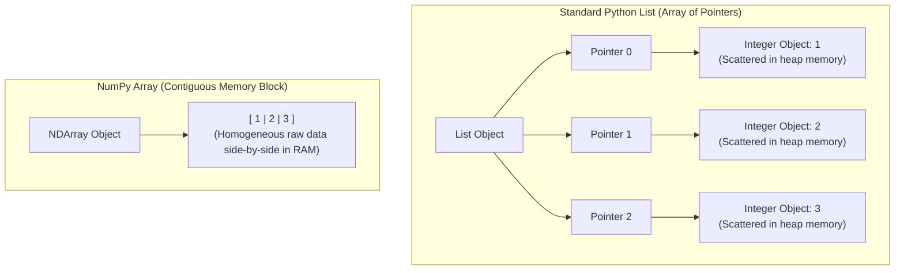

# Day 12: NumPy Arrays & Vector Operations

### 🎯 Learning Objectives
- Explain what NumPy is and why it outperforms standard Python lists for numerical computations.
- Describe the key attributes of a NumPy array, including `shape`, `ndim`, and `dtype`.
- Create NumPy arrays using helper functions like `np.zeros()`, `np.ones()`, and `np.eye()`.
- Perform vectorized arithmetic operations, broadcasting, and matrix multiplication.

### 🧩 Core Concepts (Why)
In data science and machine learning, we constantly work with large collections of numbers (matrices, vectors, and tensors). 
While standard Python has lists, they are not designed for high-performance mathematical calculations.
Python lists are arrays of pointers to scattered objects in memory, which introduces overhead due to type checking and memory lookups.
**NumPy** (Numerical Python) provides the **ndarray** (N-dimensional array), which is:
1. **Fast**: Implemented in C, utilizing contiguous memory layouts and CPU-level optimizations (vectorization and SIMD).
2. **Memory Efficient**: Stores data homogeneously (same type), avoiding object overhead.
3. **Convenient**: Supports mathematical operations on whole arrays without writing explicit loops.

### 🔁 Logic and Operation
The main reason NumPy is so fast is its **contiguous memory layout** compared to Python's pointer-based lists.



By storing values next to each other in memory, the CPU can load them into cache much faster. Furthermore, NumPy operations are **vectorized**—they run compiling-level loops in C rather than Python, allowing the hardware to perform Single Instruction Multiple Data (SIMD) parallel operations.

### 📝 Annotated Examples

Here is how to create, inspect, and perform calculations with NumPy arrays:

```python
import numpy as np

# 1. Creation and Attributes
arr = np.array([[1, 2, 3], [4, 5, 6]], dtype=np.float32)
print("Array:\n", arr)
print("Shape:", arr.shape)    # Output: (2, 3) -> 2 rows, 3 columns
print("Dimensions:", arr.ndim) # Output: 2 -> 2D array
print("Data Type:", arr.dtype) # Output: float32

# 2. Built-in Creation Helpers
zeros_arr = np.zeros((2, 2))  # Creates a 2x2 matrix of zeros
ones_arr = np.ones((3, 1))    # Creates a 3x1 column vector of ones
identity_matrix = np.eye(3)   # Creates a 3x3 identity matrix

# 3. Vectorized Operations (No loops needed!)
a = np.array([1, 2, 3])
b = np.array([10, 20, 30])
print("Addition:", a + b)       # Output: [11, 22, 33]
print("Multiplication:", a * 3) # Output: [3, 6, 9]

# 4. Broadcasting (Arithmetic on arrays of different shapes)
matrix = np.array([[1, 2, 3], [4, 5, 6]]) # Shape (2, 3)
row_vector = np.array([10, 20, 30])      # Shape (3,)
# row_vector is automatically stretched to (2, 3) to match matrix
print("Broadcast Sum:\n", matrix + row_vector) 
# Output:
# [[11, 22, 33]
#  [14, 25, 36]]

# 5. Matrix Multiplication
A = np.array([[1, 2], [3, 4]])
B = np.array([[5, 6], [7, 8]])
# Use the @ operator or np.dot() for matrix multiplication
print("Matrix Product:\n", A @ B)
# Output:
# [[19, 22]
#  [43, 50]]
```

### ❌ Common Mistakes

**Mistake 1: Using element-wise multiplication (*) when expecting matrix multiplication**
```python
import numpy as np
A = np.array([[1, 2], [3, 4]])
B = np.array([[5, 6], [7, 8]])
# Attempting matrix multiplication
result = A * B
```
```text
# No error is raised, but the result is incorrect element-wise multiplication:
# [[ 5, 12]
#  [21, 32]]
```
```python
import numpy as np
A = np.array([[1, 2], [3, 4]])
B = np.array([[5, 6], [7, 8]])
# Correct matrix multiplication
result = A @ B
```
> In NumPy, the asterisk operator `*` performs element-wise multiplication. To perform true matrix multiplication (dot product), you must use the `@` operator or `np.dot(A, B)`.

**Mistake 2: Calling list methods like .append() on a NumPy array**
```python
import numpy as np
arr = np.array([1, 2, 3])
arr.append(4)
```
```text
AttributeError: 'numpy.ndarray' object has no attribute 'append'
```
```python
import numpy as np
arr = np.array([1, 2, 3])
arr = np.append(arr, 4) # Creates a new array
```
> NumPy arrays have a fixed size in memory. You cannot append elements in-place. Functions like `np.append()` return a newly allocated array, which is an expensive operation.

**Mistake 3: Incompatible dimensions for broadcasting**
```python
import numpy as np
matrix = np.array([[1, 2], [3, 4]]) # Shape (2, 2)
vec = np.array([10, 20, 30])        # Shape (3,)
result = matrix + vec
```
```text
ValueError: operands could not be broadcast together with shapes (2,2) (3,) 
```
```python
import numpy as np
matrix = np.array([[1, 2], [3, 4]]) # Shape (2, 2)
vec = np.array([10, 20])            # Shape (2,)
result = matrix + vec
```
> For broadcasting to occur, the trailing dimensions of the arrays must either be equal or one of them must be 1.

### 💡 Tips & Idioms
- **Avoid Loops**: Whenever you find yourself writing a `for` loop over elements of a NumPy array, stop and search for a vectorized alternative. Loops in Python are slow, while vectorized operations are compiled and optimized.
- **Axes in NumPy**: Many reduction functions (like `np.sum()`, `np.mean()`) accept an `axis` argument. `axis=0` performs the operation down the columns (collapsing rows), while `axis=1` performs the operation across the rows (collapsing columns).
- **Views vs Copies**: Slicing an array (e.g., `sub_arr = arr[0:2]`) creates a **view**, not a copy. Modifying `sub_arr` will modify the original `arr`. If you want a completely independent copy, use `arr[0:2].copy()`.

### 🧠 Deep Dive (Under the hood)
<details><summary>Memory Layout Strides: Row-major (C) vs Column-major (Fortran) (Click to expand)</summary>

Under the hood, a multi-dimensional ndarray is stored as a flat, 1D contiguous block of memory. To treat this 1D block as 2D or 3D, NumPy uses **strides**.
Strides are a tuple of integers representing the number of bytes to step in each dimension to reach the next element.

For a 2D array of 32-bit floats (4 bytes each) with shape `(3, 3)`:
- **C-Contiguous (Row-major)**: Elements of a row are stored adjacent to each other.
  - Memory order: `[0,0], [0,1], [0,2], [1,0], [1,1], [1,2], [2,0], [2,1], [2,2]`
  - Strides: `(12, 4)` -> To move down one row (same column), skip 12 bytes (3 elements). To move right one column (same row), skip 4 bytes (1 element).
- **F-Contiguous (Column-major)**: Elements of a column are stored adjacent to each other.
  - Memory order: `[0,0], [1,0], [2,0], [0,1], [1,1], [2,1], [0,2], [1,2], [2,2]`
  - Strides: `(4, 12)` -> To move down one row, skip 4 bytes. To move right one column, skip 12 bytes.

Understanding strides explains why transpose operations (`arr.T`) in NumPy are instantaneous: NumPy doesn't move any data in memory; it simply swaps the strides tuple!
</details>

### 🏋️ Exercise
Complete the function `matrix_operations(n)` to perform the following operations:
1. Create an $n \times n$ identity matrix using `np.eye(n)`.
2. Scale it by multiplying the matrix by 5.
3. Calculate and return the row sums of the scaled matrix using `np.sum(..., axis=1)`.

```python
import numpy as np

def matrix_operations(n):
    # 1. Create an n x n identity matrix using np.eye(n)
    # 2. Scale it by multiplying the matrix by 5
    # 3. Calculate and return the row sums of the scaled matrix using np.sum(..., axis=1)
    row_sums = None
    return row_sums
```

### ✅ Self-Check
1. If you have an array with shape `(3, 4, 5)`, what will `arr.ndim` return?
2. If `arr = np.array([1, 2])` and you perform `arr + 10`, what will be the output? Why?
<details><summary>Answers</summary>

1. It will return `3` because the shape has three dimensions.
2. It will return `[11, 12]` because of broadcasting. The scalar `10` is broadcast (stretched) to match the shape of the array `[10, 10]`, and then element-wise addition is performed.
</details>

### 📌 Summary
- **NumPy** is faster than Python lists due to contiguous memory allocation and vectorized execution in C.
- The `shape` attribute describes dimensions, and `dtype` specifies the homogeneous data type.
- Vectorized operations and **broadcasting** allow for math operations across arrays of different sizes without loops.
- Use `@` for matrix multiplication and specify `axis` in reduction operations to control the direction of calculations.
