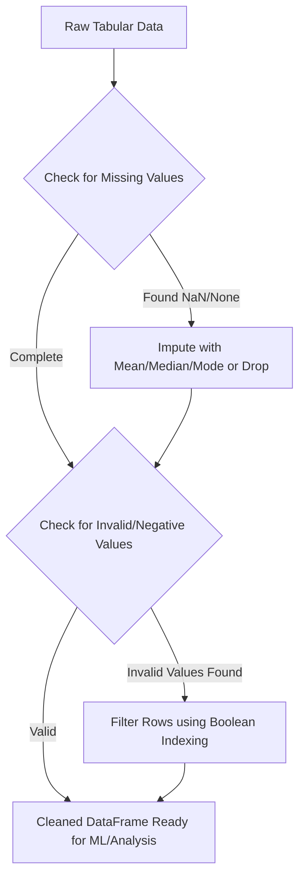

# Day 13: Pandas DataFrame & Data Cleaning

### 🎯 Learning Objectives
- Differentiate between a Pandas Series and a DataFrame.
- Use `.loc` and `.iloc` indexing to select rows and columns.
- Filter tabular data using boolean indexing.
- Detect and impute missing values using `.fillna()`.
- Avoid and resolve `SettingWithCopyWarning` issues.

### 🧩 Core Concepts (Why)
In real-world data science and machine learning, raw datasets are rarely clean. They contain missing values, invalid records, and inconsistent formatting. While NumPy arrays are excellent for mathematical computations on homogeneous data, they are not designed to easily handle labeled, multi-type tabular data.

Pandas introduces two primary data structures to solve this:
1. **Series**: A one-dimensional labeled array capable of holding any data type (integers, strings, floating-point numbers, Python objects). It represents a single column of a table.
2. **DataFrame**: A two-dimensional, size-mutable, and potentially heterogeneous tabular data structure with labeled axes (rows and columns). It represents an entire table.

Data cleaning is the process of detecting and correcting corrupt or inaccurate records from a record set, table, or database. By learning to clean data, you ensure that the machine learning models you train receive high-quality input, which directly leads to better prediction accuracy.

### 🔁 Logic and Operation
The data cleaning process involves loading the data, identifying gaps or bad records, repairing them, and filtering out outliers or invalid rows.



- **Imputation**: Filling in missing values (`NaN`) with statistically reasonable substitutes (such as the mean of that column) prevents down-stream algorithms from crashing.
- **Boolean Masking**: Creating a Series of `True` / `False` values corresponding to whether each row meets a condition, and using it to select only the matching rows.

### 📝 Annotated Examples
Let's create a DataFrame, locate specific values, impute missing entries, and filter out invalid rows.

```python
import pandas as pd
import numpy as np

# 1. Create a Series and a DataFrame
names = pd.Series(["Alice", "Bob", "Charlie"], name="Name")
data = {
    "name": ["Alice", "Bob", "Charlie", "David"],
    "age": [25.0, np.nan, 30.0, 40.0],
    "salary": [50000.0, 60000.0, -1000.0, np.nan]
}
df = pd.DataFrame(data)
print(df)
# Output:
#       name   age   salary
# 0    Alice  25.0  50000.0
# 1      Bob   NaN  60000.0
# 2  Charlie  30.0  -1000.0
# 3    David  40.0      NaN

# 2. Select data using .loc (label-based) and .iloc (integer-position-based)
# Select the value at row label 1, column 'name'
print(df.loc[1, "name"])  # Output: 'Bob'

# Select the value at row index 1, column index 0
print(df.iloc[1, 0])      # Output: 'Bob'

# 3. Inspect missing values
print(df.isna())          # Returns a DataFrame of boolean values indicating missingness

# 4. Fill missing values with the column mean
age_mean = df["age"].mean()       # (25 + 30 + 40) / 3 = 31.666...
df["age"] = df["age"].fillna(age_mean)

salary_mean = df["salary"].mean() # (50000 + 60000 - 1000) / 3 = 36333.333...
df["salary"] = df["salary"].fillna(salary_mean)

# 5. Filter out rows where salary is negative
cleaned_df = df[df["salary"] >= 0]
print(cleaned_df)
# Output:
#     name        age        salary
# 0  Alice  25.000000  50000.000000
# 1    Bob  31.666667  60000.000000
# 3  David  40.000000  36333.333333
```

### ❌ Common Mistakes

**Mistake 1: Chained indexing causing SettingWithCopyWarning**
```python
df = pd.DataFrame({'age': [20, 30, 40]})
df[df['age'] > 25]['age'] = 25
```
```text
SettingWithCopyWarning: 
A value is trying to be set on a copy of a slice from a DataFrame.
Try using .loc[row_indexer,col_indexer] = value instead
```
```python
df = pd.DataFrame({'age': [20, 30, 40]})
df.loc[df['age'] > 25, 'age'] = 25
```
> Chained indexing returns a temporary copy of a DataFrame, meaning assignments do not modify the original data. Use `.loc` to write directly to the original DataFrame.

**Mistake 2: Checking for missing values using equality operator `== np.nan`**
```python
df = pd.DataFrame({'age': [20, np.nan, 40]})
missing = df[df['age'] == np.nan]
print(missing)
```
```text
Empty DataFrame
Columns: [age]
Index: []
```
```python
df = pd.DataFrame({'age': [20, np.nan, 40]})
missing = df[df['age'].isna()]
print(missing)
```
> Floating-point NaN values do not equal themselves (`np.nan == np.nan` is False). Use `.isna()` or `.isnull()` to check for missing values.

**Mistake 3: Attempting to access row position using label selection on index**
```python
df = pd.DataFrame({'age': [20, 30]}, index=['a', 'b'])
row = df.loc[0]
```
```text
KeyError: 0
```
```python
df = pd.DataFrame({'age': [20, 30]}, index=['a', 'b'])
row = df.iloc[0]
```
> `.loc` selects rows by custom label name, which in this case is `'a'` or `'b'`. To access by numerical position, use `.iloc`.

### 💡 Tips & Idioms
- **Use `.copy()`**: When selecting a subset of a DataFrame that you intend to modify, append `.copy()` to decouple it from the original DataFrame and avoid modifications propagating back.
- **Handling Outliers**: You can clip outliers between percentiles using `df['column'].clip(lower=min_val, upper=max_val)`.
- **String operations**: When working with text, access vectorized string methods via the `.str` accessor, such as `df['name'].str.strip()`.

### 🧠 Deep Dive (Under the hood)
<details><summary>BlockManager and View vs. Copy Semantics (Click to expand)</summary>

Pandas internally manages tabular data using an object called the `BlockManager`. Instead of storing data row-by-row, it group columns of the same data type (e.g., float64, int64, object) into contiguous 2D NumPy arrays called Blocks.

```
DataFrame
 ├── Column Labels: ['name', 'age', 'salary']
 └── BlockManager
      ├── FloatBlock: Columns ['age', 'salary'] (2D float64 NumPy array)
      └── ObjectBlock: Column ['name'] (1D object NumPy array)
```

#### Why `SettingWithCopyWarning` Happens
When you index a DataFrame in Python, Pandas decides whether to return a *view* (a reference pointing to the existing Block in memory) or a *copy* (a newly allocated block of memory). 

If a slice is a *view*, modifying it changes the parent DataFrame. If it is a *copy*, modifying it does not change the parent DataFrame. In chained indexing like `df[df['age'] > 25]['age'] = 25`:
1. `df[df['age'] > 25]` runs first, and Pandas creates a temporary DataFrame. Because of indexing complexities, this could be a copy or a view.
2. `['age'] = 25` runs next on this temporary DataFrame.
3. Pandas warns you because if the temporary DataFrame is a copy, your assignment is discarded and has no effect on the original `df`.

Using `.loc[row_indexer, col_indexer]` ensures that the selection and assignment are sent to the `BlockManager` as a single instruction, allowing Pandas to modify the underlying Block directly in-place.
</details>

### 🏋️ Exercise
Complete the function `clean_and_filter(df)` to:
1. Impute missing values in the `'age'` column with the column mean.
2. Impute missing values in the `'salary'` column with the column mean.
3. Filter out any rows where `'salary'` is less than `0`.
4. Return the cleaned DataFrame.

```python
import pandas as pd

def clean_and_filter(df):
    # 1. Fill missing values in 'age' and 'salary' columns with the respective column mean
    # 2. Filter out rows where 'salary' is less than 0
    # 3. Return the cleaned DataFrame
    cleaned_df = None
    return cleaned_df
```

### ✅ Self-Check
1. What is the difference between `.loc` and `.iloc`?
2. If `df` has a column `'price'` with missing values, what is the safest way to replace them with `0` in-place without generating a warning?
<details><summary>Answers</summary>

1. `.loc` indexes data using row and column *labels* (names), whereas `.iloc` indexes data using row and column *integer positions* (indices starting from 0).
2. Use `.loc` to access and assign directly, or use `.fillna()` with assignment:
   ```python
   df['price'] = df['price'].fillna(0)
   ```
</details>

### 📌 Summary
- **Series** represents a single column, and **DataFrame** represents a 2D table.
- Use `.loc` for label-based selection and `.iloc` for position-based selection.
- Always use `.isna()` to check for `NaN` and `.fillna()` to impute missing values.
- Never write chained index assignments like `df[cond]['col'] = val`. Use `df.loc[cond, 'col'] = val` instead.
