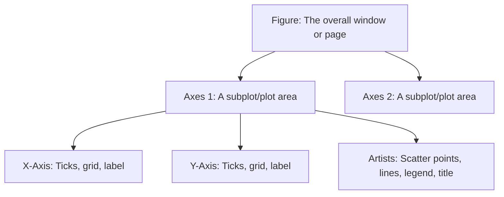

# Day 14: Data Visualization with Matplotlib

### 🎯 Learning Objectives
- Contrast the state-based (`pyplot`) and object-oriented plotting approaches in Matplotlib.
- Create scatter, line, and bar plots.
- Customize plots with custom labels, titles, grids, and legends.
- Export and save plots to disk using `savefig()`.

### 🧩 Core Concepts (Why)
Data visualization is the graphical representation of information and data. By using visual elements like charts, graphs, and maps, data visualization tools provide an accessible way to see and understand trends, outliers, and patterns in data.

In machine learning and data science, visualization is essential for:
1. **Exploratory Data Analysis (EDA)**: Before feeding data into a model, you need to understand the relationships between features (e.g., checking if two features are linearly correlated).
2. **Model Diagnosis**: Plotting training vs. validation loss over epochs helps detect overfitting or underfitting.
3. **Communicating Insights**: Stakeholders understand charts much faster than raw matrices of numbers.

Matplotlib is the foundational plotting library in Python. Most other Python plotting libraries (like Seaborn or Pandas' internal `.plot()` wrapper) are built on top of Matplotlib. Learning Matplotlib gives you full low-level control over every element in your charts.

### 🔁 Logic and Operation
Matplotlib separates figures (the overall window/canvas) from axes (the subplots containing the coordinate system).



Matplotlib provides two primary interfaces to build these plots:
1. **Pyplot State-based Interface (`plt.plot`)**: Keeps track of the "active" figure/axes and automatically directs plotting commands to them. It is simple and quick for interactive work.
2. **Object-Oriented (OO) Interface (`fig, ax = plt.subplots()`)**: You explicitly create Figure and Axes objects and call methods on them. This is the recommended style for complex or nested subplots because it avoids state conflicts.

### 📝 Annotated Examples
Let's compare the state-based approach and the object-oriented approach while generating different types of plots.

```python
import matplotlib.pyplot as plt

# --- 1. Pyplot State-Based Interface (Line Plot) ---
plt.clf()  # Clear any active figure to start fresh

# Data coordinates
x_line = [1, 2, 3, 4, 5]
y_line = [2, 4, 6, 8, 10]

plt.plot(x_line, y_line, color="blue", marker="o", label="Linear growth")
plt.xlabel("Input values")
plt.ylabel("Output values")
plt.title("Line Chart (State-Based)")
plt.grid(True)
plt.legend()
plt.savefig("pyplot_line.png")  # Save plot as PNG

# --- 2. Object-Oriented Interface (Scatter Plot) ---
# Subplots returns a Figure object and an Axes object (or array of Axes)
fig, ax = plt.subplots()

x_scatter = [5, 7, 8, 7, 2, 17, 2, 9, 4, 11]
y_scatter = [99, 86, 87, 88, 111, 86, 103, 87, 94, 78]

# Create a scatter plot on the Axes 'ax'
ax.scatter(x_scatter, y_scatter, color="orange", label="Data Points")

# In OO-style, methods are usually prefixed with 'set_'
ax.set_xlabel("Age of Car (years)")
ax.set_ylabel("Max Speed (mph)")
ax.set_title("Car Age vs Speed (OO Style)")
ax.grid(True)
ax.legend()

# Save through the Figure object
fig.savefig("oo_scatter.png")

# --- 3. Creating a Bar Plot ---
plt.clf()
categories = ["A", "B", "C", "D"]
values = [15, 24, 9, 32]

plt.bar(categories, values, color="green")
plt.title("Bar Chart Example")
plt.savefig("bar_chart.png")
```

### ❌ Common Mistakes

**Mistake 1: Overlapping plots due to not clearing the figure**
```python
import matplotlib.pyplot as plt
plt.plot([1, 2], [10, 20])
plt.savefig("plot1.png")
plt.plot([1, 2], [30, 40]) # Overlaps on top of plot1!
plt.savefig("plot2.png")
```
```text
(No error traceback, but plot2.png contains both datasets instead of just the second one)
```
```python
import matplotlib.pyplot as plt
plt.plot([1, 2], [10, 20])
plt.savefig("plot1.png")
plt.clf() # Clear current figure
plt.plot([1, 2], [30, 40])
plt.savefig("plot2.png")
```
> Matplotlib maintains a global state in `pyplot`. If you do not call `plt.clf()` or `plt.close()`, subsequent calls to `plot()` will keep drawing on the same active axes.

**Mistake 2: Mixing Object-Oriented methods on the state-based Pyplot interface**
```python
import matplotlib.pyplot as plt
plt.set_xlabel("X-Axis")
```
```text
AttributeError: module 'matplotlib.pyplot' has no attribute 'set_xlabel'
```
```python
import matplotlib.pyplot as plt
plt.xlabel("X-Axis") # or ax.set_xlabel() if using OO interface
```
> Properties on `pyplot` are set directly using functions (e.g., `plt.xlabel()`), whereas on `Axes` objects they are set using methods prefixed with `set_` (e.g., `ax.set_xlabel()`).

### 💡 Tips & Idioms
- **Prevent Cutoff Labels**: Sometimes long titles or axis labels get cut off at the edge of the saved image. Always run `plt.tight_layout()` or use `bbox_inches='tight'` in `savefig` to auto-adjust sizes:
  ```python
  plt.savefig("plot.png", bbox_inches="tight")
  ```
- **DPI for Print Quality**: By default, saved plots can look blurry. Use the `dpi` (dots per inch) argument to increase resolution:
  ```python
  plt.savefig("high_res.png", dpi=300)
  ```
- **Hiding Grid Lines Behind Bars**: When making bar charts, grids can draw on top of bars. Use `ax.set_axisbelow(True)` to draw gridlines underneath graphic elements.

### 🧠 Deep Dive (Under the hood)
<details><summary>Matplotlib's Architecture and Pyodide/Headless Backend Rendering (Click to expand)</summary>

Matplotlib consists of a three-layer architecture:
1. **Scripting Layer**: The `matplotlib.pyplot` module, which exposes a simple interface for users to build plots.
2. **Artist Layer**: The class hierarchy that represents all graphic elements in a figure (e.g., `Figure`, `Axes`, `Axis`, `Line2D`, `Rectangle`). The Artist layer knows how to layout and arrange these components relative to one another.
3. **Backend Layer**: The engine that renders drawing commands onto a specific device or file format.

#### Interactive vs. Non-Interactive Backends
On a standard desktop computer, Matplotlib detects your OS window manager and loads an interactive GUI backend (like `TkAgg`, `QtAgg`, or `MacOSX`) to create a popup window showing your chart.

However, in non-GUI (headless) environments — such as a cloud server running a Cron job or a WebAssembly browser sandbox (like Pyodide):
- There is no display server or windowing system to open a window.
- Matplotlib switches to a non-interactive backend, typically **Agg** (Anti-Grain Geometry engine).
- The Agg backend renders drawing primitives (lines, circles, text) directly into a pixel buffer in RAM.
- When `plt.savefig(filename)` is called, the backend converts this buffer into a compressed file format (like PNG) and writes the byte stream directly to disk (or Pyodide's virtual memory filesystem MEMFS).

This allows you to generate charts seamlessly in automated pipelines or in-browser Python runtimes without needing any display output hardware.
</details>

### 🏋️ Exercise
Complete the function `save_scatter_plot(x, y, filename)` to:
1. Clear any current active figure using `plt.clf()`.
2. Generate a scatter plot of `x` vs `y` using `plt.scatter(x, y)`.
3. Add the following titles and labels:
   - X-Axis label: `'X-Axis'`
   - Y-Axis label: `'Y-Axis'`
   - Plot Title: `'Scatter Plot'`
4. Save the figure to disk using `plt.savefig(filename)`.
5. Return `True` if successful.

```python
import matplotlib.pyplot as plt

def save_scatter_plot(x, y, filename):
    # Write your code here
    return False
```

### ✅ Self-Check
1. Which function is used to create subplots in Matplotlib and returns both the figure and axes objects?
2. How do you clear a figure in Matplotlib to prevent different plots from overlapping?
<details><summary>Answers</summary>

1. `plt.subplots()` (e.g., `fig, ax = plt.subplots()`).
2. Use `plt.clf()` to clear the current figure, or `plt.close()` to close the figure completely.
</details>

### 📌 Summary
- Matplotlib uses a **Figure** as the canvas and one or more **Axes** as individual plots.
- The **Pyplot** interface is state-based, whereas the **Subplots** API is object-oriented.
- Use `plt.scatter()` for scatter plots, `plt.plot()` for line charts, and `plt.bar()` for bar charts.
- Always clear figures with `plt.clf()` between consecutive plotting sequences in the state-based API.
