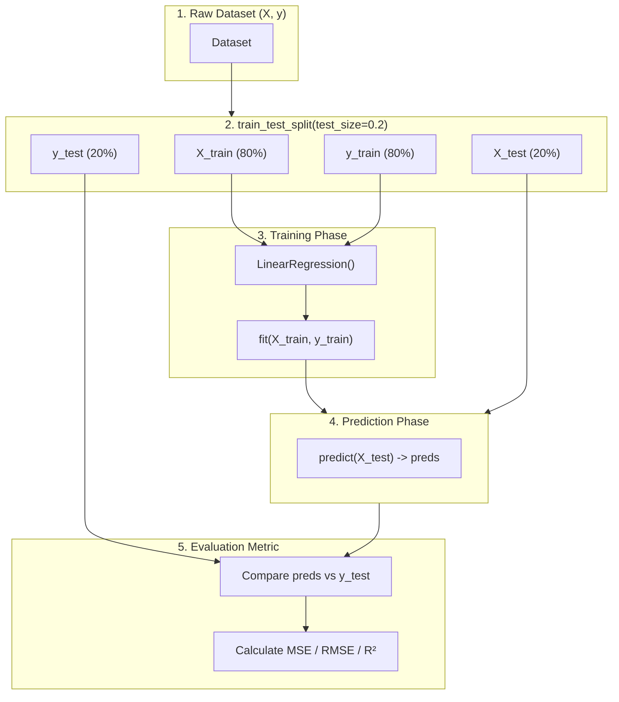

# Day 15: Train/Test Split & Model Evaluation

### 🎯 Learning Objectives
- Explain why splitting data into training and test sets is necessary to assess model generalization.
- Identify the differences between overfitting and underfitting.
- Calculate and interpret key regression evaluation metrics: Mean Squared Error (MSE), Root Mean Squared Error (RMSE), and R-squared ($R^2$).
- Implement a model training and evaluation workflow using Scikit-Learn's `train_test_split`.

### 🧩 Core Concepts (Why)
When training a machine learning model, our primary goal is to make accurate predictions on **new, unseen data**. If we evaluate our model on the same data we used to train it, we will get an overly optimistic estimate of its performance. This is a critical mistake known as **data leakage** or evaluating on training data.

To get a realistic measure of how a model performs in the real world, we split our dataset into two main partitions:
1. **Training Set**: Used by the model to learn relationships and optimize its parameters.
2. **Test Set**: Kept completely hidden during training. It acts as an independent evaluator to measure how well the model generalizes to new data.

Without this split, we risk two major problems:
- **Overfitting (High Variance)**: The model learns the noise and random fluctuations in the training set rather than the actual underlying pattern. It performs exceptionally well on the training data but fails miserably on the test data.
- **Underfitting (High Bias)**: The model is too simple to capture the underlying pattern in the data (e.g., trying to fit a straight line to quadratic data). It performs poorly on both training and test data.

### 🔁 Logic and Operation
The standard evaluation pipeline involves splitting the raw data, training the model on the training subset, generating predictions on the test subset, and computing evaluation metrics to measure error.



#### Evaluation Metrics
We use quantitative metrics to measure how close our model's predictions are to the actual targets:

1. **Mean Squared Error (MSE)**: The average of the squared differences between predicted values ($\hat{y}$) and actual values ($y$). It penalizes larger errors more heavily because of the squaring operation.
   $$MSE = \frac{1}{n} \sum_{i=1}^{n} (y_i - \hat{y}_i)^2$$
2. **Root Mean Squared Error (RMSE)**: The square root of MSE. It brings the error metric back to the original unit of the target variable, making it easier to interpret.
   $$RMSE = \sqrt{MSE}$$
3. **R-squared ($R^2$)**: The coefficient of determination. It measures the proportion of variance in the target variable that is predictable from the features. An $R^2$ of 1.0 indicates perfect predictions, while 0.0 indicates a model that performs no better than predicting the mean of the target.

### 📝 Annotated Examples
Here is how to split a dataset, train a model, and calculate all three evaluation metrics using Scikit-Learn:
```python
import numpy as np
from sklearn.model_selection import train_test_split
from sklearn.linear_model import LinearRegression
from sklearn.metrics import mean_squared_error, r2_score

# 1. Create a synthetic dataset
np.random.seed(42)
X = np.random.rand(100, 1) * 10  # 100 samples, 1 feature
y = 3.5 * X.squeeze() + np.random.randn(100) * 3  # Target with some noise

# 2. Split dataset into train (80%) and test (20%) sets
X_train, X_test, y_train, y_test = train_test_split(X, y, test_size=0.2, random_state=42)

# 3. Initialize and fit the model on the training data only
model = LinearRegression()
model.fit(X_train, y_train)

# 4. Predict on the test features
predictions = model.predict(X_test)

# 5. Calculate evaluation metrics on the test set
mse = mean_squared_error(y_test, predictions)
rmse = np.sqrt(mse)
r2 = r2_score(y_test, predictions)

print(f"Mean Squared Error (MSE): {mse:.4f}")       # Measures squared error variance
print(f"Root Mean Squared Error (RMSE): {rmse:.4f}") # Error in same unit as target y
print(f"R-squared Score (R2): {r2:.4f}")             # Goodness of fit (0 to 1)
```

### ❌ Common Mistakes

**Mistake 1: Evaluating on the training data instead of the test data**
```python
from sklearn.metrics import mean_squared_error
model.fit(X_train, y_train)
preds = model.predict(X_train)
mse = mean_squared_error(y_train, preds)
```
```text
(No traceback, but the resulting MSE is artificially low and does not represent generalization performance)
```
```python
model.fit(X_train, y_train)
preds = model.predict(X_test) # Predict on unseen test features
mse = mean_squared_error(y_test, preds) # Evaluate using test targets
```
> Evaluating on the training data is like seeing the exam questions beforehand; it hides overfitting and gives a false sense of accuracy.

**Mistake 2: Inconsistent sample sizes in metric calculation**
```python
from sklearn.metrics import mean_squared_error
preds = model.predict(X_test)
mse = mean_squared_error(y_train, preds)
```
```text
ValueError: Found input variables with inconsistent numbers of samples: [80, 20]
```
```python
preds = model.predict(X_test)
mse = mean_squared_error(y_test, preds)
```
> Always compare the predictions `preds` (computed from `X_test`) against the actual ground truth of the test set (`y_test`).

**Mistake 3: Splitting features and targets independently without matching rows**
```python
from sklearn.model_selection import train_test_split
X_train, X_test = train_test_split(X, test_size=0.2, random_state=42)
y_train, y_test = train_test_split(y, test_size=0.2, random_state=24) # Different seed!
```
```text
(No immediate traceback during split, but model training or evaluation yields garbage results due to mismatched rows)
```
```python
X_train, X_test, y_train, y_test = train_test_split(X, y, test_size=0.2, random_state=42)
```
> Always pass both `X` and `y` into a single `train_test_split` call to ensure that sample pairs remain aligned and use the same random state.

### 💡 Tips & Idioms
- **Set a random state**: Always set `random_state` to a fixed integer (e.g., `42`) to make your train/test split reproducible. If omitted, a different split will occur every time the script runs, yielding different scores.
- **Stratified splits**: For classification tasks, use `stratify=y` inside `train_test_split` to ensure that the proportion of classes is identical in both training and test sets.
- **RMSE calculation**: Since Scikit-Learn 1.4+, you can get RMSE directly by passing `root_mean_squared_error(y_test, preds)` (imported from `sklearn.metrics`), though `np.sqrt(mean_squared_error(y_test, preds))` remains universally compatible.

### 🧠 Deep Dive (Under the hood)
<details><summary>The Bias-Variance Tradeoff (Click to expand)</summary>

Any machine learning model's prediction error on unseen data can be mathematically decomposed into three components:

$$\text{Expected Test Error} = \text{Bias}^2 + \text{Variance} + \text{Irreducible Error}$$

#### 1. Bias (Error from overly simplistic assumptions)
- **High Bias** leads to **Underfitting**.
- The model fails to capture the complexity of the data. For instance, a linear model trying to fit a complex wave pattern will have high bias.
- **Symptom**: Poor performance on both training and test data.

#### 2. Variance (Error from sensitivity to training data fluctuations)
- **High Variance** leads to **Overfitting**.
- The model is highly flexible and models the noise present in the training data. If we change the training data slightly, the model parameters will change drastically.
- **Symptom**: Low training error but very high test error.

#### 3. Irreducible Error
- The inherent noise in the data generating process itself (e.g., measurement errors). No model can overcome this.

#### Finding the Tradeoff
As model complexity increases, bias decreases, but variance increases. The goal of machine learning is to find the sweet spot that minimizes the sum of both errors.

```text
Error
  ^
  |      \             /  Total Error (Bias^2 + Variance)
  |       \  *----*   /
  |        \         /
  |  High   \       /   High
  |  Bias    \     /    Variance
  | (Underfit)\   /    (Overfit)
  |            \_/ <--- Sweet Spot (Optimal Complexity)
  +--------------------------------------> Model Complexity
```
</details>

### 🏋️ Exercise
Complete the function `split_and_evaluate(X, y)` to split the datasets `X` and `y` into train and test subsets (using an 80/20 split and `random_state=42`), fit a `LinearRegression` model on the training set, predict on the test set, and return the Mean Squared Error (MSE) on the test set.

```python
import numpy as np
from sklearn.model_selection import train_test_split
from sklearn.linear_model import LinearRegression
from sklearn.metrics import mean_squared_error

def split_and_evaluate(X, y):
    # 1. Split data into train and test sets (test_size=0.2, random_state=42)
    # 2. Fit a LinearRegression model on the training set
    # 3. Predict targets on the test set
    # 4. Calculate and return the Mean Squared Error (MSE) on the test set
    mse = 0.0
    return mse
```

### ✅ Self-Check
1. If your model achieves 99% accuracy on the training data but only 60% accuracy on the test data, what is this phenomenon called?
2. Which metric, MSE or RMSE, is expressed in the same units as the target variable?
<details><summary>Answers</summary>

1. This is called **Overfitting** (the model has high variance and fails to generalize to unseen data).
2. **RMSE** (Root Mean Squared Error) is expressed in the same units as the target variable because it takes the square root of the squared errors.
</details>

### 📌 Summary
- **Data splitting** prevents data leakage and provides an unbiased estimate of how well a model generalizes.
- **Overfitting** is when a model fits training noise; **underfitting** is when a model is too simple.
- **Mean Squared Error (MSE)** measures average squared differences; **RMSE** scales this back to the original units.
- **R-squared ($R^2$)** measures the proportion of target variance explained by the features.
