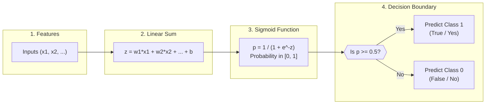

# Day 16: Logistic Regression (Classification)

### 🎯 Learning Objectives
- Explain the fundamental difference between regression and classification tasks.
- Describe how the Sigmoid function maps any real-valued number into a probability value between 0 and 1.
- Build and train a binary classification model using Scikit-Learn's `LogisticRegression`.
- Obtain class probabilities and apply custom decision thresholds.
- Compute and interpret the classification accuracy metric.

### 🧩 Core Concepts (Why)
In preceding lessons, we used linear regression to predict continuous numbers (like prices). However, many real-world problems require predicting **categories** or **discrete labels**. This is a **classification** task:
- Predicting whether an email is spam (1) or not spam (0).
- Diagnosing whether a tumor is malignant (1) or benign (0).
- Classifying whether a transaction is fraudulent (1) or legitimate (0).

If we try to use standard Linear Regression for binary classification (labels 0 and 1), the predictions can fall outside the $[0, 1]$ interval, and the model is highly sensitive to outliers.

**Logistic Regression** solves this problem. Despite the word "regression" in its name, it is a classification algorithm. It computes a linear score ($z = w x + b$) and then passes this score through the **Sigmoid function**. The Sigmoid function squeezes the output into a range between 0 and 1, allowing us to interpret the result as a **probability** of belonging to class 1.

### 🔁 Logic and Operation
The logistic regression pipeline processes input features, calculates a linear sum, maps it to a probability using the Sigmoid curve, and compares it to a decision threshold to make a final class prediction.



#### The Sigmoid Function
The Sigmoid function (or logistic curve) is defined mathematically as:

$$\sigma(z) = \frac{1}{1 + e^{-z}}$$

- If $z$ is a large positive number, $e^{-z}$ approaches 0, so $\sigma(z)$ approaches 1.
- If $z$ is a large negative number, $e^{-z}$ becomes extremely large, so $\sigma(z)$ approaches 0.
- If $z = 0$, then $\sigma(z) = 0.5$.

#### Classification Threshold
By default, Scikit-Learn classifies any sample with a predicted probability $p \ge 0.5$ as class 1, and any sample with $p < 0.5$ as class 0.

### 📝 Annotated Examples
Here is how to create a classification dataset, train a Logistic Regression model, predict class labels, and retrieve prediction probabilities:
```python
import numpy as np
from sklearn.linear_model import LogisticRegression
from sklearn.metrics import accuracy_score

# 1. Prepare classification data (2 features, binary target labels)
# Features: Hours studied, Sleep duration
X = np.array([
    [1.0, 5.0], [1.5, 6.0], [2.0, 5.5],  # Class 0: Failed the exam
    [5.0, 7.0], [6.0, 8.0], [5.5, 7.5]   # Class 1: Passed the exam
])
y = np.array([0, 0, 0, 1, 1, 1])

# 2. Instantiate and fit the classification model
model = LogisticRegression()
model.fit(X, y)

# 3. Predict class labels (output is either 0 or 1)
class_predictions = model.predict(X)
print("Predicted Class Labels:", class_predictions) # Output: [0 0 0 1 1 1]

# 4. Predict probabilities (returns a probability for class 0 and class 1)
probabilities = model.predict_proba(X)
print("\nPredicted Probabilities (Class 0, Class 1):\n", probabilities)
# Column 1 shows prob(class 0), Column 2 shows prob(class 1)

# 5. Evaluate the model using Accuracy Score
accuracy = accuracy_score(y, class_predictions)
print(f"\nModel Accuracy Score: {accuracy * 100:.2f}%") # 100.00% (linearly separable)
```

### ❌ Common Mistakes

**Mistake 1: Confusing predict() and predict_proba() when computing accuracy**
```python
from sklearn.metrics import accuracy_score
preds_proba = model.predict_proba(X)
acc = accuracy_score(y, preds_proba)
```
```text
ValueError: Classification metrics can't handle a mix of binary and continuous-multioutput targets
```
```python
preds = model.predict(X) # Use predicted class labels
acc = accuracy_score(y, preds)
```
> `predict()` outputs class labels (like 0 or 1), while `predict_proba()` outputs continuous probabilities for each class. `accuracy_score` expects class labels.

**Mistake 2: Passing a 1D array representing a single sample to predict()**
```python
# Features: [Hours studied, Sleep duration]
prediction = model.predict([2.5, 6.0])
```
```text
ValueError: Expected 2D array, got 1D array instead:
array=[2.5 6. ].
Reshape your data either using array.reshape(1, -1) if it contains a single sample or array.reshape(-1, 1) if it contains a single feature.
```
```python
prediction = model.predict([[2.5, 6.0]]) # Wrap in a nested list to make it a 2D array
```
> Scikit-Learn estimators require features to be formatted as a 2D array of shape `(n_samples, n_features)`. Even for a single prediction, pass it as a 2D list `[[...]]`.

**Mistake 3: Trying to extract coefficients directly as floats**
```python
weight = model.coef_ # Attempting to use this as a single float weight
```
```text
(No traceback, but model.coef_ is a 2D array of shape (1, n_features), which can cause dimension errors during math operations)
```
```python
weight_for_feature_0 = model.coef_[0][0]
```
> Even in binary classification, `model.coef_` is formatted as a 2D array because Scikit-Learn is designed to support multiclass models and multiple features.

### 💡 Tips & Idioms
- **Interpreting Probability Columns**: `model.predict_proba(X)` returns an array of shape `(n_samples, 2)`. Column 0 corresponds to probability of class 0, and column 1 corresponds to class 1. For any sample `i`, `prob[i, 0] + prob[i, 1] == 1.0`.
- **Applying Custom Thresholds**: If your application demands higher caution (e.g., predicting a rare disease), you might classify anything above 0.3 probability as positive. You can implement this manually:
  ```python
  prob_class_1 = model.predict_proba(X)[:, 1]
  custom_preds = (prob_class_1 >= 0.3).astype(int)
  ```
- **Linearly Separable Data**: If the classes can be perfectly separated by a straight line, accuracy on that synthetic data will be 1.0, as shown in the exercise.

### 🧠 Deep Dive (Under the hood)
<details><summary>The Log Loss / Binary Cross-Entropy Cost Function (Click to expand)</summary>

In linear regression, we optimized parameters by minimizing Mean Squared Error (MSE). However, for Logistic Regression, if we substitute the non-linear Sigmoid function into the MSE cost function, the resulting function becomes **non-convex**. This means the cost surface has many local minimums, and standard gradient descent could easily get stuck.

To resolve this, we use the **Log Loss** (also called **Binary Cross-Entropy**) cost function, which is convex and penalizes incorrect predictions exponentially:

$$J(w, b) = -\frac{1}{n} \sum_{i=1}^{n} \left[ y_i \log(\hat{y}_i) + (1 - y_i) \log(1 - \hat{y}_i) \right]$$

Where:
- $y_i$ is the actual binary label (0 or 1).
- $\hat{y}_i$ is the predicted probability that the sample belongs to class 1 (computed via the Sigmoid function).

#### Why does it work?
- If actual class $y_i = 1$: The right term $(1 - y_i) \log(1 - \hat{y}_i)$ becomes 0. The loss is $-\log(\hat{y}_i)$. As predicted probability $\hat{y}_i \to 1$, the loss approaches $-\log(1) = 0$. As $\hat{y}_i \to 0$, the loss approaches $-\log(0) \to \infty$.
- If actual class $y_i = 0$: The left term becomes 0. The loss is $-\log(1 - \hat{y}_i)$. As predicted probability $\hat{y}_i \to 0$, the loss approaches 0. As $\hat{y}_i \to 1$, the loss approaches $\infty$.

This cost function heavily penalizes the model if it is confident and wrong (e.g., predicting a probability of 0.99 for class 1 when the actual label is 0).
</details>

### 🏋️ Exercise
Complete the function `classify_logistic(X, y)` to fit a Scikit-Learn `LogisticRegression` model on the features `X` and targets `y`, predict labels on the same data `X`, and return the classification accuracy score.

```python
import numpy as np
from sklearn.linear_model import LogisticRegression
from sklearn.metrics import accuracy_score

def classify_logistic(X, y):
    # 1. Fit a LogisticRegression model on the data X and labels y
    # 2. Predict labels on the same data X
    # 3. Calculate and return the classification accuracy score
    accuracy = 0.0
    return accuracy
```

### ✅ Self-Check
1. True or False: Logistic Regression is used for predicting continuous numerical variables.
2. If the linear score ($z$) computed for a sample is exactly $0.0$, what is the predicted probability ($p$) from the Sigmoid function?
<details><summary>Answers</summary>

1. **False**. Despite its name, Logistic Regression is used for classification tasks (predicting discrete class labels).
2. The predicted probability is exactly **0.5** ($\sigma(0) = \frac{1}{1 + e^{0}} = \frac{1}{1 + 1} = 0.5$).
</details>

### 📌 Summary
- **Classification** predicts discrete class labels instead of continuous numbers.
- **Logistic Regression** passes a linear equation through the **Sigmoid function** to output a probability between 0 and 1.
- The **Sigmoid function** is defined as $\sigma(z) = \frac{1}{1 + e^{-z}}$.
- Scikit-Learn uses a default decision threshold of **0.5** to map probabilities to classes 0 and 1.
- **Accuracy score** measures the proportion of correctly predicted labels.
