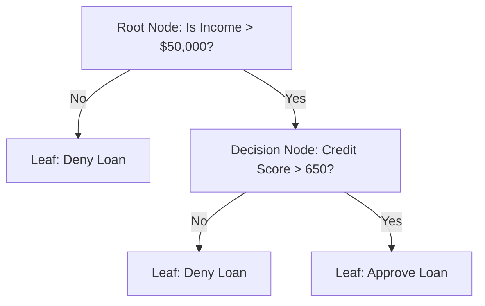

# Day 17: Decision Trees & Random Forests

### 🎯 Learning Objectives
- Understand the structure of Decision Trees, including root nodes, internal nodes, branches, and leaf nodes.
- Explain the difference between Gini Impurity and Entropy as splitting metrics.
- Understand the concept of ensemble learning and how Random Forests improve on individual Decision Trees.
- Train and evaluate a Decision Tree classifier using Scikit-Learn.
- Retrieve and interpret feature importances from a trained tree model.

### 🧩 Core Concepts (Why)
When humans make decisions, we often follow a series of yes/no questions. For example: "Is it raining? If yes, bring an umbrella. If no, is it sunny? If yes, wear sunglasses."
A **Decision Tree** is a machine learning model that mimics this logical flowchart structure to classify data points or predict values.

#### Key Structure Components:
1. **Root Node**: The very top node representing the entire dataset, which gets split into two or more homogeneous sets based on a feature.
2. **Internal/Decision Node**: Nodes where the data is split based on a feature decision.
3. **Branches**: Links between nodes representing the decision path (e.g., True/False).
4. **Leaf Node**: The final terminal nodes that do not split further. They contain the predicted output class or value.

#### How Splits are Chosen: Gini Impurity vs. Entropy
To build a tree, we must decide *which feature* and *which threshold* split the data best. We want the child nodes to be as "pure" (containing mostly one class) as possible. We measure this using:
- **Gini Impurity**: Measures how often a randomly chosen element from the set would be incorrectly labeled if it were randomly labeled according to the distribution of labels in the subset. A Gini of `0` means the node is perfectly pure (all elements belong to one class).
- **Entropy (Information Gain)**: Originating from Information Theory, it measures the level of disorder or uncertainty in the data. Information Gain is the reduction in entropy after a split.

#### Ensemble Learning & Random Forests
Individual Decision Trees are prone to **overfitting**—they learn the training data too well, including its noise, leading to poor generalization on new data.
To solve this, we use **Random Forests**, which belong to a class of algorithms called **Ensemble Learning**. Instead of relying on a single decision tree, a Random Forest builds multiple trees (a forest) using:
- **Bagging (Bootstrap Aggregating)**: Training each tree on a random sample of the data (with replacement).
- **Feature Randomness**: Splitting nodes by choosing from a random subset of features rather than all features.
The final prediction is made by taking a majority vote (classification) or average (regression) of the predictions from all individual trees.

### 🔁 Logic and Operation
Here is the logical structure of a simple decision tree used to decide whether to approve a loan application based on income and credit score:



### 📝 Annotated Examples
Let's train a Decision Tree Classifier using Scikit-Learn on a custom dataset, make predictions, and inspect the importance of each feature:

```python
import numpy as np
from sklearn.tree import DecisionTreeClassifier

# 1. Prepare synthetic dataset
# Features: [Income (in thousands), Credit Score]
X = np.array([
    [45, 600],
    [55, 700],
    [30, 580],
    [80, 640],
    [70, 720],
    [90, 680]
])
# Labels: 0 (Deny), 1 (Approve)
y = np.array([0, 1, 0, 0, 1, 1])

# 2. Initialize DecisionTreeClassifier
# max_depth=3 prevents the tree from growing indefinitely and overfitting
# random_state=42 ensures reproducibility of splits
model = DecisionTreeClassifier(max_depth=3, random_state=42)

# 3. Fit the model to our training data
model.fit(X, y)

# 4. Predict the class for a new applicant
# New applicant: Income=60k, Credit Score=660
new_applicant = np.array([[60, 660]])
prediction = model.predict(new_applicant)
print("Prediction (0=Deny, 1=Approve):", prediction[0]) # Output: 1

# 5. Check Feature Importances
# Tells us which features were most useful in building the splits
for name, importance in zip(["Income", "Credit Score"], model.feature_importances_):
    print(f"Feature: {name}, Importance: {importance:.4f}")
```

### ❌ Common Mistakes

**Mistake 1: Passing non-numeric/string categorical features directly to the tree**
```python
from sklearn.tree import DecisionTreeClassifier
import numpy as np
X = np.array([['Low'], ['High'], ['Low']])
y = np.array([0, 1, 0])
model = DecisionTreeClassifier()
model.fit(X, y)
```
```text
ValueError: could not convert string to float: 'Low'
```
```python
from sklearn.tree import DecisionTreeClassifier
import numpy as np
# Correct: Encode string categories into numerical representations
X = np.array([[0], [1], [0]]) # 0 = Low, 1 = High
y = np.array([0, 1, 0])
model = DecisionTreeClassifier()
model.fit(X, y)
```
> Scikit-Learn estimators require all input data to be numeric. Categorical text variables must be encoded (e.g. using label encoding or one-hot encoding) prior to training.

**Mistake 2: Requesting predictions with a 1D feature array**
```python
from sklearn.tree import DecisionTreeClassifier
import numpy as np
X = np.array([[1, 2], [3, 4]])
y = np.array([0, 1])
model = DecisionTreeClassifier()
model.fit(X, y)
model.predict([1, 2])
```
```text
ValueError: Expected 2D array, got 1D array instead:
array=[1 2].
Reshape your data either using array.reshape(-1, 1) if your data has a single feature or array.reshape(1, -1) if it contains a single sample.
```
```python
from sklearn.tree import DecisionTreeClassifier
import numpy as np
X = np.array([[1, 2], [3, 4]])
y = np.array([0, 1])
model = DecisionTreeClassifier()
model.fit(X, y)
model.predict([[1, 2]]) # Pass as a 2D list/array
```
> Scikit-learn estimators expect predictions to be queried with a 2D input array `(n_samples, n_features)`, even when making predictions for a single sample.

### 💡 Tips & Idioms
- **Regularization via `max_depth`**: Unconstrained Decision Trees will continue splitting until every leaf is pure, creating complex boundaries that overfit. Always set `max_depth` or `min_samples_leaf` to keep the model generalizable.
- **Feature Importance**: You can inspect `model.feature_importances_` to identify which variables contribute the most to predictions. The values sum to 1.
- **Tree Visualization**: Scikit-learn provides `sklearn.tree.plot_tree(model)` to plot and view the splits, thresholds, and leaf contents visually using matplotlib.

### 🧠 Deep Dive (Under the hood)
<details><summary>Mathematical Formulas for Gini Impurity and Entropy (Click to expand)</summary>

#### Gini Impurity
For a node containing samples from $C$ different classes, let $p_i$ be the probability (proportion) of samples belonging to class $i$. The Gini Impurity $I_G(p)$ is defined as:

$$I_G(p) = 1 - \sum_{i=1}^{C} p_i^2$$

- **Pure Node**: If all samples belong to one class (e.g., $p_1 = 1$, others $0$), $I_G = 1 - 1^2 = 0$.
- **Even Distribution**: For a binary classification split with equal representation ($p_1 = 0.5, p_2 = 0.5$), $I_G = 1 - (0.5^2 + 0.5^2) = 0.5$. This is the maximum possible Gini impurity for 2 classes.

#### Entropy
Entropy $H(p)$ measures the average level of information, surprise, or uncertainty in the node's class distribution:

$$H(p) = - \sum_{i=1}^{C} p_i \log_2(p_i)$$

If $p_i = 0$, we define $0 \log_2(0) = 0$.
- **Pure Node**: If all samples belong to one class ($p_1 = 1$), $H = - (1 \log_2 1) = 0$.
- **Even Distribution**: For a binary split ($p_1 = 0.5, p_2 = 0.5$), $H = - (0.5 \log_2 0.5 + 0.5 \log_2 0.5) = 1.0$. This is the maximum possible entropy for 2 classes.

The algorithm chooses splits that maximize **Information Gain** (for Entropy) or minimize the weighted sum of impurity of the child nodes.
</details>

### 🏋️ Exercise
Complete the function `train_tree(X, y)` to build a Decision Tree classifier with a maximum depth of 3, train it on the features `X` and labels `y`, and return the trained model.

```python
import numpy as np
from sklearn.tree import DecisionTreeClassifier

def train_tree(X, y):
    # 1. Create a DecisionTreeClassifier instance with max_depth=3 and random_state=42
    # 2. Fit the classifier on the features X and labels y
    # 3. Return the trained model
    model = None
    return model
```

### ✅ Self-Check
1. How does setting a higher `max_depth` affect a Decision Tree's training performance vs. test performance?
2. What are the two primary techniques Random Forests use to ensure individual trees are uncorrelated?
<details><summary>Answers</summary>

1. A higher `max_depth` allows the tree to capture more complex patterns, improving training accuracy. However, if it grows too deep, it will capture noise, leading to overfitting and lower test accuracy.
2. Random Forests use **Bagging** (sampling training data randomly with replacement for each tree) and **Feature Randomness** (choosing splits from a random subset of features).
</details>

### 📌 Summary
- **Decision Trees** recursively split data based on features to group similar targets together.
- Splits are evaluated using **Gini Impurity** or **Entropy** to maximize leaf purity.
- **Random Forests** build ensembles of decision trees using bagging and feature randomness to reduce overfitting.
- Restrict tree growth using `max_depth` to regularize the model and improve generalization.
