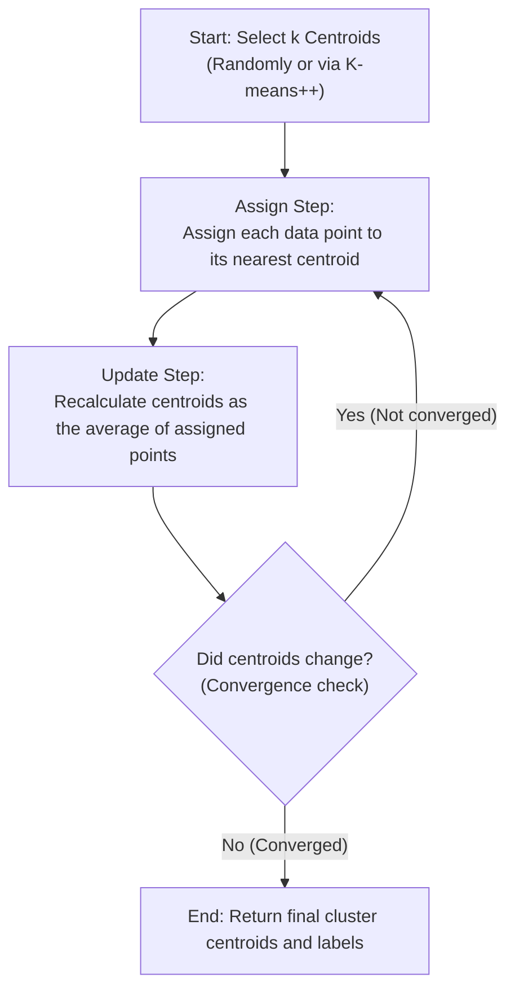

# Day 18: K-means Clustering

### 🎯 Learning Objectives
- Distinguish between supervised learning and unsupervised learning.
- Explain the iterative steps of the K-means clustering algorithm.
- Train a K-means clustering model using Scikit-Learn.
- Retrieve and interpret cluster centroids and labels.
- Understand the importance of feature scaling and how to select the number of clusters using the Elbow Method.

### 🧩 Core Concepts (Why)
So far, we have studied supervised learning algorithms (like Linear Regression and Decision Trees), where our dataset contains explicit targets or labels ($y$) to guide model training.
However, in many real-world situations, we do not have labels. We might have a database of customers with their purchase history, but no pre-defined categories. Our goal is to discover hidden patterns or groupings naturally. This is **Unsupervised Learning**.

**Clustering** is the most common unsupervised learning task, and **K-means** is the most widely used clustering algorithm. It partitions a dataset into $k$ distinct, non-overlapping groups (clusters).

#### How K-means Iterates:
The algorithm finds clusters by repeating three basic steps:
1. **Initialization**: Choose $k$ initial points as centroids (cluster centers) in the feature space.
2. **Assignment Step**: Assign each data point to its nearest centroid (usually based on Euclidean distance).
3. **Update Step**: Recompute the centroid of each cluster by taking the mean (average position) of all data points currently assigned to that cluster.
Steps 2 and 3 repeat until the centroids no longer move significantly (convergence) or a maximum number of iterations is reached.

### 🔁 Logic and Operation
Here is the flowchart representing the iterative optimization loop of K-means training:



### 📝 Annotated Examples
Let's train a K-means model on a 2D synthetic dataset using Scikit-Learn and extract the learned cluster assignments and cluster centers:

```python
import numpy as np
from sklearn.cluster import KMeans

# 1. Prepare synthetic 2D dataset
# Data points clearly forming three distinct groups
X = np.array([
    [1.0, 2.0], [1.5, 1.8], [1.2, 2.2], # Group 1
    [8.0, 8.0], [8.5, 8.2], [9.0, 8.5], # Group 2
    [1.0, 8.0], [1.2, 7.8], [0.8, 8.2]  # Group 3
])

# 2. Instantiate KMeans
# n_clusters=3 specifies that we expect 3 distinct clusters
# n_init='auto' lets the algorithm decide how many times to run with different seeds
# random_state=42 ensures reproducibility
kmeans = KMeans(n_clusters=3, n_init='auto', random_state=42)

# 3. Fit the model to the data (unsupervised, no 'y' labels passed)
kmeans.fit(X)

# 4. Retrieve cluster assignments (labels) for training points
labels = kmeans.labels_
print("Cluster Labels:", labels) # Output: array of 0s, 1s, and 2s matching the groups

# 5. Retrieve the coordinates of the 3 cluster centers (centroids)
centroids = kmeans.cluster_centers_
print("Centroids:\n", centroids)

# 6. Predict the cluster for a new data point
new_point = np.array([[2.0, 2.0]])
predicted_cluster = kmeans.predict(new_point)
print("Predicted Cluster for [2.0, 2.0]:", predicted_cluster[0])
```

### ❌ Common Mistakes

**Mistake 1: Passing a 1D array to KMeans fit method**
```python
from sklearn.cluster import KMeans
import numpy as np
X = np.array([1.2, 2.3, 8.9, 9.5])
kmeans = KMeans(n_clusters=2, n_init='auto', random_state=42)
kmeans.fit(X)
```
```text
ValueError: Expected 2D array, got 1D array instead:
array=[1.2 2.3 8.9 9.5].
Reshape your data either using array.reshape(-1, 1) if your data has a single feature or array.reshape(1, -1) if it contains a single sample.
```
```python
from sklearn.cluster import KMeans
import numpy as np
# Correct: Reshape to a 2D array of column vectors
X = np.array([[1.2], [2.3], [8.9], [9.5]])
kmeans = KMeans(n_clusters=2, n_init='auto', random_state=42)
kmeans.fit(X)
```
> Scikit-Learn estimators, including unsupervised clustering models, require the feature matrix X to be 2D, even if there is only a single feature.

**Mistake 2: Querying predictions with a different number of features than the training dataset**
```python
from sklearn.cluster import KMeans
import numpy as np
X = np.array([[1, 2], [2, 3], [8, 8], [9, 9]])
kmeans = KMeans(n_clusters=2, n_init='auto', random_state=42)
kmeans.fit(X)
kmeans.predict([[1]])
```
```text
ValueError: X has 1 features, but KMeans is expecting 2 features as input.
```
```python
from sklearn.cluster import KMeans
import numpy as np
X = np.array([[1, 2], [2, 3], [8, 8], [9, 9]])
kmeans = KMeans(n_clusters=2, n_init='auto', random_state=42)
kmeans.fit(X)
kmeans.predict([[1, 2]]) # Pass exactly 2 features
```
> The dimension of the test samples passed to `predict()` or `transform()` must match the number of features of the training data `X` that the model was fitted on.

### 💡 Tips & Idioms
- **Elbow Method**: How do you choose the right value of $k$? Plot the model's **inertia** (sum of squared distances of samples to their closest cluster center, retrieved via `kmeans.inertia_`) for different values of $k$ (e.g., 1 to 10). The point where the decrease in inertia slows down dramatically (forming an "elbow") is typically the optimal $k$.
- **Scale Your Features**: K-means is highly sensitive to the scale of features because it relies on Euclidean distance. If one feature ranges from 0 to 1 and another ranges from 0 to 1,000,000, the second feature will completely dominate the distance calculations. Always standardize features (e.g., using `StandardScaler`) beforehand.
- **n_init parameter**: K-means can get stuck in poor local minima depending on initial centroid choices. Setting `n_init` runs the algorithm multiple times with different initial seeds and keeps the best resulting clustering.

### 🧠 Deep Dive (Under the hood)
<details><summary>K-means++ Initialization Mechanism (Click to expand)</summary>

Standard K-means randomly selects the initial centroids. If two initial centroids are placed very close to each other in the same natural group, the algorithm might converge to a poor local minimum.

To solve this, Scikit-Learn uses **K-means++** initialization by default. The K-means++ algorithm selects centroids that are far apart from each other using the following probabilistic steps:

1. **First Centroid**: Choose the first centroid $c_1$ uniformly at random from the dataset $X$.
2. **Compute Distances**: For each data point $x_i$, compute the distance $D(x_i)$, which is the Euclidean distance from $x_i$ to the nearest centroid that has already been selected.
3. **Select Next Centroid**: Choose the next centroid $c_j$ from $X$ with a probability proportional to the squared distance:
   
   $$P(x_i) = \frac{D(x_i)^2}{\sum_{y \in X} D(y)^2}$$
   
   This step ensures that points located far away from existing centroids are much more likely to be selected as new centroids.
4. **Repeat**: Repeat steps 2 and 3 until all $k$ centroids are chosen.

This smart initialization significantly reduces training time and yields much more robust, higher-quality clustering results.
</details>

### 🏋️ Exercise
Complete the function `cluster_kmeans(X, k)` to instantiate a Scikit-Learn `KMeans` model with `k` clusters, `n_init='auto'`, and `random_state=42`. Fit the model on the data `X`, and return the trained cluster centroids.

```python
import numpy as np
from sklearn.cluster import KMeans

def cluster_kmeans(X, k):
    # 1. Create a KMeans instance with k clusters, n_init='auto', and random_state=42
    # 2. Fit the KMeans model on the data X
    # 3. Return the cluster centroids (cluster_centers_)
    centers = None
    return centers
```

### ✅ Self-Check
1. Why is feature scaling critical before applying K-means clustering?
2. What metric is stored in the `inertia_` attribute of a fitted `KMeans` instance, and how is it used?
<details><summary>Answers</summary>

1. K-means uses Euclidean distance to assign clusters. Features with much larger scales will dominate the distance calculation, making features with smaller scales irrelevant. Scaling ensures all features contribute equally.
2. `inertia_` measures the Sum of Squared Errors (SSE) of samples to their nearest centroid. We plot `inertia_` across different values of $k$ to locate the "elbow" point and determine the optimal number of clusters.
</details>

### 📌 Summary
- **Unsupervised Learning** models data that has no target labels ($y$) to find underlying patterns.
- **K-means Clustering** iteratively assigns data points to the nearest centroid and re-calculates centroids based on cluster means.
- Standardize features before applying K-means because distance metrics are highly scale-sensitive.
- Use **K-means++** initialization (default in Scikit-Learn) to choose spread-out initial centroids and avoid sub-optimal clustering.
