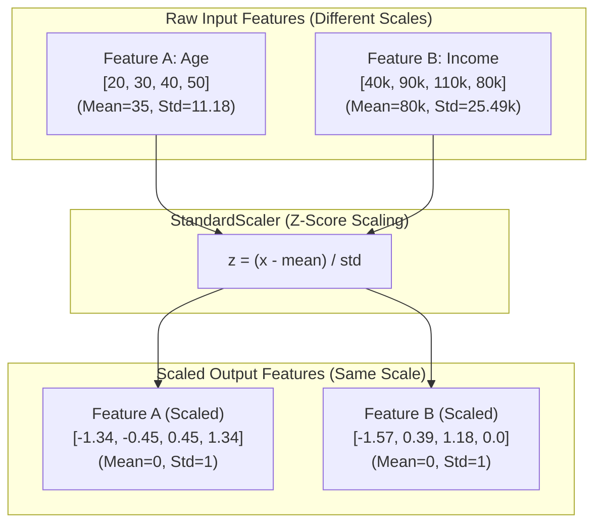

# Day 19: Feature Scaling & Preprocessing

### 🎯 Learning Objectives
- Explain why feature scaling is necessary for distance-sensitive algorithms and gradient descent optimization.
- Distinguish between Standardization (Z-score scaling) and Normalization (Min-Max scaling).
- Implement feature scaling using Scikit-Learn's `StandardScaler`.
- Prevent data leakage by correctly separating the fitting and transforming steps for training and testing datasets.

### 🧩 Core Concepts (Why)
In machine learning, datasets often contain features measured in completely different units and scales. For example, a house dataset might have `Age` (ranging from 0 to 50 years) and `Price` (ranging from $100,000 to $1,000,000). 

If we feed these raw features into a machine learning algorithm, two major problems occur:
1. **Distance Domination**: Algorithms that calculate spatial distances between points (such as K-Means, K-Nearest Neighbors (KNN), and Support Vector Machines (SVM)) will be heavily biased towards features with larger magnitudes. A difference of $100,000 in price will completely overwhelm a difference of 10 years in age.
2. **Slow Gradient Descent Convergence**: Optimization algorithms like gradient descent (used in Linear/Logistic Regression and Neural Networks) will take much longer to find the minimum of the cost function. This is because the contours of the cost function become highly elongated, causing the gradient steps to oscillate wildly.

To solve this, we use **Feature Scaling** to bring all numerical features to a similar scale without losing the original distribution or information.

There are two primary methods:
- **Standardization (Z-score normalization)**: Scales features to have a mean ($\mu$) of 0 and a standard deviation ($\sigma$) of 1. It is ideal for algorithms that assume normally distributed data and is less sensitive to outliers.
- **Normalization (Min-Max scaling)**: Scales features to a fixed range, typically between 0 and 1. It is useful when we need bounded values but is highly sensitive to outliers.

### 🔁 Logic and Operation
The process of standardization maps any raw distribution to a standard normal distribution.



### 📝 Annotated Examples
Here is how to standardize features using `StandardScaler` from Scikit-Learn:

```python
import numpy as np
from sklearn.preprocessing import StandardScaler

# 1. Prepare raw features: 4 samples, 2 features (Age, Income)
X = np.array([
    [25.0, 50000.0],
    [35.0, 75000.0],
    [45.0, 110000.0],
    [20.0, 45000.0]
])

# 2. Instantiate StandardScaler
scaler = StandardScaler()

# 3. Fit (calculate mean & std) and transform (apply scaling formula)
X_scaled = scaler.fit_transform(X)

print("Scaled Features:\n", X_scaled)
# Scaled values will have mean = 0 and std = 1 per column:
print("Mean of features:", np.round(X_scaled.mean(axis=0), 2)) # [0. 0.]
print("Std of features:", np.round(X_scaled.std(axis=0), 2))   # [1. 1.]

# 4. Use transform on new data (using parameters learned from X)
new_data = np.array([[30.0, 60000.0]])
new_data_scaled = scaler.transform(new_data)
print("New scaled data:", new_data_scaled)
```

### ❌ Common Mistakes

**Mistake 1: Calling transform before fitting the scaler**
```python
from sklearn.preprocessing import StandardScaler
scaler = StandardScaler()
X_scaled = scaler.transform(X)
```
```text
sklearn.exceptions.NotFittedError: This StandardScaler instance is not fitted yet. Call 'fit' with appropriate arguments before using this estimator.
```
```python
from sklearn.preprocessing import StandardScaler
scaler = StandardScaler()
X_scaled = scaler.fit_transform(X)
```
> You must fit the scaler using `fit()` or `fit_transform()` first so it can compute the mean and standard deviation of the features before transforming them.

**Mistake 2: Passing a 1D array to the scaler**
```python
import numpy as np
from sklearn.preprocessing import StandardScaler
X = np.array([1.0, 2.0, 3.0, 4.0])
scaler = StandardScaler()
X_scaled = scaler.fit_transform(X)
```
```text
ValueError: Expected 2D array, got 1D array instead:
array=[1. 2. 3. 4.].
Reshape your data either using array.reshape(-1, 1) if your data has a single feature or array.reshape(1, -1) if it contains a single sample.
```
```python
import numpy as np
from sklearn.preprocessing import StandardScaler
X = np.array([[1.0], [2.0], [3.0], [4.0]])
scaler = StandardScaler()
X_scaled = scaler.fit_transform(X)
```
> Scikit-Learn transformers expect the feature matrix `X` to be a 2D array of shape `(n_samples, n_features)`. A single feature must be reshaped into a 2D column vector.

**Mistake 3: Fitting the scaler on test data (Data Leakage)**
```python
from sklearn.preprocessing import StandardScaler
scaler = StandardScaler()
X_train_scaled = scaler.fit_transform(X_train)
X_test_scaled = scaler.fit_transform(X_test)
```
```text
(Logic Error: Model evaluation is compromised because the test set is scaled using its own statistics instead of training set statistics)
```
```python
from sklearn.preprocessing import StandardScaler
scaler = StandardScaler()
X_train_scaled = scaler.fit_transform(X_train)
X_test_scaled = scaler.transform(X_test)
```
> The test set must be scaled using the mean and standard deviation learned *only* from the training set to prevent data leakage and simulate a true inference scenario.

### 💡 Tips & Idioms
- **Only scale features, not targets**: For standard classification or regression, scaling targets ($y$) is generally not necessary, and doing so can complicate predictions.
- **Inverse Transform**: You can revert scaled data back to its original scale using `scaler.inverse_transform(X_scaled)`.
- **Pipeline integration**: In practice, wrap your scaler and estimator inside a Scikit-Learn `Pipeline` to automatically handle fitting on training and transforming on test sets.

### 🧠 Deep Dive (Under the hood)
<details><summary>Mathematical Formulas for StandardScaler and MinMaxScaler (Click to expand)</summary>

#### StandardScaler (Standardization)
The standardized value $z$ of a feature $x$ is computed as:

$$z = \frac{x - \mu}{\sigma}$$

Where:
- $\mu$ is the mean of the feature: $\mu = \frac{1}{n} \sum_{i=1}^n x_i$
- $\sigma$ is the standard deviation: $\sigma = \sqrt{\frac{1}{n} \sum_{i=1}^n (x_i - \mu)^2}$

This shifts the feature distribution to have $\text{mean} = 0$ and $\text{variance} = 1$. It does not restrict values to a specific range.

#### MinMaxScaler (Normalization)
The normalized value $x_{norm}$ of a feature $x$ is computed as:

$$x_{norm} = \frac{x - x_{min}}{x_{max} - x_{min}} \cdot (\text{max} - \text{min}) + \text{min}$$

By default, this maps the features to the range $[0, 1]$:

$$x_{norm} = \frac{x - x_{min}}{x_{max} - x_{min}}$$

If an outlier is present (e.g., a value of 1000 when most values are around 10), then $x_{max}$ becomes very large, squeezing all standard values into a tiny range (e.g., between 0.0 and 0.01). Standardization is much more robust to outliers because it relies on standard deviation.
</details>

### 🏋️ Exercise
Complete the function `scale_features(X)` to instantiate a Scikit-Learn `StandardScaler` object, fit it to the features matrix `X`, transform the features, and return the scaled numpy array.

```python
import numpy as np
from sklearn.preprocessing import StandardScaler

def scale_features(X):
    # 1. Create a StandardScaler instance
    # 2. Fit the scaler on the features X and transform them
    # 3. Return the scaled features array
    scaled_X = None
    return scaled_X
```

### ✅ Self-Check
1. If we fit a `StandardScaler` on a single feature array `[[1.0], [3.0], [5.0]]`, what will the mean of the scaled array be?
2. What is the main drawback of using `MinMaxScaler` when data contains extreme outliers?
<details><summary>Answers</summary>

1. The mean of the scaled feature will be exactly `0.0`, and its standard deviation will be `1.0`.
2. Extreme outliers will skew the minimum or maximum values, compression-scaling the remaining non-outlier data points into a very small range and losing feature variance.
</details>

### 📌 Summary
- **Feature Scaling** prevents features with large magnitudes from dominant distance calculations and accelerates optimization algorithms.
- **Standardization** (`StandardScaler`) centers features to mean 0 and standard deviation 1.
- **Normalization** (`MinMaxScaler`) bounds features between a set range (usually 0 and 1) but is outlier-sensitive.
- Always use `fit_transform` on the training set and only `transform` on the test/new datasets to avoid **data leakage**.
