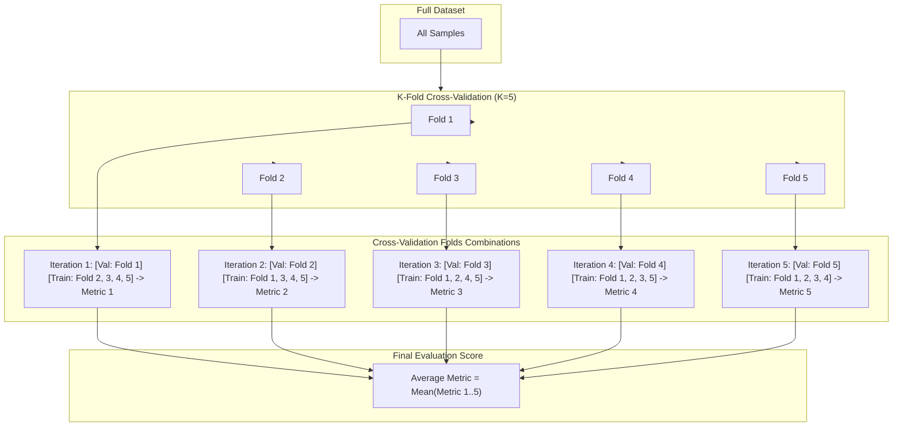

# Day 20: Hyperparameter Tuning

### 🎯 Learning Objectives
- Distinguish between model parameters (learned during training) and hyperparameters (set before training).
- Explain the concept of $K$-fold cross-validation and why it prevents overfitting during model selection.
- Implement exhaustive search for optimal hyperparameters using Scikit-Learn's `GridSearchCV`.
- Interpret tuning search results to retrieve the best parameters and the best performing model.

### 🧩 Core Concepts (Why)
When training machine learning models, we deal with two types of configurations:
1. **Model Parameters**: Values the model learns by itself from training data. For example, weights ($w$) and biases ($b$) in regression or neural networks.
2. **Hyperparameters**: Configurations we set *before* training to control how the model learns. For example, the number of trees in a Random Forest, the learning rate in gradient descent, or the maximum depth (`max_depth`) of a Decision Tree.

If we choose poor hyperparameters, our model will perform poorly: it might either underfit (be too simple to learn patterns) or overfit (memorize noise in the training set). How do we find the best hyperparameters? We cannot simply test them on the test set, because that would lead to data leakage—the test set would influence our choice of model, invalidating our final evaluation.

To solve this, we use two techniques in combination:
- **K-Fold Cross-Validation**: We split our training dataset into $K$ equal-sized subsets ("folds"). We train the model $K$ times, each time using $K-1$ folds for training and the remaining 1 fold for validation. The final performance is the average score across all $K$ iterations. This ensures that every data point is used for both training and validation, giving a highly robust estimate of model performance.
- **Grid Search**: We define a grid of hyperparameter values we want to test. The algorithm systematically trains and evaluates models for every possible combination of these values using cross-validation to find the optimal set.

### 🔁 Logic and Operation
The diagram below illustrates K-Fold cross-validation, showing how data folds are cycled through to compute a robust average metric.



### 📝 Annotated Examples
Here is how to tune the hyperparameters of a Decision Tree using `GridSearchCV`:

```python
import numpy as np
from sklearn.tree import DecisionTreeClassifier
from sklearn.model_selection import GridSearchCV

# 1. Prepare sample dataset (binary classification)
X = np.array([[1, 2], [2, 3], [1, 1], [10, 12], [11, 13], [12, 10]])
y = np.array([0, 0, 0, 1, 1, 1])

# 2. Instantiate the base model
dt = DecisionTreeClassifier(random_state=42)

# 3. Define the parameter grid (keys are argument names of the estimator)
param_grid = {
    'max_depth': [2, 4, 6],
    'criterion': ['gini', 'entropy']
}

# 4. Instantiate GridSearchCV
# cv=3 means 3-fold cross validation, scoring sets evaluation metric
grid_search = GridSearchCV(estimator=dt, param_grid=param_grid, cv=3, scoring='accuracy')

# 5. Execute the search (fits models for all combinations)
grid_search.fit(X, y)

# 6. Retrieve results
print("Best parameters:", grid_search.best_params_)
# Output might be: {'criterion': 'gini', 'max_depth': 2}

print("Best score (CV mean accuracy):", grid_search.best_score_)
# Output: 1.0

# 7. Get the best trained model instance directly
best_model = grid_search.best_estimator_
print("Prediction using best model:", best_model.predict([[5, 5]]))
```

### ❌ Common Mistakes

**Mistake 1: Passing non-list values in the parameter grid**
```python
from sklearn.model_selection import GridSearchCV
from sklearn.tree import DecisionTreeClassifier
param_grid = {'max_depth': 4} # Integer instead of list
grid = GridSearchCV(DecisionTreeClassifier(), param_grid, cv=3)
```
```text
ValueError: Parameter values for parameter (max_depth) need to be a sequence(list, ndarray, etc.) or a distribution. OrderedDict([('max_depth', 4)]) was passed.
```
```python
from sklearn.model_selection import GridSearchCV
from sklearn.tree import DecisionTreeClassifier
param_grid = {'max_depth': [4]} # Wrap in a sequence
grid = GridSearchCV(DecisionTreeClassifier(), param_grid, cv=3)
```
> The parameter grid values must be iterable sequences (like lists or arrays), even if you are testing only a single value for that hyperparameter.

**Mistake 2: Accessing fit attributes before calling fit**
```python
from sklearn.model_selection import GridSearchCV
from sklearn.tree import DecisionTreeClassifier
grid = GridSearchCV(DecisionTreeClassifier(), {'max_depth': [2, 4]}, cv=3)
best = grid.best_params_
```
```text
AttributeError: 'GridSearchCV' object has no attribute 'best_params_'
```
```python
from sklearn.model_selection import GridSearchCV
from sklearn.tree import DecisionTreeClassifier
grid = GridSearchCV(DecisionTreeClassifier(), {'max_depth': [2, 4]}, cv=3)
grid.fit(X, y)
best = grid.best_params_
```
> The `best_params_` attribute is only created and populated after the search has been executed by calling `fit()`.

**Mistake 3: Using an invalid scorer name**
```python
from sklearn.model_selection import GridSearchCV
from sklearn.tree import DecisionTreeClassifier
grid = GridSearchCV(DecisionTreeClassifier(), {'max_depth': [2, 4]}, scoring='acc')
grid.fit(X, y)
```
```text
ValueError: 'acc' is not a valid scoring value. Use sorted(sklearn.metrics.SCORERS.keys()) to get valid options.
```
```python
from sklearn.model_selection import GridSearchCV
from sklearn.tree import DecisionTreeClassifier
grid = GridSearchCV(DecisionTreeClassifier(), {'max_depth': [2, 4]}, scoring='accuracy')
grid.fit(X, y)
```
> Scikit-Learn uses specific, exact string identifiers for evaluation metrics. For classification accuracy, you must use the full string `'accuracy'`.

### 💡 Tips & Idioms
- **Combinatorial Explosion**: Grid search evaluates all possible parameter combinations. If you search 5 values for parameter A, 5 for parameter B, and 4 for parameter C, with 5-fold CV, you will train $5 \times 5 \times 4 \times 5 = 500$ models. Keep your grids focused!
- **Parallel processing**: Set `n_jobs=-1` inside `GridSearchCV` to run training configurations concurrently using all CPU cores.
- **Refit feature**: By default, `GridSearchCV` automatically refits the best estimator using the entire dataset after the cross-validation searches complete. You can call `.predict()` directly on the `GridSearchCV` object.

### 🧠 Deep Dive (Under the hood)
<details><summary>Grid Search vs. Random Search Comparison (Click to expand)</summary>

When search spaces are large, Grid Search becomes computationally expensive. An alternative is **Random Search** (`RandomizedSearchCV`), which samples a fixed number of parameter settings from specified probability distributions.

Here is a comparison of their characteristics:

| Feature | Grid Search (`GridSearchCV`) | Random Search (`RandomizedSearchCV`) |
| :--- | :--- | :--- |
| **Search Strategy** | Exhaustive search over all specified combinations. | Randomly samples a fixed number of combinations. |
| **Computation Time** | Slow and increases exponentially with parameter count. | Faster; execution time is controlled by the `n_iter` parameter. |
| **Resolution** | Discretized; might miss optimal intermediate values. | Continuous; can discover values between grid steps. |
| **When to use** | Small search space (< 100 total combinations). | Large search space, or for initial coarse search. |

For example, if you are testing learning rates, Grid Search might test `[0.001, 0.01, 0.1]`. Random Search can sample values from a uniform log distribution between `0.001` and `0.1`, potentially finding that `0.054` is the actual optimal rate.
</details>

### 🏋️ Exercise
Complete the function `tune_parameters(X, y)` to instantiate a Scikit-Learn `DecisionTreeClassifier` with `random_state=42`. Define a parameter grid searching `max_depth` with values `[2, 4, 6]`. Instantiate `GridSearchCV` using 3-fold cross-validation (`cv=3`) and `'accuracy'` scoring. Run the search on the data `X` and `y`, and return the best parameters dictionary.

```python
import numpy as np
from sklearn.tree import DecisionTreeClassifier
from sklearn.model_selection import GridSearchCV

def tune_parameters(X, y):
    # 1. Create a DecisionTreeClassifier instance with random_state=42
    # 2. Define the param_grid with 'max_depth': [2, 4, 6]
    # 3. Create a GridSearchCV instance with cv=3, scoring='accuracy'
    # 4. Fit the GridSearchCV model on the data X and y
    # 5. Return the best parameters dictionary (best_params_)
    best_params = None
    return best_params
```

### ✅ Self-Check
1. If your parameter grid has 3 values for `max_depth` and 2 values for `criterion`, and you use `cv=5` (5-fold cross-validation), how many times will the Decision Tree model be trained?
2. How do you obtain the best estimator model from a fitted `GridSearchCV` instance?
<details><summary>Answers</summary>

1. The model will be trained $3 \times 2 \times 5 = 30$ times in total.
2. You can access the best fitted model instance using the `.best_estimator_` attribute.
</details>

### 📌 Summary
- **Parameters** are learned from data; **hyperparameters** are configuration parameters set before training.
- **K-fold Cross-Validation** splits data into $K$ subsets, cycling a validation set to estimate model performance robustly.
- **Grid Search** (`GridSearchCV`) systematically runs cross-validation across all grid parameter combinations.
- Use `.best_params_` to retrieve the best settings and `.best_estimator_` to retrieve the best fitted model.
