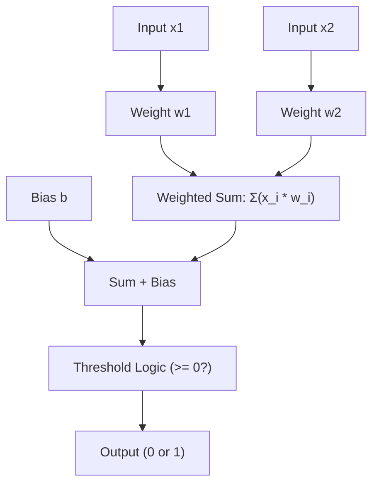

# Day 21: Introduction to Neural Networks / Perceptron

### 🎯 Learning Objectives
- Describe the biological inspiration behind artificial neurons and the Perceptron model.
- Explain the role of inputs, weights, bias, and the activation function (threshold logic).
- Implement a single-layer perceptron using vectorized operations in NumPy.
- Build basic logical gates (AND, OR) using a Perceptron model.

### 🧩 Core Concepts (Why)
At the core of modern Deep Learning is the **artificial neuron**. Just like biological neurons in our brains receive electrical signals, process them, and decide whether to fire, an artificial neuron takes numerical inputs, processes them, and produces an output.

The **Perceptron** is the simplest and oldest form of an artificial neuron, introduced by Frank Rosenblatt in 1958. 
Why do we study the Perceptron?
1. **Foundation of Deep Learning**: Multi-Layer Perceptrons (MLPs) are the building blocks of modern deep neural networks. Understanding how a single unit works is crucial before stacking them.
2. **Binary Classification**: It introduces the concept of separating data into two classes using a linear boundary.
3. **Parameter Learning**: It demonstrates how machine learning models use parameters (weights and bias) to map inputs to outputs.

### 🔁 Logic and Operation
A perceptron processes inputs through three main steps:
1. **Weighted Sum**: Multiply each input $x_i$ by its corresponding weight $w_i$, and sum them up. We add a **bias** ($b$) to this sum. The bias allows us to shift the activation function's threshold.
   $$z = \sum_{i=1}^{n} x_i w_i + b = \mathbf{w} \cdot \mathbf{x} + b$$
2. **Threshold / Activation**: If the weighted sum $z$ is greater than or equal to 0, the output is 1 (neuron fires). Otherwise, the output is 0.
   $$\hat{y} = \begin{cases} 1 & \text{if } z \geq 0 \\ 0 & \text{if } z < 0 \end{cases}$$

Here is how the data flows through a Perceptron:



### 📝 Annotated Examples
Here is how to implement a basic perceptron and model logical operations (AND, OR):
```python
import numpy as np

# 1. Define input features (e.g., AND gate inputs)
inputs = np.array([1, 0])

# 2. Define weights and bias for AND gate
# To output 1, both inputs must be 1. Sum must exceed the threshold.
weights_and = np.array([1.0, 1.0])
bias_and = -1.5

# 3. Calculate weighted sum using NumPy dot product
weighted_sum = np.dot(inputs, weights_and) + bias_and
print("Weighted Sum:", weighted_sum)  # Output: -0.5

# 4. Apply step activation function
output = 1 if weighted_sum >= 0 else 0
print("Perceptron Output:", output)  # Output: 0 (which is correct for 1 AND 0)
```

### ❌ Common Mistakes

**Mistake 1: Forgetting to add the bias term**
```python
import numpy as np
x = np.array([1.0, 1.0])
w = np.array([1.0, 1.0])
b = -1.5
# Missing bias addition
weighted_sum = np.dot(x, w)
output = 1 if weighted_sum >= 0 else 0
```
```text
AssertionError: Should output 0 for AND logic when input is 0, 1
```
```python
import numpy as np
x = np.array([1.0, 1.0])
w = np.array([1.0, 1.0])
b = -1.5
# Correctly add the bias term
weighted_sum = np.dot(x, w) + b
output = 1 if weighted_sum >= 0 else 0
```
> The bias is necessary to shift the decision boundary. Without a bias, the decision boundary would always pass through the origin, severely limiting what the perceptron can represent.

**Mistake 2: Using loops instead of vectorized NumPy functions**
```python
import numpy as np
x = np.array([0.5, 0.8])
w = np.array([0.2, 0.4])
b = -0.1
# Slow loop-based approach
weighted_sum = 0.0
for i in range(len(x)):
    weighted_sum += x[i] * w[i]
weighted_sum += b
```
```text
(No error, but inefficient on large datasets)
```
```python
import numpy as np
x = np.array([0.5, 0.8])
w = np.array([0.2, 0.4])
b = -0.1
# Efficient vectorized approach
weighted_sum = np.dot(x, w) + b
```
> NumPy's `np.dot` uses highly optimized C libraries under the hood. For large networks and inputs, loops will cause severe performance bottlenecks.

### 💡 Tips & Idioms
- **Dot Product**: Always prefer `np.dot(x, w)` or the `@` operator (e.g., `x @ w`) for computing weighted sums. They are clean and fast.
- **Bias Representation**: In advanced neural networks, the bias is often treated as an extra weight $w_0$ associated with an input $x_0$ that is always fixed to $1.0$. This allows the bias to be computed within the same dot product.

### 🧠 Deep Dive (Under the hood)
<details><summary>The History of the Perceptron and the Linear Separability Problem (Click to expand)</summary>

The Perceptron was initially met with immense enthusiasm. Rosenblatt claimed it would soon be able to walk, talk, and write. However, in 1969, Marvin Minsky and Seymour Papert published the book *Perceptrons*, where they mathematically proved that a single-layer perceptron is incapable of learning functions that are not **linearly separable**.

A dataset is linearly separable if we can draw a straight line (in 2D), plane (in 3D), or hyperplane (in higher dimensions) to perfectly split the classes.

#### The XOR Problem
While a single perceptron can easily represent AND, OR, and NOT gates, it cannot represent the **XOR (Exclusive OR)** gate:
| Input 1 | Input 2 | XOR Output |
| :--- | :--- | :--- |
| 0 | 0 | 0 |
| 0 | 1 | 1 |
| 1 | 0 | 1 |
| 1 | 1 | 0 |

If you plot these points on a grid, you'll see that it is impossible to draw a single straight line that separates the `0` outputs from the `1` outputs. This proof led to the first **AI Winter**, a period where neural network research funding dried up. The solution was discovered years later: stacking multiple perceptrons into multiple layers (Multi-Layer Perceptrons) with non-linear activation functions, allowing them to solve non-linear decision boundaries.
</details>

### 🏋️ Exercise
Complete the function `perceptron(x, w, b)` to calculate the weighted sum of inputs `x` and weights `w` plus bias `b`, and return `1` if the result is greater than or equal to 0, and `0` otherwise.

```python
import numpy as np

def perceptron(x, w, b):
    # x: np.ndarray, w: np.ndarray, b: float
    # Calculate weighted sum and return 1 or 0
    return None
```

### ✅ Self-Check
1. Why is the bias term necessary in a perceptron?
2. Can a single perceptron solve the XOR logical function? Why or why not?
<details><summary>Answers</summary>

1. Without bias, the weighted sum $\sum x_i w_i$ is 0 when all inputs are 0. The bias allows shifting the activation threshold away from 0, letting the neuron activate even when inputs are zero or near-zero.
2. No, because XOR outputs are not linearly separable. You cannot separate the points $(0,0), (1,1)$ (output 0) from $(0,1), (1,0)$ (output 1) with a single straight line.
</details>

### 📌 Summary
- The **Perceptron** is the simplest model of an artificial neuron, computing a weighted sum of inputs plus bias.
- The **weighted sum** is mathematically formulated as $z = \mathbf{w} \cdot \mathbf{x} + b$.
- The **activation function** of a Perceptron is a step function: returns 1 if $z \geq 0$, else 0.
- A single perceptron can only solve **linearly separable** problems, meaning it cannot solve the XOR problem.
