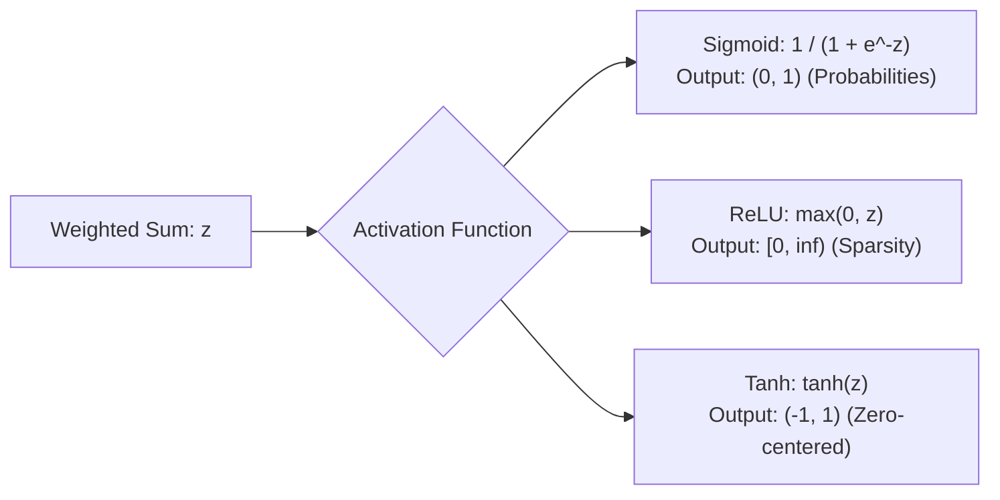

# Day 22: Activation Functions

### 🎯 Learning Objectives
- Explain why non-linear activation functions are critical for deep neural networks.
- Describe the mathematical definitions, output ranges, and properties of Sigmoid, ReLU, and Tanh.
- Understand the Vanishing Gradient problem and how ReLU helps solve it.
- Implement vectorized versions of these activation functions using NumPy.

### 🧩 Core Concepts (Why)
If we only multiply inputs by weights and add biases, our neural network remains a series of linear transformations. The composition of multiple linear layers is mathematically equivalent to a single linear layer:
$$y = w_2(w_1 x + b_1) + b_2 = (w_2 w_1)x + (w_2 b_1 + b_2) = Wx + B$$

Without **non-linear activation functions**, a neural network with 1,000 layers would have no more representational power than a single-layer linear model. It would be unable to learn complex, non-linear relationships such as images, text, or decision boundaries like the XOR gate.

Activation functions introduce non-linearity, allowing neural networks to act as **universal function approximators** capable of fitting virtually any complex mapping.

### 🔁 Logic and Operation
The three most foundational activation functions in deep learning are:
1. **Sigmoid**: Maps inputs to a range between $(0, 1)$. It is useful for binary classification where the output represents a probability.
2. **Tanh (Hyperbolic Tangent)**: Maps inputs to a range between $(-1, 1)$. It is zero-centered, which makes optimization easier.
3. **ReLU (Rectified Linear Unit)**: Maps negative inputs to $0$, and positive inputs directly to their value ($x$). It is computationally simple and prevents vanishing gradients.

Here is how the weighted sum $z$ is transformed by different activation functions:



### 📝 Annotated Examples
Here is how to calculate and observe the output ranges of Sigmoid, ReLU, and Tanh using NumPy:
```python
import numpy as np

# A sample array containing negative, zero, and positive values
z = np.array([-3.0, -1.0, 0.0, 1.0, 3.0])

# 1. Sigmoid Implementation
# Squeezes values between 0 and 1. Values < 0 become < 0.5, values > 0 become > 0.5.
sigmoid_outputs = 1 / (1 + np.exp(-z))
print("Sigmoid:", sigmoid_outputs)
# Output: [0.047 0.268 0.5   0.731 0.952]

# 2. Tanh Implementation
# Squeezes values between -1 and 1. Zero becomes exactly 0.0.
tanh_outputs = np.tanh(z)
print("Tanh:", tanh_outputs)
# Output: [-0.995 -0.761  0.     0.761  0.995]

# 3. ReLU Implementation
# Replaces negative values with 0, keeps positive values unchanged.
relu_outputs = np.maximum(0, z)
print("ReLU:", relu_outputs)
# Output: [0. 0. 0. 1. 3.]
```

### ❌ Common Mistakes

**Mistake 1: Implementing Sigmoid using math.exp instead of np.exp**
```python
import math
import numpy as np
def sigmoid(x):
    # Fails when x is a NumPy array
    return 1 / (1 + math.exp(-x))

x = np.array([-1.0, 0.0, 2.0])
print(sigmoid(x))
```
```text
TypeError: only size-1 arrays can be converted to Python scalars
```
```python
import numpy as np
def sigmoid(x):
    # Correct: np.exp supports array element-wise operations (vectorization)
    return 1 / (1 + np.exp(-x))

x = np.array([-1.0, 0.0, 2.0])
print(sigmoid(x))
```
> The standard Python `math` module functions only work on scalar inputs. When building neural networks, we must use NumPy's vectorized equivalents (like `np.exp`) to process entire arrays at once.

**Mistake 2: Implementing ReLU using built-in max() for arrays**
```python
import numpy as np
def relu(x):
    # Fails for NumPy arrays with multiple elements
    return max(0, x)

x = np.array([-1.0, 0.0, 2.0])
print(relu(x))
```
```text
ValueError: The truth value of an array with more than one element is ambiguous. Use a.any() or a.all()
```
```python
import numpy as np
def relu(x):
    # Correct: np.maximum compares each element in x with 0
    return np.maximum(0, x)

x = np.array([-1.0, 0.0, 2.0])
print(relu(x))
```
> Python's built-in `max()` expects scalars and cannot compare an array element-by-element with a scalar. `np.maximum(0, x)` performs an element-wise maximum operation across the array.

### 💡 Tips & Idioms
- **np.maximum vs np.max**: Use `np.maximum(a, b)` for element-wise comparison. Do not confuse it with `np.max()`, which computes the global maximum value of a single array.
- **Tanh Zero-Centering**: Because Tanh is zero-centered (its output average is closer to 0), it is usually preferred over Sigmoid in hidden layers of neural networks, as it keeps gradients moving in both positive and negative directions, speeding up training.

### 🧠 Deep Dive (Under the hood)
<details><summary>Mathematical Derivatives and the Vanishing Gradient Problem (Click to expand)</summary>

During training, neural networks learn via Backpropagation. Backpropagation uses the **chain rule** of calculus to compute how the loss changes with respect to each weight. The derivative of the activation function is a major term in this chain rule.

#### Mathematical Derivatives
Let's inspect the derivatives (gradients) of each function:
- **Sigmoid Derivative**:
  $$\frac{d}{dz}\sigma(z) = \sigma(z)(1 - \sigma(z))$$
  The maximum possible value of this derivative is **0.25** (when $z = 0$, where $\sigma(0) = 0.5$).
- **Tanh Derivative**:
  $$\frac{d}{dz}\tanh(z) = 1 - \tanh^2(z)$$
  The maximum possible value of this derivative is **1.0** (when $z = 0$, where $\tanh(0) = 0$).
- **ReLU Derivative**:
  $$f'(z) = \begin{cases} 1 & \text{if } z > 0 \\ 0 & \text{if } z < 0 \end{cases}$$

#### The Vanishing Gradient Problem
When training a very deep network using Sigmoid activation functions, we multiply the derivatives layer by layer during backpropagation:
$$\text{Gradient} \propto \frac{\partial f_n}{\partial z_n} \cdot \frac{\partial f_{n-1}}{\partial z_{n-1}} \cdots \frac{\partial f_1}{\partial z_1}$$

Since the derivative of Sigmoid is at most $0.25$, multiplying many terms less than $0.25$ causes the gradient to decay exponentially towards zero:
$$(0.25)^5 \approx 0.00097, \quad (0.25)^{10} \approx 0.00000095$$

By the time the gradient reaches the early layers, it has virtually vanished. Consequently, the early layers update their weights extremely slowly, and the network fails to train.
**ReLU** solves this problem because its derivative is exactly $1.0$ for any positive input. Gradients can pass backward through positive active neurons without being scaled down.
</details>

### 🏋️ Exercise
Complete the functions `sigmoid(x)`, `relu(x)`, and `tanh(x)` to return their respective mathematical activation outputs for a given NumPy array `x`.

```python
import numpy as np

def sigmoid(x):
    return None

def relu(x):
    return None

def tanh(x):
    return None
```

### ✅ Self-Check
1. Which activation function has the output range $(-1, 1)$?
2. Why does ReLU prevent the Vanishing Gradient problem?
<details><summary>Answers</summary>

1. The Tanh (hyperbolic tangent) activation function.
2. Because the derivative of ReLU is exactly $1.0$ for all positive inputs ($z > 0$). This ensures that gradients flowing back through active neurons are not diminished, no matter how many layers they traverse.
</details>

### 📌 Summary
- **Activation functions** introduce non-linearity, allowing neural networks to learn complex non-linear mappings.
- **Sigmoid** maps outputs to $(0, 1)$; commonly used in the final layer for binary classification.
- **Tanh** maps outputs to $(-1, 1)$ and is zero-centered, facilitating optimization.
- **ReLU** outputs $\max(0, x)$, offering computational efficiency and solving the vanishing gradient problem.
