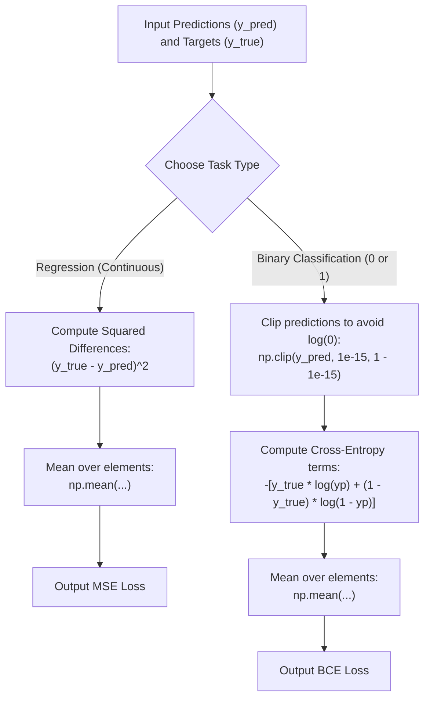

# Day 23: Loss Functions

### 🎯 Learning Objectives
- Explain the role of loss functions in quantifying model error during training.
- Implement Mean Squared Error (MSE) using NumPy for regression tasks.
- Implement Binary Cross-Entropy (BCE) using NumPy for classification tasks.
- Apply clipping techniques to prevent numerical instability (such as `log(0)` errors).
- Describe how loss values change as prediction accuracy improves or degrades.

### 🧩 Core Concepts (Why)
In deep learning, a neural network makes predictions by passing inputs through its layers. But how do we know if these predictions are good or bad? We need a mathematical metric to quantify the difference between the model's predictions ($\hat{y}$ or $y_{pred}$) and the actual target labels ($y$ or $y_{true}$). This metric is called a **loss function** (also known as a cost or error function).

Without a loss function, optimization algorithms wouldn't have a numeric target to minimize. Choosing the right loss function depends entirely on the type of machine learning task:
1. **Regression Tasks**: For predicting continuous values (e.g., house prices, temperatures), we want to measure the average squared difference between predictions and targets. We use **Mean Squared Error (MSE)**. Squaring the errors penalizes large deviations much more heavily than small ones.
2. **Binary Classification Tasks**: For predicting probabilities between 0 and 1 (e.g., spam detection, disease diagnosis), we compare the predicted probability distribution with the true binary labels. We use **Binary Cross-Entropy (BCE)**, which heavily penalizes confident but incorrect predictions (as the prediction approaches the wrong label, the loss approaches infinity).

### 🔁 Logic and Operation
The diagram below illustrates the steps involved in computing both MSE and BCE loss.



Additionally, let's visualize how the loss value behaves relative to predictions:
- For a target $y_{true} = 1.0$, as the prediction $y_{pred}$ approaches $1.0$, the loss decreases to $0$. As it approaches $0.0$, the loss grows exponentially.

```mermaid
graph TD
    subgraph Loss Behavior (Target = 1.0)
        direction LR
        P1["Prediction: 0.05"] --> L1["High BCE Loss: ~3.00"]
        P2["Prediction: 0.50"] --> L2["Medium BCE Loss: ~0.69"]
        P3["Prediction: 0.95"] --> L3["Low BCE Loss: ~0.05"]
    end
```

### 📝 Annotated Examples
Here is how to calculate both loss functions using NumPy.

```python
import numpy as np

# --- 1. Mean Squared Error (MSE) Example ---
y_true_reg = np.array([3.0, -0.5, 2.0, 7.0])
y_pred_reg = np.array([2.5,  0.0, 2.0, 8.0])

# Step-by-step breakdown:
# Differences:      [0.5, -0.5, 0.0, -1.0]
# Squared diffs:    [0.25, 0.25, 0.0, 1.0]
# Mean of squared:  (0.25 + 0.25 + 0.0 + 1.0) / 4 = 0.375
mse = np.mean((y_true_reg - y_pred_reg) ** 2)
print(f"MSE Loss: {mse}")  # Output: 0.375


# --- 2. Binary Cross-Entropy (BCE) Example ---
y_true_cls = np.array([1, 0, 1])
y_pred_cls = np.array([0.9, 0.1, 0.8])

# Clip predictions to prevent taking log(0)
epsilon = 1e-15
y_pred_clipped = np.clip(y_pred_cls, epsilon, 1 - epsilon)

# Element-wise cross-entropy terms:
# Sample 1: -(1 * ln(0.9) + 0 * ln(0.1)) = 0.10536
# Sample 2: -(0 * ln(0.1) + 1 * ln(0.9)) = 0.10536
# Sample 3: -(1 * ln(0.8) + 0 * ln(0.2)) = 0.22314
# Average BCE: (0.10536 + 0.10536 + 0.22314) / 3 = 0.14462
bce = -np.mean(y_true_cls * np.log(y_pred_clipped) + (1 - y_true_cls) * np.log(1 - y_pred_clipped))
print(f"BCE Loss: {bce}")  # Output: ~0.14462
```

### ❌ Common Mistakes

**Mistake 1: Missing Clipping in BCE**
```python
import numpy as np

def bce_unstable(y_true, y_pred):
    # Calculates BCE directly without clipping
    return -np.mean(y_true * np.log(y_pred) + (1 - y_true) * np.log(1 - y_pred))

yt = np.array([1, 0])
yp = np.array([1.0, 0.0]) # Perfect predictions
print(bce_unstable(yt, yp))
```
```text
RuntimeWarning: divide by zero encountered in log
RuntimeWarning: invalid value encountered in multiply
nan
```
```python
import numpy as np

def bce_stable(y_true, y_pred):
    yp_clipped = np.clip(y_pred, 1e-15, 1 - 1e-15)
    return -np.mean(y_true * np.log(yp_clipped) + (1 - y_true) * np.log(1 - yp_clipped))

yt = np.array([1, 0])
yp = np.array([1.0, 0.0])
print(bce_stable(yt, yp)) # Output: 9.992007221626415e-16 (virtually 0)
```
> When `y_pred` contains exactly `0.0` or `1.0`, taking the log of zero yields negative infinity. Multiplying `0 * -inf` results in `nan` (Not a Number) in NumPy. Clipping predictions to a tiny value close to 0 and 1 prevents this numerical breakdown.

**Mistake 2: Returning element-wise differences instead of a single scalar**
```python
import numpy as np

def incorrect_mse(y_true, y_pred):
    # Missing the mean operation
    return (y_true - y_pred) ** 2

yt = np.array([3.0, 2.0])
yp = np.array([2.0, 2.0])
loss = incorrect_mse(yt, yp)
print(float(loss))
```
```text
TypeError: only size-1 arrays can be converted to Python scalars
```
```python
import numpy as np

def correct_mse(y_true, y_pred):
    return np.mean((y_true - y_pred) ** 2)

yt = np.array([3.0, 2.0])
yp = np.array([2.0, 2.0])
loss = correct_mse(yt, yp)
print(float(loss)) # Output: 0.5
```
> Optimization algorithms require a single scalar value representing the total error across the training batch to perform updates. Returning an array of errors will break downstream computations.

### 💡 Tips & Idioms
- **Vectorized Performance**: Always use vectorized NumPy operations (e.g. subtraction, multiplication, and `np.mean`) instead of Python `for` loops. NumPy processes operations in highly optimized C, making them orders of magnitude faster.
- **Float Comparison**: When writing tests, never compare float results using the `==` operator due to standard floating-point representation limitations. Use `np.isclose()` or `np.allclose()` to check equality within a small tolerance.
- **Strict Probability Bounds**: Ensure activation functions like Sigmoid output values strictly within $(0, 1)$ before passing them to BCE loss.

### 🧠 Deep Dive (Under the hood)
<details><summary>Mathematical Formulations and Gradients (Click to expand)</summary>

#### Mathematical Formulae
- **Mean Squared Error (MSE)**:
  $$MSE = \frac{1}{N} \sum_{i=1}^{N} (y_i - \hat{y}_i)^2$$
- **Binary Cross-Entropy (BCE)**:
  $$BCE = -\frac{1}{N} \sum_{i=1}^{N} \left[ y_i \log(\hat{y}_i) + (1 - y_i) \log(1 - \hat{y}_i) \right]$$

#### Why not use MSE for classification?
1. **Mathematical justification**: BCE is derived from Maximum Likelihood Estimation (MLE) under a Bernoulli distribution.
2. **Gradient Saturation**: Classifying with a Sigmoid activation function $a = \sigma(z)$ combined with MSE results in gradients containing the term $\sigma'(z) = a(1-a)$. When predictions are confidently wrong, $a \to 0$ or $1$, causing the derivative $\sigma'(z)$ to shrink to 0. This "freezes" learning. 
3. **BCE Advantage**: The derivative of BCE loss $L$ with respect to the pre-activation input $z$ is:
   $$\frac{\partial L}{\partial z} = a - y$$
   This is linear and does not saturate, ensuring strong gradients and fast learning even when the network is far from correct.
</details>

### 🏋️ Exercise
Complete the implementations of `mean_squared_error` and `binary_cross_entropy` using NumPy in the editor.

```python
import numpy as np

def mean_squared_error(y_true, y_pred):
    # y_true: np.ndarray, y_pred: np.ndarray
    return None

def binary_cross_entropy(y_true, y_pred):
    # y_true: np.ndarray, y_pred: np.ndarray (probabilities between 0 and 1)
    # Clip y_pred to avoid log(0) using np.clip(y_pred, 1e-15, 1 - 1e-15)
    return None
```

### ✅ Self-Check
1. What value does BCE output if a target is `1.0` and the predicted probability is exactly `0.0` (with clipping set to `1e-15`)?
2. Why is squaring the error in MSE important compared to just using the absolute differences?
<details><summary>Click to view answers</summary>

1. If $y_{true} = 1.0$ and $y_{pred\_clipped} = 10^{-15}$, the loss term is $-\log(10^{-15}) \approx -(-34.54) = 34.54$. This large loss value heavily penalizes the model for being confidently wrong.
2. Squaring the error:
   - Eliminates negative signs so errors don't cancel each other out.
   - Penalizes larger errors much more severely than smaller errors (e.g., an error of 4 becomes a penalty of 16, whereas an error of 2 is only 4). This forces the model to prioritize correcting outliers.
</details>

### 📌 Summary
- **Loss functions** act as the mathematical feedback system guiding model parameter updates.
- **Mean Squared Error (MSE)** is the standard loss metric for continuous regression tasks.
- **Binary Cross-Entropy (BCE)** is the standard loss metric for predicting probabilities in binary classification.
- **Numerical Stability**: Always clip predictions in logarithmic calculations to prevent division-by-zero or undefined outputs.
