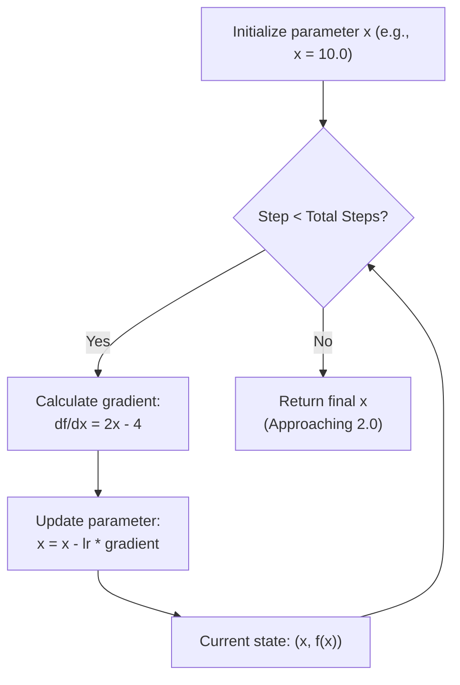

# Day 24: Gradient Descent from Scratch

### 🎯 Learning Objectives
- Explain the intuitive meaning of gradient descent, slope, and derivatives in optimization.
- Describe the role of the learning rate and the consequences of setting it too high or too low.
- Visualize and trace the optimization path of gradient descent descending a convex quadratic function.
- Implement a basic gradient descent optimizer from scratch in Python to find the minimum of a mathematical function.

### 🧩 Core Concepts (Why)
In machine learning and deep learning, once we define a loss function (like MSE or BCE), the next challenge is to find the model parameters (weights and biases) that make the loss as small as possible. Since neural networks can contain millions of parameters, we cannot solve for the minimum analytically (i.e. using algebra). Instead, we use an iterative optimization algorithm called **Gradient Descent**.

To understand gradient descent, imagine standing on a mountain in thick fog. Your goal is to reach the lowest valley (the minimum). Since you cannot see the path, you look at the slope under your feet and take a step in the steepest downward direction. By repeating this process, you will eventually reach the bottom.

In mathematics:
- **Derivative/Slope**: Tells us which direction is "up" or "down". The gradient points in the direction of steepest *ascent* (upwards). To find the minimum, we must move in the opposite direction (downwards).
- **Learning Rate ($lr$ or $\eta$)**: The step size of our movement. If the learning rate is too small, the descent will take a very long time. If the learning rate is too large, we might overshoot the minimum and bounce out of the valley completely.
- **Local vs. Global Minima**: A local minimum is the lowest point in a specific region, while the global minimum is the absolute lowest point across the entire function landscape.

### 🔁 Logic and Operation
The flowchart below shows the optimization loop of updating the parameter $x$ to minimize the function $f(x) = x^2 - 4x + 4$.



To see how this works step-by-step, let's trace the optimization path starting from $x_{init} = 10.0$ with a learning rate $lr = 0.1$. The minimum of $f(x) = x^2 - 4x + 4$ is at $x = 2.0$, where the slope is exactly 0.

```mermaid
graph TD
    subgraph Optimization Path (lr = 0.1)
        direction TB
        S["Start: x = 10.0 (f(x) = 64.0, slope = 16.0)"] ==>|Step 1: x - 0.1*16| S1["x = 8.4 (f(x) = 40.96, slope = 12.8)"]
        S1 ==>|Step 2: x - 0.1*12.8| S2["x = 7.12 (f(x) = 26.21, slope = 10.24)"]
        S2 -.->|Many steps...| SF["Target Minimum: x = 2.0 (f(x) = 0.0, slope = 0.0)"]
    end
```

### 📝 Annotated Examples
Here is a Python script that implements gradient descent to minimize $f(x) = x^2 - 4x + 4$.

```python
def f(x):
    # The mathematical function we want to minimize
    return x**2 - 4*x + 4

def df(x):
    # The derivative (slope) of the function f(x)
    # d/dx (x^2 - 4x + 4) = 2x - 4
    return 2*x - 4

# Initialize variables
x = 10.0
learning_rate = 0.1
steps = 10

print(f"Starting Point: x = {x:.4f}, f(x) = {f(x):.4f}")

# Optimization Loop
for step in range(1, steps + 1):
    gradient = df(x)               # Calculate the current slope
    x = x - learning_rate * gradient  # Update x in the opposite direction of the slope
    print(f"Step {step:2d}: x = {x:.4f}, f(x) = {f(x):.4f}, gradient = {gradient:.4f}")

print(f"Final Optimized Value: x = {x:.4f}") # Will be very close to 2.0
```

### ❌ Common Mistakes

**Mistake 1: Adding the gradient instead of subtracting it**
```python
def bad_optimizer(x_init, lr, steps):
    x = x_init
    for _ in range(steps):
        grad = 2 * x - 4
        # WRONG: Adding the gradient moves in the direction of maximum increase
        x = x + lr * grad
    return x

print(bad_optimizer(x_init=3.0, lr=0.1, steps=20))
```
```text
OverflowError: (34) Result too large
```
```python
def good_optimizer(x_init, lr, steps):
    x = x_init
    for _ in range(steps):
        grad = 2 * x - 4
        # CORRECT: Subtracting the gradient moves downhill towards the minimum
        x = x - lr * grad
    return x

print(good_optimizer(x_init=3.0, lr=0.1, steps=20)) # Output: 2.0115
```
> The gradient indicates the direction of steepest increase. Therefore, we must *subtract* the gradient to move in the direction of steepest decrease (downhill).

**Mistake 2: Calculating the gradient outside the loop**
```python
def bad_loop(x_init, lr, steps):
    x = x_init
    grad = 2 * x - 4 # WRONG: Gradient calculated only once!
    for _ in range(steps):
        x = x - lr * grad
    return x

print(bad_loop(x_init=10.0, lr=0.1, steps=50))
```
```text
# Returns -70.0 instead of converging to 2.0, causing test assertions to fail
AssertionError: Gradient descent did not converge to the minimum at x=2.0
```
```python
def good_loop(x_init, lr, steps):
    x = x_init
    for _ in range(steps):
        grad = 2 * x - 4 # CORRECT: Recalculate gradient using the updated x
        x = x - lr * grad
    return x

print(good_loop(x_init=10.0, lr=0.1, steps=50)) # Output: 2.0
```
> The slope changes as $x$ moves. We must recalculate the gradient at every single step using the new value of $x$ to adjust our direction and step size.

### 💡 Tips & Idioms
- **Learning Rate Decay**: Starting with a higher learning rate and gradually decreasing it helps speed up early training while preventing oscillation around the minimum later on.
- **Gradient Clipping**: In neural networks, gradients can sometimes grow extremely large, causing parameters to overflow into `NaN`. Setting a threshold to clip gradients (e.g. max value of 1.0) prevents this.
- **Saddle Points**: In high-dimensional optimization (deep learning), simple local minima are less common than saddle points—flat regions where the slope is zero in some directions but not others. Special optimization methods (like Adam or Momentum) help escape them.

### 🧠 Deep Dive (Under the hood)
<details><summary>Convexity, Convergence, and Learning Rate Bounds (Click to expand)</summary>

#### Convex vs. Non-Convex Optimization
- **Convex Functions**: A function is convex if a line segment drawn between any two points on its graph lies above or on the graph itself. Convex functions (such as $f(x) = x^2 - 4x + 4$) are mathematically guaranteed to have exactly one minimum, which is the global minimum.
- **Non-Convex Functions**: Neural network loss surfaces are highly non-convex, featuring thousands of peaks, valleys, local minima, and saddle points. This is why initializing weights randomly is crucial—it gives the optimizer multiple starting points to find a high-quality minimum.

#### The Math of the Learning Rate Bound
For a quadratic function $f(x)$, we can determine the exact mathematical threshold for convergence:
- The update step is: $x_{k+1} = x_k - \eta f'(x_k)$
- For our function, $f'(x) = 2x - 4$.
- Let's analyze the distance to the minimum ($x^* = 2$):
  $$x_{k+1} - 2 = (x_k - \eta(2x_k - 4)) - 2 = x_k - 2\eta x_k + 4\eta - 2 = (1 - 2\eta)(x_k - 2)$$
- For the distance to shrink, the multiplier must satisfy:
  $$|1 - 2\eta| < 1 \implies -1 < 1 - 2\eta < 1 \implies 0 < \eta < 1$$
- **Consequences**:
  - If $\eta = 0.5$, we converge in exactly 1 step ($1 - 2(0.5) = 0$).
  - If $0 < \eta < 1.0$, we converge successfully.
  - If $\eta \ge 1.0$, the updates will oscillate or diverge to infinity.
</details>

### 🏋️ Exercise
Complete the `gradient_descent` function to find the minimum of $f(x) = x^2 - 4x + 4$.

```python
def gradient_descent(x_init, lr, steps):
    # Find the minimum of f(x) = x^2 - 4x + 4
    # df/dx = 2x - 4
    x = x_init
    for _ in range(steps):
        # Update x
        pass
    return x
```

### ✅ Self-Check
1. What is the value of the gradient of $f(x) = x^2 - 4x + 4$ when $x = 2.0$?
2. What happens to the step sizes as gradient descent approaches the minimum (assuming a fixed learning rate of $0.1$)?
<details><summary>Click to view answers</summary>

1. At $x = 2.0$, the gradient is $2(2) - 4 = 0$. Since the gradient is 0, the update step becomes $x = x - lr \times 0 = x$, meaning the parameter stops moving. This is a stationary point (minimum).
2. The step sizes become smaller. Because the slope (gradient) decreases as we get closer to the flat bottom of the valley, the update term $lr \times gradient$ naturally shrinks, allowing the model to settle smoothly into the minimum.
</details>

### 📌 Summary
- **Gradient descent** is an iterative algorithm that minimizes functions by moving parameters in the opposite direction of the gradient.
- The **gradient** represents the slope of the function; it points to 0 at local and global minima.
- The **learning rate** controls the step size. If it is too small, training is slow; if too large, optimization diverges.
- In convex optimization, we are guaranteed to find the global minimum. Neural networks require advanced strategies to navigate non-convex landscapes.
