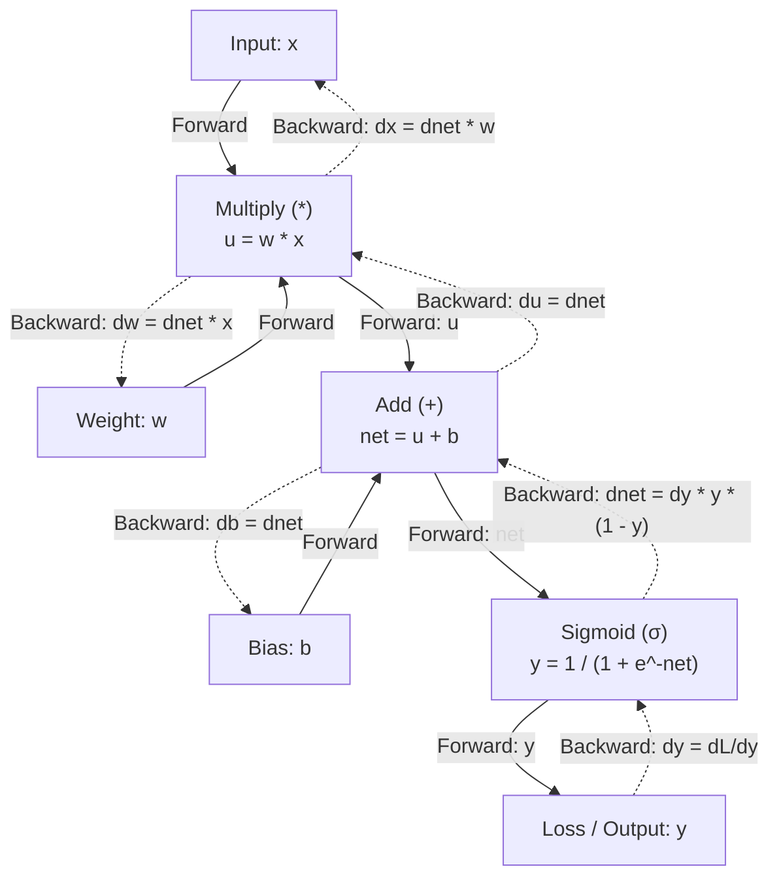
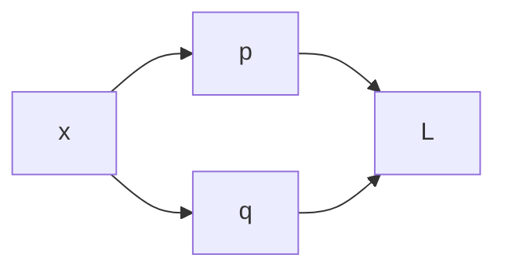

# Day 25: Backpropagation by Hand

### 🎯 Learning Objectives
- Explain the Chain Rule of calculus and its application in backpropagation.
- Compute partial derivatives of intermediate variables in a computational graph.
- Trace and implement a backward pass for a single neuron node with a sigmoid activation.
- Calculate gradients for weights and biases manually using local derivatives.

### 🧩 Core Concepts (Why)
In neural networks, we chain together layers of mathematical operations. To optimize these networks using gradient descent, we must calculate how the final loss ($L$) changes with respect to every single parameter (weights $w$ and biases $b$). 

If we calculated the gradient for each weight individually from scratch (numerical differentiation), we would have to run the network forward once for every single weight. In modern networks with billions of parameters, this is computationally impossible.

Instead, we use **Backpropagation**, which is the efficient calculation of gradients via the mathematical **Chain Rule of Calculus**. The key idea is that we can break down complex mathematical functions into a sequence of simple operations (a computational graph). Each operation only needs to know its own **local gradient**. By multiplying this local gradient by the incoming gradient from the next layer (the **upstream gradient**), we can propagate the gradients backward through the network in a single pass ($O(1)$ time relative to the forward pass).

According to the Chain Rule, if a variable $y$ depends on $u$, and $u$ depends on $x$, then the rate of change of $y$ with respect to $x$ is:
$$\frac{\partial y}{\partial x} = \frac{\partial y}{\partial u} \cdot \frac{\partial u}{\partial x}$$

### 🔁 Logic and Operation
The computational graph below shows the flow of forward computation (solid lines) and backward gradient propagation (dashed lines) for a single neuron:
$$y = \sigma(w \cdot x + b)$$



#### 1. Forward Pass
1. Compute the weighted input product: $u = w \cdot x$
2. Add the bias to get the pre-activation value: $net = u + b$
3. Apply the sigmoid activation function: $y = \sigma(net) = \frac{1}{1 + e^{-net}}$

#### 2. Backward Pass
During backpropagation, we receive an upstream gradient $dy = \frac{\partial L}{\partial y}$. We compute the gradients of the parameters by working backward:
1. **Sigmoid Node**: The local derivative is $\frac{\partial y}{\partial net} = y(1 - y)$.
   We chain this with $dy$ to get:
   $$dnet = \frac{\partial L}{\partial net} = dy \cdot y(1 - y)$$
2. **Add Node**: The local derivatives with respect to inputs $u$ and $b$ are both $1$.
   Therefore, we just pass the gradient down:
   $$db = \frac{\partial L}{\partial b} = dnet \cdot 1 = dnet$$
   $$du = \frac{\partial L}{\partial u} = dnet \cdot 1 = dnet$$
3. **Multiply Node**: The local derivative of $u = w \cdot x$ is $\frac{\partial u}{\partial w} = x$ and $\frac{\partial u}{\partial x} = w$.
   Therefore:
   $$dw = \frac{\partial L}{\partial w} = du \cdot \frac{\partial u}{\partial w} = dnet \cdot x$$
   $$dx = \frac{\partial L}{\partial x} = du \cdot \frac{\partial u}{\partial x} = dnet \cdot w$$

### 📝 Annotated Examples
Let's calculate the forward and backward passes using specific numerical values:
- Input: $x = 2.0$
- Weight: $w = 0.5$
- Bias: $b = -1.0$
- Upstream Loss Gradient: $dy = 1.0$

#### Step-by-Step Calculation:
1. **Forward:**
   - $u = w \cdot x = 0.5 \cdot 2.0 = 1.0$
   - $net = u + b = 1.0 + (-1.0) = 0.0$
   - $y = \sigma(0.0) = \frac{1}{1 + e^0} = 0.5$
2. **Backward:**
   - $dnet = dy \cdot y(1 - y) = 1.0 \cdot 0.5 \cdot (1 - 0.5) = 0.25$
   - $db = dnet = 0.25$
   - $dw = dnet \cdot x = 0.25 \cdot 2.0 = 0.5$

Here is how this is traced in code:
```python
import numpy as np

# Inputs
x = 2.0
w = 0.5
b = -1.0
dy = 1.0  # Incoming gradient dL/dy

# --- FORWARD PASS ---
u = w * x
net = u + b
y = 1 / (1 + np.exp(-net))
print(f"Forward output y: {y}")  # Output: 0.5

# --- BACKWARD PASS ---
# Local derivative of sigmoid: dy/dnet = y * (1 - y)
dy_dnet = y * (1 - y)

# Chain rule for the pre-activation net: dL/dnet = dL/dy * dy/dnet
dnet = dy * dy_dnet

# Local derivative of addition: dnet/db = 1 -> dL/db = dL/dnet * 1
db = dnet

# Local derivative of multiplication: dnet/dw = x -> dL/dw = dL/dnet * x
dw = dnet * x

print(f"Calculated db (dL/db): {db}")  # Output: 0.25
print(f"Calculated dw (dL/dw): {dw}")  # Output: 0.5
```

### ❌ Common Mistakes

**Mistake 1: Forgetting to multiply by the upstream gradient**
```python
def backprop_step(x, w, b, dy):
    net = w * x + b
    y = 1 / (1 + np.exp(-net))
    dy_dnet = y * (1 - y)
    # WRONG: db and dw only compute the local gradient instead of chaining
    db = dy_dnet
    dw = dy_dnet * x
    return dw, db
```
```text
Traceback (most recent call last):
  File "exercise.py", line 12, in <module>
    assert np.isclose(db, 0.25), "db gradient incorrect"
AssertionError: db gradient incorrect
```
```python
def backprop_step(x, w, b, dy):
    net = w * x + b
    y = 1 / (1 + np.exp(-net))
    dy_dnet = y * (1 - y)
    # CORRECT: Multiply by the upstream gradient dy to continue the chain
    db = dy * dy_dnet
    dw = dy * dy_dnet * x
    return dw, db
```
> The chain rule requires multiplying the local gradient by the incoming upstream gradient. Omitting it isolates the node and produces incorrect derivative values relative to the final loss.

**Mistake 2: Swapping the local derivative variables**
```python
def backprop_step(x, w, b, dy):
    net = w * x + b
    y = 1 / (1 + np.exp(-net))
    dy_dnet = y * (1 - y)
    db = dy * dy_dnet
    # WRONG: w is used as the local derivative for dw instead of x
    dw = dy * dy_dnet * w
    return dw, db
```
```text
Traceback (most recent call last):
  File "exercise.py", line 13, in <module>
    assert np.isclose(dw, 0.5), "dw gradient incorrect"
AssertionError: dw gradient incorrect
```
```python
def backprop_step(x, w, b, dy):
    net = w * x + b
    y = 1 / (1 + np.exp(-net))
    dy_dnet = y * (1 - y)
    db = dy * dy_dnet
    # CORRECT: The derivative of w*x + b with respect to w is x
    dw = dy * dy_dnet * x
    return dw, db
```
> Since $u = w \cdot x$, the rate of change of $u$ with respect to the weight $w$ is the input $x$ (i.e., $\frac{\partial u}{\partial w} = x$). Thus, $dw$ must scale with $x$, not $w$.

### 💡 Tips & Idioms
- **Sigmoid Output Reuse**: Since the derivative of the Sigmoid function is $\sigma'(z) = \sigma(z)(1 - \sigma(z))$, you should always save the output of the forward pass $y = \sigma(z)$ and reuse it in the backward pass. This avoids repeating the computationally expensive exponentiation step (`np.exp`).
- **Intermediate Variables**: Always store intermediate forward variables (like `net` and `y`) in variables. Trying to write the entire forward and backward pass in a single compressed line is highly error-prone.
- **Gradient Naming**: A common industry standard is to name the loss gradients of variables by prefixing them with a `d` (e.g. `dw` for $\frac{\partial L}{\partial w}$, `db` for $\frac{\partial L}{\partial b}$, and `dnet` for $\frac{\partial L}{\partial net}$).

### 🧠 Deep Dive (Under the hood)
<details><summary>Deriving the Sigmoid Derivative and the Multivariate Chain Rule (Click to expand)</summary>

#### Analytical Derivation of the Sigmoid Derivative
Let $\sigma(z) = \frac{1}{1 + e^{-z}} = (1 + e^{-z})^{-1}$.
We apply the chain rule and power rule to find the derivative with respect to $z$:
$$\frac{d}{dz} \sigma(z) = -1 \cdot (1 + e^{-z})^{-2} \cdot \frac{d}{dz}(1 + e^{-z})$$
$$\frac{d}{dz} \sigma(z) = -(1 + e^{-z})^{-2} \cdot (-e^{-z})$$
$$\frac{d}{dz} \sigma(z) = \frac{e^{-z}}{(1 + e^{-z})^2}$$

We can rewrite this expression to express the derivative in terms of $\sigma(z)$ itself:
$$\frac{d}{dz} \sigma(z) = \frac{1}{1 + e^{-z}} \cdot \frac{e^{-z}}{1 + e^{-z}}$$
$$\frac{d}{dz} \sigma(z) = \sigma(z) \cdot \left( \frac{(1 + e^{-z}) - 1}{1 + e^{-z}} \right)$$
$$\frac{d}{dz} \sigma(z) = \sigma(z) \cdot \left( \frac{1 + e^{-z}}{1 + e^{-z}} - \frac{1}{1 + e^{-z}} \right)$$
$$\frac{d}{dz} \sigma(z) = \sigma(z)(1 - \sigma(z))$$
This simple algebraic form makes it incredibly efficient to compute in deep learning.

#### The Multivariate Chain Rule (Branches in Graphs)
In a computational graph, a variable might branch out and affect multiple downstream nodes. For example, if a variable $x$ affects both $p$ and $q$, which then both affect the final loss $L$:

In this scenario, changing $x$ changes $L$ through two separate pathways. By the multivariate chain rule, we must **sum** the gradients flowing back from all branches:
$$\frac{\partial L}{\partial x} = \frac{\partial L}{\partial p}\frac{\partial p}{\partial x} + \frac{\partial L}{\partial q}\frac{\partial q}{\partial x}$$
Thus, when implementing backpropagation for nodes that distribute their outputs to multiple paths, you must accumulate (sum) all incoming gradients.
</details>

### 🏋️ Exercise
Complete the function `backprop_step(x, w, b, dy)` to implement the forward and backward pass for a single neuron node with a sigmoid activation. Return `dw` ($\frac{\partial L}{\partial w}$) and `db` ($\frac{\partial L}{\partial b}$).

```python
import numpy as np

def backprop_step(x, w, b, dy):
    # Forward pass: y = sigmoid(w * x + b)
    # backward pass: calculate dw (dL/dw) and db (dL/db) given dy (dL/dy)
    dw = None
    db = None
    return dw, db
```

### ✅ Self-Check
1. If the pre-activation value $net = w \cdot x + b$ is very large (e.g. $10.0$), what happens to the output gradient $dw$?
2. In a computational graph, what is the local gradient of a multiplication node $u = a \cdot b$ with respect to $a$?
<details><summary>Answers</summary>

1. If $net = 10.0$, the sigmoid activation $y = \sigma(10.0) \approx 0.99995$. The local gradient of sigmoid is $y(1 - y) \approx 0.99995 \times (0.00005) \approx 0.00005$, which is extremely close to $0$. As a result, the gradients $db$ and $dw$ will become virtually $0$. This is known as the **vanishing gradient problem**, where active saturated neurons stop learning.
2. The local gradient of $u = a \cdot b$ with respect to $a$ is $\frac{\partial u}{\partial a} = b$. In other words, during the backward pass of a multiplication node, the incoming gradient is multiplied by the value of the *other* input (swapping inputs).
</details>

### 📌 Summary
- **Backpropagation** uses the calculus **Chain Rule** to compute the gradient of the loss function with respect to all weights and biases.
- Breaking down computations into a graph allows each node to compute local gradients independently.
- The Sigmoid activation function $\sigma(z)$ has a simple derivative: $\sigma(z)(1 - \sigma(z))$.
- During the backward pass, gradients flow backward, multiplying the upstream gradient by the local gradient at each step.
