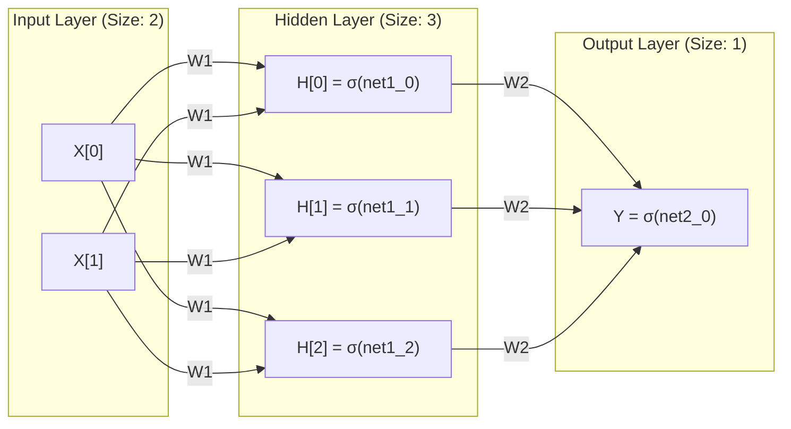

# Day 26: 2-Layer Neural Network

### 🎯 Learning Objectives
- Explain the role of hidden layers and non-linear activations in neural networks.
- Determine the compatible shapes of weight matrices and bias vectors across multiple layers.
- Implement feedforward logic for a multi-layer neural network from scratch using NumPy.
- Apply random weight initialization and understand why zero initialization fails for weights.

### 🧩 Core Concepts (Why)
A single-layer network (like a single perceptron) can only classify linearly separable data. It fails completely on simple non-linear relationships, such as the XOR problem.

To solve complex real-world problems, we stack multiple layers of neurons together. This creates a **Multi-Layer Perceptron (MLP)** or a feedforward neural network. 

The core concepts of a multi-layer network are:
1. **Hidden Layers**: Layers positioned between the inputs and outputs. These layers construct **hidden representations**—automatically extracting abstract features from raw inputs (e.g., detecting edges from raw pixels).
2. **Activation Functions (Non-linearity)**: If we do not apply a non-linear function (like Sigmoid or ReLU) after each layer, the entire network simplifies to a single linear equation, regardless of how many layers we stack. Non-linearities allow the network to learn complex curved decision boundaries.
3. **Layer Dimensions**: Each layer has a set of weights mapping its input dimensions to its output dimensions. Keeping track of these matrix shapes is crucial for bug-free deep learning implementations.

### 🔁 Logic and Operation
The feedforward diagram below shows a 2-layer network that maps an input of size 2 (e.g. 2 features) to a hidden layer of size 3, and finally to an output layer of size 1:



Let's trace the mathematical dimensions and operations for a batch of $N$ input samples:
1. **Input Matrix $X$**: Shape $(N, 2)$ where $N$ is the number of samples.
2. **Hidden Layer 1 weights & biases**:
   - Weight $W_1$ of shape $(2, 3)$ maps input size 2 to hidden size 3.
   - Bias $b_1$ of shape $(1, 3)$ is added to each of the 3 hidden nodes.
   - Pre-activation: $net_1 = X \cdot W_1 + b_1$ (Shape: $(N, 3)$).
   - Activation: $H = \sigma(net_1) = \frac{1}{1 + e^{-net_1}}$ (Shape: $(N, 3)$).
3. **Output Layer 2 weights & biases**:
   - Weight $W_2$ of shape $(3, 1)$ maps hidden size 3 to output size 1.
   - Bias $b_2$ of shape $(1, 1)$ is added to the output node.
   - Pre-activation: $net_2 = H \cdot W_2 + b_2$ (Shape: $(N, 1)$).
   - Activation: $Y = \sigma(net_2) = \frac{1}{1 + e^{-net_2}}$ (Shape: $(N, 1)$).

### 📝 Annotated Examples
Here is how to define the class, initialize weights randomly, and perform a feedforward pass:
```python
import numpy as np

class TwoLayerNet:
    def __init__(self, input_size, hidden_size, output_size):
        # np.random.seed ensures reproducible initial weights
        np.random.seed(42)
        
        # Initialize weights with small random values from a standard normal distribution
        self.W1 = np.random.randn(input_size, hidden_size) * 0.01
        self.b1 = np.zeros((1, hidden_size))
        
        self.W2 = np.random.randn(hidden_size, output_size) * 0.01
        self.b2 = np.zeros((1, output_size))

    def forward(self, X):
        # 1. Compute hidden layer activation
        net1 = np.dot(X, self.W1) + self.b1
        H = 1 / (1 + np.exp(-net1))  # Sigmoid activation
        
        # 2. Compute output layer activation
        net2 = np.dot(H, self.W2) + self.b2
        Y = 1 / (1 + np.exp(-net2))  # Sigmoid activation
        
        return H, Y

# Instantiate: Input size 2, Hidden size 3, Output size 1
net = TwoLayerNet(input_size=2, hidden_size=3, output_size=1)

# Pass a batch of 2 samples:
X_batch = np.array([[0.5, 0.8], 
                    [0.1, 0.4]])

hidden_act, output_act = net.forward(X_batch)

print("Input shape: ", X_batch.shape)        # Output: (2, 2)
print("Hidden shape:", hidden_act.shape)     # Output: (2, 3)
print("Output shape:", output_act.shape)     # Output: (2, 1)
print("Outputs:\n", output_act)
```

### ❌ Common Mistakes

**Mistake 1: Swapping matrix dimensions in dot product**
```python
def forward(self, X):
    # WRONG: np.dot(self.W1, X) has dimension mismatch (2,3) x (1,2)
    net1 = np.dot(self.W1, X) + self.b1
    H = 1 / (1 + np.exp(-net1))
    net2 = np.dot(self.W2, H) + self.b2
    Y = 1 / (1 + np.exp(-net2))
    return H, Y
```
```text
Traceback (most recent call last):
  File "exercise.py", line 15, in <module>
    H, Y = net.forward(X)
  File "exercise.py", line 11, in forward
    net1 = np.dot(self.W1, X) + self.b1
ValueError: shapes (2,3) and (1,2) not aligned: 3 (dim 1) != 1 (dim 0)
```
```python
def forward(self, X):
    # CORRECT: X is (N, D) and W1 is (D, H), so np.dot(X, W1) yields (N, H)
    net1 = np.dot(X, self.W1) + self.b1
    H = 1 / (1 + np.exp(-net1))
    net2 = np.dot(H, self.W2) + self.b2
    Y = 1 / (1 + np.exp(-net2))
    return H, Y
```
> Matrix multiplication is not commutative ($A \cdot B \neq B \cdot A$). The columns of the first matrix must match the rows of the second. Thus, for input $X \in \mathbb{R}^{N \times D}$ and weight $W \in \mathbb{R}^{D \times H}$, we must multiply as $X \cdot W$.

**Mistake 2: Using element-wise multiplication (*) instead of matrix dot product**
```python
def forward(self, X):
    # WRONG: '*' is element-wise multiplication, not matrix multiplication
    net1 = X * self.W1 + self.b1
    H = 1 / (1 + np.exp(-net1))
    net2 = H * self.W2 + self.b2
    Y = 1 / (1 + np.exp(-net2))
    return H, Y
```
```text
Traceback (most recent call last):
  File "exercise.py", line 15, in <module>
    H, Y = net.forward(X)
  File "exercise.py", line 11, in forward
    net1 = X * self.W1 + self.b1
ValueError: operands could not be broadcast together with shapes (1,2) (2,3) 
```
```python
def forward(self, X):
    # CORRECT: Use np.dot() or the '@' operator for matrix multiplication
    net1 = np.dot(X, self.W1) + self.b1
    H = 1 / (1 + np.exp(-net1))
    net2 = np.dot(H, self.W2) + self.b2
    Y = 1 / (1 + np.exp(-net2))
    return H, Y
```
> In NumPy, the standard `*` operator performs element-wise multiplication, which requires matching shapes. To project inputs into high-dimensional hidden spaces, matrix multiplication (`np.dot` or `@`) must be used.

### 💡 Tips & Idioms
- **The `@` Operator**: In modern Python (3.5+), you can use the `@` operator as a shorthand for matrix multiplication: `net1 = X @ self.W1 + self.b1`.
- **NumPy Broadcasting**: When adding the bias $b_1$ of shape $(1, H)$ to $X \cdot W_1$ of shape $(N, H)$, NumPy automatically replicates $b_1$ along the batch dimension ($N$ times) so that they can be added together. This is called **broadcasting**.
- **Keeping Biases at Zero**: While initializing weights to zero prevents learning (due to symmetric gradients), initializing biases to all zeros (`np.zeros`) is perfectly fine and standard practice, as long as weights are randomly initialized.

### 🧠 Deep Dive (Under the hood)
<details><summary>Matrix Compatibility and Random Weight Initialization Strategies (Click to expand)</summary>

#### Matrix Dimension Compatibility Rule
For a sequence of linear transformations in a neural network, the inner dimensions must match at every interface:
$$\text{Input: } X \in \mathbb{R}^{N \times D}$$
$$\text{Weight 1: } W_1 \in \mathbb{R}^{D \times H} \implies X \cdot W_1 \in \mathbb{R}^{N \times H}$$
$$\text{Weight 2: } W_2 \in \mathbb{R}^{H \times M} \implies H \cdot W_2 \in \mathbb{R}^{N \times M}$$
Here:
- $N$ is the batch size (independent sample count).
- $D$ is the input feature dimension.
- $H$ is the hidden layer size.
- $M$ is the output layer size.
If you stack $K$ layers, the column dimension of weight matrix $W_i$ must exactly match the row dimension of weight matrix $W_{i+1}$.

#### The Problem of Zero Initialization (Symmetry Breaking)
Why can't we initialize weight matrices to all zeros (`np.zeros`)?
If all weights are initialized to 0:
1. Every hidden unit in the layer will compute the exact same output: $h_j = \sigma(0) = 0.5$ (assuming sigmoid).
2. During backpropagation, every hidden unit will compute the exact same gradient.
3. When updating weights, all neurons will update in lockstep.
As a result, the hidden layer will behave like a single neuron, making it impossible for different neurons to learn different features. This is called the **symmetric weights problem**. Random initialization **breaks this symmetry**.

#### Advanced Initialization Strategies
Initializing weights simply as `randn * 0.01` works for shallow networks, but for deep networks, it can cause activations to collapse to zero or explode to infinity. Modern deep learning uses variance-scaling methods:
1. **Xavier (Glorot) Initialization**: Used for Sigmoid or Tanh activations. It draws weights from a normal distribution with variance $\sigma^2 = \frac{2}{n_{in} + n_{out}}$:
   ```python
   limit = np.sqrt(6 / (input_size + output_size))
   W = np.random.uniform(-limit, limit, (input_size, output_size))
   ```
2. **He (Kaiming) Initialization**: Used for ReLU activations. It draws weights with variance $\sigma^2 = \frac{2}{n_{in}}$:
   ```python
   W = np.random.randn(input_size, output_size) * np.sqrt(2.0 / input_size)
   ```
These methods ensure that the variance of signals remains consistent during both forward passes and backward passes.
</details>

### 🏋️ Exercise
Complete the `forward(self, X)` method of the `TwoLayerNet` class. Compute the hidden layer activations `H` and final output activations `Y` using matrix multiplication and sigmoid activations.

```python
import numpy as np

class TwoLayerNet:
    def __init__(self, input_size, hidden_size, output_size):
        np.random.seed(42)
        self.W1 = np.random.randn(input_size, hidden_size) * 0.01
        self.b1 = np.zeros((1, hidden_size))
        self.W2 = np.random.randn(hidden_size, output_size) * 0.01
        self.b2 = np.zeros((1, output_size))

    def forward(self, X):
        # Implement forward pass here
        H = None
        Y = None
        return H, Y
```

### ✅ Self-Check
1. If our input $X$ has shape $(5, 4)$ and output $Y$ has shape $(5, 2)$, what must be the dimensions of $W_1$ and $W_2$ if we use a hidden size of $10$?
2. What happens if we remove the Sigmoid activation from both layers in `TwoLayerNet`?
<details><summary>Answers</summary>

1. Input dimension $D = 4$, hidden size $H = 10$, and output dimension $M = 2$.
   - $W_1$ must map from $D$ to $H$, so its shape is $(4, 10)$.
   - $W_2$ must map from $H$ to $M$, so its shape is $(10, 2)$.
2. Without activation functions, the forward pass is:
   $$Y = (X \cdot W_1 + b_1) \cdot W_2 + b_2 = X \cdot (W_1 \cdot W_2) + (b_1 \cdot W_2 + b_2)$$
   Let $W_{eff} = W_1 \cdot W_2$ and $b_{eff} = b_1 \cdot W_2 + b_2$. The equation simplifies to $Y = X \cdot W_{eff} + b_{eff}$. Thus, the network behaves exactly like a single-layer linear model, losing all its multi-layer feature extraction capability.
</details>

### 📌 Summary
- **Multi-layer neural networks** introduce hidden layers to learn non-linear decision boundaries.
- **Non-linear activations** are essential to prevent stacked layers from collapsing into a single linear transformation.
- Weight matrices map dimensions between layers; compatible matrix multiplication shapes must be maintained.
- **Random weight initialization** breaks symmetry, allowing individual neurons to learn distinct features.
