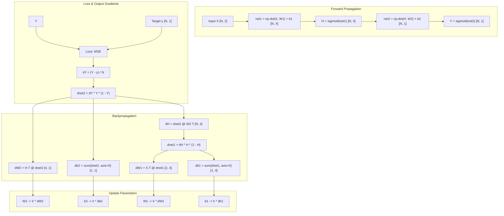

### 🎯 Learning Objectives
- Explain why a single-layer perceptron cannot solve the XOR gate problem.
- Understand the architecture of a 2-layer Feedforward Neural Network (Multilayer Perceptron).
- Implement forward propagation, backpropagation, and parameter updates for a 2-layer network from scratch using NumPy.
- Train a neural network to solve a non-linearly separable classification problem.

### 🧩 Core Concepts (Why)
A single-layer perceptron can only draw a straight line (a linear decision boundary) to separate data points. In classification tasks, some problems are **linearly separable** (like AND / OR gates) where a single straight line can perfectly divide the classes. 

However, the **XOR (Exclusive OR) gate** is the classic example of a **non-linearly separable** problem. If you plot the inputs of XOR:
- `(0, 0) -> 0` (Class A)
- `(1, 1) -> 0` (Class A)
- `(0, 1) -> 1` (Class B)
- `(1, 0) -> 1` (Class B)

You will see that no single straight line can separate Class A from Class B. To solve this, we must introduce at least one **hidden layer** with a non-linear activation function. This hidden layer transforms the input space into a new feature space where the classes become linearly separable by the output layer.

### 🔁 Logic and Operation
The training process of a 2-layer neural network on the XOR dataset consists of:
1. **Initialize Weights**: Small random values for weight matrices $W_1, W_2$ and zeros for biases $b_1, b_2$.
2. **Forward Propagation**:
   - Compute the hidden layer's pre-activation: $net_1 = X \cdot W_1 + b_1$
   - Apply activation function (Sigmoid): $H = \sigma(net_1)$
   - Compute the output layer's pre-activation: $net_2 = H \cdot W_2 + b_2$
   - Apply activation function (Sigmoid): $Y = \sigma(net_2)$
3. **Loss Computation**: Measure the difference between prediction $Y$ and target $y$ using Mean Squared Error (MSE).
4. **Backward Propagation**: Use the Chain Rule to calculate gradients for all parameters ($W_2, b_2, W_1, b_1$).
5. **Parameter Update**: Adjust weights and biases using Gradient Descent.



### 📝 Annotated Examples
Here is how you implement a forward pass and compute the final output using pre-initialized weights.

```python
import numpy as np

# Inputs: 4 samples of 2 features (XOR inputs)
X = np.array([[0, 0], [0, 1], [1, 0], [1, 1]])

# Layer sizes: Input=2, Hidden=4, Output=1
# Initialize weights manually for demonstration
W1 = np.array([[ 0.5, -0.2,  0.8, -0.5],
               [-0.3,  0.6, -0.7,  0.9]])
b1 = np.zeros((1, 4))

W2 = np.array([[ 0.3], [-0.8], [ 0.5], [ 0.2]])
b2 = np.zeros((1, 1))

# Helper: Sigmoid activation
def sigmoid(x):
    return 1 / (1 + np.exp(-x))

# 1. Forward Pass to Hidden Layer
net1 = np.dot(X, W1) + b1    # shape: (4, 2) @ (2, 4) + (1, 4) = (4, 4)
H = sigmoid(net1)            # shape: (4, 4)

# 2. Forward Pass to Output Layer
net2 = np.dot(H, W2) + b2    # shape: (4, 4) @ (4, 1) + (1, 1) = (4, 1)
Y = sigmoid(net2)            # shape: (4, 1)

print("Predictions:\n", Y)
```

### ❌ Common Mistakes

**Mistake 1: Incorrect dimension matching when computing hidden layer loss gradient ($dH$)**
```python
# Wrong code
dH = np.dot(W2, dnet2)
```
```text
ValueError: shapes (4,1) and (4,1) not aligned: 1 (dim 1) != 4 (dim 0)
```
```python
# Correct code
dH = np.dot(dnet2, W2.T)
```
> The variable `dnet2` represents the gradient of the pre-activation at the output layer with shape `(N, 1)`. The output weight `W2` has shape `(4, 1)`. In order to propagate the error back to the hidden layer `H` (which has shape `(N, 4)`), we must matrix multiply `dnet2` by the transpose of `W2` (`W2.T`), resulting in `(N, 1) @ (1, 4) = (N, 4)`.

**Mistake 2: Forgetting to keep dimensions during bias gradient summation**
```python
# Wrong code
db1 = np.sum(dnet1, axis=0) # Loses the row dimension, becomes 1D array
```
```text
ValueError: operands could not be broadcast together with shapes (1,4) (4,)
```
```python
# Correct code
db1 = np.sum(dnet1, axis=0, keepdims=True)
```
> NumPy's `np.sum` collapses the specified axis. Without `keepdims=True`, the shape changes from `(N, 4)` to `(4,)` instead of `(1, 4)`. When updating the bias `b1` (which is `(1, 4)`), the shapes must match exactly to perform broadcasting.

### 💡 Tips & Idioms
- **Matrix Multiplications**: Use `np.dot(A, B)` or the `@` operator (`A @ B`) in Python for matrix multiplications. Keep track of matrix shapes by printing `.shape` frequently during debugging.
- **Sigmoid Derivative**: If $a = \sigma(z)$, then the derivative $\frac{\partial a}{\partial z} = a(1 - a)$. There is no need to re-compute exponents during backpropagation; reuse the forward pass outputs `H` and `Y`.
- **Reproducibility**: Always call `np.random.seed(seed_number)` before initializing weights to ensure that the initial random states are consistent across different run trials.

### 🧠 Deep Dive (Under the hood)
<details><summary>Deriving Backpropagation Gradients for Matrix Computations (Click to expand)</summary>

Let's derive the equations step-by-step using matrix calculus.
Given:
$$H = \sigma(X W_1 + b_1)$$
$$Y = \sigma(H W_2 + b_2)$$

We define the loss function (Mean Squared Error) over $N$ samples:
$$L = \frac{1}{2N} \sum_{i=1}^{N} (Y_i - y_i)^2$$

1. **Gradient of Output Layer**:
   The gradient with respect to output predictions $Y$ is:
   $$\frac{\partial L}{\partial Y} = \frac{1}{N} (Y - y)$$
   
   Using the Chain Rule, the gradient of the pre-activation output $net_2 = H W_2 + b_2$:
   $$\text{dnet}_2 = \frac{\partial L}{\partial net_2} = \frac{\partial L}{\partial Y} \odot \sigma'(net_2) = \text{dY} \odot Y \odot (1 - Y)$$
   *(where $\odot$ denotes element-wise multiplication).*

2. **Gradients of Weights and Biases (Output Layer)**:
   $$dW_2 = H^T \cdot \text{dnet}_2$$
   $$db_2 = \sum \text{dnet}_2 \quad \text{(summed across batches)}$$

3. **Gradient of Hidden Layer**:
   Now we propagate the gradient back to the activation of the hidden layer $H$:
   $$dH = \frac{\partial L}{\partial H} = \text{dnet}_2 \cdot W_2^T$$
   
   The gradient of the pre-activation hidden layer $net_1 = X W_1 + b_1$:
   $$\text{dnet}_1 = \frac{\partial L}{\partial net_1} = dH \odot H \odot (1 - H)$$

4. **Gradients of Weights and Biases (Hidden Layer)**:
   $$dW_1 = X^T \cdot \text{dnet}_1$$
   $$db_1 = \sum \text{dnet}_1 \quad \text{(summed across batches)}$$
</details>

### 🏋️ Exercise
Implement the forward propagation and backpropagation loops inside the function `train_xor(epochs, lr)` to successfully train the model to solve the XOR logic.

```python
import numpy as np

def train_xor(epochs=1000, lr=0.1):
    # XOR inputs and targets
    X = np.array([[0, 0], [0, 1], [1, 0], [1, 1]])
    y = np.array([[0], [1], [1], [0]])
    
    # Initialize parameters
    np.random.seed(42)
    W1 = np.random.randn(2, 4)
    b1 = np.zeros((1, 4))
    W2 = np.random.randn(4, 1)
    b2 = np.zeros((1, 1))
    
    for epoch in range(epochs):
        # TODO: Implement forward pass, backward pass, and parameter updates
        pass
        
    return W1, b1, W2, b2
```

### ✅ Self-Check
1. Why does a hidden layer require a non-linear activation function? If we use linear activation functions, can we solve XOR?
2. What are the dimensions of the weights $W_1$ and $W_2$ if the input layer has 2 nodes, the hidden layer has 8 nodes, and the output layer has 1 node?
<details><summary>Answers</summary>
1. If we use linear activations (or no activation), the composition of linear functions remains linear: $Y = (X W_1 + b_1) W_2 + b_2 = X (W_1 W_2) + (b_1 W_2 + b_2) = X W_{eff} + b_{eff}$. The network collapses into a single-layer linear model, which cannot learn non-linear boundaries like XOR.
2. $W_1$ will have shape `(2, 8)` and $W_2$ will have shape `(8, 1)`.
</details>

### 📌 Summary
- The XOR problem is **non-linearly separable**, requiring at least one hidden layer with non-linear activation.
- Backpropagation uses the **chain rule** to calculate derivatives of the loss function with respect to weights and biases.
- Transposing matrices during matrix operations aligns dimensions correctly for error backpropagation.
