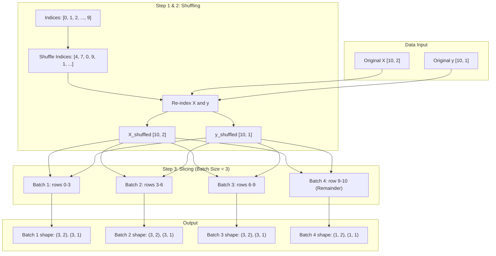

### 🎯 Learning Objectives
- Differentiate between Batch, Stochastic (SGD), and Mini-Batch Gradient Descent.
- Explain the role of batch size and how it impacts convergence speed and gradient stability.
- Understand why shuffling data before creating batches is critical.
- Implement a custom mini-batch generator from scratch using NumPy.

### 🧩 Core Concepts (Why)
In neural network training, we calculate the gradient of the loss function to update weights. The way we feed data to the model determines the training speed and accuracy:

1. **Batch Gradient Descent**: Computes gradients using the *entire* dataset. While stable, this is extremely slow and memory-intensive for large datasets.
2. **Stochastic Gradient Descent (SGD)**: Computes gradients using *one* random sample at a time. It is very fast, but updates are highly noisy, causing the loss to fluctuate wildly.
3. **Mini-Batch Gradient Descent**: Computes gradients on small subsets of data (e.g., 32, 64, or 128 samples). This is the standard in modern deep learning as it balances the stability of Batch Gradient Descent with the speed of SGD, while utilizing vectorized hardware acceleration.

By dividing our dataset into mini-batches, we can perform several parameter updates within a single **epoch** (one full pass through the entire dataset), accelerating training convergence.

### 🔁 Logic and Operation
To generate mini-batches:
1. **Generate Indices**: Create an index array representing rows of the dataset.
2. **Shuffle Indices**: Randomly shuffle these indices to ensure batches contain randomized mixtures of classes/samples.
3. **Slice Shuffled Data**: Re-index the features $X$ and labels $y$ with the shuffled indices.
4. **Group into Batches**: Slice the shuffled data in steps of `batch_size`. If the total number of samples is not divisible by `batch_size`, the final batch will contain the remaining samples.



### 📝 Annotated Examples
Here is how you shuffle indices and group a simple dataset into mini-batches using NumPy.

```python
import numpy as np

# Create a dummy dataset (10 samples, 2 features)
X = np.arange(20).reshape(10, 2)
y = np.arange(10).reshape(10, 1)

# Parameters
batch_size = 3
N = X.shape[0]

# 1. Shuffle indices
indices = np.arange(N)
np.random.shuffle(indices) # Modifies array in-place

# 2. Re-index features and labels
X_shuffled = X[indices]
y_shuffled = y[indices]

# 3. Create mini-batches
batches = []
for i in range(0, N, batch_size):
    # Slice from i to i + batch_size
    X_batch = X_shuffled[i : i + batch_size]
    y_batch = y_shuffled[i : i + batch_size]
    batches.append((X_batch, y_batch))

# Inspect batches
for idx, (xb, yb) in enumerate(batches):
    print(f"Batch {idx+1}: X shape {xb.shape}, y shape {yb.shape}")
```

### ❌ Common Mistakes

**Mistake 1: Shuffling features $X$ and labels $y$ independently**
```python
# Wrong code
np.random.shuffle(X)
np.random.shuffle(y)
```
```text
(No traceback error occurs, but the model fails to learn because features are mismatched from labels)
```
```python
# Correct code
indices = np.arange(X.shape[0])
np.random.shuffle(indices)
X_shuffled = X[indices]
y_shuffled = y[indices]
```
> Shuffling $X$ and $y$ separately breaks the alignment between features and their matching targets. A feature vector for class 1 could be matched with a class 0 label. We must shuffle a shared list of indices and use those indices to rearrange both arrays.

**Mistake 2: Missing the remainder batch when dataset size is not divisible by batch size**
```python
# Wrong code
batches = []
for i in range(0, X.shape[0] - batch_size, batch_size):
    X_batch = X_shuffled[i:i+batch_size]
    y_batch = y_shuffled[i:i+batch_size]
    batches.append((X_batch, y_batch))
```
```text
(The code runs, but len(batches) is 3 instead of 4, dropping the last sample)
```
```python
# Correct code
batches = []
for i in range(0, X.shape[0], batch_size):
    X_batch = X_shuffled[i:i+batch_size]
    y_batch = y_shuffled[i:i+batch_size]
    batches.append((X_batch, y_batch))
```
> Using `X.shape[0] - batch_size` in the range parameter cuts off the loop prematurely, throwing away any remaining samples at the end of the dataset if the total size is not perfectly divisible. Python's slicing syntax automatically handles indices exceeding length bounds gracefully.

### 💡 Tips & Idioms
- **Step-Based Range Loops**: `range(0, limit, step)` is the idiomatic way to loop through indices in batch increments.
- **Power of Two**: Batch sizes are traditionally set to powers of 2 (e.g., 32, 64, 128, 256) because modern computer memory configurations and GPU thread layouts process powers of 2 most efficiently.
- **Slicing Safety**: In Python, `array[start:end]` does not throw an error if `end` is larger than the array length; it simply returns the elements up to the end of the array.

### 🧠 Deep Dive (Under the hood)
<details><summary>Hardware Vectorization & Parallel Processing of Mini-Batches (Click to expand)</summary>

Why do we prefer mini-batches over single-sample updates (SGD) from a hardware perspective?
Modern processors (CPUs with SIMD units, and GPUs with thousands of compute cores) rely on **vectorization** and **parallel instruction execution**.

When you run a matrix multiplication on a batch of size 1:
- The processor spends more overhead loading instructions and weights from memory than doing actual calculations. The arithmetic units are underutilized.

When you run a batch of size 64:
- The same weight matrix is multiplied by 64 inputs simultaneously.
- Memory access operations are unified: weights are fetched once from memory and reused 64 times in parallel inside registers.
- This dramatically increases memory bandwidth efficiency and computing core occupancy.

However, if the batch size becomes too large (e.g. Batch Gradient Descent):
- The dataset might exceed the fast cache/GPU memory limits, forcing slow reads from system RAM or disk.
- Gradients lose the regular "noise" that helps escape local minima or saddle points during optimization.
</details>

### 🏋️ Exercise
Implement the function `get_mini_batches(X, y, batch_size)` to shuffle inputs and return a list of tuples containing the input features and target labels sliced into batches.

```python
import numpy as np

def get_mini_batches(X, y, batch_size):
    # Set seed for auto-grader reproducibility
    np.random.seed(42)
    
    batches = []
    # TODO: Shuffle indices, re-index data, and construct batches
    return batches
```

### ✅ Self-Check
1. If we have a dataset of 1,000 samples and set our batch size to 64, how many mini-batches will be generated in one epoch, and what is the size of the last mini-batch?
2. Why is it important to shuffle our dataset at the start of every epoch rather than keeping it in the same order?
<details><summary>Answers</summary>
1. $1000 / 64 = 15.625$. This results in 16 batches in total. The first 15 batches will have 64 samples, and the 16th (last) batch will contain the remaining 40 samples ($1000 - 15 \times 64 = 40$).
2. Shuffling prevents the model from learning biases based on the order of the dataset. For instance, if the dataset is sorted by class (e.g., all 0s followed by all 1s), the model's updates within a batch would bias its weights entirely toward one class at a time, leading to unstable learning.
</details>

### 📌 Summary
- **Mini-Batch Gradient Descent** balances calculation speed, training stability, and hardware utilization.
- Data must be **shuffled** together using aligned indices before partitioning to avoid class sequence bias.
- Step-based iteration using `range(0, N, batch_size)` and slicing safely captures remainder samples.
