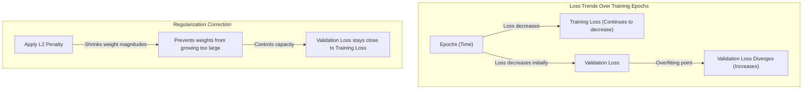

### 🎯 Learning Objectives
- Define overfitting and underfitting in neural networks.
- Explain how L1 and L2 regularization modify the loss function and parameter updates.
- Understand L2 regularization as weight decay.
- Implement gradient adjustments with L2 regularization using NumPy.

### 🧩 Core Concepts (Why)
Deep neural networks have millions of learnable parameters, making them highly flexible. However, this flexibility poses a serious risk: the model can easily memorize the training data (including random noise) instead of learning the underlying patterns. 

This leads to two common failure modes:
1. **Underfitting**: The model is too simple to capture the patterns in the data, resulting in low training and low validation accuracy.
2. **Overfitting**: The model fits the training data almost perfectly but fails to generalize to unseen test/validation data, resulting in high training accuracy but poor validation accuracy.

To combat overfitting, we use **Regularization**. It works by penalizing complex models. In L2 regularization, we add a penalty term to the loss function that is proportional to the sum of the squared weights:
$$\text{Total Loss} = \text{Data Loss} + \frac{\lambda}{2} \sum W^2$$
Here, $\lambda$ (lambda) is a hyperparameter that controls the penalty strength. By forcing weights to remain small, we restrict the network's capacity to fit noise, smoothing its decision boundaries and improving its ability to generalize.

### 🔁 Logic and Operation
As training progresses, training loss continues to decrease. Without regularization, validation loss will initially decrease, but eventually start to rise (diverge) as the model begins to overfit the noise.



To update our weights with L2 regularization, we adjust the gradient of the loss. The derivative of the L2 penalty $\frac{\lambda}{2} W^2$ with respect to weight $W$ is $\lambda W$. Thus, the regularized gradient $dW_{reg}$ is computed as:
$$dW_{reg} = dW + \lambda W$$
Where $dW$ is the raw gradient from standard backpropagation.

### 📝 Annotated Examples
Here is how to calculate the regularized gradients and update the weights in Python:

```python
import numpy as np

# 1. Initialize weights (W) and standard gradients (dW)
W = np.array([[1.0, -2.0], [0.5, 3.0]])
dW = np.array([[0.1, -0.1], [0.2, 0.4]])

# 2. Define regularization strength (lambda) and learning rate
lambda_reg = 0.01
learning_rate = 0.1

# 3. Calculate L2 loss penalty: 0.5 * lambda * sum(W^2)
l2_loss = 0.5 * lambda_reg * np.sum(W**2)
print("L2 Penalty Loss:", l2_loss)

# 4. Compute regularized gradient: dW_reg = dW + lambda * W
dW_reg = dW + lambda_reg * W
print("Regularized Gradient:\n", dW_reg)

# 5. Update weights: W = W - learning_rate * dW_reg
W_updated = W - learning_rate * dW_reg
print("Updated Weights:\n", W_updated)
```

### ❌ Common Mistakes

**Mistake 1: Mismatched shape when adding L2 penalty to gradients**
```python
import numpy as np
W = np.array([1.0, -2.0, 0.5, 3.0]) # 1D array
dW = np.array([[0.1, -0.1], [0.2, 0.4]]) # 2D array
lambda_reg = 0.01
dW_reg = dW + lambda_reg * W
```
```text
ValueError: operands could not be broadcast together with shapes (2,2) and (4,)
```
```python
import numpy as np
W = np.array([[1.0, -2.0], [0.5, 3.0]]) # Matching 2D shape
dW = np.array([[0.1, -0.1], [0.2, 0.4]])
lambda_reg = 0.01
dW_reg = dW + lambda_reg * W
```
> The weight matrix $W$ and its gradient $dW$ must have the exact same shape to perform element-wise addition.

**Mistake 2: Subtracting the regularization term from the gradient**
```python
import numpy as np
W = np.array([1.0, 2.0])
dW = np.array([0.1, 0.2])
lambda_reg = 0.01
# Incorrect subtraction
dW_reg = dW - lambda_reg * W
W_updated = W - 0.1 * dW_reg
assert np.all(np.abs(W_updated) < np.abs(W))
```
```text
AssertionError
```
```python
import numpy as np
W = np.array([1.0, 2.0])
dW = np.array([0.1, 0.2])
lambda_reg = 0.01
# Correct addition
dW_reg = dW + lambda_reg * W
W_updated = W - 0.1 * dW_reg
assert np.all(np.abs(W_updated) < np.abs(W))
```
> Regularization penalizes large weights. Adding $\lambda W$ to the gradient ensures that when subtracting the gradient, weights shrink (decay) towards zero. Subtracting $\lambda W$ would instead increase weight magnitudes.

### 💡 Tips & Idioms
- **Weight Decay Equivalence**: In gradient descent, updating $W \leftarrow W - \eta (dW + \lambda W)$ is mathematically identical to $W \leftarrow (1 - \eta \lambda) W - \eta dW$. This shows why L2 regularization is called **weight decay**: at each step, the weights are first scaled down by a factor of $(1 - \eta \lambda)$ before the raw gradient update is applied.
- **Biases are Excluded**: We do not regularize bias terms ($b$). Biases represent translation offsets rather than model complexity, so regularizing them does not prevent overfitting and can restrict model capacity.
- **Hyperparameter Scaling**: If you increase your dataset size, remember to scale your regularization coefficient $\lambda$ appropriately, or normalize the L2 loss by dividing it by the batch size ($N$).

### 🧠 Deep Dive (Under the hood)
<details><summary>L1 (Lasso) vs L2 (Ridge) properties, why L1 produces sparsity</summary>

L1 and L2 regularization introduce different penalty shapes to the objective function:
- **L2 Regularization (Ridge)**: Adds $\frac{\lambda}{2} \sum W^2$. Its gradient with respect to $W$ is $\lambda W$. The decay force is proportional to the weight's size; as the weight approaches zero, the decay force vanishes. Weights get close to zero, but rarely become exactly zero.
- **L1 Regularization (Lasso)**: Adds $\lambda \sum |W|$. Its gradient with respect to $W$ is $\lambda \cdot \text{sign}(W)$ (where $\text{sign}(x) = 1$ if $x > 0$, $-1$ if $x < 0$, and undefined at $0$). The decay force remains constant regardless of weight size. This pushes weights all the way to exactly zero.

#### Geometric Explanation
Consider the optimization surface. The loss contours represent combinations of weights that yield the same data loss. The regularization term acts as a constraint boundary.
- For L2, the boundary is a hypersphere (a circle in 2D). The optimal solution is the tangent point between the loss contour and the circle, which can occur anywhere.
- For L1, the boundary is a hyperdiamond (a diamond in 2D) with sharp corners on the axes. The loss contour is highly likely to touch the diamond at one of these corners, where one or more coordinates (weights) are exactly zero. This makes L1 highly useful for **feature selection** and creating sparse representations.
</details>

### 🏋️ Exercise
Complete the function `regularized_gradient(W, dW, lambda_reg)` to adjust the standard gradients `dW` by adding the L2 regularization term (weight decay).

```python
import numpy as np

def regularized_gradient(W, dW, lambda_reg):
    # Reg loss = 0.5 * lambda_reg * sum(W^2) (just for concept)
    # Regularized gradient: dW_reg = dW + lambda_reg * W
    dW_reg = None
    return dW_reg
```

### ✅ Self-Check
1. If the learning rate is 0.1 and the L2 regularization coefficient $\lambda$ is 0.05, what is the weight decay multiplier $(1 - \eta \lambda)$ applied to the weights at each step?
2. Does L1 or L2 regularization lead to sparse parameter matrices (many weights set to exactly zero)?
<details><summary>Answers</summary>

1. The weight decay multiplier is $1 - (0.1 \times 0.05) = 1 - 0.005 = 0.995$.
2. L1 regularization leads to sparsity.
</details>

### 📌 Summary
- **Overfitting** occurs when a model memorizes noise in the training set and fails to generalize to the validation/test sets.
- **Regularization** adds a penalty term to the loss to discourage large weight magnitudes.
- **L2 Regularization** (weight decay) adds a squared penalty ($\sum W^2$), shrinking weights smoothly towards zero.
- **L1 Regularization** adds an absolute penalty ($\sum |W|$), driving weights to exactly zero and producing sparsity.
- The regularized gradient is computed as $dW_{reg} = dW + \lambda W$.
