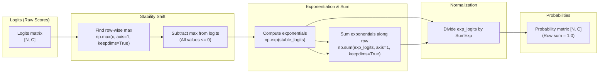

### 🎯 Learning Objectives
- Differentiate between binary classification and multi-class classification.
- Understand the Softmax activation function and how it maps logits to probability distributions.
- Identify the numerical overflow issue in exponentiating large values and implement the numerically stable Softmax equation.
- Explain the role of the Categorical Cross-Entropy loss function in training multi-class models.

### 🧩 Core Concepts (Why)
In previous lessons, we solved binary classification problems (such as the XOR gate) where the output was a single value representing the probability of a sample belonging to class 1. However, real-world tasks like **handwritten digit classification** (such as classifying images of digits from 0 to 9) require predicting one of many possible classes. This is a **multi-class classification** problem.

In a multi-class neural network, the output layer produces a raw real-valued score for each class, called **logits**. To interpret these logits as probabilities (which must be between 0 and 1, and sum to 1 across all classes), we pass them through the **Softmax function**:
$$\sigma(z)_i = \frac{e^{z_i}}{\sum_{j=1}^{C} e^{z_j}}$$
Where $z$ is the vector of raw logits and $C$ is the number of classes.

#### The Numerical Stability Problem
Computers represent numbers using fixed-precision floats. If one of the logits $z_i$ is large (e.g., $z_i > 709$), calculating $e^{z_i}$ results in **numerical overflow** (`inf` in Python). To prevent this, we subtract the maximum logit value from all logits in the sample before exponentiating:
$$\sigma(z)_i = \frac{e^{z_i - \max(z)}}{\sum_{j=1}^{C} e^{z_j - \max(z)}}$$
Mathematically, the outputs are identical because the constant cancels out, but numerically, the largest exponent becomes $e^0 = 1$. This keeps all exponentiated values between 0 and 1, preventing overflow.

### 🔁 Logic and Operation
The process of transforming raw network logits to probabilities via the stable Softmax function:



### 📝 Annotated Examples
Here is how to implement the stable Softmax function step-by-step using NumPy:

```python
import numpy as np

# A batch of logits for 2 samples, 3 classes
# Note that 1000.0 would overflow standard np.exp(1000.0) -> inf
logits = np.array([
    [1000.0, 1000.0, 998.0],
    [1.0, 2.0, 3.0]
])

# 1. Find the maximum value in each row (keepdims=True to preserve 2D shape)
row_max = np.max(logits, axis=1, keepdims=True)
print("Row Maximums:\n", row_max)

# 2. Subtract the maximum to stabilize values (largest value becomes 0)
stable_logits = logits - row_max
print("Stable Logits:\n", stable_logits)

# 3. Compute the exponential values
exp_logits = np.exp(stable_logits)
print("Exponentiated values:\n", exp_logits)

# 4. Sum the exponentials along each row
sum_exp = np.sum(exp_logits, axis=1, keepdims=True)
print("Sums of Exponentials:\n", sum_exp)

# 5. Divide each exponential by the sum to get probabilities
probabilities = exp_logits / sum_exp
print("Probabilities (sum to 1):\n", probabilities)
```

### ❌ Common Mistakes

**Mistake 1: Forgetting keepdims=True when calculating row maximums**
```python
import numpy as np
x = np.array([[1.0, 2.0], [3.0, 4.0]])
# Incorrect: returns a 1D array of shape (2,)
max_val = np.max(x, axis=1) 
x_stable = x - max_val
```
```text
ValueError: operands could not be broadcast together with shapes (2,2) and (2,)
```
```python
import numpy as np
x = np.array([[1.0, 2.0], [3.0, 4.0]])
# Correct: keepdims=True preserves the (2,1) shape for broadcasting
max_val = np.max(x, axis=1, keepdims=True)
x_stable = x - max_val
```
> Broadcasting requires matching dimensions. Subtracting a `(2,)` shape from a `(2,2)` shape is invalid, whereas a `(2,1)` shape broadcasts across columns automatically.

**Mistake 2: Normalizing along the wrong axis (axis=0 instead of axis=1)**
```python
import numpy as np
x = np.array([[1.0, 2.0, 3.0], [5.0, 5.0, 5.0]])
exp_x = np.exp(x - np.max(x, axis=1, keepdims=True))
# Incorrect axis=0 (normalizes columns instead of rows)
probs = exp_x / np.sum(exp_x, axis=0, keepdims=True)
assert np.allclose(np.sum(probs, axis=1), [1.0, 1.0])
```
```text
AssertionError
```
```python
import numpy as np
x = np.array([[1.0, 2.0, 3.0], [5.0, 5.0, 5.0]])
exp_x = np.exp(x - np.max(x, axis=1, keepdims=True))
# Correct axis=1 (normalizes each sample row)
probs = exp_x / np.sum(exp_x, axis=1, keepdims=True)
assert np.allclose(np.sum(probs, axis=1), [1.0, 1.0])
```
> In a batch, each row represents an independent sample. The probabilities of each class for a single sample must sum to 1.0, which requires operations along the row axis (`axis=1`).

**Mistake 3: Numerical overflow due to unstable implementation**
```python
import numpy as np
x = np.array([[1000.0, 1000.0]])
# Incorrect: computing exp directly on large values
exp_x = np.exp(x)
probs = exp_x / np.sum(exp_x, axis=1, keepdims=True)
assert not np.isnan(probs).any(), "Probabilities contain NaN values"
```
```text
RuntimeWarning: overflow encountered in exp
RuntimeWarning: invalid value encountered in divide
AssertionError: Probabilities contain NaN values
```
```python
import numpy as np
x = np.array([[1000.0, 1000.0]])
# Correct: subtract max first to stabilize
x_stable = x - np.max(x, axis=1, keepdims=True)
exp_x = np.exp(x_stable)
probs = exp_x / np.sum(exp_x, axis=1, keepdims=True)
assert not np.isnan(probs).any(), "Probabilities contain NaN values"
```
> Without subtracting the max, $e^{1000.0}$ overflows to `inf`. Dividing `inf` by the sum of `inf` yields `NaN` (Not a Number).

### 💡 Tips & Idioms
- **Categorical Target Representations**: In multi-class classification, target labels $y$ are often provided as integer class indices (e.g. `[3, 0, 9]`). Before feeding them to cross-entropy computations or comparing them directly with predictions, they are often converted to **one-hot encoded** vectors of shape `(N, C)` where only the target class index contains a `1` and other elements are `0`.
- **Log-Sum-Exp Trick**: If you compute the loss directly using the output of `np.log(softmax(x))`, you may encounter numerical underflow if a probability is very close to 0. It is numerically much more stable to calculate the Log-Softmax directly using:
$$\log(\sigma(z)_i) = z_i - \log \sum_{j} e^{z_j}$$

### 🧠 Deep Dive (Under the hood)
<details><summary>Categorical Cross-Entropy Loss and its Derivation</summary>

For multi-class classification, the standard loss function used is **Categorical Cross-Entropy (CCE)**:
$$L = -\frac{1}{N} \sum_{k=1}^{N} \sum_{i=1}^{C} y_{ki} \log(\hat{y}_{ki})$$
Where $y_{ki}$ is the one-hot target value (0 or 1) for sample $k$ and class $i$, and $\hat{y}_{ki}$ is the predicted probability from the Softmax layer.

#### Gradient Derivation
Let's compute the derivative of the loss $L$ for a single sample with respect to the raw logit $z_i$ of the output layer.
We know that:
$$L = -\sum_{c} y_c \log(\hat{y}_c) \quad \text{where } \hat{y}_c = \frac{e^{z_c}}{\sum_j e^{z_j}}$$

Using the chain rule, we compute:
$$\frac{\partial L}{\partial z_i} = \sum_c \frac{\partial L}{\partial \hat{y}_c} \frac{\partial \hat{y}_c}{\partial z_i}$$

First, the derivative of loss with respect to $\hat{y}_c$:
$$\frac{\partial L}{\partial \hat{y}_c} = -\frac{y_c}{\hat{y}_c}$$

Second, the derivative of Softmax output $\hat{y}_c$ with respect to logit $z_i$ has two cases:
1. **If $c = i$**:
   $$\frac{\partial \hat{y}_i}{\partial z_i} = \hat{y}_i(1 - \hat{y}_i)$$
2. **If $c \neq i$**:
   $$\frac{\partial \hat{y}_c}{\partial z_i} = -\hat{y}_c \hat{y}_i$$

Now, substituting these back into the chain rule summation:
$$\frac{\partial L}{\partial z_i} = -\frac{y_i}{\hat{y}_i} \cdot \left( \hat{y}_i(1 - \hat{y}_i) \right) + \sum_{c \neq i} \left( -\frac{y_c}{\hat{y}_c} \right) \cdot \left( -\hat{y}_c \hat{y}_i \right)$$
$$\frac{\partial L}{\partial z_i} = -y_i(1 - \hat{y}_i) + \sum_{c \neq i} y_c \hat{y}_i$$
$$\frac{\partial L}{\partial z_i} = -y_i + y_i \hat{y}_i + \hat{y}_i \sum_{c \neq i} y_c$$
$$\frac{\partial L}{\partial z_i} = -y_i + \hat{y}_i \sum_{c} y_c$$

Since $y$ is a one-hot encoded vector representing a single class distribution, the sum of its elements $\sum_c y_c$ must be exactly $1$. Thus:
$$\frac{\partial L}{\partial z_i} = \hat{y}_i - y_i$$

This is a remarkably clean and simple gradient! The error gradient propagated backwards through the Softmax layer is simply **the predicted probabilities minus the one-hot target values**:
$$dZ = \hat{Y} - Y$$
This simplicity is the primary reason why the Softmax and Categorical Cross-Entropy pair is the default choice for multi-class classification tasks.
</details>

### 🏋️ Exercise
Complete the function `softmax(x)` to compute numerically stable class probabilities for a 2D array of logits where each row represents a sample.

```python
import numpy as np

def softmax(x):
    # x: 2D numpy array (each row is a sample's logits)
    # Return probabilities (rows sum to 1)
    # Subtract np.max(x, axis=1, keepdims=True) from x for numerical stability
    probs = None
    return probs
```

### ✅ Self-Check
1. If the input logit row to Softmax is `[2.5, 2.5, 2.5]`, what are the resulting class probabilities?
2. Why is the raw score subtraction step ($x - \max(x)$) mathematically valid without changing the Softmax probability results?
<details><summary>Answers</summary>

1. Since all raw scores are equal, the probabilities are equally distributed: `[1/3, 1/3, 1/3]`.
2. Mathematically, subtracting a constant $C$ from all terms in the exponent corresponds to dividing the numerator and denominator by $e^C$. This division cancels out:
$$\frac{e^{z_i - C}}{\sum e^{z_j - C}} = \frac{e^{z_i}/e^C}{\sum (e^{z_j}/e^C)} = \frac{e^{z_i}}{\sum e^{z_j}}$$
</details>

### 📌 Summary
- **Multi-class classification** predicts one class out of $C$ possible categories.
- **Logits** are the raw, unnormalized output scores of the network.
- **Softmax** exponentiates and normalizes these logits into a valid probability distribution.
- **Numerical stability** is achieved by subtracting the maximum value of each row from the logits before exponentiation, preventing float overflow.
- The combination of Softmax and **Categorical Cross-Entropy** yields a simple gradient $\hat{Y} - Y$ for backpropagation.
