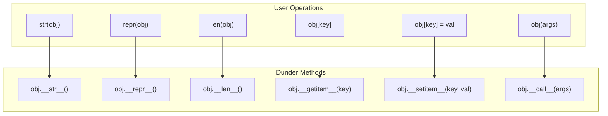

### 🎯 Learning Objectives
- Understand the concept of "Dunder" (Double Underscore) methods in Python.
- Implement custom string representation using `__str__` and `__repr__`.
- Design custom container-like classes using `__getitem__`, `__setitem__`, and `__len__`.
- Create callable objects using the `__call__` method.

### 🧩 Core Concepts (Why)
Python's execution model is deeply integrated with its object-oriented features. Instead of requiring special keyword-based operators or native APIs for custom data types, Python uses special methods prefixed and suffixed with double underscores—often called **dunder methods** or **magic methods**.

For example, when you use the `+` operator, Python translates `a + b` into `a.__add__(b)`. Similarly, calling `len(obj)` calls `obj.__len__()`. By overriding these dunder methods, we can make our custom classes behave like native Python types (such as lists, dictionaries, or even functions). This promotes "Pythonic" code that is intuitive, readable, and highly reusable.

### 🔁 Logic and Operation
The following diagram shows how standard Python functions or operations are translated into underlying dunder method calls:



### 📝 Annotated Examples
Here is an implementation of a custom `Vector` class demonstrating representation methods.

```python
class Vector:
    def __init__(self, x, y):
        self.x = x
        self.y = y

    # __repr__ is meant to be unambiguous and, if possible, match the code to recreate the object
    def __repr__(self):
        return f"Vector({self.x}, {self.y})"

    # __str__ is for a user-friendly, readable string representation
    def __str__(self):
        return f"({self.x}i + {self.y}j)"

# Create a Vector instance
v = Vector(3, 4)
print(repr(v)) # Output: Vector(3, 4) (Ideal for debugging)
print(str(v))  # Output: (3i + 4j)  (Ideal for user display)
```

### ❌ Common Mistakes

**Mistake 1: Returning a non-string type from `__str__` or `__repr__`**
```python
class Point:
    def __init__(self, x, y):
        self.x = x
        self.y = y
    def __str__(self):
        return self.x # Oops, returning integer
```
```text
TypeError: __str__ returned non-string (type int)
```
```python
class Point:
    def __init__(self, x, y):
        self.x = x
        self.y = y
    def __str__(self):
        return f"Point({self.x}, {self.y})" # Correct: returns a string
```
> Both `__str__` and `__repr__` must always return a string object (`str`). Returning other types raises a `TypeError`.

**Mistake 2: Forgetting to return a value from `__getitem__`**
```python
class CustomList:
    def __init__(self):
        self._items = [1, 2, 3]
    def __getitem__(self, index):
        self._items[index] # Oops, forgot return statement
```
```text
None
```
```python
class CustomList:
    def __init__(self):
        self._items = [1, 2, 3]
    def __getitem__(self, index):
        return self._items[index] # Correct: returns the fetched item
```
> `__getitem__` is expected to return the value associated with the key or index. Without a `return` statement, Python implicitly returns `None`.

### 💡 Tips & Idioms
- Always implement `__repr__` first. If `__str__` is not defined, Python will fall back to using `__repr__`.
- Use `__call__` to implement instances that maintain state across calls, serving as a clean alternative to closures or single-method classes. For example, a memoization cache or rate limiter.

### 🧠 Deep Dive (Under the hood)
<details><summary>The Lookup Process of Dunder Methods</summary>

When Python searches for a dunder method (like `__len__`), it bypasses the instance dictionary (`__dict__`) and searches directly on the class object. This is done for efficiency and to guarantee consistent behavior for built-in operations.

For example, writing `len(obj)` does not look up `obj.__dict__['__len__']`. Instead, it retrieves `type(obj).__len__(obj)`. This ensures that even if you dynamically attach a function named `__len__` to an instance, Python's built-in `len()` function will ignore it unless it is defined on the class itself.
</details>

### 🏋️ Exercise
Complete the `DictWrapper` class to wrap a dictionary and support bracket access, length determination, and key lookup via a direct function call interface.

```python
class DictWrapper:
    def __init__(self):
        self._data = {}
    # Implement __getitem__, __setitem__, __len__ and __call__
```

### ✅ Self-Check
1. What is the fallback behavior if a class implements `__str__` but not `__repr__` and you call `repr(obj)`?
2. What exception should `__getitem__` raise if an out-of-range index is passed to a sequence?
<details><summary>Answers</summary>

1. If `__repr__` is not defined, calling `repr(obj)` falls back to the default object representation (e.g. `<__main__.ClassName object at 0x... >`). However, if `__str__` is missing but `__repr__` exists, calling `str(obj)` falls back to `__repr__`.
2. `__getitem__` should raise an `IndexError` for sequences (like lists) and a `KeyError` for mappings (like dictionaries).
</details>

### 📌 Summary
- **Dunder methods** allow custom objects to integrate with Python's syntax features and built-in functions.
- `__str__` is optimized for end-user readability, while `__repr__` provides an unambiguous developer-centric representation.
- Container protocol methods (`__getitem__`, `__setitem__`, `__len__`) let custom classes act like lists or dictionaries.
- The `__call__` method allows instances of class objects to be invoked like functions.
