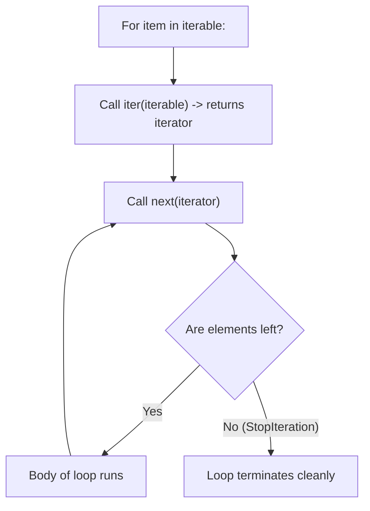

### 🎯 Learning Objectives
- Understand the difference between an Iterable and an Iterator.
- Implement the Iteration Protocol using `__iter__` and `__next__`.
- Create custom iterators to represent infinite or custom collections.
- Master generator functions using the `yield` keyword and write memory-efficient stream processing pipelines.
- Understand generator expressions and delegation using the `yield from` syntax.

### 🧩 Core Concepts (Why)
When dealing with large datasets or infinite streams (e.g., reading a multi-gigabyte log file or generating infinite mathematical sequences), loading all elements into a Python list at once can exhaust the computer's memory.

Python solves this using **Iterators** and **Generators**. These concepts implement **lazy evaluation**—generating the next element only when it is explicitly requested.

- An **Iterable** is any object you can loop over (like lists, tuples, or strings).
- An **Iterator** is the stateful stream-producer object that yields one value at a time via `next()`.
- A **Generator** is a simpler way to write an iterator using a function with the `yield` keyword.

### 🔁 Logic and Operation
The lifecycle of iteration and how Python automatically manages the Iteration Protocol:



### 📝 Annotated Examples
Here is an example of a custom range iterator, followed by a generator function that reads lines from a list matching a query.

```python
# 1. Custom Iterator implementing the Iteration Protocol
class Countdown:
    def __init__(self, start):
        self.current = start

    def __iter__(self):
        return self # An iterator must return itself in __iter__

    def __next__(self):
        if self.current <= 0:
            raise StopIteration # Signal end of iteration
        val = self.current
        self.current -= 1
        return val

# Testing the custom iterator
for num in Countdown(3):
    print(num) # Output: 3, then 2, then 1

# 2. Generator function using the yield keyword
def read_logs(lines):
    for line in lines:
        if "ERROR" in line:
            yield line.strip()

log_data = ["INFO: System OK", "ERROR: DB Connection failed", "INFO: Job finished"]
error_generator = read_logs(log_data)
print(next(error_generator)) # Output: ERROR: DB Connection failed
```

### ❌ Common Mistakes

**Mistake 1: Exhausting an iterator and trying to reuse it**
```python
my_list = [1, 2, 3]
iterator = iter(my_list)
print(list(iterator)) # Consumes the iterator
print(list(iterator)) # Try to reuse it
```
```text
[1, 2, 3]
[]
```
```python
my_list = [1, 2, 3]
# Create a new iterator if you need to iterate again
iterator = iter(my_list)
print(list(iterator))
iterator_new = iter(my_list)
print(list(iterator_new))
```
> Iterators are stateful and consume their elements as they go. Once StopIteration is raised, they are exhausted and will return empty if queried again.

**Mistake 2: Forgetting to raise StopIteration in a custom iterator's `__next__`**
```python
class InfiniteOne:
    def __init__(self):
        self.count = 0
    def __iter__(self):
        return self
    def __next__(self):
        if self.count >= 2:
            pass # Oops, forgot to raise StopIteration!
        self.count += 1
        return 1
print(list(InfiniteOne()))
```
```text
(Execution Timeout / Infinite Loop Detected)
```
```python
class InfiniteOne:
    def __init__(self):
        self.count = 0
    def __iter__(self):
        return self
    def __next__(self):
        if self.count >= 2:
            raise StopIteration # Correct: signals the loop to terminate
        self.count += 1
        return 1
print(list(InfiniteOne())) # Output: [1, 1]
```
> Without raising `StopIteration`, loops and collection conversions (like `list()`) will execute infinitely, leading to program hangs or errors.

### 💡 Tips & Idioms
- **Generator Expressions**: Just like list comprehensions, you can write concise generators using parentheses: `gen = (x * x for x in range(10))`.
- **`yield from`**: Use `yield from` to delegate part of a generator's operations to another generator.
  ```python
  def chain_generators(gen1, gen2):
      yield from gen1
      yield from gen2
  ```

### 🧠 Deep Dive (Under the hood)
<details><summary>How Generator Functions Pause & Resume</summary>

When a generator function is called, it does not execute the code inside the function. Instead, it returns a generator object.

When `next()` is called on this object:
1. The function starts executing until it hits the first `yield` statement.
2. The function's execution state (local variables, instruction pointer, and stack frame) is frozen and saved.
3. The yielded value is returned.
4. The next call to `next()` resumes execution exactly from where it was paused, restoring all local state. This local stack frame persistence is what makes generators incredibly efficient and powerful for stateful flow control.
</details>

### 🏋️ Exercise
Complete the function `fibonacci_limit(limit)` to yield Fibonacci numbers up to and including the specified limit. The sequence should start with `0, 1, 1, 2, 3...`.

```python
def fibonacci_limit(limit):
    # Yield fibonacci numbers up to (and including) limit
    pass
```

### ✅ Self-Check
1. What is the fundamental difference between calling a regular function with `return` vs a generator function with `yield`?
2. Is `[x for x in range(10)]` a generator expression?
<details><summary>Answers</summary>

1. A regular function returns a single value once and discards its stack frame. A generator function returns an iterator object, yields values multiple times, and preserves its stack frame and local state between calls.
2. No, square brackets create a list comprehension (which builds the entire list in memory immediately). Parentheses `(x for x in range(10))` create a generator expression.
</details>

### 📌 Summary
- **Iterables** support looping; **Iterators** produce the elements on demand.
- The **Iteration Protocol** relies on `__iter__` to return the iterator, and `__next__` to return the next value or raise `StopIteration`.
- **Generators** simplify iterator creation using the `yield` keyword.
- Generators preserve their state, enabling memory-efficient processing of extremely large datasets.
