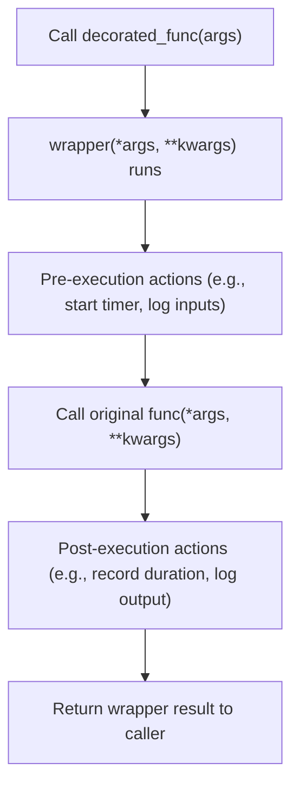

### 🎯 Learning Objectives
- Explain what decorators are and how they allow modifying function behavior.
- Understand Python functions as first-class objects.
- Create and use decorators without arguments.
- Create and use decorators with arguments.
- Apply `functools.wraps` to preserve original function metadata.
- Implement class-based decorators using the `__call__` method.

### 🧩 Core Concepts (Why)
In software development, we often need to run auxiliary logic alongside core business functions. For example, logging function calls, checking permissions, caching expensive results, or measuring performance. If we copy-paste this logic into every function, our code becomes repetitive, hard to maintain, and prone to bugs.

Python solves this with **Decorators**. A decorator is a function that takes another function as an argument, extends its behavior without modifying it explicitly, and returns a new function. 

This is made possible because functions in Python are **first-class citizens**:
- They can be assigned to variables.
- They can be passed as arguments to other functions.
- They can be defined inside other functions (nested functions).
- They can be returned from other functions.

### 🔁 Logic and Operation
The decorator syntax `@decorator` is syntactic sugar. Writing:
```python
@my_decorator
def my_func():
    pass
```
Is exactly equivalent to writing:
```python
my_func = my_decorator(my_func)
```

The flow of execution when calling a decorated function looks like this:



### 📝 Annotated Examples

#### 1. Basic Decorator (Without Arguments)
This decorator prints messages before and after executing the wrapped function.
```python
import functools

def my_logger(func):
    @functools.wraps(func) # Preserves the original function's name and docstring
    def wrapper(*args, **kwargs):
        print(f"[LOG] Calling {func.__name__} with args: {args}, kwargs: {kwargs}")
        result = func(*args, **kwargs)
        print(f"[LOG] {func.__name__} finished execution.")
        return result
    return wrapper

@my_logger
def greet(name, greeting="Hello"):
    return f"{greeting}, {name}!"

print(greet("Alice"))
# Output:
# [LOG] Calling greet with args: ('Alice',), kwargs: {}
# [LOG] greet finished execution.
# Hello, Alice!
```

#### 2. Decorator With Arguments
To pass arguments to the decorator itself, we need three nested functions: the outermost function accepts the decorator arguments, the middle function accepts the target function, and the innermost function handles the execution.
```python
import functools

def repeat(num_times):
    def decorator_repeat(func):
        @functools.wraps(func)
        def wrapper(*args, **kwargs):
            for _ in range(num_times):
                result = func(*args, **kwargs)
            return result
        return wrapper
    return decorator_repeat

@repeat(num_times=3)
def greet_loudly(name):
    print(f"HELLO {name.upper()}!")

greet_loudly("Bob")
# Output:
# HELLO BOB!
# HELLO BOB!
# HELLO BOB!
```

#### 3. Class-Based Decorator
We can also implement decorators as classes. The class receives the function in its `__init__` constructor and implements execution logic inside the `__call__` magic method.
```python
class CountCalls:
    def __init__(self, func):
        self.func = func
        self.num_calls = 0

    def __call__(self, *args, **kwargs):
        self.num_calls += 1
        print(f"Function {self.func.__name__} has been called {self.num_calls} times")
        return self.func(*args, **kwargs)

@CountCalls
def say_hello():
    print("Hello")

say_hello() # Output: Function say_hello has been called 1 times \n Hello
say_hello() # Output: Function say_hello has been called 2 times \n Hello
```

### ❌ Common Mistakes

**Mistake 1: Forgetting to use `functools.wraps`**
```python
def bad_decorator(func):
    def wrapper(*args, **kwargs):
        return func(*args, **kwargs)
    return wrapper

@bad_decorator
def greet():
    """Greets the user."""
    return "Hello!"

print(greet.__name__)
print(greet.__doc__)
```
```text
wrapper
None
```
```python
import functools

def good_decorator(func):
    @functools.wraps(func)
    def wrapper(*args, **kwargs):
        return func(*args, **kwargs)
    return wrapper

@good_decorator
def greet():
    """Greets the user."""
    return "Hello!"

print(greet.__name__)
print(greet.__doc__)
```
> Without `@functools.wraps`, the decorated function loses its identity (name, docstring, etc.) and takes on the identity of the internal wrapper function. This breaks debugging and introspection tools.

**Mistake 2: Forgetting to return the result from the wrapper function**
```python
def log_only(func):
    def wrapper(*args, **kwargs):
        print(f"Executing {func.__name__}")
        func(*args, **kwargs)  # Forgot to return!
    return wrapper

@log_only
def add(a, b):
    return a + b

result = add(5, 5)
print(result)
```
```text
Executing add
None
```
```python
def log_only(func):
    def wrapper(*args, **kwargs):
        print(f"Executing {func.__name__}")
        return func(*args, **kwargs)  # Correct: return the result
    return wrapper

@log_only
def add(a, b):
    return a + b

result = add(5, 5)
print(result)
```
> If the wrapper function does not return the result of the wrapped function call, the decorated function will discard the computed result and always return `None`.

### 💡 Tips & Idioms
- **Chaining Decorators**: You can apply multiple decorators to a single function. They are executed in order from bottom to top (inside-out).
  ```python
  @decorator_one
  @decorator_two
  def my_func():
      pass
  # Equivalent to: my_func = decorator_one(decorator_two(my_func))
  ```
- **Debugging Decorated Functions**: If you need to access the undecorated original function directly, you can access the `__wrapped__` attribute if you used `@functools.wraps`.
  ```python
  original_func = greet.__wrapped__
  ```

### 🧠 Deep Dive (Under the hood)
<details><summary>Closures and Scope Resolution</summary>

Under the hood, decorators rely on a Python feature called **closures**. A closure is a record storing a function together with an environment: a mapping associating each free variable of the function with the value or reference to which the name was bound when the function was created.

When an outer function returns an inner function, the inner function retains access to the outer function's local variables, even after the outer function has finished executing. 

Python implements this using **cell objects** in the function's `__closure__` attribute:
```python
def outer(x):
    def inner():
        print(x)
    return inner

my_closure = outer(10)
print(my_closure.__closure__[0].cell_contents) # Output: 10
```
When `inner()` is called, Python searches the local scope first, then the enclosing scope (stored in the closure cell objects), then the global scope, and finally built-ins (LEGB rule). The wrapper function in a decorator is a closure that captures the original `func` variable.
</details>

### 🏋️ Exercise
Implement a timer decorator that measures the time taken by a function to run and appends the duration (as a float) to the global list `TIMED_RECORDS`.

```python
import functools
import time

TIMED_RECORDS = []

def timer(func):
    # Implement timer decorator that appends duration to TIMED_RECORDS
    pass
```

### ✅ Self-Check
1. How does a decorator receive arguments passed to the decorated function?
2. If we chain `@dec1` above `@dec2` on a function `f()`, which decorator's wrapper executes first?
<details><summary>Answers</summary>

1. It receives them by using the variable argument lists `*args` and keyword arguments `**kwargs` in the signature of the internal wrapper function and passing them to the original function call.
2. The wrapper of `@dec1` executes first, wrapping the wrapper of `@dec2`, which in turn wraps `f()`.
</details>

### 📌 Summary
- **Decorators** allow you to wrap a function to extend its behavior without modifying the original source code.
- Functions are **first-class citizens** in Python, which is the foundation of nested functions and decorators.
- `@functools.wraps` should always be used in custom decorators to preserve the original function name and docstrings.
- Decorators can be implemented as functions (with or without arguments) or as classes.
