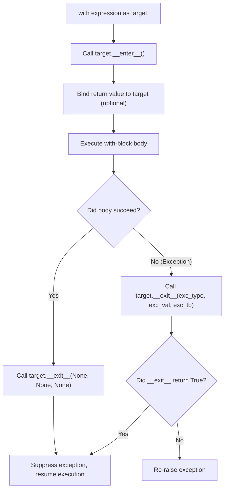

### 🎯 Learning Objectives
- Understand resource management and why closing resources is critical.
- Learn how `try...finally` statements handle cleanup.
- Implement custom context managers using the `__enter__` and `__exit__` protocol.
- Build context managers using `contextlib.contextmanager` and generators.
- Nest context managers to handle multiple resources safely.

### 🧩 Core Concepts (Why)
In software development, your programs constantly interact with external resources. These include files on the hard drive, connections to a database, network sockets, or system-wide locks. 

When you open or acquire these resources, the operating system allocates handles (like file descriptors) to your process. If you forget to close these resources after using them, they remain locked in memory. This is called a **resource leak**. 

If a program leaks resources repeatedly, it will eventually run out of available handles, leading to crashes, frozen processes, or database connection failures. 

To solve this, Python provides **Context Managers**. They allow you to define set-up and tear-down actions that run automatically around a block of code, ensuring resources are cleaned up safely even if exceptions or crashes occur.

### 🔁 Logic and Operation
The most common way to use context managers is via the `with` statement. The lifecycle of a `with` statement is managed internally by Python as follows:



### 📝 Annotated Examples

#### 1. Class-Based Context Manager
To implement a context manager using a class, you define two special methods:
- `__enter__`: Acquires the resource and returns the object to be bound to the `as` variable.
- `__exit__`: Handles releasing the resource and managing exceptions.
```python
class DatabaseConnection:
    def __init__(self, db_name):
        self.db_name = db_name

    def __enter__(self):
        print(f"Connecting to database: {self.db_name}")
        return self # This object is bound to the variable after 'as'

    def __exit__(self, exc_type, exc_val, exc_tb):
        print("Closing database connection")
        if exc_type:
            print(f"An error occurred: {exc_val}")
        return False # Propagate exception if there was one

with DatabaseConnection("user_db") as conn:
    print("Executing queries...")
# Output:
# Connecting to database: user_db
# Executing queries...
# Closing database connection
```

#### 2. Generator-Based Context Manager
The `contextlib` module allows you to write a generator function that yields control exactly once instead of creating a full class.
```python
from contextlib import contextmanager
import os

@contextmanager
def temporary_dir_change(destination):
    original_dir = os.getcwd()
    os.chdir(destination)
    try:
        yield # Code block inside 'with' runs here
    finally:
        os.chdir(original_dir) # Guaranteed cleanup code

# Usage:
# with temporary_dir_change("/tmp"):
#     # do stuff in /tmp
```

#### 3. Nesting Multiple Context Managers
You can manage multiple resources in a single `with` statement, separated by commas.
```python
# Copying content from source file to destination file
with open("source.txt", "r") as src, open("dest.txt", "w") as dest:
    dest.write(src.read())
```

### ❌ Common Mistakes

**Mistake 1: Forgetting to use try-finally in `@contextmanager`**
```python
from contextlib import contextmanager

@contextmanager
def unsafe_resource():
    print("Acquire Resource")
    yield "data"
    print("Release Resource") # This will not run if exceptions occur!

with unsafe_resource() as data:
    raise ValueError("Something went wrong!")
```
```text
Acquire Resource
Traceback (most recent call last):
  ...
ValueError: Something went wrong!
```
```python
from contextlib import contextmanager

@contextmanager
def safe_resource():
    print("Acquire Resource")
    try:
        yield "data"
    finally:
        print("Release Resource") # Guaranteed to run

try:
    with safe_resource() as data:
        raise ValueError("Something went wrong!")
except ValueError:
    pass
```
> When using `@contextmanager`, if an exception occurs inside the `with` block, it is thrown back into your generator at the `yield` statement. If `yield` is not inside a `try...finally` block, the cleanup statements after the `yield` will be skipped.

**Mistake 2: Accidentally suppressing all exceptions in `__exit__`**
```python
class SuppressEverything:
    def __enter__(self):
        return self
    def __exit__(self, exc_type, exc_val, exc_tb):
        return True # Suppresses all exceptions indiscriminately!

with SuppressEverything():
    result = 1 / 0
print("Program continued running despite ZeroDivisionError!")
```
```text
Program continued running despite ZeroDivisionError!
```
```python
class SuppressNone:
    def __enter__(self):
        return self
    def __exit__(self, exc_type, exc_val, exc_tb):
        if exc_type is ZeroDivisionError:
            print("Suppressed division by zero error")
            return True
        return False # Let all other exceptions propagate

try:
    with SuppressNone():
        result = 1 / 0
except ZeroDivisionError:
    pass
```
> Returning `True` from the `__exit__` method signals Python to swallow the exception. Doing this unconditionally is dangerous as it masks bugs like name typos, syntax errors, or logic errors.

### 💡 Tips & Idioms
- **`contextlib.suppress`**: Instead of empty `try...except` blocks, you can suppress expected exceptions cleanly:
  ```python
  from contextlib import suppress
  with suppress(FileNotFoundError):
      os.remove("nonexistent.txt")
  ```
- **`contextlib.closing`**: If an object has a `close()` method but is not a context manager, you can wrap it with `closing()` to ensure it closes:
  ```python
  from contextlib import closing
  from urllib.request import urlopen

  with closing(urlopen('https://www.python.org')) as page:
      for line in page:
          pass
  ```

### 🧠 Deep Dive (Under the hood)
<details><summary>The Bytecode Mechanics of with</summary>

At the bytecode level, Python uses specific instructions to implement the `with` statement. If we disassemble a function containing a `with` statement, we will see instructions like `SETUP_WITH` and `WITH_EXCEPT_START`.

When Python enters the `with` block:
1. `SETUP_WITH` pushes the `__exit__` method of the context manager onto the execution stack.
2. The block code is executed.
3. If an exception occurs, the interpreter pops `__exit__` from the stack and calls it with details of the exception (`exc_type`, `exc_val`, `exc_tb`).
4. `WITH_EXCEPT_START` executes the exit method and inspects its return value. If it evaluates to true, the exception is popped and the interpreter resumes execution with the next statement. If it evaluates to false, the exception is re-raised.
</details>

### 🏋️ Exercise
Implement a generator-based context manager `temp_file(filename, content)` that creates a text file containing the specified content when entering the block, and deletes the file when exiting the block (even if exceptions are raised inside the block).

```python
import os
from contextlib import contextmanager

@contextmanager
def temp_file(filename, content):
    # Create file with content on enter, delete it on exit
    pass
```

### ✅ Self-Check
1. What values does Python pass to `__exit__` if the `with` block completes without any errors?
2. How do you return a value from a generator-based context manager to be bound to the `as` variable in a `with` statement?
<details><summary>Answers</summary>

1. It passes `None, None, None` for the arguments `exc_type, exc_val, exc_tb`.
2. You pass it as the value in the `yield` statement (e.g., `yield resource`).
</details>

### 📌 Summary
- **Context managers** ensure resources are clean and correctly closed or released.
- The **`with` statement** automates the execution of `__enter__` and `__exit__` protocols.
- Custom context managers can be created as classes implementing `__enter__` and `__exit__`, or as generator functions decorated with `@contextmanager`.
- Always wrap the `yield` statement inside a `try...finally` block in generator-based managers to guarantee cleanup execution.
