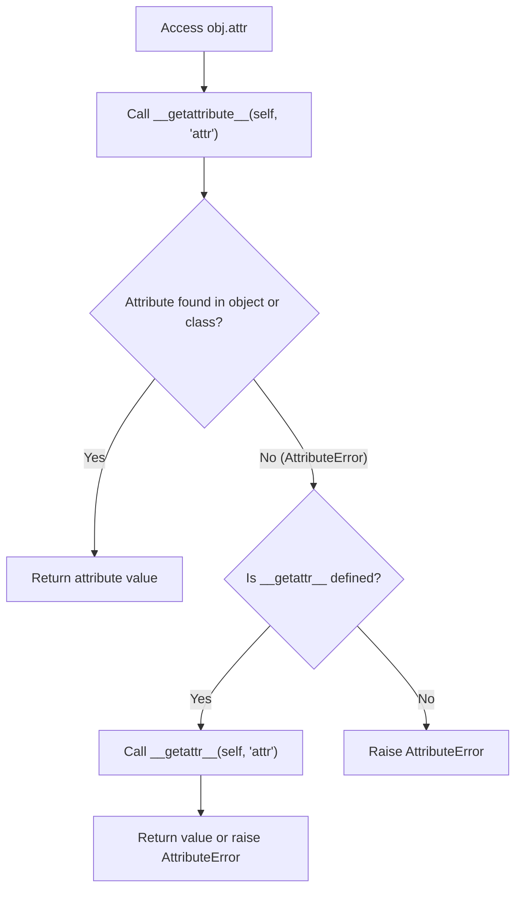

### 🎯 Learning Objectives
- Master dynamic attribute management using special methods: `__getattr__`, `__getattribute__`, `__setattr__`, and `__delattr__`.
- Differentiate between `__getattr__` and `__getattribute__` and know when to use each.
- Generate classes dynamically at runtime using `type()`.
- Understand metaclasses, their lifecycle, and how to write custom metaclasses using `__new__` and `__init__`.

### 🧩 Core Concepts (Why)
In standard object-oriented programming, classes and objects have rigid, predefined structures. You define attributes and methods in your source code, and they remain fixed.

However, modern software design often requires extreme flexibility. You might need to build an Object-Relational Mapper (ORM) that automatically maps database columns to Python class attributes, or a wrapper that forwards attribute accesses dynamically to an API response.

This is where **Metaprogramming** comes in. Metaprogramming is the practice of writing code that treats other code as data—allowing you to inspect, modify, or generate classes and objects dynamically at runtime. Python is highly dynamic and exposes deep hooks into class creation and attribute access. Mastering these hooks allows you to build highly expressive, clean, and powerful APIs and libraries.

### 🔁 Logic and Operation
Understanding the attribute lookup flow is critical. When you access an attribute `obj.attr` on a Python object, the interpreter goes through a specific decision sequence:



1. **`__getattribute__`** is called unconditionally for *every* attribute lookup.
2. If the attribute is not found through normal lookup, or if `__getattribute__` raises an `AttributeError`, Python falls back to **`__getattr__`**.
3. **`__setattr__`** intercepts all attribute assignments (`obj.attr = value`).
4. **`__delattr__`** intercepts all attribute deletions (`del obj.attr`).

### 📝 Annotated Examples

#### 1. Dynamic Attribute Customization
The `__getattr__` method is only triggered for attributes that do not exist on the object. This makes it perfect for fallback behaviors or delegation.
```python
class DynamicDictWrapper:
    def __init__(self, data_dict):
        # Store internal data. We bypass standard setattr to avoid conflicts
        super().__setattr__('_data', data_dict)

    def __getattr__(self, name):
        # Triggered only if 'name' is not a normal attribute
        if name in self._data:
            return self._data[name]
        raise AttributeError(f"'{self.__class__.__name__}' has no attribute '{name}'")

    def __setattr__(self, name, value):
        # Intercepts all attribute assignments
        self._data[name] = value

# Usage:
wrapper = DynamicDictWrapper({'title': 'Sensei Hub', 'version': 1.0})
print(wrapper.title)    # Output: Sensei Hub (via __getattr__)
wrapper.version = 2.0   # (via __setattr__)
print(wrapper.version)  # Output: 2.0
```

#### 2. Dynamic Class Generation with `type()`
Typically, classes are created using the `class` keyword. However, you can create them dynamically using `type(name, bases, dict)`.
```python
# Create a class dynamically at runtime
# type(name, bases, dict)
# - name: String representing the class name
# - bases: Tuple of base classes to inherit from
# - dict: Dictionary containing class attributes and methods

def greet(self):
    return f"Hello, I am {self.name}!"

# Create class 'DynamicPerson' inheriting from object, with attribute 'species' and method 'greet'
DynamicPerson = type(
    'DynamicPerson',
    (object,),
    {
        'species': 'Human',
        'greet': greet
    }
)

# Use the dynamic class
person = DynamicPerson()
person.name = "Bob"
print(person.greet())   # Output: Hello, I am Bob!
print(person.species)  # Output: Human
```

#### 3. Writing a Custom Metaclass
A metaclass is a class whose instances are classes. `type` is the default metaclass in Python. You can inherit from `type` to intercept class creation.
```python
class PrefixMetaclass(type):
    # __new__ is called to allocate memory and create the class object
    # mcs: Metaclass itself
    # name: Name of the class being created
    # bases: Base classes
    # dct: Class dictionary (namespace containing methods/attributes)
    def __new__(mcs, name, bases, dct):
        prefixed_dct = {}
        for key, val in dct.items():
            # Automatically prefix custom methods (non-dunder) with 'api_'
            if not key.startswith('__') and callable(val):
                prefixed_dct[f'api_{key}'] = val
            else:
                prefixed_dct[key] = val
        return super().__new__(mcs, name, bases, prefixed_dct)

class Endpoint(metaclass=PrefixMetaclass):
    def fetch_users(self):
        return ["Alice", "Bob"]

# Instantiate the class
ep = Endpoint()
# 'fetch_users' was renamed to 'api_fetch_users' by the metaclass
print(hasattr(ep, 'fetch_users'))      # Output: False
print(ep.api_fetch_users())            # Output: ['Alice', 'Bob']
```

### ❌ Common Mistakes

**Mistake 1: Infinite recursion when assigning attributes inside `__setattr__`**
```python
class UnsafeSetAttr:
    def __setattr__(self, name, value):
        self.name = value # Triggers __setattr__ again, leading to recursion!
```
```text
RecursionError: maximum recursion depth exceeded in comparison
```
```python
class SafeSetAttr:
    def __setattr__(self, name, value):
        # Correctly call the parent object's setattr to bypass recursion
        super().__setattr__(name, value)
```
> Assigning attributes directly on `self` inside `__setattr__` recursively invokes `__setattr__` itself. To avoid this, delegate the attribute assignment using `super().__setattr__(name, value)` or write directly to the instance namespace dictionary `self.__dict__[name] = value`.

**Mistake 2: Infinite recursion when accessing attributes inside `__getattribute__`**
```python
class UnsafeGetAttribute:
    def __getattribute__(self, name):
        print(f"Log: accessing {name}")
        return self.name # Triggers __getattribute__ again recursively!
```
```text
RecursionError: maximum recursion depth exceeded while calling a Python object
```
```python
class SafeGetAttribute:
    def __getattribute__(self, name):
        print(f"Log: accessing {name}")
        # Safely delegate lookup to parent implementation
        return super().__getattribute__(name)
```
> Since `__getattribute__` intercepts all attribute lookups unconditionally, accessing any attribute of `self` inside it (e.g. `self.name`) causes an infinite loop. Always use `super().__getattribute__(name)` or access through class dict descriptors to retrieve properties inside this method.

### 💡 Tips & Idioms
- **Prefer `__getattr__` over `__getattribute__`**: `__getattr__` is much safer and runs faster because it is only called as a fallback when the attribute does not exist. Use `__getattribute__` only if you absolutely must control every single attribute access (e.g., for security sandboxing or lazy logging).
- **Dynamic programming with built-ins**: Use `getattr()`, `setattr()`, `hasattr()`, and `delattr()` for programmatic access when attribute names are only known at runtime as strings.
- **Metaclass vs Class Decorator**: Many problems solved by metaclasses can also be solved more simply using class decorators. Use metaclasses when you need class creation mechanics to be inherited by all subclasses.

### 🧠 Deep Dive (Under the hood)
<details><summary>Metaclass Lifecycle & Dynamic Class Creation</summary>

When Python executes a `class` definition block, it carries out the following steps:
1. **Determines the Metaclass**: It checks the class definition for a `metaclass=` argument, then checks parent base classes, and defaults to `type`.
2. **Prepares the Namespace**: It calls the metaclass's `__prepare__(name, bases, **kwargs)` method. This returns a dictionary-like object representing the namespace where class variables and methods will be defined.
3. **Executes the Class Body**: Python runs the statements inside the class definition, executing them inside the namespace prepared in step 2.
4. **Instantiates the Class Object**: It calls the metaclass's constructor:
   `metaclass(name, bases, namespace_dict)`.
   Inside this metaclass call, the following methods are executed:
   - `__new__(mcs, name, bases, dct)`: Allocates space and returns the class object.
   - `__init__(cls, name, bases, dct)`: Initializes the created class object.
</details>

### 🏋️ Exercise
Implement a class `SafeAttribute` that enforces restricted attribute operations. The allowed attributes are passed to `__init__` as a list of strings. Accessing or modifying any attributes not in this list must raise an `AttributeError`.

```python
class SafeAttribute:
    # Allowed attributes must be passed to __init__ as a list of names
    # Access to other attributes should raise AttributeError
    pass
```

### ✅ Self-Check
1. What is the key difference between `__getattr__` and `__getattribute__`?
2. Why is a class object itself considered an instance?
<details><summary>Answers</summary>

1. `__getattribute__` is called unconditionally for every attribute access, whether the attribute exists or not. `__getattr__` is only called as a fallback when the attribute is not found through standard lookup (raising AttributeError).
2. In Python, everything is an object, including classes. Classes are instances of a metaclass (by default, `type`).
</details>

### 📌 Summary
- **Metaprogramming** allows Python programs to customize runtime behavior, create classes dynamically, and intercept attribute actions.
- Use `__getattr__` for fallback lookups and `__getattribute__` for absolute attribute access interception.
- Avoid infinite recursion loops in custom attribute hooks by delegating to `super()`.
- Metaclasses inherit from `type` and intercept class creation via `__new__` and `__init__`.
