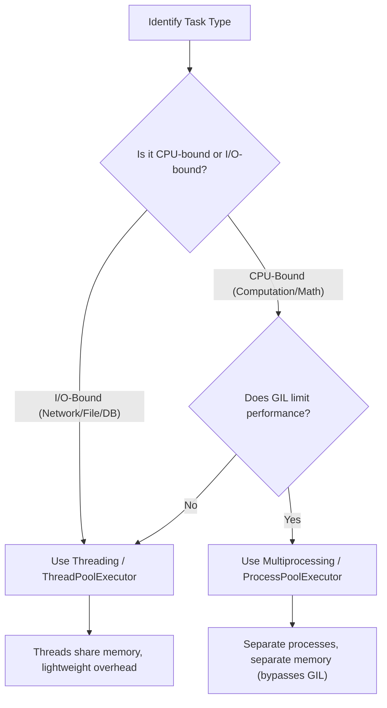

### 🎯 Learning Objectives
- Differentiate between Concurrency and Parallelism.
- Understand Python's Global Interpreter Lock (GIL) and its implications on performance.
- Know when to use Threading (I/O-bound) vs Multiprocessing (CPU-bound).
- Manage thread and process pools efficiently using `concurrent.futures`.

### 🧩 Core Concepts (Why)
Modern computers have processors with multiple cores, capable of executing many instructions at the same time. To utilize this hardware, programs need to run tasks concurrently.

However, Python developers face a unique challenge: the **Global Interpreter Lock (GIL)**. The GIL is a mechanism in CPython (the standard Python interpreter) that ensures only one OS thread executes Python bytecode at a time. This means that even on a machine with 16 CPU cores, a multi-threaded Python program will only run on a single core for CPU-bound tasks.

To build high-performance applications, you must understand how to bypass the GIL. You must learn to distinguish between **I/O-bound tasks** (waiting for network, disk, or database, where threads are excellent because they release the GIL while waiting) and **CPU-bound tasks** (heavy computations, where you must use separate processes with their own memory space and interpreters to achieve true parallelism).

### 🔁 Logic and Operation
When deciding how to structure concurrent code in Python, use the following decision framework:



- **Concurrency** is about *dealing* with lots of things at once (structuring a program to handle multiple overlapping tasks, e.g., waiting for web requests).
- **Parallelism** is about *doing* lots of things at once (executing multiple operations simultaneously on multiple CPU cores).

### 📝 Annotated Examples

#### 1. ThreadPoolExecutor for I/O-Bound Tasks
The `concurrent.futures` module provides a clean high-level interface for running tasks asynchronously using pools of threads or processes.
```python
from concurrent.futures import ThreadPoolExecutor
import urllib.request
import time

URLS = [
    'https://www.python.org',
    'https://www.wikipedia.org',
    'https://httpbin.org/delay/1'
]

def load_url(url):
    # A typical I/O-bound operation: fetching a web page
    with urllib.request.urlopen(url, timeout=5) as conn:
        return conn.read()

# Using a Context Manager ensures the thread pool shuts down cleanly
start_time = time.time()
with ThreadPoolExecutor(max_workers=3) as executor:
    # executor.map applies the load_url function to each item in URLS in parallel
    results = list(executor.map(load_url, URLS))

print(f"Downloaded {len(results)} pages in {time.time() - start_time:.2f} seconds")
```

#### 2. ProcessPoolExecutor for CPU-Bound Tasks
For heavy computations, threads are useless because of the GIL. We use `ProcessPoolExecutor` to run tasks in separate processes.
```python
from concurrent.futures import ProcessPoolExecutor
import time

def calculate_prime_factors(n):
    # A typical CPU-bound operation: factorization
    factors = []
    d = 2
    while d * d <= n:
        while (n % d) == 0:
            factors.append(d)
            n //= d
        d += 1
    if n > 1:
        factors.append(n)
    return factors

numbers = [1000000007, 2000000014, 3000000019, 4000000021]

if __name__ == '__main__':
    start_time = time.time()
    # ProcessPoolExecutor bypasses the GIL by spawning separate Python interpreters
    with ProcessPoolExecutor(max_workers=4) as executor:
        results = list(executor.map(calculate_prime_factors, numbers))
    
    print(f"Calculated factors in {time.time() - start_time:.2f} seconds")
```
*(Note: Always wrap multiprocessing entry points under `if __name__ == '__main__':` on Windows and macOS to prevent child processes from running the parent script recursively).*

#### 3. Granular Execution Control with `submit()` and `as_completed`
While `executor.map` returns results in the exact order of the input list, `submit()` returns `Future` objects. You can monitor their status and process results as they complete.
```python
from concurrent.futures import ThreadPoolExecutor, as_completed
import time

def delayed_task(n):
    time.sleep(n)
    return f"Task with {n}s delay done"

delays = [3, 1, 2]

with ThreadPoolExecutor(max_workers=3) as executor:
    # Submit tasks and map futures to their parameters
    future_to_delay = {executor.submit(delayed_task, d): d for d in delays}
    
    # Process results as soon as they finish, regardless of order
    for future in as_completed(future_to_delay):
        delay = future_to_delay[future]
        try:
            result = future.result()
            print(f"Result: {result} (original delay: {delay}s)")
        except Exception as exc:
            print(f"Task generated an exception: {exc}")
# Output:
# Result: Task with 1s delay done (original delay: 1s)
# Result: Task with 2s delay done (original delay: 2s)
# Result: Task with 3s delay done (original delay: 3s)
```

### ❌ Common Mistakes

**Mistake 1: Using Threading to speed up CPU-bound tasks**
```python
import threading

def cpu_heavy_work():
    # Summing squares of a large range (CPU intensive)
    sum(i * i for i in range(10**7))

# Trying to run them in parallel using threads
t1 = threading.Thread(target=cpu_heavy_work)
t2 = threading.Thread(target=cpu_heavy_work)
t1.start(); t2.start()
t1.join(); t2.join()
```
```text
(This runs slower than or equal to sequential execution on multi-core processors due to lock contention)
```
```python
from multiprocessing import Process

def cpu_heavy_work():
    sum(i * i for i in range(10**7))

if __name__ == '__main__':
    # Bypasses GIL by executing in separate system processes
    p1 = Process(target=cpu_heavy_work)
    p2 = Process(target=cpu_heavy_work)
    p1.start(); p2.start()
    p1.join(); p2.join()
```
> Because of the GIL, only one thread can execute Python bytecodes at any instant. Multi-threading CPU-bound tasks in Python actually decreases performance because of thread switching overhead and contention for the GIL lock. True parallelism for calculations must be achieved using the `multiprocessing` module or `ProcessPoolExecutor`.

**Mistake 2: Not synchronizing shared mutable state in threads**
```python
import threading

counter = 0

def unsafe_increment():
    global counter
    for _ in range(100000):
        counter += 1 # Not thread-safe!

t1 = threading.Thread(target=unsafe_increment)
t2 = threading.Thread(target=unsafe_increment)
t1.start(); t2.start()
t1.join(); t2.join()
assert counter == 200000
```
```text
Traceback (most recent call last):
  ...
AssertionError
```
```python
import threading

counter = 0
lock = threading.Lock()

def safe_increment():
    global counter
    for _ in range(100000):
        # Acquire lock to ensure atomic update of the counter
        with lock:
            counter += 1

t1 = threading.Thread(target=safe_increment)
t2 = threading.Thread(target=safe_increment)
t1.start(); t2.start()
t1.join(); t2.join()
assert counter == 200000
```
> Threads share the same memory space. Operations like `counter += 1` are not atomic; they involve reading, incrementing, and writing the variable. Multiple threads running this concurrently will overwrite each other's updates. Use a `threading.Lock` to serialize access to shared mutable data.

### 💡 Tips & Idioms
- **Prefer `concurrent.futures` over raw `threading`/`multiprocessing`**: The executor pools automate thread/process creation, task queueing, thread reuse, and resource cleanup.
- **Exceptions are preserved**: If a task raises an exception, the exception is stored in the `Future` and will be raised when you call `future.result()` or iterate over `executor.map` results.
- **Keep workers reasonable**: For `ThreadPoolExecutor`, `max_workers` can be relatively high (e.g., 5 * CPU cores) since they spend time waiting. For `ProcessPoolExecutor`, `max_workers` should not exceed the number of physical CPU cores (typically `os.cpu_count()`) to avoid excessive process creation overhead.

### 🧠 Deep Dive (Under the hood)
<details><summary>The Mechanics of Python's GIL and Multiprocessing Data Sharing</summary>

**GIL Internals:**
The GIL is a simple mutex (mutual exclusion lock) designed to make CPython's memory management thread-safe. CPython uses reference counting for garbage collection. Without the GIL, two threads could simultaneously increment/decrement a reference count, causing memory leaks or premature deallocation. 

Python threads are actual OS threads. When a thread runs, it acquires the GIL. Every few milliseconds (configured via `sys.getswitchinterval()`), or when performing I/O operations, the current thread releases the GIL, giving other threads a chance to run.

**Multiprocessing Communication:**
Because processes do not share memory, they cannot easily share Python variables. To pass data to a worker process:
1. The parent process serializes (pickles) the function and arguments using `pickle`.
2. The serialized data is sent to the child process via IPC (Inter-Process Communication) pipes.
3. The child process deserializes (unpickles) the inputs, executes the code, pickles the result, and sends it back.
This pickling process adds significant overhead. If the arguments or results are huge, multiprocessing can be slower than single-threaded execution due to data serialization bottlenecks.
</details>

### 🏋️ Exercise
Implement a function `concurrent_downloader(urls)` using `ThreadPoolExecutor` from `concurrent.futures`. The function should download or process the urls concurrently using the provided mock function `fake_fetch(url)` and return a list containing all the results.

```python
from concurrent.futures import ThreadPoolExecutor

def fake_fetch(url):
    import time
    time.sleep(0.01)
    return f"Fetched {url}"

def concurrent_downloader(urls):
    # Use ThreadPoolExecutor to run fake_fetch in parallel and return list of results
    pass
```

### ✅ Self-Check
1. If you are developing a web scraper that fetches 100 pages, should you use `ThreadPoolExecutor` or `ProcessPoolExecutor`?
2. What happens to exceptions raised inside tasks run by `ThreadPoolExecutor`?
<details><summary>Answers</summary>

1. You should use `ThreadPoolExecutor`. Web scraping is highly I/O-bound (waiting for network packets). Threads will release the GIL during network I/O, allowing other threads to run concurrently with minimal memory overhead.
2. The exceptions are not raised immediately. They are captured by the `Future` object representing the task. When you call `future.result()` or iterate over the outputs from `executor.map()`, the exception is re-raised and must be handled in a try-except block.
</details>

### 📌 Summary
- **Concurrency** is structured task overlap; **Parallelism** is simultaneous execution on multi-core hardware.
- Python's **GIL** limits multi-threaded execution to a single core, making threads ineffective for CPU-bound tasks.
- Use **Threading** (via `ThreadPoolExecutor`) for I/O-bound tasks to release the GIL while waiting.
- Use **Multiprocessing** (via `ProcessPoolExecutor`) for CPU-bound tasks to bypass the GIL by using separate interpreters.
