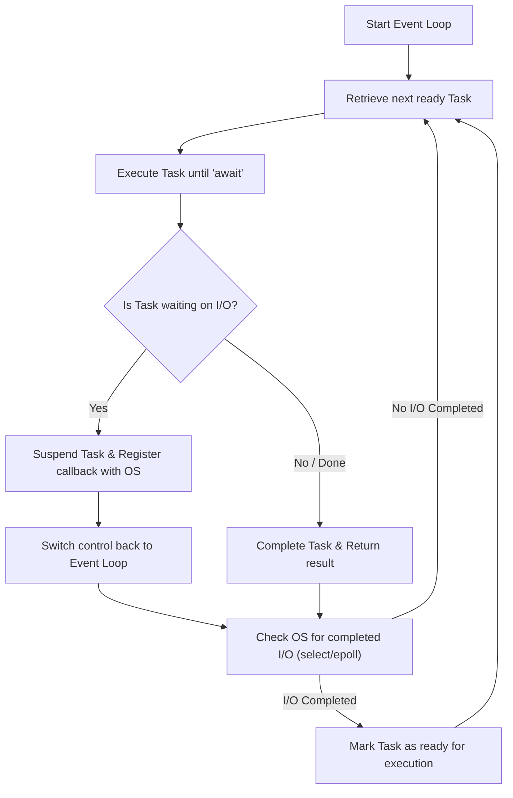

### 🎯 Learning Objectives
- Explain the concept of the Event Loop and cooperative multitasking.
- Contrast coroutines with standard synchronous Python functions.
- Use `async` and `await` syntax to write non-blocking code.
- Schedule tasks concurrently using `asyncio.create_task()`.
- Wait for multiple asynchronous tasks using `asyncio.gather()`.

### 🧩 Core Concepts (Why)
In traditional synchronous programming, operations are blocking. If your code makes a request to a database or a remote server, the CPU waits idly for the network packet or disk operation to finish. In Day 36, we saw how threads can mitigate this by letting the OS switch execution. However, threads have substantial memory overhead, and thread context switching is expensive.

**Asyncio** addresses this using **Cooperative Multitasking**. Instead of spawning many OS threads, your entire application runs on a single thread managed by an **Event Loop**. Tasks yield execution control voluntarily when they hit an I/O wait point. This single-threaded concurrency allows Python to handle thousands of simultaneous connections with negligible resource overhead, making it the industry standard for high-performance web applications and network APIs.

### 🔁 Logic and Operation
The execution model of `asyncio` is based on an Event Loop. The loop manages active tasks and handles I/O multiplexing.



- **Coroutines**: Special Python functions defined with `async def`. Calling them returns a coroutine object without running their code.
- **Event Loop**: A continuous loop that coordinates the scheduling and execution of coroutines based on I/O readiness.
- **Cooperative Multitasking**: The mechanism where the running task voluntarily hands over control to the event loop using the `await` keyword.

### 📝 Annotated Examples

#### 1. Coroutines vs Regular Functions
Calling a coroutine function returns a coroutine object. You must run it within an event loop to execute its code.
```python
import asyncio

# The 'async def' syntax defines a coroutine function
async def say_hello():
    print("Inside the coroutine!")
    return "Hello World"

# Calling it returns a coroutine object immediately
coro = say_hello()
print(type(coro))  # Output: <class 'coroutine'>

# To run it, we use asyncio.run() to bootstrap the Event Loop
result = asyncio.run(coro)
print(result)  # Output: Hello World
```

#### 2. Cooperative Multitasking with `asyncio.create_task()`
By scheduling coroutines as Tasks, they are registered with the event loop and run concurrently.
```python
import asyncio
import time

async def fetch_web_page(site_id, delay):
    print(f"Fetching site {site_id}...")
    # asyncio.sleep yields control to the event loop, unlike time.sleep
    await asyncio.sleep(delay)
    print(f"Finished site {site_id}!")
    return f"Data from site {site_id}"

async def main():
    start = time.time()
    
    # Schedule two fetches concurrently
    task1 = asyncio.create_task(fetch_web_page(1, 2.0))
    task2 = asyncio.create_task(fetch_web_page(2, 3.0))
    
    # Await the results. Both tasks run concurrently.
    data1 = await task1
    data2 = await task2
    
    print(f"Results: {data1}, {data2}")
    print(f"Elapsed: {time.time() - start:.2f} seconds")  # Prints ~3.00 seconds instead of 5.00

asyncio.run(main())
```

#### 3. Managing Multiple Tasks with `asyncio.gather()`
`asyncio.gather` is a high-level function to run multiple awaitable tasks concurrently and unpack the results in order.
```python
import asyncio

async def compute_square(x):
    await asyncio.sleep(0.1)
    return x * x

async def main():
    numbers = [1, 2, 3, 4, 5]
    
    # Create a list of coroutine objects
    tasks = [compute_square(num) for num in numbers]
    
    # Wait for all tasks concurrently and retrieve results in order
    results = await asyncio.gather(*tasks)
    print(results)  # Output: [1, 4, 9, 16, 25]

asyncio.run(main())
```

### ❌ Common Mistakes

**Mistake 1: Calling a coroutine without awaiting it**
```python
import asyncio

async def get_value():
    return 42

async def main():
    # Calling the coroutine function without 'await'
    value = get_value()
    print(f"Value is: {value}")
```
```text
RuntimeWarning: coroutine 'get_value' was never awaited
Value is: <coroutine object get_value at 0x7f884c...>
```
```python
import asyncio

async def get_value():
    return 42

async def main():
    # Correctly awaiting the coroutine
    value = await get_value()
    print(f"Value is: {value}")

asyncio.run(main())
```
> An asynchronous function defined with `async def` does not execute automatically when called. It returns a coroutine object. You must explicitly use the `await` keyword to execute the coroutine and retrieve its return value.

**Mistake 2: Using blocking synchronous operations**
```python
import asyncio
import time

async def blocking_task(name):
    print(f"Task {name} started")
    time.sleep(1.0)  # Blocking! Freezes the event loop thread
    print(f"Task {name} finished")

async def main():
    await asyncio.gather(blocking_task("A"), blocking_task("B"))

asyncio.run(main())
```
```text
Task A started
Task A finished
Task B started
Task B finished
(Runs sequentially, taking 2.0 seconds total)
```
```python
import asyncio

async def non_blocking_task(name):
    print(f"Task {name} started")
    await asyncio.sleep(1.0)  # Non-blocking! Yields control
    print(f"Task {name} finished")

async def main():
    await asyncio.gather(non_blocking_task("A"), non_blocking_task("B"))

asyncio.run(main())
```
> Asyncio is single-threaded. If any task invokes blocking code (like `time.sleep()`, synchronous DB drivers, or standard `requests`), the event loop is blocked. All other scheduled tasks are frozen. You must use async-native libraries (e.g., `asyncio.sleep()`, `httpx` or `aiohttp`) and yield control using `await`.

**Mistake 3: Awaiting tasks immediately upon creation**
```python
import asyncio

async def task_worker(n):
    await asyncio.sleep(1)
    return n

async def main():
    # Awaiting task1 immediately before task2 is even created
    t1 = await asyncio.create_task(task_worker(1))
    t2 = await asyncio.create_task(task_worker(2))
    return [t1, t2]

asyncio.run(main())
```
```text
(Runs sequentially, taking 2.0 seconds total)
```
```python
import asyncio

async def task_worker(n):
    await asyncio.sleep(1)
    return n

async def main():
    # Create the task handles first (registers them with the loop)
    task1 = asyncio.create_task(task_worker(1))
    task2 = asyncio.create_task(task_worker(2))
    # Await the scheduled tasks
    t1 = await task1
    t2 = await task2
    return [t1, t2]

asyncio.run(main())
```
> Using `await` suspends execution of the current function. If you write `t1 = await asyncio.create_task(...)`, you halt the outer function before it has a chance to execute the next line of code, turning the execution flow back to synchronous. You must create the Task objects first so they run concurrently, then await them.

### 💡 Tips & Idioms
- **Check your libraries**: Do not mix synchronous libraries (like `requests`) with asynchronous ones. Look for async alternatives like `httpx` for HTTP, `motor` for MongoDB, or `aiopg`/`asyncpg` for PostgreSQL.
- **Use `asyncio.run()` with care**: Only use `asyncio.run()` as the main entry point to launch your program. Do not call it inside an already running asynchronous function; it will raise a `RuntimeError: Timeout context manager should be used`.
- **Integrate CPU-bound tasks**: If you must perform CPU-intensive work (e.g., image rendering) in an async application, delegate it to a process pool executor using `await loop.run_in_executor(None, cpu_bound_function)`.

### 🧠 Deep Dive (Under the hood)
<details><summary>The Event Loop, epoll/kqueue, and Generator-based Coroutines</summary>

**OS-Level Multiplexing:**
How can a single thread manage thousands of concurrent I/O operations? It delegates the waiting to the operating system kernel.
When an asynchronous library initializes a socket connection, it sets the socket to non-blocking mode. Instead of waiting for data to arrive, the library registers the socket's file descriptor with an OS event-notification service like `epoll` (Linux), `kqueue` (macOS), or `IOCP` (Windows).
The event loop runs a continuous cycle:
1. It queries the kernel (e.g., via `select()` or `epoll_wait()`) for a list of sockets ready for read/write.
2. If none are ready, the thread blocks temporarily, letting the OS sleep until an interrupt is triggered.
3. Once an I/O event is fired, the OS wakes the event loop, which translates the event to callbacks, waking up the matching coroutine.

**Generators to Coroutines:**
Under the hood, Python coroutines are specialized generators. Historically (before Python 3.5), asynchronous programming was achieved using generators decorated with `@asyncio.coroutine` and yielding control using `yield from`.
When you write `await coro`, Python suspends the frame stack of the current coroutine, returning execution control to the event loop. The loop interacts with the coroutine using its low-level `.send(value)` and `.throw(exception)` generator methods to advance the execution state until a final `StopIteration` exception is raised, indicating task completion.
</details>

### 🏋️ Exercise
Implement the function `async_fetch_all(urls)` which fetches all of the URLs in parallel using `fake_async_fetch(url)`. It must run them concurrently and return a list containing all the results.

```python
import asyncio

async def fake_async_fetch(url):
    await asyncio.sleep(0.01)
    return f"Async {url}"

async def async_fetch_all(urls):
    # Use asyncio.gather to fetch all urls concurrently and return list
    pass
```

### ✅ Self-Check
1. If you run `asyncio.create_task(my_coroutine())`, does it run immediately?
2. How does the event loop execute multiple tasks on a single OS thread?
<details><summary>Answers</summary>

1. It does not execute immediately, but it is registered with the Event Loop's ready queue. The moment the currently running coroutine yields control (reaches an `await` point or completes), the event loop will start executing the task.
2. It uses OS-level non-blocking I/O multiplexing. The loop registers tasks' sockets/descriptors with the kernel and goes to sleep. When the kernel signals that an operation is complete, the loop wakes up and resumes the corresponding coroutine.
</details>

### 📌 Summary
- **Asyncio** runs on a single thread and uses cooperative multitasking, yielding execution via the `await` keyword.
- An **Event Loop** schedules, pauses, and resumes tasks by responding to OS-level ready-notifications.
- Avoid using **blocking synchronous calls** inside async functions, as they freeze the entire application.
- Use `asyncio.create_task()` to schedule background operations, and `asyncio.gather()` to wait for multiple tasks in parallel.
