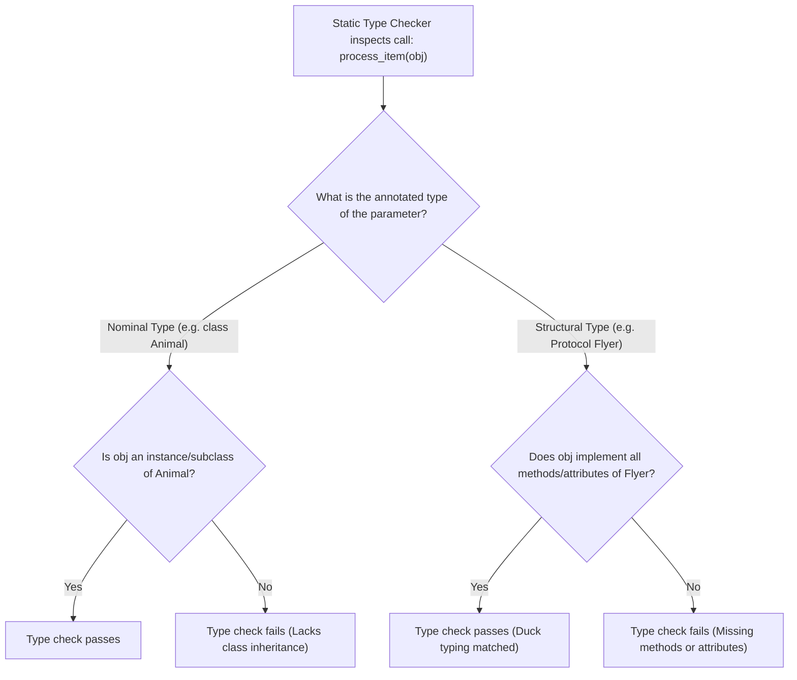

### 🎯 Learning Objectives
- Differentiate between Nominal Typing and Structural Typing (Static Duck Typing).
- Define structural interfaces using `typing.Protocol`.
- Work with advanced types like `Union`, `Optional`, and `Callable`.
- Implement reusable code components using Generics (`TypeVar`).
- Use static type checkers (like `mypy` or `pyright`) to verify type correctness.

### 🧩 Core Concepts (Why)
Python is dynamically typed: types are checked at runtime, and anything goes as long as an object behaves as expected (duck typing: *"if it walks like a duck and quacks like a duck, it's a duck"*). However, in large codebases, dynamic typing can lead to runtime errors that are difficult to trace.

To address this, Python introduced optional static type hints (PEP 484). Type hints allow static type checkers (like `mypy` or VS Code's `pyright`/`Pylance`) to analyze your code for bugs without executing it.

Initially, Python's type system relied on **Nominal Typing**—an object matches a type only if it is an explicit subclass of that type. This conflicts with Python's traditional duck-typing philosophy. To bridge this gap, PEP 544 introduced **Structural Subtyping** via `typing.Protocol`. With protocols, you can define interfaces based on what methods or properties an object implements, rather than its inheritance hierarchy. This combines the flexibility of duck typing with the safety of static analysis.

### 🔁 Logic and Operation
Understanding how static type checkers verify parameters depends on whether you use Nominal Typing or Structural Typing.



- **Nominal Typing**: Type compatibility is determined by explicit declarations and class inheritance (e.g. `class Dog(Animal)`).
- **Structural Typing (Protocols)**: Type compatibility is determined by the shape of the object (methods, attributes, and signatures). No inheritance is required.
- **Generics**: Parameterized types that allow functions/classes to accept different types while enforcing consistency between inputs and outputs.

### 📝 Annotated Examples

#### 1. Union, Optional, and Callable
These annotations allow you to represent complex function signatures and return types.
```python
from typing import Union, Optional, Callable

# Python 3.10+ also supports syntax: int | str
def parse_id(val: Union[int, str]) -> str:
    # Accepts either int or str, always returns str
    return str(val)

# Optional[T] is shorthand for Union[T, None]
def get_user_name(user_id: int) -> Optional[str]:
    # May return a string or None if the user does not exist
    if user_id == 1:
        return "Alice"
    return None

# Callable[[ArgTypes...], ReturnType] annotates callback functions
def process_data(data: list, transform: Callable[[str], str]) -> list:
    return [transform(item) for item in data]
```

#### 2. Generics with `TypeVar`
Generics allow you to write reusable code while retaining type relationships.
```python
from typing import TypeVar, List

# TypeVar binds the input type to the output type
T = TypeVar('T')

def get_first_element(items: List[T]) -> T:
    # If a List[int] is passed, mypy knows the return type is int.
    # If a List[str] is passed, it knows the return type is str.
    return items[0]

first_num = get_first_element([1, 2, 3])  # Inferred as int
first_word = get_first_element(["a", "b"])  # Inferred as str
```

#### 3. Structural Subtyping with `typing.Protocol`
Using protocols allows you to enforce interfaces without forcing classes to inherit from a base class.
```python
from typing import Protocol, List

# Define a Protocol describing what an object must do
class Greeter(Protocol):
    def greet(self) -> str:
        ...  # Ellipsis indicates signature definition without implementation

class EnglishPerson:
    def greet(self) -> str:
        return "Hello"

class JapanesePerson:
    def greet(self) -> str:
        return "Konnichiwa"

# This class does NOT match the protocol because its return type is wrong
class BrokenGreeter:
    def greet(self) -> int:
        return 42

def introduce(people: List[Greeter]) -> None:
    for person in people:
        print(person.greet())

# EnglishPerson and JapanesePerson implicitly satisfy Greeter protocol
introduce([EnglishPerson(), JapanesePerson()])

# Static type checkers will raise an error here because BrokenGreeter does not fit the Protocol
# introduce([BrokenGreeter()])
```

### ❌ Common Mistakes

**Mistake 1: Forgetting to handle Optional types (None checking)**
```python
from typing import Optional

def get_upper_name(name: Optional[str]) -> str:
    # Calling a string method directly on an Optional type
    return name.upper()
```
```text
error: Item "None" of "Optional[str]" has no attribute "upper"
```
```python
from typing import Optional

def get_upper_name(name: Optional[str]) -> str:
    # Correctly checking for None before processing
    if name is None:
        return "ANONYMOUS"
    return name.upper()
```
> Static type checkers enforce safety. Since an `Optional[str]` can be `None`, you cannot perform string operations on it directly without a type guard (like `if name is None:` or `if not name:`), which narrows the type down to just `str`.

**Mistake 2: Missing the `self` parameter inside a Protocol method**
```python
from typing import Protocol

class Printable(Protocol):
    # Defining a method without 'self'
    def print_item() -> str:
        ...
```
```text
error: Protocol member "print_item" must be a method (take self as first argument)
```
```python
from typing import Protocol

class Printable(Protocol):
    # Correctly including self
    def print_item(self) -> str:
        ...
```
> Protocol definitions describe instance methods, which are expected to accept `self` as the first parameter. Leaving it out makes the type checker treat it as a static method, causing errors when matching normal instance methods on classes.

**Mistake 3: Overusing TypeVar without restriction (lack of upper bounds)**
```python
from typing import TypeVar

T = TypeVar('T')

# Trying to add elements of generic type T
def sum_two(a: T, b: T) -> T:
    return a + b
```
```text
error: Unsupported operand types for + ("T" and "T")
```
```python
from typing import TypeVar

# Bound the TypeVar to types that support addition (like numbers)
T = TypeVar('T', int, float)

def sum_two(a: T, b: T) -> T:
    return a + b
```
> A generic `TypeVar` with no constraints represents any object (`object`). Since arbitrary objects do not support the addition operator `+`, type checkers will throw an error. You must constrain the `TypeVar` by passing allowed types as arguments, or by using the `bound` parameter to restrict subclasses.

### 💡 Tips & Idioms
- **Use `runtime_checkable` for runtime support**: Normally, Protocols are ignored at runtime. If you want to use them with `isinstance()` or `issubclass()`, decorate the protocol class with `typing.runtime_checkable`.
- **Prefer newer syntax in Python 3.10+**: Instead of importing `Union` and `Optional` from `typing`, write `int | str` or `str | None`. It is cleaner and more readable.
- **Use `Any` sparingly**: Using `Any` disables type checking for that variable. Resorting to it defeats the purpose of static type checking. Use `TypeVar` or `Protocol` instead.

### 🧠 Deep Dive (Under the hood)
<details><summary>Nominal vs Structural Subtyping and Type Erasure</summary>

**Nominal vs. Structural Typing:**
Nominal typing is rooted in taxonomy. A class `Dog` is a subclass of `Animal` only if you write `class Dog(Animal):`. Even if `Dog` implements the exact same fields and methods as `Cat`, you cannot pass a `Dog` to a function expecting a `Cat` unless they share a common ancestor.
Structural typing (Protocols), on the other hand, is based on shapes. The type checker creates an internal representation of the protocol's methods and signatures. When validating a parameter, it iterates through the target object's class methods and checks if the signatures match the protocol. If they do, the type checker is satisfied, even if the class has never heard of the protocol itself.

**Type Erasure:**
Python type hints are completely ignored by the Python interpreter at runtime. This is called **Type Erasure**. When Python executes your code, there is no performance overhead for using type annotations, but there is also no automatic enforcement. 
For instance, the code:
```python
def add(a: int, b: int) -> int:
    return a + b
```
Is executed by the interpreter exactly the same as:
```python
def add(a, b):
    return a + b
```
Because of this, type hints are purely tools for developer ergonomics and static analysis tools. They do not enforce types at runtime unless you use third-party runtime validation libraries like `pydantic`.
</details>

### 🏋️ Exercise
Implement a function `render_shapes(shapes)` where `shapes` is a list of objects satisfying the `Drawable` protocol. The function should call `draw()` on each shape and return a single, comma-separated string containing all the results.

```python
from typing import Protocol, List

class Drawable(Protocol):
    def draw(self) -> str:
        ...

def render_shapes(shapes):
    # Shapes is a List[Drawable]
    # Call draw() on all shapes and return a comma-separated string
    pass
```

### ✅ Self-Check
1. How does `typing.Protocol` support Python's "duck typing" philosophy statically?
2. What is the difference between `Union[str, None]` and `Optional[str]`?
<details><summary>Answers</summary>

1. It allows you to specify an expected type based on its interface (methods and attributes) rather than its inheritance hierarchy. Classes do not need to inherit from the Protocol class; they just need to implement its methods.
2. There is no difference. `Optional[str]` is a shorthand alias for `Union[str, None]`. In Python 3.10+, both can be written simply as `str | None`.
</details>

### 📌 Summary
- **Static type checkers** parse your source code to catch bugs without executing the program.
- **Structural Subtyping** (`typing.Protocol`) allows static validation of dynamic duck typing.
- **Generics** (`TypeVar`) allow functions and classes to adapt to different types while retaining type safety across boundaries.
- **Optional** requires explicit handling of `None` cases before you can perform operations on the underlying type.
