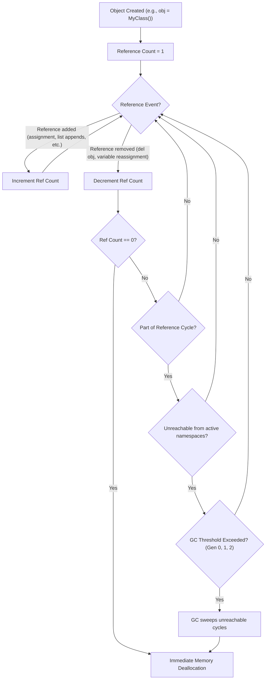

### 🎯 Learning Objectives
- Explain CPython's reference counting mechanism and monitor counts using `sys.getrefcount`.
- Describe cyclic garbage collection, including generation-based traversal (Gen 0, 1, 2) and thresholds.
- Implement weak references via the `weakref` module to prevent and break reference cycles.
- Detect and prevent memory leaks caused by globals, mutable default arguments, and circular references.
- Optimize memory usage in high-instantiation classes using `__slots__` to eliminate instance dictionaries (`__dict__`).

### 🧩 Core Concepts (Why)
Python provides automatic memory management. When you create objects, Python allocates memory on the heap; when you are done with them, Python automatically reclaims that memory. However, understanding *how* this works is crucial for writing high-performance, production-ready code.

CPython (the standard implementation of Python) uses two complementary strategies for memory management:
1. **Reference Counting**: The primary line of defense. Every Python object tracks how many references point to it. Once this count drops to zero, the object is immediately destroyed and its memory is reclaimed.
2. **Cyclic Garbage Collection**: Reference counting cannot detect circular references (e.g., object A references object B, which references object A). To clean up these isolated islands of unreachable objects, CPython runs a cyclic garbage collector.

As applications scale and handle millions of objects (such as nodes in a graph or items in a database query), the default overhead of Python objects can cause high memory utilization. By default, every user-defined class stores its instance attributes in a dictionary (`__dict__`). Dictionaries are highly dynamic but require significant memory overhead. Knowing how to replace `__dict__` with `__slots__` allows you to optimize memory usage by up to 80% for high-density objects.

### 🔁 Logic and Operation

Here is how memory allocation, reference tracking, and garbage collection interact:



- **Reference Counting**: Executes deterministically and instantly. If there are no reference cycles, memory is freed the exact millisecond an object's reference count hits zero.
- **Generational GC**: CPython groups objects into three generations (Gen 0, Gen 1, and Gen 2) based on how long they have survived. Gen 0 is checked frequently. If objects survive, they are promoted to Gen 1, and then to Gen 2, which is collected least frequently.
- **__slots__ Optimization**: Eliminates the dynamic `__dict__` structure from instances. Instead of a hash-map, instances store attributes in a fixed-size, flat array layout in C memory, bypassing dictionary overhead.

### 📝 Annotated Examples

#### 1. Tracking Reference Counting
We can observe reference counts in Python using `sys.getrefcount()`. Note that passing an object to `sys.getrefcount()` increases its reference count temporarily by 1 because the function call creates a new reference on the call stack.

```python
import sys

# Create list object
a = [1, 2, 3]
print(sys.getrefcount(a))  # Output: 2 (variable 'a' + temporary parameter in getrefcount)

b = a  # Assign to b
print(sys.getrefcount(a))  # Output: 3 ('a', 'b', and getrefcount)

c = [a]  # Add inside a list
print(sys.getrefcount(a))  # Output: 4 ('a', 'b', list index, and getrefcount)

del b
print(sys.getrefcount(a))  # Output: 3 ('a', list index, and getrefcount)
```

#### 2. Cyclic References and the `gc` Module
Here is a circular reference where two objects reference each other, maintaining a reference count of 1 even after we delete our access variables.

```python
import gc

class Node:
    def __init__(self, value):
        self.value = value
        self.ref = None

# Enable garbage collection debugging if needed
gc.enable()

# Create a cycle
n1 = Node(1)
n2 = Node(2)
n1.ref = n2
n2.ref = n1

# Delete our local variables
del n1
del n2

# At this point, the Node objects are unreachable from Python code.
# However, their reference counts are still 1 due to the internal cycle.
# We trigger the garbage collector manually to collect them:
collected = gc.collect()
print(f"Garbage collector collected {collected} objects.")  # Output: 2
```

#### 3. Breaking Cycles with `weakref`
A weak reference does not increment the reference count of the target object. It is created using `weakref.ref` or containers like `weakref.WeakValueDictionary`.

```python
import sys
import weakref

class LargeObject:
    def __init__(self, data):
        self.data = data

obj = LargeObject("very large string")
print(sys.getrefcount(obj))  # Output: 2

# Create a weak reference
wref = weakref.ref(obj)
print(sys.getrefcount(obj))  # Output: 2 (did not increase!)

# Dereference to access the original object
retrieved = wref()
if retrieved is not None:
    print("Object is still alive:", retrieved.data)

# Delete the only strong reference
del obj

# Check the weak reference again
print(wref())  # Output: None (Automatically invalidated)
```

#### 4. Memory Optimization using `__slots__`
Here is a comparison between a standard class and a memory-optimized class using `__slots__`.

```python
import sys

class StandardPoint:
    def __init__(self, x, y):
        self.x = x
        self.y = y

class OptimizedPoint:
    # Defining slots prevents __dict__ and __weakref__ creation
    __slots__ = ['x', 'y']
    def __init__(self, x, y):
        self.x = x
        self.y = y

sp = StandardPoint(1, 2)
op = OptimizedPoint(1, 2)

# Standard instances have a dictionary storing attributes
print(sp.__dict__)  # Output: {'x': 1, 'y': 2}

# Optimized instances do not have a __dict__
print(hasattr(op, '__dict__'))  # Output: False

# Trying to set an undeclared attribute on an optimized instance raises AttributeError
try:
    op.z = 10
except AttributeError as e:
    print(e)  # Output: 'OptimizedPoint' object has no attribute 'z'
```

### ❌ Common Mistakes

**Mistake 1: Appending to a global list/dictionary without clearing it (Memory Leak)**
```python
# Simulated long-running server cache
CACHE = []

def process_request(data):
    # Appending request data to a global cache list
    CACHE.append(data)
    return f"Processed: {len(data)} bytes"
```
```text
(No traceback - memory usage grows indefinitely until the system runs out of memory and crashes with MemoryError)
```
```python
# Simulated long-running server cache
CACHE = []

def process_request(data):
    # Process data and clean up or limit cache size
    result = f"Processed: {len(data)} bytes"
    # Keep only the last 100 entries to prevent memory exhaustion
    CACHE.append(data)
    if len(CACHE) > 100:
        CACHE.pop(0)
    return result
```
> Globals exist for the entire lifetime of the application process. Adding references to a global list or dict without limit prevents those objects from ever reaching a reference count of zero, causing a classic memory leak in Python.

**Mistake 2: Assuming a class with `__slots__` will automatically optimize subclasses**
```python
class Parent:
    __slots__ = ['x']

class Child(Parent):
    # Subclass does not define __slots__
    def __init__(self, x, y):
        self.x = x
        self.y = y
```
```text
(No traceback at declaration, but child instances will still create a __dict__ containing 'y')
```
```python
class Parent:
    __slots__ = ['x']

class Child(Parent):
    # Subclass must declare slots for additional attributes
    __slots__ = ['y']
    def __init__(self, x, y):
        self.x = x
        self.y = y
```
> If a parent class uses `__slots__` but the subclass does not define `__slots__`, Python will automatically create a `__dict__` for instances of the subclass, defeating the memory optimization. The subclass must define `__slots__ = [...]` even if it is an empty sequence.

### 💡 Tips & Idioms
- **Check Memory Usage**: Use the standard `sys.getsizeof()` to check the memory size of an object (in bytes). However, note that it only measures the container itself, not the nested references. For deep inspection, use third-party libraries like `pympler`.
- **Prefer `weakref.WeakValueDictionary` for caches**: If you are implementing a lookup cache, using a `WeakValueDictionary` ensures that cache entries are automatically removed when the cached objects have no other active strong references.
- **Use `__slots__` for scale**: Only implement `__slots__` when you expect to instantiate thousands or millions of instances of a class. Do not use it prematurely, as it restricts dynamic attribute creation which can break some decorators or serialization libraries.

### 🧠 Deep Dive (Under the hood)
<details><summary>Generational Garbage Collection & Cycles Detection</summary>

CPython's Garbage Collector (`gc` module) works on a generational premise: "most objects die young". It maintains three doubly-linked lists representing the generations:
- **Generation 0**: Newly created container objects.
- **Generation 1**: Objects that survived a Gen 0 collection.
- **Generation 2**: Objects that survived Gen 1 collections.

**Cycle Detection Algorithm:**
The GC detects cycles by performing the following steps:
1. **Initial Copy**: For every container object in a generation, it copies its reference count (`ob_refcnt`) to a field `gc_refs` inside the GC's internal tracking header.
2. **Simulate Deletions**: It traverses all objects in the generation and decrements the `gc_refs` count of any object referenced by the current object. In other words, if object A references object B, it decrements B's `gc_refs`.
3. **Isolate Cycles**: After completing the traversal, any object whose `gc_refs` is reduced to 0 is a candidate for garbage collection. This is because all references to it come from inside the generation list itself (no external references from the stack or global namespaces).
4. **Resurrect Reachable Objects**: The GC sweeps the list. If it finds that an object with `gc_refs > 0` references an object with `gc_refs == 0`, it resurrects the target object (along with everything it references) because it is still reachable through an external chain.
5. **Collect Trash**: Any remaining objects with `gc_refs == 0` are unreachable cycles and are cleared.
</details>

### 🏋️ Exercise
Implement a class named `OptimizedPoint` that represents a 2D coordinate with attributes `x` and `y`. This class must be optimized to use `__slots__` instead of instance dictionaries.

```python
class OptimizedPoint:
    # Implement a point with x and y using __slots__
    pass
```

### ✅ Self-Check
1. Why does `sys.getrefcount(obj)` return a value that is 1 higher than the actual reference count?
2. What happens to a weak reference if the target object is garbage collected?
3. Does a class using `__slots__` support dynamic attribute assignment at runtime?
<details><summary>Answers</summary>

1. Because passing the object to the `sys.getrefcount(obj)` function creates a temporary reference to the object on the function's local execution frame call stack.
2. The weak reference object is automatically invalidated, and calling it (e.g., `wref()`) returns `None`.
3. No. If a class defines `__slots__`, you can only read and write attributes that are explicitly declared in the slots tuple. Attempting to assign a new attribute raises an `AttributeError`.
</details>

### 📌 Summary
- **Reference Counting** handles immediate deallocation of objects whose reference counts reach zero.
- **Cyclic Garbage Collector** scans container objects to break reference cycles using generational lists (Gen 0, 1, 2).
- **Weak References** (`weakref` module) allow you to reference objects without increasing their reference counts, which is useful for caching.
- **`__slots__`** eliminates the `__dict__` attribute in class instances, significantly reducing memory consumption for classes with a large number of instances.
