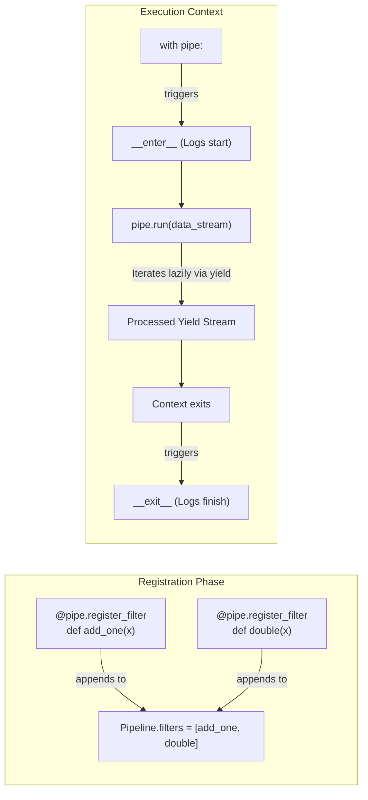
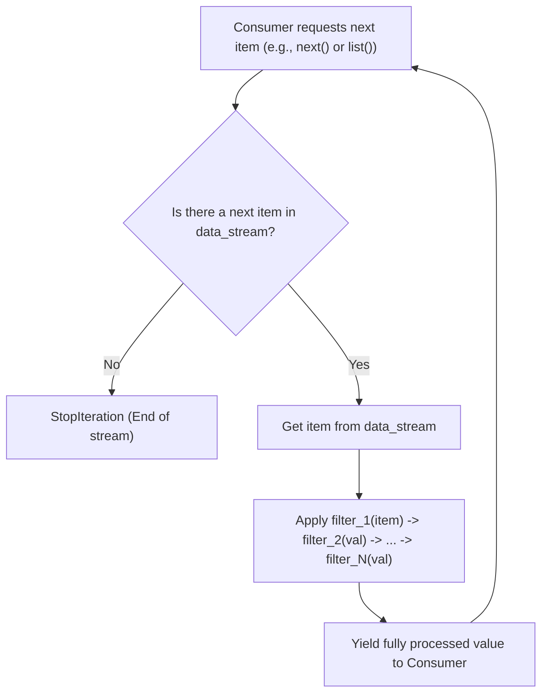

### 🎯 Learning Objectives
- Design and build a modular, memory-efficient data processing pipeline class.
- Integrate method-based decorators to register data-processing filters dynamically.
- Implement context managers (`__enter__` and `__exit__`) to manage pipeline execution lifecycles, logging, and setups.
- Utilize generator-based streaming (`yield`) to achieve lazy evaluation and $O(1)$ memory complexity.
- Combine decorator patterns, context management, and generators to solve a complex system design problem.

### 🧩 Core Concepts (Why)
In modern software engineering, data processing pipelines are essential for cleaning, transforming, and analyzing large volumes of data. However, processing massive datasets (such as system logs, transactional databases, or live sensor feeds) can easily exhaust system memory if we load all records into memory at once.

To build a production-grade data pipeline in Python, we must combine three core design paradigms:
1. **Decorators for Filter Registration**: Instead of hardcoding transformations inside the pipeline class, decorators allow us to register modular, reusable transformation functions dynamically. This adheres to the Open/Closed Principle (software entities should be open for extension, but closed for modification).
2. **Context Managers for Scope Lifecycle**: A pipeline needs to track its execution state—such as logging when it starts and finishes, setting up databases, or cleaning up temporary resources. Context managers (`with` statements) cleanly decouple setup and teardown logic from the data processing itself.
3. **Generators for Lazy Streaming**: Traditional lists process all items immediately and store the complete results in memory. By using generators with `yield`, the pipeline processes data lazily—one item at a time. The memory footprint remains constant ($O(1)$) regardless of whether we process ten items or ten billion items.

This Capstone project brings these concepts together into a cohesive **Pipeline Compiler** class.

### 🔁 Logic and Operation

Here is the architectural design and execution flow of the Pipeline compiler:

#### 1. Architectural Layout


#### 2. Lazy Processing Flow (Generator Stream)


- **Declarative Filter Registration**: Decorating a function registers it in the pipeline's internal list of filters, then returns the function unchanged so it can still be called normally.
- **Context Boundaries**: The `with` block guarantees that initialization and logging occur before execution begins, and cleanup/reporting occurs when execution ends—even if errors are raised.
- **On-Demand Processing**: In `run()`, when the consumer requests the next item, a single value is pulled from the source stream, transformed by all filters sequentially, and immediately yielded. The pipeline does not store intermediate results.

### 📝 Annotated Examples

#### 1. A Simple Pipeline Compilation
Let's look at how the `Pipeline` registers filters and processes numbers lazily.

```python
LOGS = []

class Pipeline:
    def __init__(self):
        self.filters = []
    
    def register_filter(self, func):
        # Registers the decorated function into the filters list
        self.filters.append(func)
        return func  # Return the function to allow normal usage elsewhere
    
    def __enter__(self):
        LOGS.append("Pipeline started")
        return self
        
    def __exit__(self, exc_type, exc_val, exc_tb):
        LOGS.append("Pipeline finished")
        # If an exception occurred, returning False propagates it
        return False
        
    def run(self, data_stream):
        # Generator function: yields values one by one
        for item in data_stream:
            val = item
            for f in self.filters:
                val = f(val)
            yield val

# Usage:
pipe = Pipeline()

@pipe.register_filter
def clean_whitespace(text):
    return text.strip()

@pipe.register_filter
def to_uppercase(text):
    return text.upper()

# Run the pipeline within the context manager
raw_data = ["  alice ", " bob  ", "   charlie"]
with pipe:
    # Notice: No processing has happened yet.
    # The 'run' method returns a generator object.
    processed_generator = pipe.run(raw_data)
    
    # We consume the generator to execute the pipeline
    final_output = list(processed_generator)

print("Output:", final_output)  # Output: ['ALICE', 'BOB', 'CHARLIE']
print("Logs:", LOGS)            # Output: ['Pipeline started', 'Pipeline finished']
```

#### 2. Processing Infinite Streams
Because the pipeline uses generator delegation, it can process infinite streams without running out of memory.

```python
import time

def infinite_number_stream():
    n = 1
    while True:
        yield n
        n += 1

pipe = Pipeline()

@pipe.register_filter
def square(x):
    return x * x

@pipe.register_filter
def format_str(x):
    return f"Value: {x}"

with pipe:
    # Process only the first 5 elements from the infinite stream
    stream = pipe.run(infinite_number_stream())
    for _ in range(5):
        print(next(stream))
```
**Output:**
```text
Value: 1
Value: 4
Value: 9
Value: 16
Value: 25
```

### ❌ Common Mistakes

**Mistake 1: Accumulating items inside the generator instead of yielding (Memory Exhaustion)**
```python
class Pipeline:
    # ...
    def run(self, data_stream):
        results = []
        for item in data_stream:
            val = item
            for f in self.filters:
                val = f(val)
            results.append(val)
        return results  # Returning a completed list
```
```text
(No traceback, but memory usage spikes up to gigabytes when processing massive/infinite streams, eventually throwing MemoryError)
```
```python
class Pipeline:
    # ...
    def run(self, data_stream):
        for item in data_stream:
            val = item
            for f in self.filters:
                val = f(val)
            yield val  # Yielding items lazily
```
> Returning a list defeats the purpose of generator streams. It forces the system to load the entire input dataset and hold all intermediate results in memory, causing potential Out-Of-Memory (OOM) failures on large streams.

**Mistake 2: Forgetting to return the function from the registration decorator**
```python
class Pipeline:
    # ...
    def register_filter(self, func):
        self.filters.append(func)
        # Missing 'return func'
```
```text
TypeError: 'NoneType' object is not callable
```
```python
class Pipeline:
    # ...
    def register_filter(self, func):
        self.filters.append(func)
        return func  # Correctly returning the function
```
> In Python, a decorator replaces the decorated function with whatever the decorator function returns. If your registration decorator doesn't return the original function (or a wrapper), the function variable becomes `None`. This will raise a `TypeError` as soon as you attempt to call it later in your code.

### 💡 Tips & Idioms
- **Composition over Inheritance**: Notice how our pipeline does not require filter classes to inherit from a base `Filter` class. Instead, it accepts any callable object (functions, methods, or classes implementing `__call__`), allowing for maximum flexibility.
- **Chaining Generators**: You can chain pipelines or wrap generator outputs directly. For example, `filtered_stream = (x for x in pipe.run(data) if x is not None)` enables lazy conditional filtering.
- **Handling Exceptions**: You can enhance `__exit__` to log errors during processing. If an exception is raised inside the `with` block, its type, value, and traceback are passed to `__exit__`, allowing you to log or suppress errors gracefully.

### 🧠 Deep Dive (Under the hood)
<details><summary>The Mechanics of Generator Pipelines and Execution Contexts</summary>

**How the Call Stack Behaves with Generators:**
When you call a standard function, a new execution frame is pushed onto the call stack. When the function returns, its frame is popped and discarded.
With generators, the behavior is different:
1. When `pipe.run()` is called, Python does not execute the body of the function. Instead, it compiles it and returns a generator iterator.
2. The generator frame is allocated on the heap rather than the stack. It preserves the local variables and the instruction pointer (the current line of execution).
3. Every time `next(generator)` is called, Python pushes the generator's frame back onto the stack and resumes execution from where it was last paused until it hits a `yield` statement.
4. Once it yields, the execution frame is paused, popped from the active stack, and saved back to the heap.

This stack suspend/resume cycle allows generators to process data stream records one-by-one with negligible context-switching overhead, preserving the exact state of your data transformations.
</details>

### 🏋️ Exercise
Build the `Pipeline` class. It should support filter registration using the `@register_filter` decorator, support standard context management (`__enter__` and `__exit__`) logging to a global `LOGS` list, and execute lazy streaming via `run(data_stream)`.

```python
LOGS = []

class Pipeline:
    def __init__(self):
        self.filters = []
    # Implement register_filter, __enter__, __exit__, and run
```

### ✅ Self-Check
1. Does calling `pipe.run(data_stream)` immediately execute the filters?
2. If an exception occurs inside the `with` block, does `__exit__` still execute?
3. Can a class method be registered as a pipeline filter using `@pipe.register_filter`?
<details><summary>Answers</summary>

1. No. Because `run` is a generator function (using `yield`), calling it only returns a generator object. Execution starts only when the generator is iterated over (e.g., using `next()`, `list()`, or a `for` loop).
2. Yes. The `with` statement guarantees that `__exit__` is called even if an exception is raised inside the block. This makes it ideal for resource cleanup and failure logging.
3. Yes. Any callable object (including bound class methods) can be decorated and registered as a filter, provided it accepts a single input value and returns a transformed value.
</details>

### 📌 Summary
- **Data pipelines** process data records in sequential stages using filters.
- **Decorators** provide a declarative way to register filter functions dynamically.
- **Context managers** safely manage execution boundaries, handling setup, teardown, logging, and error contexts.
- **Generators** use lazy evaluation (`yield`) to stream data records one-by-one, keeping memory usage constant ($O(1)$) regardless of the size of the stream.
