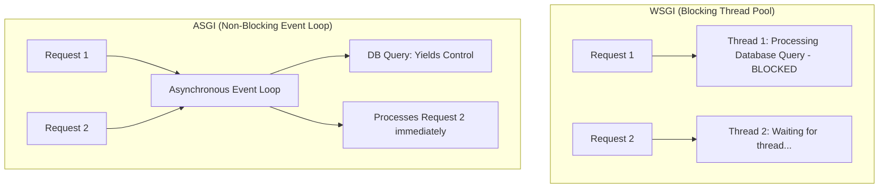
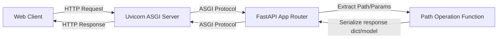

### 🎯 Learning Objectives
- Differentiate between WSGI and ASGI web server specifications and understand why modern frameworks favor ASGI.
- Install and configure FastAPI and Uvicorn to run a development server.
- Create a basic FastAPI application instance and register route handlers using path operation decorators.
- Access the auto-generated Swagger UI and ReDoc interactive documentation.
- Write unit tests for FastAPI endpoints using `TestClient` to perform virtual HTTP requests.

### 🧩 Core Concepts (Why)
Traditional Python web frameworks like Flask and Django (historically) rely on the **WSGI (Web Server Gateway Interface)** specification. Designed in 2003, WSGI was built for synchronous, blocking execution: one request maps directly to one operating system thread or process. When an application waits for a database query or external API call, the entire thread blocks. This model struggles to scale under thousands of concurrent connections and cannot natively handle modern asynchronous protocols like WebSockets or HTTP/2.

To solve this, the Python community developed **ASGI (Asynchronous Server Gateway Interface)**. ASGI is a spiritual successor to WSGI that provides a standard interface for asynchronous-capable Python web servers, frameworks, and applications. Under ASGI, the web server runs a single-threaded asynchronous event loop (e.g., using `asyncio`), allowing thousands of concurrent requests to be handled non-blockingly on a single thread.

**Uvicorn** is a lightning-fast ASGI server implementation, built on `uvloop` (a fast, drop-in replacement for the standard asyncio event loop) and `httptools` (a Python binding for the nodejs HTTP parser).

**FastAPI** is a modern, high-performance web framework for building APIs with Python 3.8+ based on standard Python type hints. By leveraging ASGI and Pydantic (for data validation), FastAPI is one of the fastest Python frameworks available, rivaling NodeJS and Go. It also automatically generates interactive Swagger UI documentation at `/docs` out of the box, drastically speeding up frontend-backend integration.

### 🔁 Logic and Operation

Here is the architectural design and execution flow of a FastAPI request lifecycle:

#### 1. ASGI vs WSGI Request Handling


#### 2. Request-Response Lifecycle in FastAPI


- **Asynchronous Routing**: FastAPI supports both `def` and `async def` route handlers. If you use `async def`, FastAPI runs it directly in the main event loop. If you use `def`, FastAPI runs it in an external thread pool to prevent blocking the main loop.
- **Virtual Requests with TestClient**: During testing, booting up a real Uvicorn server on a TCP port is slow and resource-heavy. FastAPI's `TestClient` uses `Starlette`'s virtual client to mock Uvicorn. It directly passes ASGI scope dictionaries to the FastAPI application, simulating a full HTTP round-trip entirely in memory.

### 📝 Annotated Examples

#### 1. Designing Your First FastAPI Server
Let's look at how to declare a basic FastAPI server and define paths.

```python
# main.py
from fastapi import FastAPI

# 1. Instantiate the main application object
# This app object is the central entry point for Uvicorn
app = FastAPI(
    title="My First API",
    description="A simple FastAPI introduction",
    version="1.0.0"
)

# 2. Define a Path Operation Decorator
# @app.get("/") declares that the function below handles GET requests to the root path
@app.get("/")
def read_root():
    # FastAPI automatically serializes dictionary returns into JSON
    # It also sets the Content-Type header to application/json
    return {"message": "Hello World"}

# 3. Path Parameters and Query Parameters
@app.get("/items/{item_id}")
def read_item(item_id: int, q: str = None):
    # FastAPI automatically parses item_id as an integer based on the type hint.
    # If a user requests /items/abc, FastAPI returns a 422 Unprocessable Entity error.
    # 'q' is a query parameter because it is not declared in the path path pattern.
    return {"item_id": item_id, "query": q}
```

To run this application locally:
```bash
uvicorn main:app --reload
```
- `main:app` refers to the `main.py` module and the `app` instance.
- `--reload` enables auto-reload, which restarts the server whenever code changes.

#### 2. Writing Virtual Integration Tests
Using `TestClient` allows us to verify our routes without launching a live server.

```python
# test_main.py
from fastapi.testclient import TestClient
from main import app

# Create a TestClient instance by wrapping our FastAPI application
client = TestClient(app)

def test_read_root():
    # Make a virtual GET request to the root URL
    response = client.get("/")
    
    # Assertions
    assert response.status_code == 200
    assert response.json() == {"message": "Hello World"}

def test_read_item_valid():
    # Test valid path and query parameters
    response = client.get("/items/42?q=searchterm")
    assert response.status_code == 200
    assert response.json() == {"item_id": 42, "query": "searchterm"}

def test_read_item_invalid():
    # Test path parameter type mismatch (sending string "abc" instead of integer)
    response = client.get("/items/abc")
    assert response.status_code == 422  # Validation Error
```

### ❌ Common Mistakes

**Mistake 1: Blocking the event loop in an `async def` path operation**
```python
import time
from fastapi import FastAPI

app = FastAPI()

@app.get("/slow")
async def slow_route():
    # blocking synchronous function inside async def
    time.sleep(3)
    return {"status": "slept"}
```
```text
(No traceback is raised, but the entire server event loop freezes, blocking all other concurrent requests for 3 seconds)
```
```python
import asyncio
from fastapi import FastAPI

app = FastAPI()

@app.get("/slow")
async def slow_route():
    # Correct: Use non-blocking async sleep
    await asyncio.sleep(3)
    return {"status": "slept"}
```
> When you declare a path operation with `async def`, you tell FastAPI to execute it directly on the single-threaded event loop. If you perform a blocking synchronous call (like `time.sleep()`, synchronous database queries, or blocking HTTP requests) inside it, you halt the loop. If you must use synchronous blocking libraries, declare the path handler with `def` instead of `async def`; FastAPI will then automatically run it in a separate thread pool.

**Mistake 2: Missing the `:app` portion or using the wrong file module name when running Uvicorn**
```python
uvicorn app --reload
```
```text
Error loading ASGI app. Import string "app" must be in format "<module>:<attribute>".
```
```python
# If your code is in main.py, and the FastAPI variable is named app:
uvicorn main:app --reload
```
> Uvicorn loads your application dynamically. It requires an import string matching the format `module_name:variable_name`. Specifying only the module or folder will cause Uvicorn to fail during initialization.

### 💡 Tips & Idioms
- **Interactive Documentation**: Always visit `http://127.0.0.1:8000/docs` while your Uvicorn server is running. FastAPI automatically compiles your routes, query parameters, path variables, and schemas into a fully interactive OpenAPI/Swagger page.
- **Asynchronous vs Synchronous Choice**: Use `async def` ONLY when you use libraries that support `async/await` (e.g., `httpx`, `tortoise-orm`, `motor`). If you are using standard blocking libraries (e.g., `requests`, `psycopg2`, `sqlite3`), use `def` so FastAPI handles the thread scheduling safely.

### 🧠 Deep Dive (Under the hood)
<details><summary>The ASGI Protocol and Starlette Request Routing</summary>

FastAPI does not handle raw HTTP parsing or connection sockets directly. Under the hood, FastAPI is built on top of **Starlette**, which is a lightweight ASGI toolkit.

When Uvicorn receives a connection, it invokes the ASGI application using a 3-argument signature:
```python
async def app(scope, receive, send):
    ...
```
1. **`scope`**: A dictionary containing metadata about the incoming request (e.g., type is `"http"` or `"websocket"`, client IP, HTTP headers, request path).
2. **`receive`**: An asynchronous callable that receives incoming HTTP request body chunks.
3. **`send`**: An asynchronous callable that sends HTTP response headers and body chunks back to the client.

Starlette parses these raw ASGI payloads into a structured `Request` object, matches the path against the registered routing tree, handles query parsing, and passes control to FastAPI's route wrappers. FastAPI then inspects your function signatures, performs validation using Pydantic, calls your handler, and serializes the return value into a JSON response which is sent back via the `send` channel.
</details>

### 🏋️ Exercise
Create a FastAPI application that exposes a GET route at `/` which returns `{"message": "Hello World"}`.

```python
from fastapi import FastAPI

# Create a FastAPI instance and define GET / route returning {"message": "Hello World"}
app = None
```

### ✅ Self-Check
1. What happens if you request a route defined with path parameter `{item_id: int}` using `/items/hello`?
2. Does `TestClient` start a server on a local port like `8000` when running test suites?
3. How do you view the automatic interactive OpenAPI documentation?
<details><summary>Answers</summary>

1. FastAPI automatically attempts to parse `"hello"` into an integer. When it fails, it returns an HTTP status code `422 Unprocessable Entity` with a structured JSON body detailing the validation error.
2. No, `TestClient` uses ASGI mock transport layers to pass requests directly to the application in-memory. This makes unit testing extremely fast.
3. You can view the OpenAPI Swagger documentation by running your application using Uvicorn and visiting `http://127.0.0.1:8000/docs` (or `/redoc` for the ReDoc layout).
</details>

### 📌 Summary
- **WSGI** is a synchronous gateway interface that maps requests to threads, whereas **ASGI** is an asynchronous gateway interface supporting non-blocking concurrency.
- **Uvicorn** is a high-performance ASGI server that loads and runs FastAPI applications.
- **FastAPI** provides automatic Swagger and ReDoc interactive documentation without any manual configuration.
- **TestClient** enables memory-efficient, fast testing of ASGI routes without launching real web servers.
