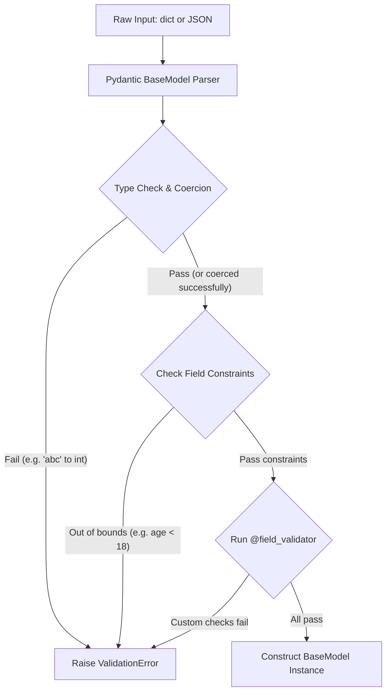

### 🎯 Learning Objectives
- Declare structured schemas by inheriting from Pydantic's `BaseModel`.
- Apply data constraints (such as `ge`, `le`, `min_length`, and regex patterns) using Pydantic's `Field`.
- Implement custom field-level validation logic using the `@field_validator` decorator in Pydantic v2.
- Understand type coercion and how Pydantic parses and validates types dynamically.
- Handle `ValidationError` exceptions and programmatically inspect the detailed error structure.

### 🧩 Core Concepts (Why)
In web applications, input data comes from untrusted sources (JSON request bodies, query parameters, external API payloads). Validating this data manually using nested `if/else` statements is error-prone, tedious, and hard to maintain.

**Pydantic** is the leading data validation and settings management library for Python. Instead of writing custom parsing code, you declare the structure of your data using Python type annotations. Pydantic guarantees that the output data matches the defined types.

Pydantic v2 is rebuilt in **Rust**, making validation up to 50 times faster than Pydantic v1. The key highlights of Pydantic are:
1. **Validation, not just Type Hinting**: Unlike IDE-only static type checkers (like mypy), Pydantic enforces types at runtime.
2. **Type Coercion (Parsing)**: Pydantic does not just reject incorrect types; it tries to parse (coerce) values into the correct type. For example, if a field expects an `int` and receives a string `"42"`, Pydantic converts it to the integer `42`.
3. **Pydantic in FastAPI**: FastAPI uses Pydantic schemas under the hood to parse request bodies, validate query parameters, format JSON responses, and automatically generate OpenAPI schemas.

### 🔁 Logic and Operation

Here is the step-by-step schema validation and parsing flow of Pydantic:

#### 1. Validation Lifecycle


- **Execution Order**: Pydantic validates inputs in three main stages:
  1. **Type Checking & Parsing**: Ensures fields match their type hints (coercing types like string to integer or boolean if possible).
  2. **Field Constraints**: Validates limits defined in `Field` (e.g., minimum values, string lengths).
  3. **Custom Validators**: Executes custom logic written with `@field_validator`.
- **Atomic Validation**: Pydantic validates the entire input before returning. If multiple fields fail validation, it collects all errors into a single `ValidationError` so that the caller receives a complete report, rather than failing on the first error.

### 📝 Annotated Examples

#### 1. Defining a Schema with Field Constraints
Let's design a schema representing a user profile with strict boundary conditions.

```python
from pydantic import BaseModel, Field, EmailStr

class UserProfile(BaseModel):
    # 'name' must be a string and have at least 2 characters
    name: str = Field(min_length=2, max_length=50)
    
    # EmailStr validates that the value is a syntactically correct email address
    # (Requires: pip install email-validator)
    email: EmailStr
    
    # 'age' is optional (defaulting to None) but if provided, must be >= 18 and <= 120
    age: int | None = Field(default=None, ge=18, le=120)
    
    # 'tags' has a default factory to avoid mutable default list bugs
    tags: list[str] = Field(default_factory=list)

# Test parsing valid input:
data = {
    "name": "Alex",
    "email": "alex@example.com",
    "age": "25",  # String "25" will be coerced to integer 25
    "tags": ["developer", "pythonist"]
}

user = UserProfile(**data)
print(user.name)  # Output: Alex
print(user.age)   # Output: 25 (type: int)
print(user.model_dump()) # Output: dict representation of the model
```

#### 2. Adding Custom Validators in Pydantic v2
We use the `@field_validator` decorator to write custom business validations (e.g., password strength, prefix validation).

```python
from pydantic import BaseModel, Field, field_validator

class SignupForm(BaseModel):
    username: str = Field(min_length=3)
    password: str = Field(min_length=8)
    
    # Custom validator for password strength
    # In Pydantic v2, custom validators must be decorated with both:
    # @field_validator and @classmethod (with field_validator outermost)
    @field_validator("password")
    @classmethod
    def check_password_complexity(cls, v: str) -> str:
        # 'v' is the value of the field being validated
        if not any(char.isdigit() for char in v):
            raise ValueError("Password must contain at least one digit.")
        return v # Always return the validated (or modified) value

# Let's see how Pydantic handles validation errors:
from pydantic import ValidationError

try:
    SignupForm(username="bob", password="nopassword")
except ValidationError as e:
    # Print the clean JSON-formatted description of the errors
    print(e.json(indent=2))
```

**JSON Error Output:**
```json
[
  {
    "type": "value_error",
    "loc": [
      "password"
    ],
    "msg": "Value error, Password must contain at least one digit.",
    "input": "nopassword",
    "ctx": {
      "error": {}
    }
  }
]
```

### ❌ Common Mistakes

**Mistake 1: Forgetting to decorate `@field_validator` with `@classmethod` in Pydantic v2**
```python
from pydantic import BaseModel, field_validator

class User(BaseModel):
    username: str
    
    @field_validator("username")
    def validate_user(self, value):  # Missing @classmethod
        if value.lower() == "admin":
            raise ValueError("Username cannot be 'admin'")
        return value
```
```text
PydanticUserError: `@field_validator` must be decorated with `@classmethod`.
```
```python
from pydantic import BaseModel, field_validator

class User(BaseModel):
    username: str
    
    @field_validator("username")
    @classmethod  # Correct: Decorated with @classmethod
    def validate_user(cls, value):  # Accepts 'cls' as the first argument
        if value.lower() == "admin":
            raise ValueError("Username cannot be 'admin'")
        return value
```
> In Pydantic v2, field validators run as class methods before the actual instance of the class is initialized. Thus, they must be marked with `@classmethod` and use `cls` instead of `self`.

**Mistake 2: Missing `email-validator` library when using `EmailStr`**
```python
from pydantic import BaseModel, EmailStr

class Account(BaseModel):
    email: EmailStr
```
```text
PydanticImportError: `pydantic-extra-types` or `email-validator` is not installed. Run `pip install email-validator` to use `EmailStr`.
```
```python
# First, run `pip install email-validator` in your shell environment,
# then import and define your schema as normal:
from pydantic import BaseModel, EmailStr

class Account(BaseModel):
    email: EmailStr
```
> Pydantic delegates email verification to the third-party `email-validator` package. Attempting to run a model containing `EmailStr` fields without this dependency will raise a `PydanticImportError` at definition time.

### 💡 Tips & Idioms
- **Validate Assignment**: By default, Pydantic only validates values when the model is initialized. If you do `user.age = 10`, no validation occurs. To enable runtime validation on attribute assignment, add `ConfigDict` inside the class:
  ```python
  from pydantic import BaseModel, ConfigDict
  
  class User(BaseModel):
      model_config = ConfigDict(validate_assignment=True)
      age: int
  ```
- **Exclude Defaults / Nones**: When serializing models via `model_dump()`, you can exclude default values or `None` values using:
  - `user.model_dump(exclude_unset=True)` (only outputs values explicitly passed during initialization).
  - `user.model_dump(exclude_none=True)` (strips any fields that contain `None`).

### 🧠 Deep Dive (Under the hood)
<details><summary>Type Coercion and Core Validation Engine (Rust Core)</summary>

In Pydantic v2, all parsing and validation rules are compiled down to a Rust engine called `pydantic-core`. 

When you instantiate a `BaseModel` class:
1. Pydantic passes the input dictionary to the compiled Rust validator.
2. The Rust engine matches keys against the schema. If it encounters a type mismatch, it attempts **coercion** based on standard parsing pathways:
   - For `int`: It attempts to parse string representations (e.g. `"100"` -> `100`), floats (e.g. `100.0` -> `100`), or booleans (`True` -> `1`, `False` -> `0`).
   - For `bool`: String values like `"true"`, `"yes"`, `"1"`, `"on"` are coerced to `True`. Values like `"false"`, `"no"`, `"0"`, `"off"` are coerced to `False`.
3. If coercion succeeds, the validator checks the constraints (which are also compiled to Rust speed).
4. Only if all Rust validation checks pass does the engine return to Python land to instantiate the Python `BaseModel` object. This architecture avoids Python call stack overhead during data checking, giving Pydantic its legendary performance.
</details>

### 🏋️ Exercise
Define a schema named `UserSchema` inheriting from Pydantic's `BaseModel`. It must contain:
- `name` (string)
- `email` (using `EmailStr`)
- `age` (integer, with a constraint that it must be greater than or equal to 18)

```python
from pydantic import BaseModel, Field, EmailStr

# Define UserSchema with name, email, and age (age must be >= 18)
```

### ✅ Self-Check
1. Does Pydantic accept a floating-point number like `25.0` for a field annotated with type `int`?
2. What is the difference between `model_dump()` and `model_dump_json()`?
3. How do you raise validation errors manually inside a `@field_validator`?
<details><summary>Answers</summary>

1. Yes, Pydantic will coerce `25.0` to the integer `25` without raising an error, since the float has no fractional part. However, `25.5` will raise a validation error.
2. `model_dump()` returns a Python dictionary representation of the model containing standard Python types, whereas `model_dump_json()` returns a serialized JSON string representation.
3. Inside a `@field_validator`, you should raise either `ValueError` or `AssertionError`. Pydantic will automatically catch these and wrap them in a formatted `ValidationError` payload.
</details>

### 📌 Summary
- **Pydantic** validates and parses input data structures dynamically using standard Python type annotations.
- **BaseModel** is the base class for declaring data schemas in Pydantic.
- **Field** enables detailed constraints like range limits (`ge`, `le`), string length restrictions, and default value configurations.
- **@field_validator** allows custom class methods to implement domain-specific business rules.
- **ValidationError** is raised when validation fails, capturing all validation failures in a single structured schema payload.
