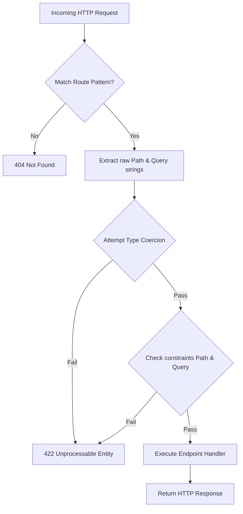

### 🎯 Learning Objectives
- Define and extract dynamic path parameters using FastAPI route templates.
- Define query parameters for optional parameters, filtering, and sorting.
- Apply validations and metadata to path and query parameters using `Path` and `Query` helpers.
- Understand automatic type coercion and the validation engine.
- Handle type mismatch errors and generate appropriate HTTP 422 error responses.

### 🧩 Core Concepts (Why)
In RESTful web APIs, endpoints need to receive inputs from clients. The two most common ways to pass simple data types (like numbers, strings, and booleans) are:
1. **Path Parameters**: Used to identify a specific resource. They form a permanent part of the URL path (e.g., `/items/42` where `42` is the ID).
2. **Query Parameters**: Used to filter, sort, paginate, or customize the response. They appear after the `?` in the URL (e.g., `/items?limit=10&sort=desc`).

FastAPI simplifies parameter handling by utilizing Python's native type annotations. By simply declaring type hints in your route handler function, FastAPI automatically:
- Parses parameters from the request URL.
- Coerces the raw string values into the declared Python types (e.g., `"42"` to `42`).
- Validates the values against basic constraints (e.g., minimum/maximum values, string length, regex patterns).
- Documents the parameters automatically in the OpenAPI/Swagger interface.

Using the `Path` and `Query` functions from FastAPI allows you to add extra validation constraints and description metadata to your parameters.

### 🔁 Logic and Operation

#### Parameter Parsing and Validation Lifecycle
When a request arrives, FastAPI processes path and query parameters through this lifecycle:



### 📝 Annotated Examples

#### 1. Basic Path & Query Parameters with Automatic Coercion
FastAPI distinguishes path and query parameters automatically based on whether they are defined in the route path pattern.
```python
from fastapi import FastAPI

app = FastAPI()

# 'item_id' is declared in the path, so it is a path parameter.
# 'q' and 'short' are not in the path, so they are query parameters.
@app.get("/items/{item_id}")
def read_item(item_id: int, q: str | None = None, short: bool = False):
    # FastAPI automatically coerces item_id to int, and short to bool.
    # Request: GET /items/42?q=hello&short=true
    # Result: {"item_id": 42, "q": "hello", "short": True}
    return {"item_id": item_id, "q": q, "short": short}
```

#### 2. Advanced Validations using Path and Query
You can import `Path` and `Query` from `fastapi` to apply constraints like numeric bounds or string length limitations.
```python
from typing import Annotated
from fastapi import FastAPI, Query, Path

app = FastAPI()

@app.get("/products/{product_id}")
def get_product(
    # product_id must be an integer greater than or equal to 1 (ge=1)
    product_id: int = Path(..., title="The ID of the product", ge=1),
    
    # search parameter must be a string with a minimum length of 3
    search: str | None = Query(None, min_length=3, max_length=50),
    
    # limit must be between 1 and 100
    limit: int = Query(20, ge=1, le=100)
):
    return {"product_id": product_id, "search": search, "limit": limit}
```

*Note: In modern Python, you can use `Annotated` (from `typing` or `typing_extensions`) for cleaner syntax:*
```python
product_id: Annotated[int, Path(ge=1)]
```

### ❌ Common Mistakes

**Mistake 1: Declaring path parameters with default values**
```python
from fastapi import FastAPI, Path

app = FastAPI()

@app.get("/users/{user_id}")
def get_user(user_id: int = Path(10)):  # Wrong: Path parameters cannot have a default fallback value.
    return {"user_id": user_id}
```
```text
AssertionError: Path parameters cannot have default values
```
```python
from fastapi import FastAPI, Path

app = FastAPI()

@app.get("/users/{user_id}")
def get_user(user_id: int = Path(...)):  # Correct: Use Ellipsis (...) to indicate it is required.
    return {"user_id": user_id}
```
> Path parameters are part of the URL path itself, meaning the request cannot match the route without supplying them. Therefore, declaring a default value for a path parameter is conceptually invalid and FastAPI will raise an assertion error.

**Mistake 2: Mixing default parameters before non-default parameters in the function signature**
```python
from fastapi import FastAPI, Query

app = FastAPI()

# SyntaxError: non-default argument follows default argument
@app.get("/items/")
def read_items(q: str = Query(None), limit: int): 
    return {"q": q, "limit": limit}
```
```text
SyntaxError: non-default argument follows default argument
```
```python
from fastapi import FastAPI, Query

app = FastAPI()

@app.get("/items/")
def read_items(limit: int, q: str = Query(None)):  # Correct: Move mandatory arguments first
    return {"q": q, "limit": limit}
```
> Python's function syntax requires all arguments without default values (non-default arguments) to be declared before arguments with default values. To fix this, always place required query parameters first, or use a bare `*` in the function signature to indicate keyword-only arguments.

### 💡 Tips & Idioms
- **Use `Annotated`**: The modern Pythonic way to define metadata and validation constraints is using `typing.Annotated`. It keeps functions cleaner and supports easier integration with static code analyzers.
  ```python
  from typing import Annotated
  from fastapi import Query
  
  @app.get("/items/")
  def read(q: Annotated[str | None, Query(max_length=50)] = None):
      return {"q": q}
  ```
- **Query Parameter Lists**: You can accept multiple query parameters with the same name by typing them as `list[str]` or `list[int]`.
  ```python
  @app.get("/items/")
  def read(tags: list[str] = Query(None)):
      # GET /items/?tags=foo&tags=bar -> tags = ["foo", "bar"]
      return {"tags": tags}
  ```

### 🧠 Deep Dive (Under the hood)
<details><summary>FastAPI Parameter Introspection & Type Coercion</summary>

FastAPI uses Python's standard `inspect` module at startup to analyze route handler signatures. It builds an internal configuration mapping each argument's name, type annotation, and default value.

1. **Type Parsing and Coercion**: When a client accesses `/items/42?short=true`, FastAPI retrieves the path parameters as substrings of the HTTP path and query parameters from the query string (parsed into key-value pairs). It uses Pydantic's internal parsing engine to coerce:
   - The string `"42"` into the integer `42`.
   - The string `"true"` or `"1"` or `"on"` into the boolean `True`.
2. **Error Collection**: If validation fails (for instance, `/items/invalid_id`), Pydantic generates a detailed traceback of validation errors. FastAPI intercepts this and wraps it inside an `HTTPException(status_code=422)` which yields the detailed JSON error response containing the location (`loc`), input type, and expected constraints.
3. **OpenAPI Schema Sync**: Because FastAPI registers constraints via `Path` and `Query` metadata, it exports them directly to the OpenAPI JSON definition. This enables interactive tools like Swagger UI to validate constraints on the client side before even sending the request.
</details>

### 🏋️ Exercise
Define a GET endpoint `/items/{item_id}` that accepts:
- A path parameter `item_id` (integer).
- An optional query parameter `q` (string, defaults to `None`).

```python
from fastapi import FastAPI, Query, Path

app = FastAPI()

# Implement GET /items/{item_id} accepting path parameter item_id: int 
# and optional query parameter q: str = None
```

### ✅ Self-Check
1. How does FastAPI determine if a function argument is a path parameter or a query parameter?
2. What does `Path(...)` (using the Python ellipsis) mean in a route function definition?
3. How do you enforce that a query parameter must be exactly 8 characters long using `Query` constraints?
<details><summary>Answers</summary>

1. If the parameter name matches a variable defined inside the route decorator template (e.g. `"/items/{item_id}"`), FastAPI treats it as a path parameter. Otherwise, it treats it as a query parameter.
2. The ellipsis `...` indicates that the parameter is required and has no default value. Since path parameters must always be provided, this is the standard way to declare them with validations.
3. You can use the `min_length=8` and `max_length=8` parameters (or `pattern=r"^.{8}$"`) within the `Query` function: `q: str = Query(..., min_length=8, max_length=8)`.
</details>

### 📌 Summary
- **Path Parameters** reside within the URL path layout to identify specific entities.
- **Query Parameters** append to the URL after a `?` character to configure pagination, filters, and optional search text.
- FastAPI automatically coerces data types and validates parameter constraints based on standard Python type annotations.
- The `Path` and `Query` helpers enable developers to declare validation rules (like minimum value `ge` or string length constraints) and API documentation metadata directly inside the signature of route functions.
